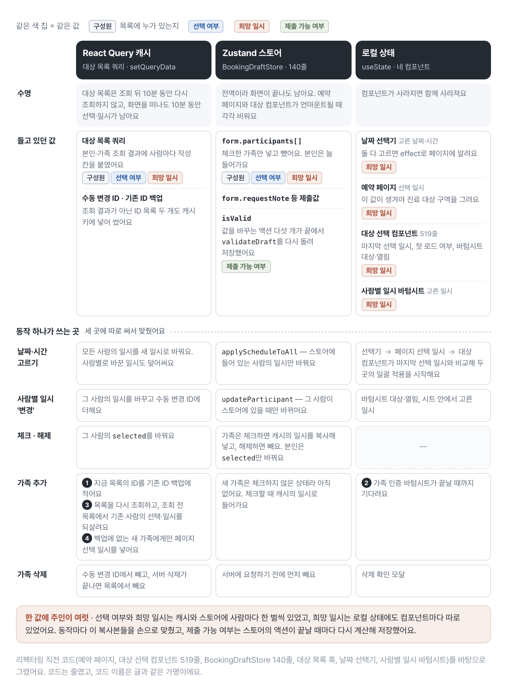
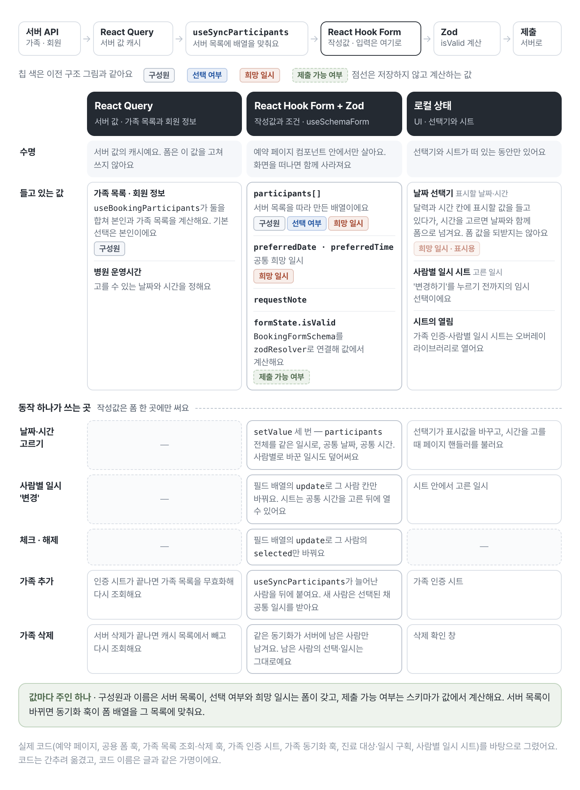
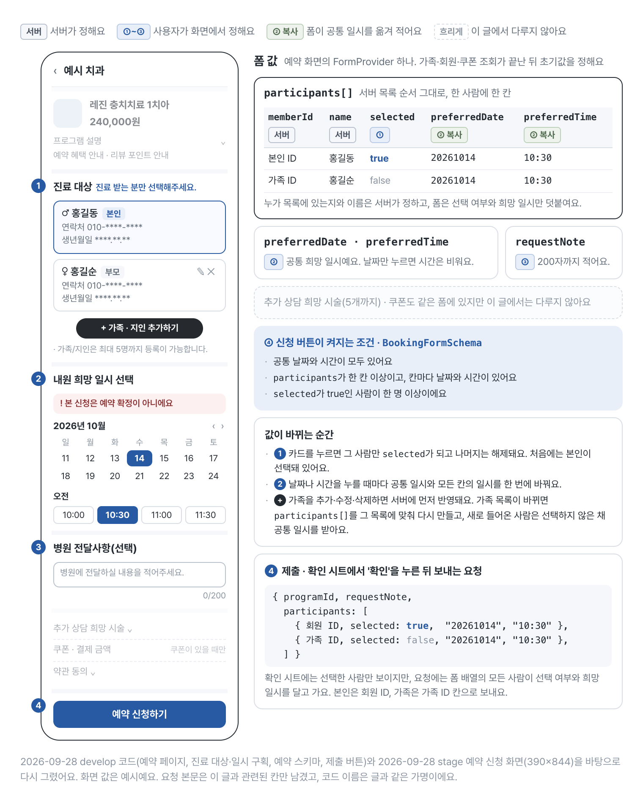
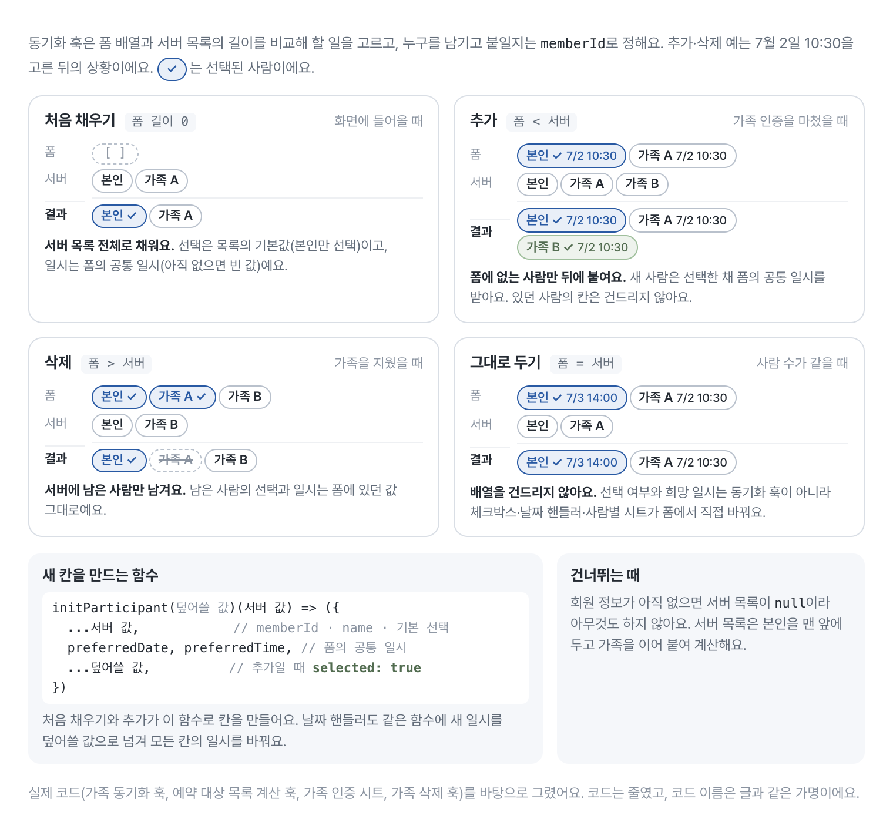

# 예약 폼의 작성 상태를 Zustand에서 React Hook Form으로 옮긴 과정

<div class="note note-summary">
  <strong>이 글에서 다루는 것</strong>
  <p>복지몰의 예약 폼에서 가족을 추가하면 날짜 선택이 어긋나는 버그가 있었어요. 원인은 같은 값을 React Query 캐시, Zustand 스토어, 컴포넌트 로컬 상태가 나눠 갖던 구조였어요. 그래서 서버 값은 React Query가, 제출 전 작성값은 React Hook Form이, 제출 조건은 Zod가 맡도록 나눴어요. 그 뒤로는 가족을 추가하면 폼에 보관한 공통 희망 일시를 동기화가 새 항목에도 붙여서, 날짜를 세 곳에서 맞추다 어긋나던 경로가 구조에서 사라졌어요. 액션마다 부르던 수동 검증과 Zustand 스토어(140줄), 화면별 정리 코드도 지웠어요. 예약 대상 선택 컴포넌트는 519줄에서 55줄이 됐지만, 그건 로직 일부가 훅과 하위 컴포넌트로 옮겨 간 결과예요.</p>
</div>

예약 폼에서 가족 한 명을 추가했는데 날짜 선택은 이전 가족 수를 기준으로 움직이는 버그가 있었어요. 화면은 날짜·시간과 예약 대상을 고르는 정도였는데, 같은 값을 세 군데가 나눠 갖고 있었어요.

- 서버에서 가져온 가족 목록은 React Query 캐시에 있었어요.
- 예약 대상과 날짜는 Zustand 스토어에 다시 저장했어요.
- 사용자가 방금 고른 날짜는 컴포넌트의 로컬 상태에도 있었어요.

한 곳을 고치면 나머지 두 곳을 맞춰야 했어요. 왜 하필 가족을 추가할 때 날짜가 어긋났을까요?

## 서버 값과 작성값을 두 저장소가 함께 갖고 있었어요

가족을 추가하거나 삭제할 때는 React Query 캐시와 Zustand 배열을 따로 맞춰야 했어요.

<figure class="figure-wide">
  
  <figcaption>리팩터링 전 예약 화면의 상태 배치예요. 선택 여부와 희망 일시가 React Query 캐시와 Zustand 스토어에 사람마다 한 벌씩 있었고, 희망 일시는 컴포넌트 로컬 상태에도 흩어져 있었어요.</figcaption>
</figure>

가족을 한 명 추가하면 캐시는 기존 ID를 백업하고, 다시 조회한 뒤 선택과 일시를 되살리고, 새 가족에게만 날짜를 넣었어요. 스토어에는 체크한 뒤에야 들어가서, 같은 사람의 일시가 두 곳에서 따로 움직일 수 있었어요.

스토어는 폼 값과 검증 결과도 함께 저장했어요.

```ts
type BookingDraftStore = {
  form: Partial<BookingFormValues>;
  isValid: boolean;
  updateParticipant: (
    memberId: number,
    values: Partial<ParticipantDraft>,
  ) => void;
  applyScheduleToAll: (date: string, time: string) => void;
};
```

그래서 액션이 끝날 때마다 검증을 직접 다시 돌려야 했어요.

```ts
updateParticipant: (memberId, values) =>
  set((state) => {
    // 값 수정
    state.isValid = validateDraft(state.form);
  });
```

당시 액션은 모두 끝에서 검증을 불렀지만, 새 액션 하나에서라도 검증 호출을 빠뜨리면 값은 최신인데 버튼의 활성화 상태는 이전 값에 머물 수 있는 구조였어요.

복잡도를 키운 건 Zustand 자체가 아니었어요. 서버에서 온 값과 사용자가 작성 중인 값을 두 저장소가 함께 소유하는 구조였어요.

## 값마다 주인을 하나만 두기로 했어요

그래서 Zustand를 React Hook Form으로 바꿨어요. 라이브러리 취향 때문이 아니라, 서버에서 받은 값과 사용자가 작성 중인 값의 주인을 가르기 위해서였어요. 역할은 이렇게 정했어요.

- React Query: 서버에서 받은 가족 목록
- React Hook Form: 제출 전까지 사용자가 편집하는 예약 값
- Zod: 제출할 수 있는 값의 조건
- 로컬 상태: 날짜 선택기의 표시값이나 시트 안의 임시 선택처럼, 확정되면 폼으로 넘기는 UI 상태

<figure class="figure-wide">
  
  <figcaption>리팩터링 뒤의 상태 배치를 같은 틀로 다시 그린 표예요. 작성값은 폼 한 곳에만 쓰고, 서버 목록이 바뀌면 동기화 훅이 폼 배열을 그 목록에 맞춰요.</figcaption>
</figure>

가족 목록과 회원 정보는 React Query가, 선택 여부와 희망 일시는 폼이 갖고, 제출 가능 여부는 스키마가 값에서 계산해요. 로컬 상태에는 날짜 선택기가 화면에 표시할 날짜·시간과 사람별 일시 시트 안의 임시 선택만 남았어요. 시트를 여닫는 일은 오버레이 라이브러리가 맡아요.

<div class="note note-decision">
  <strong>최종 결정</strong>
  <p>한 값에는 주인을 하나만 둬요. 누가 가족인지와 이름은 서버가 정하니 React Query가 갖고, 폼은 그 목록을 기준으로 선택 여부와 희망 일시만 덧붙여요. 폼의 생명주기는 예약 화면 안에서 끝나니 전역 스토어 대신 페이지에 `FormProvider`를 뒀어요.</p>
</div>

폼은 `zodResolver`를 연결해 주는 공용 폼 훅(가명 `useSchemaForm`)으로 페이지에서 만들어요. 초기값에는 빈 배열만 두고, 사람 목록은 예약 대상 선택 컴포넌트(가명 `ParticipantSelector`) 안의 동기화 훅이 서버 목록을 받아 채워요.

```tsx
function BookingPage() {
  const methods = useSchemaForm({
    schema: BookingFormSchema,
    defaultValues: {
      participants: [],
    },
  });

  // handleScheduleSelect는 아래 '날짜 일괄 적용' 절에서 다룬다.

  return (
    <FormProvider {...methods}>
      <ScheduleSection onSelect={handleScheduleSelect} />
      <ParticipantSelector />
      <RequestNoteField />
      <TermsSection />
      <SubmitButton />
    </FormProvider>
  );
}
```

<figure class="figure-wide">
  
  <figcaption>리팩터링 뒤 예약 신청 화면과 그 화면이 쓰는 폼 값이에요. 시간까지 고르면 폼이 공통 일시를 모든 사람 칸에 옮겨 적고, 신청 버튼은 스키마 조건을 모두 채울 때 켜져요.</figcaption>
</figure>

누가 목록에 있는지와 이름은 서버가, 선택 여부와 희망 일시는 사용자가 정해서 한 배열 안에서 필드 단위로 주인이 갈려요. 요청에는 선택하지 않은 사람까지 모든 사람이 선택 여부를 달고 가요.

Zustand 스토어를 비우던 화면별 정리 코드도 없어졌어요. 폼은 예약 페이지 컴포넌트에서 만들어지니, 화면을 떠나면 작성 중이던 값도 폼과 함께 사라져요.

## 제출 조건은 스키마가 값에서 계산하게 했어요

아래는 예약 폼 스키마예요.

```ts
const ParticipantSchema = z.object({
  memberId: z.number(),
  selected: z.boolean(),
  name: z.string(),
  preferredDate: z.string({ message: '희망 날짜를 입력해 주세요.' }),
  preferredTime: z.string({ message: '희망 시간을 입력해 주세요.' }),
});

export const BookingFormSchema = z
  .object({
    requestNote: z.string().max(200, '최대 200자까지 입력할 수 있어요.').optional(),
    participants: z
      .array(ParticipantSchema)
      .min(1, '가족 예약이 최소 한 명 이상 있어야 합니다.')
      .default([]),
    preferredDate: z.string(),
    preferredTime: z.string(),
  })
  .superRefine((data, ctx) => {
    if (data.participants.some((participant) => participant.selected)) return;

    ctx.addIssue({
      code: z.ZodIssueCode.custom,
      path: ['participants'],
      message: '최소 한 명은 예약 대상이어야 합니다.',
    });
  });
```

사람별 날짜·시간은 문자열이기만 하면 통과해요. 날짜와 시간을 골랐는지는 공통 `preferredDate`·`preferredTime`이 맡아서, 시간까지 고르기 전에는 이 두 값이 비어 있어 신청이 막혀요.

이제 유효성을 따로 저장하지 않고 `formState.isValid`를 읽어요. 에러 위치와 메시지도 같은 스키마에 있어요. 다만 이 화면은 아직 필드별 메시지를 그리지 않고, 버튼 비활성화로만 알려요. 버튼이 어느 시점에 다시 계산되는지는 코드에 드러나 있지 않아서, 마지막 절에 남은 부채로 따로 적었어요.

## 서버 목록이 바뀌면 폼 배열이 따라가게 했어요

가족을 추가하거나 삭제하면 서버 목록이 바뀌고, 작성 중인 폼 배열에도 반영해야 해요. 처음 버그도 가족을 추가하는 이 순간에 났어요. 이 일은 예약 대상 선택 컴포넌트가 부르는 동기화 훅 하나가 맡아요. 서버 목록은 `useBookingParticipants`가 회원 정보와 가족 목록 쿼리를 합쳐 본인을 맨 앞에 두고 계산하는데, 회원 정보가 아직 없으면 `null`이에요.

```ts
// 새 칸을 만드는 함수: 서버 값에 폼의 공통 희망 일시를 붙인다.
function useParticipantInitializer(control: Control<BookingFormValues>) {
  const preferredDate = useWatch({ control, name: 'preferredDate' }) ?? '';
  const preferredTime = useWatch({ control, name: 'preferredTime' }) ?? '';

  const initParticipant = useCallback(
    (override: Partial<Participant> = {}) =>
      <T extends { memberId: number; name: string }>(base: T) => ({
        ...base,
        preferredDate,
        preferredTime,
        ...override,
      }),
    [preferredDate, preferredTime],
  );

  return { initParticipant };
}

function useSyncParticipants() {
  const { control, setValue } = useFormContext<BookingFormValues>();
  const current = useWatch({ control, name: 'participants' });
  const serverParticipants = useBookingParticipants();
  const { initParticipant } = useParticipantInitializer(control);

  useEffect(() => {
    if (serverParticipants === null) return;

    // 처음: 서버 목록 전체로 채운다.
    if (current.length === 0) {
      setValue('participants', serverParticipants.map(initParticipant()));
      return;
    }
    // 서버 목록이 짧아졌다: 서버에 남은 사람만 남긴다.
    if (current.length > serverParticipants.length) {
      setValue(
        'participants',
        intersectionBy(current, serverParticipants, (p) => p.memberId),
      );
      return;
    }
    // 서버 목록이 길어졌다: 폼에 없는 사람을 선택한 채로 뒤에 붙인다.
    if (current.length < serverParticipants.length) {
      setValue('participants', [
        ...current,
        ...differenceBy(serverParticipants, current, (p) => p.memberId).map(
          initParticipant({ selected: true }),
        ),
      ]);
    }
  }, [serverParticipants, current, initParticipant, setValue]);
}
```

서버 목록은 누가 목록에 있는지를 정하고, 폼은 이미 있던 사람의 선택 여부와 희망 일시를 지켜요. 본인은 처음부터 선택돼 있고, 등록돼 있던 가족은 선택되지 않은 채로 시작하고, 새로 추가한 가족은 추가 직후 선택된 채로 들어와요. 이 화면 요구사항은 서버 목록의 기본값과 추가 분기의 `selected: true`가 맡아요. 새 칸은 폼에 보관한 공통 희망 날짜와 시간을 `initParticipant`가 붙여 만들기 때문에, 날짜를 고른 뒤 가족을 추가해도 새 가족만 날짜가 어긋나는 일은 없어요.

<figure class="figure-wide">
  
  <figcaption>서버 목록이 바뀔 때 동기화 훅이 폼 배열을 맞추는 네 갈래예요. 길이로 무엇을 할지 고르고, 누구를 남기고 붙일지는 memberId로 정해요. 새 칸에는 폼의 공통 희망 일시를 붙여요.</figcaption>
</figure>

길이가 같으면 동기화 훅은 배열을 그대로 둬요. 선택 여부와 희망 일시는 동기화 훅이 아니라 폼 안의 핸들러가 직접 바꿔요.

## 날짜 일괄 적용도 폼 안에서 끝냈어요

날짜 선택기는 시간까지 골라야 날짜와 시간을 함께 넘기고, 페이지의 핸들러가 모든 사람 칸과 공통 날짜·시간을 바꿔요.

```ts
const handleScheduleSelect = useCallback(
  ({ date, time }: { date: string; time: string }) => {
    const participants = methods.getValues('participants');

    // 날짜·시간 형식 변환은 생략
    methods.setValue(
      'participants',
      participants.map(initParticipant({ preferredDate: date, preferredTime: time })),
    );
    methods.setValue('preferredDate', date);
    methods.setValue('preferredTime', time);
  },
  [methods, initParticipant],
);
```

동기화에서 본 `initParticipant`에 새 일시를 덮어쓸 값으로 넘기니, 선택 여부는 그대로 두고 모든 칸의 일시만 바꿔요. 날짜를 캐시와 스토어, 로컬 상태에 각각 쓰던 흐름도 폼 업데이트 하나로 합쳐졌어요. 공통 시간을 고르고 나면 사람 카드마다 '변경'이 생기고, 시트에서 '변경하기'를 누르면 필드 배열의 `update`로 그 사람 칸만 바꿔요. 공통 일시를 다시 고르면 사람별로 바꾼 일시도 덮어써요.

## 날짜가 어긋나던 경로가 구조에서 사라졌어요

결과는 두 가지예요. 새로 추가한 가족도 폼의 공통 희망 일시를 받으니 날짜가 어긋나던 경로가 구조에서 사라졌고, 액션마다 부르던 수동 검증과 Zustand 스토어, 화면별 정리 코드가 없어졌어요.

줄 수도 바뀌었어요. 리팩터링하면서 예약 대상 선택 컴포넌트(`ParticipantSelector`)는 519줄에서 55줄이 됐어요. 정확히는 519줄짜리 옛 파일을 지우고 다른 위치에 55줄짜리 파일을 새로 썼어요. 지금은 그 역할이 선택 컴포넌트 55줄, 가족 선택 하위 컴포넌트 172줄, 서버 목록 동기화 훅 61줄로 나뉘었고, 140줄짜리 Zustand 스토어는 지웠어요. 그러니 가족 선택 기능 전체가 464줄 줄었다는 뜻은 아니에요. 줄 수보다 중요한 변화는 로직마다 입력과 출력이 분명해져 한 파일에서 세 저장소를 동시에 맞추지 않게 된 점이에요.

## 검증 시점과 동기화 테스트는 아직 남았어요

React Hook Form으로 옮기면서 생긴 비용도 있어요.

- 커스텀 입력 컴포넌트는 `Controller`로 감싸야 해요.
- 서버 목록과 작성 중인 배열을 맞추는 동기화 로직은 여전히 필요해요.
- `setValue`를 쓸 때 검증과 `dirty` 상태를 갱신할지 정해야 하는데, 예약 폼은 이를 명시하지 않아요.

세 번째가 이 폼에 남은 부채예요. 버튼이 왜 제때 바뀌는지가 코드에 드러나 있지 않거든요. `useSchemaForm`은 검증 쪽으로는 `zodResolver`만 연결할 뿐 `mode`를 정하지 않고, 예약 폼 호출부도 `mode`를 넘기지 않아요. `useFieldArray`는 진료 대상 목록 컴포넌트 한 곳에만 두고, 페이지의 날짜 핸들러와 동기화 훅은 `setValue`로 배열 전체를 바꿔요. 이때 `shouldDirty`·`shouldValidate`는 넘기지 않아요. 체크박스와 사람별 일시 변경은 `useFieldArray`의 `update`를 써요.

React Hook Form은 `isValid`를 구독하는 컴포넌트가 있으면 `mode`가 기본값인 제출 시점이어도 `register`나 `Controller`로 연결된 입력이 바뀔 때 유효성을 다시 계산해요. 하지만 `shouldValidate` 없이 부른 `setValue`만으로는 그 계산이 일어나지 않아요. 날짜 핸들러와 동기화 훅은 `useFieldArray`가 관리하는 `participants` 배열을 통째로 바꾸고, `update`도 같은 배열을 바꿔요. 버튼이 따라오는 건 배열이 바뀌면 `useFieldArray`가 유효성을 다시 계산하기 때문이에요. React Hook Form 7.56 소스를 읽어 확인한 동작이에요.

배열은 두고 날짜 필드만 `setValue`로 바꾸는 경로가 생기면, Zustand에서 검증 호출을 빠뜨렸을 때처럼 값은 최신인데 버튼은 이전 상태에 머물 수 있어요. 검증 시점을 호출부에서 정하지 않은 것은 이 구현에 남은 부채예요. 호출부에서 `mode`를 정하거나, 필드를 바꾸는 `setValue`에 `shouldValidate`를 넘기는 쪽으로 정리해야 해요.

동기화 로직의 자동화 테스트도 아직 남기지 못했어요. 검증 시점을 코드에 드러내고 동기화 테스트를 붙여야 주인 사이의 경계가 완전히 닫혀요.

## 참고

- [React Hook Form: formState](https://react-hook-form.com/docs/useform/formstate)
- [React Hook Form: setValue](https://react-hook-form.com/docs/useform/setvalue)
- [React Hook Form: useFieldArray](https://react-hook-form.com/docs/usefieldarray)
- [Zod 3: superRefine](https://v3.zod.dev/?id=superrefine)
