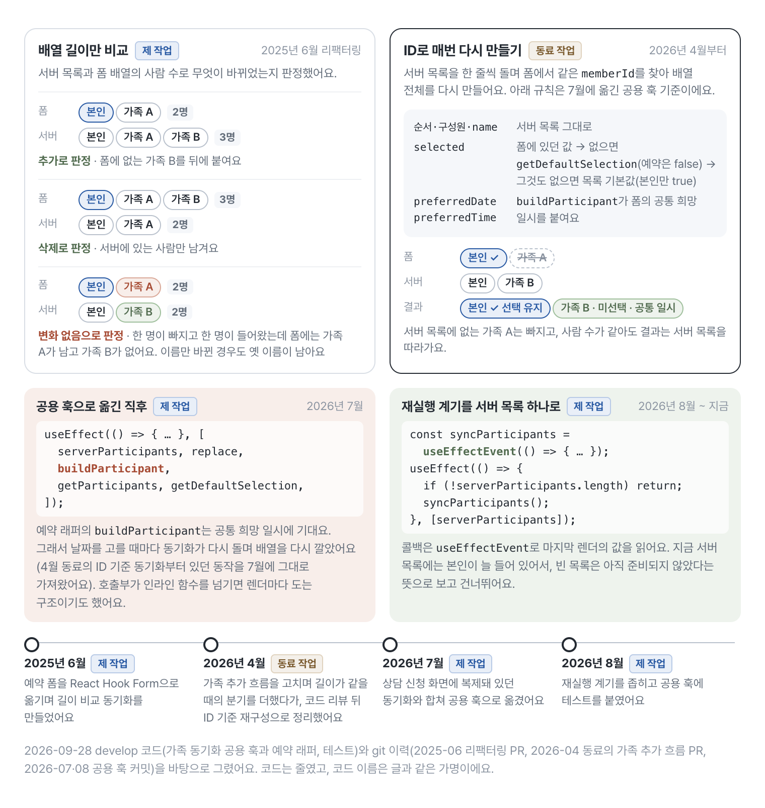

# 예약 폼의 작성 상태를 Zustand에서 React Hook Form으로 옮긴 과정

<div class="note note-summary">
  <strong>이 글에서 다루는 것</strong>
  <p>복지몰의 예약 폼에서 가족을 추가하면 날짜 선택이 어긋나는 버그가 있었어요. 원인은 같은 값을 React Query 캐시, Zustand 스토어, 컴포넌트 로컬 상태가 나눠 갖던 구조였고, 서버 값은 React Query가, 제출 전 작성값은 React Hook Form이, 제출 조건은 Zod가 맡도록 나눴어요. 그 뒤로는 가족을 추가하면 동기화가 폼에 보관한 공통 희망 일시를 새 항목에도 붙여서, 날짜를 세 곳에서 맞추다 어긋나던 경로가 구조에서 사라졌어요. 액션마다 부르던 수동 검증과 Zustand 스토어(140줄), 화면별 정리 코드도 지웠어요(2025년 6월). 예약 대상 선택 컴포넌트는 519줄에서 55줄이 됐지만, 로직 일부가 훅과 하위 컴포넌트로 옮겨 간 결과예요. 리팩터링 후 코드는 2026년 9월 28일 develop 기준(React 19.2, React Hook Form 7.71, Zod 4)으로 필요한 부분만 추렸고, 코드의 사용자 정의 이름은 모두 공개용 가명이에요.</p>
</div>

예약 폼에서 가족 한 명을 추가했는데 날짜 선택은 이전 가족 수를 기준으로 움직이는 버그가 있었어요. 화면은 날짜·시간과 예약 대상을 고르는 정도였는데, 같은 값을 세 군데가 나눠 갖고 있었어요.

- 서버에서 가져온 가족 목록은 React Query 캐시에 있었어요.
- 예약 대상과 날짜는 Zustand 스토어에 다시 저장했어요.
- 사용자가 방금 고른 날짜는 컴포넌트의 로컬 상태에도 있었어요.

한쪽을 고치면 나머지 두 곳을 맞춰야 했어요. Zustand를 React Hook Form으로 바꾼 것도 라이브러리 취향 때문이 아니라, 서버에서 받은 값과 사용자가 작성 중인 값의 주인을 가르기 위해서였어요.

## 기존 구조에서 복잡도가 생긴 이유

기존 스토어는 폼 값과 검증 결과를 함께 저장했어요.

```ts
type BookingDraftStore = {
  form: Partial<BookingFormValues>;
  isValid: boolean;
  updateParticipant: (
    memberId: number,
    values: Partial<ParticipantDraft>,
  ) => void;
  applyScheduleToAll: (date: string, time: string) => void;
};
```

그래서 액션이 끝날 때마다 검증을 직접 다시 돌려야 했어요.

```ts
updateParticipant: (memberId, values) =>
  set((state) => {
    // 값 수정
    state.isValid = validateDraft(state.form);
  });
```

당시 액션은 모두 끝에서 검증을 불렀지만, 새 액션에서 하나라도 빠뜨리면 값은 최신인데 버튼의 활성화 상태는 이전 값에 머물 수 있는 구조였어요. 가족을 추가하거나 삭제할 때는 React Query 캐시와 Zustand 배열도 함께 갱신해야 했고요.

<figure class="figure-wide">
  
  <figcaption>리팩터링 전(2025년 6월 12일) 예약 화면의 상태 배치예요. 선택 여부와 희망 일시가 React Query 캐시와 Zustand 스토어에 사람마다 한 벌씩 있었고, 희망 일시는 컴포넌트 로컬 상태에도 흩어져 있었어요.</figcaption>
</figure>

가족을 한 명 추가하면 캐시는 기존 ID를 백업하고, 다시 조회한 뒤 선택과 일시를 되살리고, 새 가족에게만 날짜를 넣었어요. 스토어에는 체크한 뒤에야 들어가서, 같은 사람의 일시가 두 곳에서 따로 움직일 수 있었어요.

복잡도를 키운 건 Zustand 자체가 아니었어요. 서버에서 온 값과 사용자가 작성 중인 값을 두 저장소가 함께 소유하는 구조였어요.

## 상태의 역할을 다시 나누기

리팩터링하면서 역할을 이렇게 정했어요.

- React Query: 서버에서 받은 가족 목록
- React Hook Form: 제출 전까지 사용자가 편집하는 예약 값
- Zod: 제출할 수 있는 값의 조건
- 로컬 상태: 드로어 열림 여부처럼 제출 데이터와 무관한 UI 상태

<figure class="figure-wide">
  
  <figcaption>리팩터링 뒤(2026년 9월 28일 develop) 같은 틀로 다시 그린 표예요. 작성값은 폼 한 곳에만 쓰고, 서버 목록이 바뀌면 동기화 훅이 ID로 폼 배열을 다시 만들어요.</figcaption>
</figure>

가족 목록과 회원 정보는 React Query가, 선택 여부와 희망 일시는 폼이 갖고, 신청 가능 여부는 스키마가 값에서 계산해요. 로컬 상태에는 시트와 확인 창이 열려 있는지만 남았어요.

<div class="note note-decision">
  <strong>최종 결정</strong>
  <p>한 값에는 주인을 하나만 둬요. 누가 가족인지와 이름은 서버가 정하니 React Query가 갖고, 폼은 그 목록을 기준으로 선택 여부와 희망 일시만 덧붙여요. 폼의 생명주기는 예약 화면 안에서 끝나니 전역 스토어 대신 페이지에 `FormProvider`를 뒀어요.</p>
</div>

폼은 `zodResolver`를 연결해 주는 공용 폼 훅(가명 `useSchemaForm`)으로 만들어요. 가족·회원·혜택처럼 초기값에 필요한 조회가 끝난 뒤에 예약 폼을 마운트해요.

```tsx
function BookingForm({ participants }: BookingFormProps) {
  const methods = useSchemaForm({
    schema: BookingFormSchema,
    defaultValues: {
      preferredDate: undefined,
      preferredTime: undefined,
      participants: participants.map((participant) => ({
        ...participant,
        preferredDate: '',
        preferredTime: '',
      })),
      requestNote: '',
    },
  });

  return (
    <FormProvider {...methods}>
      <ParticipantSelector />
      <ScheduleSection />
      <RequestNoteField />
      <SubmitButton />
    </FormProvider>
  );
}

function BookingPage() {
  const { isLoading: isParticipantLoading } = useQuery(participantOptionsQuery);
  const participants = useBookingParticipants();

  // 실제 화면은 회원·상품·혜택 로딩도 함께 확인한다.
  if (isParticipantLoading) return null;

  return <BookingForm participants={participants} />;
}
```

<figure class="figure-wide">
  
  <figcaption>지금 예약 신청 화면과 그 뒤의 폼 값이에요. 날짜나 시간을 고르면 폼이 공통 일시를 모든 사람 칸에 옮겨 적고, 신청 버튼은 스키마 조건을 모두 채울 때 켜져요.</figcaption>
</figure>

누가 목록에 있는지와 이름은 서버가, 선택 여부와 희망 일시는 사용자가 정해서 한 배열 안에서 칸 단위로 주인이 갈려요. 확인 시트에는 선택한 사람만 보이지만 요청에는 모든 사람이 선택 여부를 달고 가요.

Zustand 스토어를 비우던 화면별 정리 코드는 없어졌어요. 대신 Cache Components를 켠 뒤로는 떠난 화면이 언마운트되지 않고 숨겨져 입력값이 남아요. 그래서 공용 폼 훅이 화면이 숨겨질 때 폼을 마운트 시점의 초기값으로 되돌려요. 조회를 기다렸다가 폼을 마운트하는 이유도 여기 있어요. 되돌아갈 초기값이 비어 있으면 안 되니까요. 이 초기화의 동작과 타이밍은 [27번 글](https://jingeon27.tistory.com/27)에 따로 정리했어요.

## 검증은 값에서 계산한다

아래는 현재 스키마에서 이 글과 관련된 필드만 추린 코드예요.

```ts
const ParticipantSchema = z.object({
  memberId: z.number(),
  name: z.string(),
  selected: z.boolean(),
  preferredDate: z.string().min(1, '희망 날짜를 입력해 주세요.'),
  preferredTime: z.string().min(1, '희망 시간을 입력해 주세요.'),
});

export const BookingFormSchema = z
  .object({
    preferredDate: z.string().min(1, '희망 날짜를 입력해 주세요.'),
    preferredTime: z.string().min(1, '희망 시간을 입력해 주세요.'),
    participants: z
      .array(ParticipantSchema)
      .min(1, '가족 예약이 최소 한 명 이상 있어야 합니다.'),
    requestNote: z.string().max(200).optional(),
  })
  .superRefine((data, ctx) => {
    if (data.participants.some((participant) => participant.selected)) return;

    ctx.addIssue({
      code: 'custom',
      path: ['participants'],
      message: '최소 한 명은 예약 대상이어야 합니다.',
    });
  });
```

이제 유효성을 따로 저장하지 않고 `formState.isValid`를 읽어요. 에러 위치와 메시지도 같은 스키마에 있어요. 다만 이 화면은 아직 필드별 메시지를 그리지 않고, 버튼 비활성화로만 알려요.

그런데 버튼이 왜 제때 바뀌는지는 코드에 드러나 있지 않아요. `useSchemaForm`은 검증 쪽으로는 `zodResolver`만 연결할 뿐 `mode`를 정하지 않고, 예약 폼 호출부도 `mode`를 넘기지 않아요. 날짜와 예약 대상을 고르는 핸들러도 `setValue`에 `shouldValidate`를 주지 않고요. React Hook Form은 `isValid`를 구독하는 컴포넌트가 있으면 `mode`가 기본값인 제출 시점이어도 `register`나 `Controller`로 연결된 입력이 바뀔 때 유효성을 다시 계산하지만, `shouldValidate` 없이 부른 `setValue`만으로는 그 계산이 일어나지 않아요. 지금 버튼이 따라오는 건 두 핸들러가 모두 `useFieldArray`가 관리하는 `participants` 배열을 통째로 바꾸고, 배열이 바뀌면 `useFieldArray`가 유효성을 다시 계산하기 때문이에요. React Hook Form 7.71 소스를 읽어 확인한 동작이에요.

배열은 두고 날짜 필드만 `setValue`로 바꾸는 경로가 생기면, Zustand에서 검증 호출을 빠뜨렸을 때처럼 값은 최신인데 버튼은 이전 상태에 머물 수 있어요. 검증 시점을 호출부에서 정하지 않은 것은 현재 구현에 남은 부채예요. 호출부에서 `mode`를 정하거나, 필드를 바꾸는 `setValue`에 `shouldValidate`를 넘기는 쪽으로 정리해야 해요.

## 서버 목록과 폼 배열은 ID로 맞춘다

가족을 추가하거나 삭제하면 서버 목록이 바뀌고, 작성 중인 폼 배열에도 반영해야 해요. 리팩터링 당시 제가 만든 동기화는 배열 길이만 비교해 추가와 삭제를 판별했어요. 그러면 한 명을 지우고 한 명을 추가했거나 이름만 바뀌어 길이가 같은 변화는 놓쳐요.

지금은 서버 목록이 바뀔 때마다 구성원 ID를 기준으로 폼 배열을 다시 만들어요. 이 방식으로 바꾼 건 2026년 4월 가족 추가 흐름을 고치던 동료예요. 길이가 같은 경우를 따로 처리하다가 코드 리뷰를 거쳐 ID 기준으로 매번 다시 맞추는 쪽으로 정리했어요. 저는 7월에 이 로직을 상담 신청 화면과 함께 쓰는 공용 훅으로 옮겼고, 8월에 재실행 조건을 좁혔어요.

```ts
function useSyncParticipants({
  getParticipants, // getValues('participants')를 감싼 getter
  replace, // 래퍼 훅에서 한 번만 만든 useFieldArray({ name: 'participants' })의 replace
  buildParticipant,
  getDefaultSelection,
}: SyncParticipantsParams) {
  const serverParticipants = useBookingParticipants();

  const syncParticipants = useEffectEvent(() => {
    const currentById = keyBy(getParticipants() ?? [], (item) => item.memberId);

    replace(
      serverParticipants.map((base) => {
        const current = currentById[base.memberId];
        const selected =
          current?.selected ?? getDefaultSelection?.(base) ?? base.selected;

        return buildParticipant(base, selected);
      }),
    );
  });

  // 다시 맞추는 계기는 서버 목록이 바뀔 때뿐이다.
  useEffect(() => {
    if (!serverParticipants.length) return;

    syncParticipants();
  }, [serverParticipants]);
}
```

서버 목록은 구성원이 누구인지와 이름을 정하고, 폼은 기존 구성원의 선택 여부를 지켜요. 다만 선택돼 있던 가족이 삭제돼 아무도 선택되지 않으면 신청 버튼이 막혀서, 9월 30일에 이때는 본인을 다시 선택하도록 고쳤어요(아래 코드는 9월 28일 기준이라 이 규칙이 없어요). 예약용 래퍼의 `buildParticipant`는 폼에 보관한 공통 희망 날짜와 시간을 각 항목에 붙여요.

4월의 ID 기준 동기화부터 effect 의존성에 희망 일시에 기대는 초기화 콜백이 들어 있어서, 날짜를 고를 때마다 동기화가 다시 돌며 배열을 다시 깔았어요. 7월에 공용 훅으로 옮길 때도 주입받은 콜백을 모두 의존성에 넣어 이 구조를 그대로 가져갔고요. 예약 래퍼는 콜백을 `useCallback`으로 감쌌지만 초기화 콜백이 희망 일시에 의존했어요. 호출부가 인라인 함수를 넘기면 렌더마다 도는 구조이기도 했고요. 지금은 다시 맞추는 계기를 서버 목록 하나로 좁히고, 콜백은 React 19.2의 `useEffectEvent`로 마지막 렌더의 값을 읽어요.

<figure class="figure-wide">
  
  <figcaption>서버 목록과 폼 배열을 맞추는 방식이 바뀐 과정이에요. 2025년 6월의 길이 비교는 사람 수가 같은 변화를 놓쳤고, 2026년 4월 동료가 ID 기준 재구성으로 바꾼 뒤 저는 7월에 공용 훅으로 옮기고 8월에 재실행 계기를 서버 목록 하나로 좁혔어요.</figcaption>
</figure>

길이 비교는 무엇이 바뀌었는지를 사람 수로 추측했고, ID 기준 재구성은 추측 없이 매번 서버 목록을 따라가요. 선택 여부만 폼에서 가져오고 나머지는 서버 목록과 공통 일시로 다시 채워요.

현재 서버 목록에는 로그인한 본인이 포함되므로, 목록이 준비되기 전의 빈 배열에서는 동기화를 건너뛰어요. 나중에 빈 목록 자체가 정상 결과가 될 수 있다면 이 가드는 로딩 상태와 빈 결과를 구분하도록 다시 설계해야 해요.

## 날짜 일괄 적용도 폼 안에서 끝낸다

```ts
function ScheduleSection() {
  const { control, setValue } = useFormContext<BookingFormValues>();
  const participants = useWatch({
    control,
    name: 'participants',
  });

  const handleScheduleSelect = (date: string, time: string) => {
    setValue(
      'participants',
      participants.map((participant) => ({
        ...participant,
        preferredDate: date,
        preferredTime: time,
      })),
    );
    setValue('preferredDate', date);
    setValue('preferredTime', time);
  };

  return <SchedulePicker onSelect={handleScheduleSelect} />;
}
```

`useFieldArray`는 동기화 래퍼 훅 한 곳에만 두고, 날짜 선택기는 `replace` 대신 `setValue`로 배열 전체를 바꿔요. 날짜를 로컬 상태와 스토어에 각각 쓰던 흐름도 폼 업데이트 하나로 합쳐졌어요. `shouldDirty`·`shouldValidate`는 넘기지 않으니, 버튼 갱신은 앞에서 말한 필드 배열 경로에 기대고 있어요.

## 파일은 줄었지만 로직이 사라진 것은 아니다

리팩터링 전후 스냅샷(2025년 6월)을 기준으로 예약 대상 선택 컴포넌트(가명 `ParticipantSelector`)는 519줄에서 55줄이 됐어요. 정확히는 519줄짜리 옛 파일을 지우고 다른 위치에 55줄짜리 파일을 새로 썼어요. 2025년 6월 17일 기준으로 역할은 선택 컴포넌트 55줄, 가족 선택 하위 컴포넌트 168줄, 서버 목록 동기화 훅 61줄로 나뉘었고, 140줄짜리 Zustand 스토어는 지웠어요. 그러니 가족 선택 기능 전체가 464줄 줄었다는 뜻은 아니에요. 선택 컴포넌트는 이후 문구와 구조가 바뀌어 2026년 9월 28일 develop에서 60줄이에요. 줄 수보다 중요한 변화는 로직마다 입력과 출력이 분명해져 한 파일에서 세 저장소를 동시에 맞추지 않게 된 점이에요.

React Hook Form으로 옮기면서 생긴 비용도 있어요.

- 커스텀 입력 컴포넌트는 `Controller`로 감싸야 해요.
- 서버 목록과 작성 중인 배열을 맞추는 동기화 로직은 여전히 필요해요.
- `setValue`를 쓸 때 검증과 `dirty` 상태를 갱신할지 정해야 하는데, 지금 예약 폼은 이를 명시하지 않아요.

리팩터링 당시에는 동기화 로직의 자동화 테스트를 남기지 못했어요. 2026년 8월 재실행 조건을 좁히면서 공용 동기화 훅에 테스트를 붙여 초기화, 빈 목록, 기존 선택 보존, 목록이 바뀔 때(추가)와 같은 목록으로 리렌더될 때를 고정했어요. 삭제 두 경우(선택된 가족·선택되지 않은 가족)는 9월 30일에 테스트를 붙였고, 같은 개수의 교체는 아직 따로 검증하지 않아요.

이 작업을 "519줄을 55줄로 줄였다"로만 설명하면 중요한 부분이 빠져요. 버그의 원인은 같은 값을 세 저장소가 나눠 가진 구조였어요. 그래서 값마다 주인을 하나로 정했어요. 검증은 값에서 계산되고, 서버 목록이 바뀌면 폼이 ID 기준으로 한 방향으로 따라가요. 결과는 두 가지예요. 새로 추가한 가족도 폼의 공통 희망 일시를 받으니 날짜가 어긋나던 경로가 구조에서 사라졌고, 액션마다 부르던 수동 검증과 Zustand 스토어, 화면별 정리 코드가 없어졌어요. 이후 동료가 같은 구조로 상담 신청 폼을 만들었고, 두 화면에 복제돼 있던 가족 동기화는 제가 앞에서 말한 공용 훅 하나로 합쳤어요. 리뷰 작성 폼의 역할을 같은 기준으로 나눈 과정은 [15번 글](https://jingeon27.tistory.com/15)에 적었어요. 검증 시점 정책과 남은 테스트까지 마쳐야 이 경계가 완전히 닫혀요.

<div class="note note-limit">
  <strong>아직 확인하지 못한 것</strong>
  <p>리팩터링 뒤 예약 폼 관련 버그가 얼마나 줄었는지, 수정에 드는 시간이 달라졌는지는 측정하지 않았어요. 519줄에서 55줄은 파일 하나의 줄 수라 기능 전체의 코드량 변화가 아니에요. 버튼 상태가 필드 배열 경로로 갱신된다는 설명은 React Hook Form 7.71 소스를 읽어 확인한 것이고, 날짜 필드만 바뀌는 경로에서 버튼이 멈추는 상황은 재현해 보지 않았어요. 처음 버그의 시나리오(날짜를 고른 뒤 가족 추가)는 코드 구조로 막았지만, 공용 훅 테스트는 날짜가 없는 초기화 함수로 돌기 때문에 예약 래퍼가 새 항목에 희망 일시를 붙이는 동작을 고정한 테스트는 아직 없어요. 동기화 훅의 같은 개수 교체 테스트와 빈 목록 가드의 재설계도 남아 있어요.</p>
</div>

## 참고

- [React Hook Form: formState](https://react-hook-form.com/docs/useform/formstate)
- [React Hook Form: setValue](https://react-hook-form.com/docs/useform/setvalue)
- [React Hook Form: useFieldArray](https://react-hook-form.com/docs/usefieldarray)
- [Zod: superRefine](https://zod.dev/api?id=superrefine)
- [React: useEffectEvent](https://react.dev/reference/react/useEffectEvent)
- [Next.js: Preserving UI state](https://nextjs.org/docs/app/guides/preserving-ui-state)
- 관련 글: [Next.js에 맡기던 동작을 클라이언트로 옮기며 치른 비용](https://jingeon27.tistory.com/27) — 공용 폼 훅이 숨겨진 화면의 폼을 초기화하는 부분
- 관련 글: [3단계 리뷰 작성 폼의 역할을 RHF·Zod·퍼널로 다시 나눈 과정](https://jingeon27.tistory.com/15)
