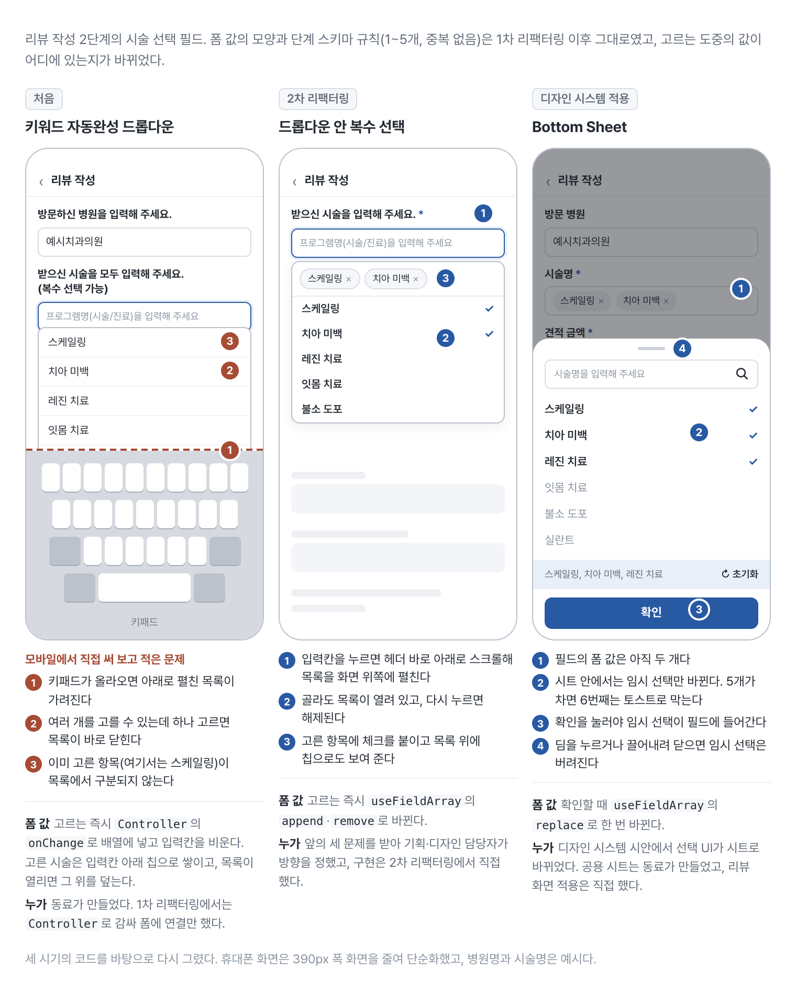
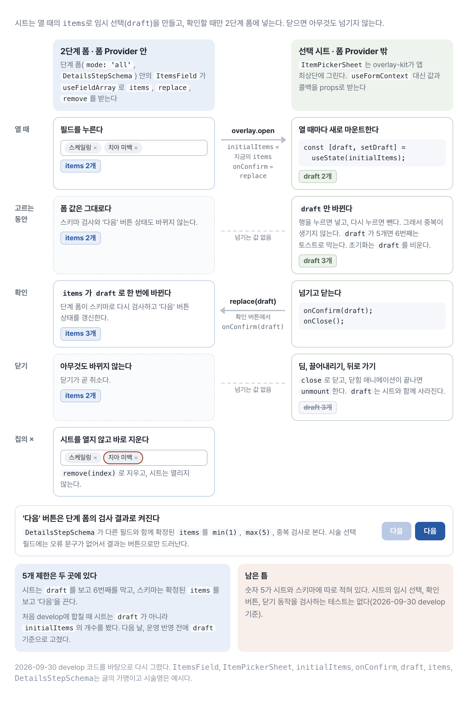

# 3단계 리뷰 작성 폼의 역할을 RHF·Zod·퍼널로 다시 나눈 과정

리뷰 작성 화면은 세 단계로 이어진다.

1. 방문 인증을 위한 영수증 업로드
2. 시술과 결제 정보 입력
3. 별점, 사진, 리뷰 내용 작성

문제는 단계가 세 개라는 사실이 아니었다. 값용 Zustand와 단계용 Zustand가 따로 있었고, 각 입력 컴포넌트가 검증과 store action까지 알고 있었다. 필드 하나를 추가할 때 값, 오류 문구, 다음 단계 조건을 여러 파일에서 함께 바꿔야 했다.

처음에는 하나의 거대한 폼으로 합치려 했다. 실제로는 단계마다 마운트되는 필드와 검증 시점이 달랐다. 그래서 세 책임만 분리했다.

- 입력값과 필드의 생명주기: React Hook Form
- 검증 규칙: Zod
- 단계와 이동 이력: `@use-funnel/core`를 감싼 공용 퍼널 훅

시술처럼 여러 개를 골라 담는 입력에서는 고르는 도중의 선택을 폼 밖의 시트에 두었다. 선택 UI가 드롭다운에서 Bottom Sheet로 바뀐 과정과 함께 뒤에서 따로 적는다.

완성된 구조는 아니다. 전체 스키마는 단계 스키마의 필드만 옮겨 담아 2단계의 추가 검증을 잃고, 최종 제출 직전의 전체 검증도 빠져 있다. 이 제약을 감춘 채 “Zod로 타입 안전한 퍼널을 만들었다”고 쓰고 싶지는 않았다.

## 기존 구조의 문제

```ts
type DraftStore = {
  draft: ReviewDraft;
  setField: <K extends keyof ReviewDraft>(
    key: K,
    value: ReviewDraft[K],
  ) => void;
};

type StepStore = {
  step: number;
  moveForward: () => void;
  moveBack: () => void;
};
```

```tsx
switch (step) {
  case 1:
    return <ProofStep />;
  case 2:
    return <DetailsStep />;
  default:
    return <FeedbackStep />;
}
```

화면 전환과 작성 중인 값이 앱 전역에서 공유돼야 할 이유는 없었다. 임시 저장은 별도 API가 담당하고 있었고, 화면 안에서 이전 단계 값을 보존하는 일은 RHF 폼 인스턴스 사이에서 처리할 수 있었다.

## 단계별 스키마와 전체 스키마의 현재 경계

각 단계에서는 해당 단계의 값만 검증하고, 최종 제출에서는 전체 값을 다시 검증하는 구조가 이상적이다. 현재 구현은 단계별 스키마를 분리했지만 전체 스키마를 조립하는 부분에는 기술 부채가 남아 있다.

아래 코드는 현재 스키마에서 핵심 필드와 추가 검증만 추린 것이다. 사용자 정의 스키마와 필드 이름은 공개용 가명이다.

```ts
import { z } from 'zod';

export const ProofStepSchema = z.object({
  proofFiles: z.array(UploadSchema).min(1).max(5),
});

export const DetailsStepSchema = z
  .object({
    visibilityFlag: z.boolean(),
    items: z.array(ItemSchema).min(1).max(5),
    quoteFieldEnabled: z.boolean().optional(),
    quotedAmount: z.number().optional(),
    paidAmount: z.number().min(1),
    amountFlag: z.boolean().optional(),
    receivedBenefitInfo: z.boolean(),
    missingBenefitReason: z
      .object({
        value: z.enum(MISSING_INFO_REASONS),
        description: z.string(),
      })
      .optional()
      .nullable(),
  })
  .superRefine((data, ctx) => {
    if (data.quoteFieldEnabled && (!data.quotedAmount || data.quotedAmount <= 0)) {
      ctx.addIssue({
        code: z.ZodIssueCode.custom,
        path: ['quotedAmount'],
        message: '금액을 입력해 주세요.',
      });
    }

    if (!data.receivedBenefitInfo && !data.missingBenefitReason) {
      ctx.addIssue({
        code: z.ZodIssueCode.custom,
        path: ['missingBenefitReason'],
        message: '안내받지 못한 이유를 입력해 주세요.',
      });
    }
  });

export const FeedbackStepSchema = z.object({
  attachments: z.array(UploadSchema),
  ratings: z.array(
    z.object({
      criterion: z.enum(RATING_CRITERIA),
      score: z.number().min(0).max(2),
    }),
  ),
  body: z.string().min(50).max(500),
  wouldRecommend: z.boolean(),
});

export const SubmissionSchema = z
  .object({
    // 방문 인증 단계에서는 min(1)을 쓰지만 전체 스키마에서는 필수가 아니다.
    proofFiles: z.array(UploadSchema).max(5),
  })
  .extend(DetailsStepSchema._def.schema.shape)
  .extend(FeedbackStepSchema.shape);
```

두 번째 단계 스키마의 `superRefine`은 해당 단계 폼에서 실행된다. 그러나 `superRefine`을 붙인 스키마는 객체 스키마를 한 겹 감싼 `ZodEffects`라서 `.shape`가 없다. 그래서 전체 스키마는 공개 API가 아닌 내부 속성 `_def.schema`로 안쪽 객체를 꺼내 필드 정의만 가져온다. 필드만 옮기는 방식이라 `superRefine`은 전체 스키마에 전달되지 않고, Zod의 내부 구조에 기대는 코드도 남는다. 현재 제출 경로에는 `SubmissionSchema.parse`를 다시 호출하는 단계도 없다. 단계별 검증은 동작하지만, 필드와 추가 검증을 함께 재사용하고 최종 제출에서 전체 규칙을 확인하는 구조는 아직 완성되지 않았다.

방문 인증 단계에서는 증빙 파일을 한 개 이상 요구한다. 다만 이 단계를 건너뛰는 흐름도 있어 전체 `SubmissionSchema`에는 `min(1)`을 두지 않았고, 현재 구현도 이 차이를 반영한다.

폼의 공개 여부도 현재는 의미가 드러나는 열거형 대신 불리언 값을 쓴다. 실제 요청을 만들 때는 다른 필드도 함께 가공하지만, 이 값의 변환만 추리면 다음과 같다.

```ts
function toSubmissionRequest(form: ReviewDraft): SubmissionRequest {
  const { visibilityFlag, ...rest } = form;

  return {
    ...rest,
    visibilityFlag: visibilityFlag
      ? VISIBILITY.Hidden
      : VISIBILITY.Public,
  };
}
```

현재 변환은 동작하지만 `true`가 숨김인지 공개인지 알려면 필드 이름과 변환 코드를 함께 봐야 한다. 폼 내부에서도 `PUBLIC | HIDDEN` 같은 값을 쓰면 해석하기 쉬워지지만, 현재 구현에는 반영되지 않은 후속 개선안이다.

## 커스텀 입력은 `Controller`에서 연결한다

```tsx
function AmountField() {
  const { control } = useFormContext<DetailsStepValues>();

  return (
    <Controller
      control={control}
      name="paidAmount"
      render={({ field: { value, onChange } }) => (
        <NumericInput
          value={value}
          onChange={normalizeNumericInput(onChange)}
        />
      )}
    />
  );
}
```

커스텀 입력의 값과 변경 핸들러를 RHF에 연결하는 코드는 `Controller` 안에서 끝난다. 검증 규칙은 단계 스키마가 맡으므로 컴포넌트가 Zustand 액션과 별도 검증 함수를 모두 알 필요가 없다.

## 고르는 동안의 값은 시트가 갖는다

여러 개를 고르는 입력은 `Controller`로 값을 잇는 것만으로 끝나지 않았다. `DetailsStepSchema`의 `items`는 시술을 1개에서 5개까지 담는 배열이고, 사용자는 목록에서 여러 번 골라 이 배열을 채운다. 이 필드의 선택 UI는 2025년 7월과 8월에 두 번 바뀌었다. 그동안 폼 값의 모양과 단계 스키마의 규칙(1~5개, 중복 없음)은 그대로였다. 바뀐 것은 고르는 도중의 값을 누가 들고 있느냐였다.

<figure class="figure-wide">
  
  <figcaption>시술 선택 UI는 두 번 바뀌었다. 드롭다운 안 복수 선택은 2차 리팩터링에서, Bottom Sheet는 디자인 시스템 적용에서 구현했고, 폼 값이 바뀌는 시점을 고르는 즉시에서 확인할 때로 옮겼다.</figcaption>
</figure>

처음 선택 UI는 동료가 만든 키워드 자동완성 드롭다운이었다. 입력칸을 누르면 바로 아래로 시술 목록이 펼쳐지고, 하나를 고르면 목록이 닫히면서 입력칸이 비워졌다. 고른 시술은 입력칸 아래에 칩으로 쌓였다. 이 글의 구조를 잡은 2025년 5월의 1차 리팩터링에서는 이 드롭다운을 `Controller`로 감싸 폼에 연결만 하고 화면은 그대로 두었다.

2025년 6월, 모바일에서 이 화면을 직접 써 보니 드롭다운으로 고르는 방식부터 불편했다. 여러 개를 골라야 하는 입력인데 하나를 고를 때마다 목록이 닫히고 입력칸이 비워져서, 시술마다 입력칸을 다시 누르고 검색해야 했다. 드롭다운 UI와 하나 고르면 닫히는 동작이 UX상 좋지 않다고 보고, 불편했던 점 세 가지를 Jira에 적어 PO에게 공유했다. 키패드가 올라오면 아래로 펼친 목록이 가려진다. 여러 개를 고를 수 있는데 하나를 고르면 목록이 바로 닫힌다. 이미 고른 항목이 목록에서 구분되지 않는다. 사용자 데이터가 아니라 직접 써 보고 적은 판단이었다. 기획·디자인 담당자들은 이를 곧 이어진 2차 리팩터링에 넣기로 하고 방향을 정했다. 드롭다운은 유지하되 그 안에서 여러 개를 고르게 하고, 고른 항목에 체크와 칩을 붙이고, 입력창을 누르면 헤더 바로 아래로 스크롤하는 방식이다. 이를 Radix Popover와 cmdk로 구현했고 2025년 7월 10일 운영에 반영됐다. 이때도 선택은 고르는 즉시 `useFieldArray`의 `append`와 `remove`로 폼 값을 고쳤다.

같은 달 말, 디자인 시스템 시안에서 시술 선택 UI가 Bottom Sheet로 바뀌었다. 디자인 시스템을 화면에 입히는 작업이라 2차 리팩터링과는 별개였다. 공용 시트 컴포넌트는 동료가 만들었고, 리뷰 화면에 적용하는 일을 맡았다. 운영에는 2025년 8월 7일에 반영됐다.

처음에는 드롭다운 때처럼 시트 안에서 폼 값을 바로 고치게 붙였다. 공용 시트는 전역 스토어가 열 때 받은 요소를 앱 최상단에서 그린다. 작업 기록에는 이 시트를 바깥에서 제어하지 못하는 문제가 있었다고만 남아 있다. 고른 값이 곧바로 폼에 들어가면 시트를 닫아도 선택이 취소되지 않는다. 닫힌 뒤 원래 값으로 되돌리는 처리를 덧대 보다가 다음 날 방향을 바꿨다. 고르는 동안의 값은 시트가 들고 있고, 폼에는 '확인'을 누를 때 한 번만 넣는다. 둘 다 배포 전, 같은 작업 안에서 있었던 일이다.

현재 코드를 줄이면 다음과 같다. 필드 컴포넌트(가명 `ItemsField`)와 선택 시트(가명 `ItemPickerSheet`)만 남겼다.

```tsx
// FieldBox는 입력칸 모양의 상자(가명)다. 필드 이름도 가명이다.
// openBottomSheet·closeBottomSheet는 공용 시트의 전역 스토어를 여닫는 함수다.
function ItemsField() {
  const { control } = useFormContext<DetailsStepValues>();
  const { fields: items, replace, remove } = useFieldArray({ control, name: 'items' });

  const openPicker = () =>
    openBottomSheet({
      detent: 'content-height',
      fullContents: true,
      children: <ItemPickerSheet initialItems={items} onConfirm={replace} />,
    });

  return (
    <FieldBox onClick={openPicker}>
      {items.map(({ itemId, itemName }, index) => (
        <Tag key={itemId} text={itemName} onClose={() => remove(index)} />
      ))}
    </FieldBox>
  );
}

function ItemPickerSheet({ initialItems, onConfirm }: ItemPickerSheetProps) {
  const [draft, setDraft] = useState(initialItems);

  const toggle = (item: DetailsStepValues['items'][number]) => {
    if (draft.some(({ itemId }) => itemId === item.itemId)) {
      setDraft((prev) => prev.filter(({ itemId }) => itemId !== item.itemId));
      return;
    }
    if (draft.length >= 5) {
      toast.warning('시술은 최대 5개까지 선택 가능해요.');
      return;
    }
    setDraft((prev) => [...prev, item]);
  };

  return (
    <div>
      {/* 검색 입력, 체크 목록(행을 누르면 toggle), 고른 항목 요약과 초기화(setDraft([])) */}
      <Button
        onClick={() => {
          onConfirm(draft);
          closeBottomSheet();
        }}
      >
        확인
      </Button>
    </div>
  );
}
```

필드는 `useFieldArray`로 `items`, `replace`, `remove`를 받고, 누르면 `openBottomSheet`로 시트에 그릴 요소를 전역 스토어에 넘긴다. 공용 시트는 앱 최상단의 Provider에서 이 요소를 그리므로, 시트는 폼 Provider(`FormProvider`) 밖에 있다. 그래서 시트는 `useFormContext`를 쓰지 않고, 열 때의 `items`와 `replace`를 props로 받는다. 공용 시트는 닫히면 닫힘 애니메이션이 끝난 뒤 내용을 언마운트하므로, 시트는 열 때마다 새로 마운트되어 그 순간의 `items`로 임시 선택을 만든다. 행을 누르면 임시 선택에 넣거나 빼고, '확인'을 눌러야 `replace`가 필드 배열을 임시 선택으로 한 번에 바꾼다. 딤을 누르거나 끌어내리거나 뒤로 가기로 닫으면 스토어의 열림 상태만 꺼지고 넘어가는 값은 없다. 시트가 언마운트되면서 임시 선택도 사라진다. 닫기가 곧 취소다. 필드의 칩에 붙은 ×는 클릭이 필드로 번지지 않게 막혀 있어서, 시트를 열지 않고 `remove`로 바로 지운다.

<figure class="figure-wide">
  
  <figcaption>시트는 열 때의 값으로 임시 선택을 만들고, 확인할 때만 replace로 필드에 넣는다. 닫으면 아무것도 넘기지 않는다.</figcaption>
</figure>

규칙은 두 곳에 있다. 시트는 임시 선택이 5개면 6번째를 토스트로 막고, 같은 항목을 다시 누르면 빼므로 중복이 생기지 않는다. 단계 스키마는 확정된 `items`를 `min(1)`, `max(5)`, 그리고 앞 절의 스키마 코드에서는 줄인 중복 검사로 본다. 시술 선택 필드에는 오류 문구가 없어서 스키마의 결과는 '다음' 버튼이 꺼지는 것으로만 드러난다.

두 규칙이 보는 값이 다르다는 점이 한 번 실수로 이어졌다. 시트를 처음 develop에 합쳤을 때 개수 제한이 `draft`가 아니라 열 때 받은 `initialItems`의 개수를 보고 있었다. 그대로 나갔다면 열 때 고른 것이 5개보다 적은 경우 시트 안에서는 제한 없이 고를 수 있고, 확인한 뒤에야 '다음' 버튼이 이유 없이 꺼지는 구조였다. 다음 날, 운영에 반영되기 전에 `draft` 기준으로 고쳤다. 같은 규칙을 두 곳에 두면 각 규칙이 어느 값을 검사하는지부터 정해야 한다. 숫자 5는 아직 시트와 스키마에 따로 적혀 있다.

필드 하나 안에서 임시 값을 따로 들고 있다가 확인할 때 합치는 이 모양은 다음 절의 단계 폼에서 한 단계 크기로 되풀이된다. 단계 폼도 자기 단계의 값을 따로 검증한 뒤에야 상위 폼에 합친다.

## 퍼널이 단계 이동과 이력을 관리한다

```tsx
// useSchemaForm·useStepFunnel·StepForm은 공용 폼 훅, 퍼널 훅, 단계 폼 래퍼의 공개용 가명이다.
// needsProof는 방문 인증 단계부터 시작하는 경우, isVisited는 예약이 방문 완료 상태인 경우다.
const form = useSchemaForm({
  schema: SubmissionSchema,
  defaultValues: savedDraft
    ? mapResponseToDraft(savedDraft.data)
    : emptyDraft,
});

const flow = useStepFunnel<Record<'proof' | 'details' | 'feedback', object>>({
  initial: {
    step: needsProof ? 'proof' : 'details',
    context: {},
  },
  id: 'public-example-flow',
});

const mergeAndReset = useCallback(
  (callback: (data: ReviewDraft) => void) =>
    <T extends Partial<ReviewDraft>>(stepValues?: T) => {
      const mergedDraft = {
        ...form.formState.defaultValues,
        ...stepValues,
      } as ReviewDraft;

      form.reset(mergedDraft);
      callback(mergedDraft);
    },
  [form],
);

const moveToStep = useCallback(
  (step: typeof flow.step) =>
    mergeAndReset(() => flow.history.replace(step)),
  [mergeAndReset, flow],
);

const confirmSubmission = mergeAndReset((data) =>
  openConfirmDialog({
    primaryAction: {
      text: '제출',
      onConfirm: () => submitDraft(data),
    },
  }),
);

return (
  <flow.Render
    proof={() => (
      <StepForm
        schema={ProofStepSchema}
        defaultValues={form.formState.defaultValues}
        onComplete={moveToStep('details')}
      >
        <ProofStep />
      </StepForm>
    )}
    details={() => (
      <StepForm
        schema={DetailsStepSchema}
        defaultValues={form.formState.defaultValues}
        onBack={needsProof ? moveToStep('proof') : undefined}
        onComplete={moveToStep('feedback')}
      >
        <DetailsStep />
      </StepForm>
    )}
    feedback={() => (
      <StepForm
        schema={FeedbackStepSchema}
        defaultValues={form.formState.defaultValues}
        onBack={moveToStep('details')}
        onComplete={confirmSubmission}
      >
        <FeedbackStep isVisited={isVisited} />
      </StepForm>
    )}
  />
);
```

단계 폼 래퍼(가명 `StepForm`)는 단계마다 `mode: 'all'`인 폼 인스턴스를 만들고 해당 단계 스키마를 검증한다. 통과한 값은 상위 RHF 인스턴스의 `defaultValues`와 합친 뒤 `reset`해 다음 단계의 초기값으로 쓴다. 단계 이동은 퍼널의 `history.replace`로 표현한다. 퍼널 `context`에 폼 값을 넣거나 `history.push`로 단계별 스냅샷을 쌓지는 않는다.

세 번째 단계도 같은 방식으로 값을 합쳐 확인 대화상자와 API 요청에 전달한다. 이 경로에는 명시적인 `SubmissionSchema.parse`가 없다. 앞 단계에서 검증한 값이 그대로 유지된다는 전제에 기대고 있어 최종 전체 검증은 남은 과제다.

## 수정 데이터는 폼을 만들기 전에 준비한다

React Hook Form의 `defaultValues`는 처음 생성될 때 캐시된다. 수정용 리뷰 데이터가 비동기로 늦게 도착하는 경우 첫 렌더링에 빈 값을 넣고 끝내서는 안 된다.

현재 화면은 서버 페이지에서 예약 정보와 리뷰 정보를 미리 요청하고, 채워진 캐시를 `HydrationBoundary`로 클라이언트에 넘긴다. 클라이언트 템플릿은 같은 쿼리 옵션으로 `useQueries`를 호출하므로 첫 렌더링부터 캐시에 든 응답을 읽는다.

```tsx
// 컴포넌트, 쿼리 옵션, 경로 파라미터 이름은 공개용 가명이다.
// 서버 페이지. 예약 id와 리뷰 id가 모두 있는 경로이고, 다른 경로는 있는 id만 미리 요청한다.
async function ReviewEditorRoute({ params }: EditorRouteProps) {
  const { sourceId, draftId } = await params;
  const queryClient = getQueryClient();

  await Promise.all([
    queryClient.prefetchQuery(sourceByIdQuery(Number(sourceId))),
    queryClient.prefetchQuery(draftByIdQuery(Number(draftId))),
  ]);

  return (
    <HydrationBoundary state={dehydrate(queryClient)}>
      <ReviewEditorPage />
    </HydrationBoundary>
  );
}

// 클라이언트 템플릿
function ReviewEditorPage() {
  const { sourceId, draftId } = useParams<EditorRouteParams>();
  const [{ data: sourceInfo }, { data: savedDraft }] = useQueries({
    queries: [
      sourceByIdQuery(toOptionalNumber(sourceId)),
      draftByIdQuery(toOptionalNumber(draftId)),
    ],
  });

  const form = useSchemaForm({
    schema: SubmissionSchema,
    defaultValues: savedDraft
      ? mapResponseToDraft(savedDraft.data)
      : emptyDraft,
  });

  // 퍼널과 단계 폼은 앞 절의 코드와 같다.
}
```

서버 페이지가 두 요청이 끝날 때까지 기다린 뒤 렌더링하므로, 클라이언트 템플릿이 처음 렌더링될 때 수정용 데이터는 이미 캐시에 있다. 그래서 응답을 폼 값으로 바꾸는 변환 함수가 만든 수정값이 첫 `defaultValues`에 들어간다. Suspense는 사용하지 않는다.

## 바뀐 부분과 남아 있는 문제

- 리뷰 작성용 Zustand 스토어를 제거했다.
- 컴포넌트에 흩어져 있던 조건부 검증을 단계별 스키마로 옮겼다.
- 화면 전환과 폼 검증을 분리했다.
- 각 단계가 자신에게 필요한 스키마로 제출 가능 여부를 판단한다.
- 시술 선택에서 고르는 도중의 값은 시트가 갖고, 확인할 때 `replace`로 한 번만 폼에 넣는다.

단계마다 폼 인스턴스를 만들기 때문에 `defaultValues`를 합치고 `reset`하는 코드는 여전히 필요하다. 현재 전체 스키마 조립은 내부 속성 `_def`로 필드만 옮겨 2단계의 추가 검증을 보존하지 않으며, 최종 제출 직전의 전체 `parse`도 없다. 이 경로를 보장하는 자동화 테스트도 없다. 리뷰 작성의 단계 스키마, 퍼널, 시술 선택 시트를 다루는 테스트 파일은 아직 하나도 없다.

시술 선택의 5개 제한은 시트와 단계 스키마에 숫자로 따로 적혀 있다. 시트의 임시 선택을 같은 규칙으로 검사하거나 숫자를 한 곳에서 가져오는 일은 아직 하지 않았다. 드롭다운에서 Bottom Sheet로 바꾼 뒤의 사용성 차이도 재지 않았다.

이미지처럼 브라우저 객체를 포함한 값은 URL 직렬화만으로 이동 이력을 복원하기 어렵다. 3단계라는 이유만으로 퍼널 라이브러리가 필요한 것은 아니다. 현재 구현처럼 `context`를 비워 두고 `replace`만 사용한다면 로컬 상태나 명시적인 리듀서가 더 단순한지도 비교할 필요가 있다.

두 Zustand store를 없앤 것보다 각 단계가 자기 필드와 검증만 알게 된 점이 더 유용했다. 반면 추가 검증이 전체 스키마로 이어지지 않는 문제와 최종 전체 검증 부재는 그대로다. 다시 손댄다면 먼저 단계의 추가 검증까지 합친 전체 스키마를 만들고, 마지막 제출이 모든 단계의 값을 다시 검사하는 테스트부터 추가할 것이다.
