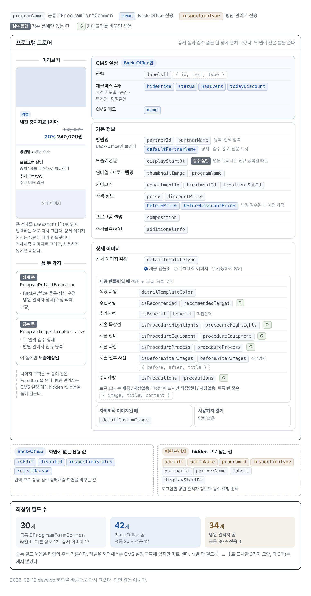
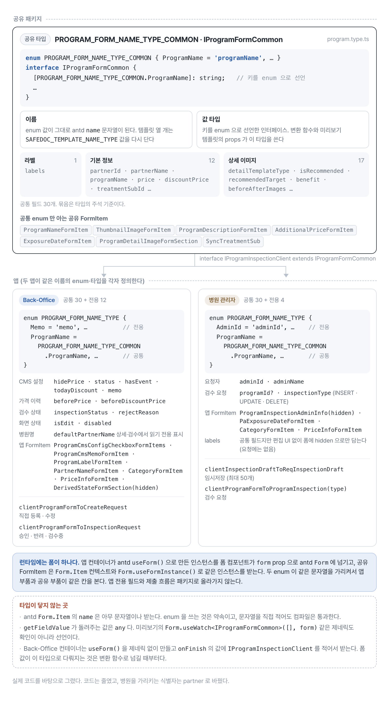
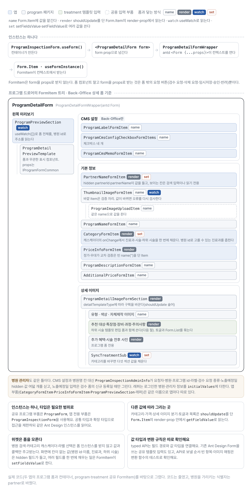
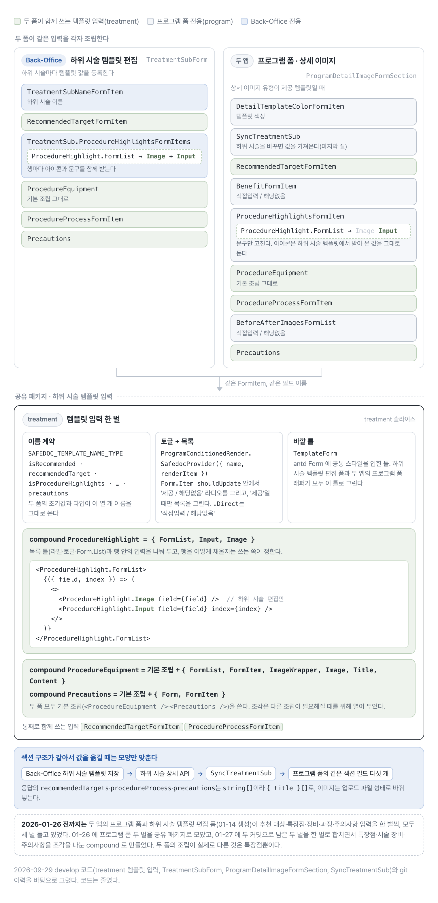
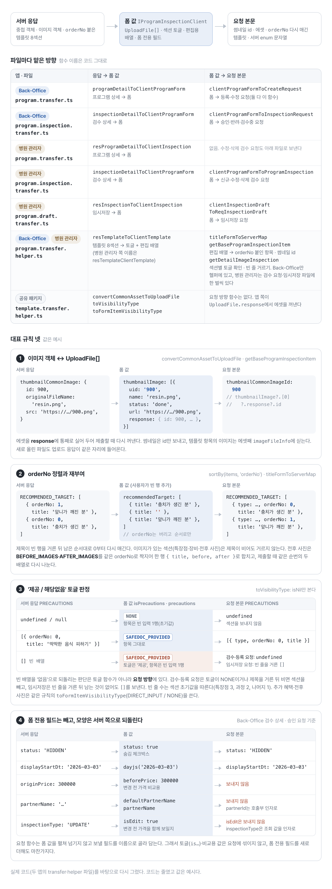
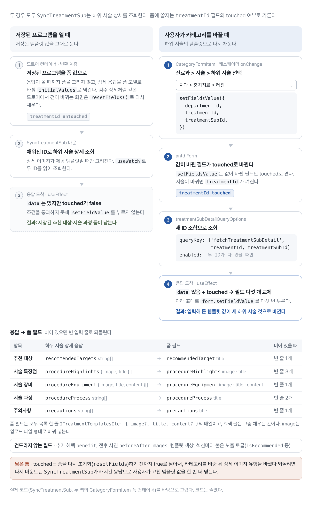

# 34개 필드로 구성된 프로그램 폼을 타입과 변환 계층으로 나눈 과정

병원 관리자의 프로그램 폼은 최상위 필드만 세도 34개다. Back-Office의 같은 폼은 42개이고, 그중 30개를 두 앱이 함께 쓴다(2026년 2월 12일 develop 기준). 필드가 많아서만 어려운 것은 아니었다.

<figure class="figure-wide">
  
  <figcaption>프로그램 드로어의 구획과 각 입력이 담기는 폼 필드를 짝지었다. 회색은 두 앱이 공유하는 IProgramFormCommon이고, 파란색과 갈색은 각 앱 전용 필드다. 노출예정일은 검수 폼에만 있다.</figcaption>
</figure>

드로어는 위에서부터 Back-Office만 쓰는 'CMS 설정' 구획, 기본 정보, 상세 이미지 순서다. 상세 이미지 유형을 제공 템플릿으로 고르면 추천 대상부터 주의사항까지 일곱 섹션이 각각 노출 토글과 목록 한 쌍으로 펼쳐진다. 그중 다섯 섹션은 '제공 / 해당없음' 토글을 달고, 카테고리를 바꾸면 하위 시술에 저장된 값으로 채워진다(↻). 추가 혜택과 시술 전후 사진의 토글은 '직접입력 / 해당없음'이다. 같은 틀을 두 폼이 나눠 쓴다. 상세 폼은 Back-Office의 등록·상세·수정 화면과 병원 관리자의 상세(수정·삭제 요청) 화면에, 검수 폼은 두 앱의 검수 상세와 병원 관리자의 신규 등록 화면에 쓰인다.

이 폼을 다루기 어렵게 만든 조건은 다섯 가지였다.

- Ant Design(antd) Form의 `NamePath`와 일부 API가 느슨해 필드 오타가 런타임까지 남았다.
- Back-Office와 병원 관리자 두 앱이 공통 필드를 공유하면서 각자 전용 필드도 가졌다.
- Back-Office의 하위 시술 템플릿 편집 폼도 추천 대상·특장점·장비·과정·주의사항 입력을 따로 갖고 있었다.
- API 응답은 중첩 객체지만 폼은 편집하기 쉬운 배열과 토글 값을 사용했다.
- 하위 시술을 바꾸면 그 시술에 저장된 추천 대상·시술 특장점·장비·과정·주의사항을 폼에 가져와야 했다.

처음에는 FormItem과 변환 코드가 앱마다 따로 있었다. 같은 입력이 두 앱의 프로그램 폼과 하위 시술 템플릿 편집 폼에 한 벌씩 있었고, 응답의 템플릿을 폼 값으로 옮기는 코드도 병원 관리자에서는 변환 파일마다 한 벌씩 있었다. 그래서 바뀌는 이유가 서로 다른 네 부분으로 나눴다.

1. 폼 모델: 공통 필드 이름과 타입, 앱 전용 필드
2. 템플릿 입력: 하위 시술 템플릿 편집 폼과 함께 쓰는 compound FormItem
3. 변환 계층: API 모델과 폼 모델 사이의 변환
4. 동기화 컴포넌트: 하위 시술 변경에 따른 값 갱신

아래 코드는 2026년 2월 12일 develop에서 옮기되 줄였고, 병원을 가리키는 식별자는 `partner`로 바꿔 적었다.

## 공통 필드와 앱 전용 필드 나누기

antd Form은 필드 이름을 `NamePath`(문자열이나 경로 배열)로 받는다. 두 앱과 공유 패키지가 같은 필드를 여러 곳에서 읽고 쓰는데 이름이 문자열로 흩어져 있으면, 오타나 이름 변경이 런타임까지 남는다. 그래서 두 앱이 함께 쓰는 필드 이름을 공유 타입 패키지의 enum 하나에 모으고, 폼 값 타입의 키도 그 enum으로 선언했다.

```ts
// 공유 타입 패키지: 두 앱이 같이 쓰는 30개
export enum PROGRAM_FORM_NAME_TYPE_COMMON {
  Labels = 'labels',
  // 기본 정보
  PartnerId = 'partnerId',
  ProgramName = 'programName',
  TreatmentSubId = 'treatmentSubId',
  // ...
  // 상세 이미지
  DetailTemplateType = 'detailTemplateType',
  IsRecommended = SAFEDOC_TEMPLATE_NAME_TYPE.IsRecommended, // 하위 시술 템플릿과 같은 이름
  RecommendedTarget = SAFEDOC_TEMPLATE_NAME_TYPE.RecommendedTarget,
  // ...
}

export interface IProgramFormCommon {
  [PROGRAM_FORM_NAME_TYPE_COMMON.Labels]?: { id: number; text: string; type?: TProgramLabelType }[];
  // 기본 정보 12개
  [PROGRAM_FORM_NAME_TYPE_COMMON.PartnerId]: number;
  [PROGRAM_FORM_NAME_TYPE_COMMON.ProgramName]: string;
  [PROGRAM_FORM_NAME_TYPE_COMMON.TreatmentSubId]: number;
  // ...
  // 상세 이미지 17개
  [PROGRAM_FORM_NAME_TYPE_COMMON.DetailTemplateType]: PROGRAM_DETAIL_TEMPLATE_TYPE; // SAFEDOC_TEMPLATE | CUSTOM_IMAGE | NONE
  [PROGRAM_FORM_NAME_TYPE_COMMON.IsRecommended]: SAFEDOC_PROVIDED_TYPE;
  [PROGRAM_FORM_NAME_TYPE_COMMON.RecommendedTarget]: BaseProgramDetailItemType; // { image?, title, content? }[] | null | undefined
  // ...
}
```

각 앱은 같은 이름의 enum과 타입을 따로 정의한다. 앱 enum은 전용 필드 이름을 더하고, 공통 필드는 공통 enum의 값을 그대로 다시 단다. 앱 타입은 공통 타입을 확장한다.

```ts
// Back-Office 앱: 공통 30개 + 전용 12개
export enum PROGRAM_FORM_NAME_TYPE {
  // 전용 필드
  InspectionStatus = 'inspectionStatus',
  RejectReason = 'rejectReason',
  Memo = 'memo',
  HidePrice = 'hidePrice',
  // ...
  // 공통 필드
  ProgramName = PROGRAM_FORM_NAME_TYPE_COMMON.ProgramName,
  // ...
}

export interface IProgramInspectionClient extends IProgramFormCommon {
  [PROGRAM_FORM_NAME_TYPE.InspectionStatus]?: PROGRAM_INSPECTION_STATUS | null;
  [PROGRAM_FORM_NAME_TYPE.RejectReason]?: string;
  [PROGRAM_FORM_NAME_TYPE.Memo]?: string;
  [PROGRAM_FORM_NAME_TYPE.HidePrice]?: boolean | null;
  // ...
}

// 병원 관리자 앱: 공통 30개 + 전용 4개
export interface IProgramInspectionClient extends IProgramFormCommon {
  [PROGRAM_FORM_NAME_TYPE.AdminId]: number;
  [PROGRAM_FORM_NAME_TYPE.AdminName]: string;
  [PROGRAM_FORM_NAME_TYPE.ProgramId]?: number;
  [PROGRAM_FORM_NAME_TYPE.InspectionType]: PROGRAM_INSPECTION_TYPE; // INSERT | UPDATE | DELETE
}
```

공유 패키지의 FormItem은 공통 enum만 알고, 앱의 컨테이너와 변환 함수는 앱 enum과 앱 타입을 쓴다. 두 enum이 같은 문자열을 가리키므로 공유 FormItem과 앱 코드가 같은 칸을 본다. 공통 필드 이름을 바꿀 때는 공통 enum 한 곳을 고치면 되고, enum에 없는 이름을 쓰면 컴파일에서 걸린다.

```tsx
// 공유 패키지의 FormItem: 공통 enum만 안다
export function ProgramNameFormItem() {
  return (
    <Form.Item
      label="프로그램명"
      name={PROGRAM_FORM_NAME_TYPE_COMMON.ProgramName}
      rules={[{ required: true, message: '프로그램명을 입력해주세요.' }]}
    >
      <Input maxLength={40} showCount />
    </Form.Item>
  );
}

// 병원 관리자 앱의 변환 함수: 앱 타입을 받는다
export function clientProgramFormToProgramInspection(inspectionType: PROGRAM_INSPECTION_TYPE) {
  return (client: IProgramInspectionClient): IProgramInspectionRequest => ({
    inspectionType,
    programName: client[PROGRAM_FORM_NAME_TYPE.ProgramName],
    // ...
  });
}
```

공통 UI를 공유한다는 이유로 Back-Office 전용 검수 상태나 병원 관리자 전용 검수 요청 종류까지 패키지에 올리지는 않았다. 반대로 공통 타입에 있어도 화면은 한쪽에만 있는 필드가 있다. `labels`는 공통 필드지만 편집 UI는 Back-Office에만 있다. 병원 관리자는 조회한 라벨을 hidden 필드로 폼에 담아 미리보기에만 쓰고, 요청에는 보내지 않는다.

<figure class="figure-wide">
  
  <figcaption>공유 패키지는 공통 필드 30개의 이름과 타입만 알고, 앱 전용 필드와 제출 흐름은 각 앱의 enum·타입과 컨테이너에 남는다.</figcaption>
</figure>

타입은 층마다 다르지만 런타임의 폼 인스턴스는 하나다. 앱 컨테이너가 antd `useForm()`으로 만든 인스턴스를 폼 컴포넌트가 `form` prop으로 antd `Form`에 넘기고, 공유 FormItem은 `Form.Item` 컨텍스트와 `Form.useFormInstance()`로 같은 인스턴스를 받는다.

이 방식이 묶는 것은 이름까지다. antd `Form.Item`의 `name`은 아무 문자열이나 받으므로 enum을 쓰는 것은 약속이고, `getFieldValue`가 돌려주는 값은 `any`다. 미리보기가 폼 전체를 읽는 `Form.useWatch<IProgramFormCommon>([], form)`의 제네릭도 확인이 아니라 선언이다. 그래서 폼 안에서 읽은 값에는 타입이 없고, 폼 값이 `IProgramInspectionClient`로 다뤄지는 것은 `onFinish`에서 변환 함수로 넘길 때부터다.

폼 하나를 FormItem 단위로 펼치면 다음과 같다.

<figure class="figure-wide">
  
  <figcaption>Back-Office 상세 폼을 FormItem 단위로 펼쳤다. 색은 부품이 있는 층이고, 뱃지는 부품이 폼과 닿는 방식이다. 인스턴스는 컨테이너가 한 번 만들고, FormItem은 컨텍스트에서 받는다.</figcaption>
</figure>

FormItem은 form을 props로 받지 않는다. 컨테이너가 만든 인스턴스가 래퍼의 antd `Form`을 거쳐 컨텍스트로 내려가고, 각 FormItem은 `Form.Item`의 `name`으로 값을 맡기거나 `Form.useFormInstance()`로 같은 인스턴스를 받는다. 다른 필드 값에 따라 그려야 하는 곳(카테고리, 가격, 상세 이미지 분기, 토글과 목록)은 `shouldUpdate`를 단 `Form.Item`의 render-prop 안에서 `getFieldValue`로 읽는다. 병원 검색이나 카테고리 캐스케이더 같은 위젯은 폼 인스턴스를 받지 않고 값과 콜백만 주고받는다. 화면에 칸이 없는 값(병원 id·이름, 진료과, 하위 시술)은 hidden 필드가 들고, 여러 필드를 한 번에 채우는 일은 FormItem이 `setFieldsValue`로 맡는다. form을 props로 받는 것은 폼 밖에 있는 요청 버튼(검수 요청·임시저장·승인·반려)뿐이다.

## 하위 시술 템플릿 입력을 compound FormItem으로 함께 쓰기

상세 이미지의 템플릿 일곱 섹션 중 '제공 / 해당없음' 토글을 단 다섯은 프로그램 폼에만 있는 입력이 아니다. Back-Office에는 하위 시술마다 템플릿 값을 등록하는 편집 폼이 따로 있고, 프로그램 폼은 하위 시술을 고르면 그 값을 가져온다. 하위 시술 템플릿 편집 폼이 생긴 2026년 1월 14일에는 두 폼이 추천 대상·특장점·장비·과정·주의사항 입력을 따로 들고 있었고, 프로그램 폼 쪽은 두 앱에 한 벌씩 있어서 모두 세 벌이었다. 여러 벌이면 검증이나 안내 문구를 고칠 때마다 모두 같이 고쳐야 한다(1월 21일·23일의 글자 수 변경은 세 곳을 함께 고쳤다). 1월 26일에 프로그램 폼의 두 벌을 공유 패키지로 모았고, 27일에 남은 두 벌을 treatment 슬라이스의 한 벌로 합쳤다.

<figure class="figure-wide">
  
  <figcaption>하위 시술 템플릿 편집 폼과 프로그램 폼이 treatment 슬라이스의 템플릿 입력 한 벌을 각자 조립한다. 행 구성이 다른 특장점은 compound로 나눠, 하위 시술 편집은 아이콘과 문구를, 프로그램 폼은 문구만 받는다.</figcaption>
</figure>

함께 쓰는 입력은 세 가지 약속 위에 선다. 필드 이름은 `SAFEDOC_TEMPLATE_NAME_TYPE`의 열 개로 두 폼이 같고, '제공 / 해당없음' 토글과 목록은 `ProgramConditionedRender`가 묶고, 바깥 틀은 두 폼 모두 같은 antd `Form` 설정(`DETAIL_DEFAULT_FORM_PROPS`, 라벨 너비 152px)과 공통 스타일(`CommonTemplatesFormStyle`)이다. 그래서 추천 대상·과정·주의사항과 시술 장비는 두 폼이 같은 컴포넌트를 그대로 쓴다. 두 폼의 값 타입은 전체로는 다르지만 이 열 개 필드는 이름과 타입이 같다. 하위 시술 편집 폼의 타입은 교집합 타입 `ITreatmentTemplateForm`을 확장하고, 프로그램 폼의 공통 타입은 같은 열 개를 같은 타입으로 선언한다. 입력 쪽은 이 열 개 이름만 알면 된다.

특장점만 행 구성이 다르다. 하위 시술 템플릿 편집 폼에서는 행마다 아이콘과 문구를 받고, 프로그램 폼에서는 문구만 고치며 아이콘은 하위 시술 템플릿에서 받아 온 값을 그대로 둔다. 그래서 특장점은 목록 틀과 행 입력을 나눈 compound로 만들고, 행을 채우는 방식은 쓰는 쪽이 정하게 했다.

```tsx
export const ProcedureHighlight = {
  FormList: ProcedureHighlightsFormList, // 라벨·'제공 / 해당없음' 토글·Form.List
  Input: ProcedureHighlightInput, // 행의 문구(필수)
  Image: ProcedureHighlightImage, // 행의 아이콘(필수)
};

// Back-Office 하위 시술 템플릿 편집: 아이콘과 문구
<ProcedureHighlight.FormList>
  {({ field, index }) => (
    <>
      <ProcedureHighlight.Image field={field} />
      <ProcedureHighlight.Input field={field} index={index} />
    </>
  )}
</ProcedureHighlight.FormList>;

// 프로그램 폼: 문구만
<ProcedureHighlight.FormList>
  {({ field, index }) => <ProcedureHighlight.Input field={field} index={index} />}
</ProcedureHighlight.FormList>;
```

시술 장비(`FormList`·`FormItem`·`ImageWrapper`·`Image`·`Title`·`Content`)와 주의사항(`Form`·`FormItem`)도 같은 방식으로 조각을 열어 두었고, 두 폼 모두 기본 조립(`<ProcedureEquipment />`·`<Precautions />`)을 그대로 쓴다.

두 폼의 섹션 구성이 같다는 점은 값을 옮길 때도 쓰인다. 마지막 절의 `SyncTreatmentSub`는 하위 시술 상세 응답을 프로그램 폼의 같은 섹션 필드에 넣으면서 모양만 맞춘다.

## 서버 모델과 폼 모델 사이에 변환 계층 두기

API와 폼이 원하는 모양은 달랐다.

```text
API response
  -> programDetailToClientProgramForm   (응답 → 폼 값)
  -> 폼 값
  -> clientProgramFormToCreateRequest   (폼 값 → 요청 본문)
  -> API request
```

예를 들어 서버 이미지 객체는 antd `UploadFile[]`로 바뀌고, 상세 템플릿은 `orderNo`로 정렬된 편집 배열이 된다. 위 두 함수는 Back-Office 상세·수정 화면에서 짝으로 쓰이고, 등록도 같은 요청 함수를 쓴다.

<figure class="figure-wide">
  
  <figcaption>두 앱의 변환 파일은 API 흐름마다 하나이고, 대부분 응답을 폼 값으로, 폼 값을 요청 본문으로 바꾸는 두 방향을 함께 둔다. 응답 방향의 이미지 변환과 토글 판정은 공유 헬퍼에, orderNo 정렬은 앱 헬퍼에 있고, 폼 전용 필드는 요청 함수가 보낼 필드만 이름으로 골라 담는 방식으로 뺀다.</figcaption>
</figure>

변환 파일은 API 흐름마다 하나다. Back-Office는 등록·수정과 검수를, 병원 관리자는 상세 조회, 검수 요청, 임시저장을 각각 파일 하나로 맡는다.

응답 방향에서 템플릿 여덟 섹션을 폼으로 옮기는 규칙은 두 앱의 변환 파일 어디서나 같다. 1월 27일과 28일에 이 코드를 모으면서 이미지 변환과 토글 판정은 공유 헬퍼로, `orderNo` 정렬은 앱마다 헬퍼로 뺐다(정렬 코드는 두 앱이 같고, 받는 템플릿 응답 타입만 앱마다 따로 정의돼 있다). 템플릿이 폼에서는 일곱 섹션인데 응답에서는 여덟인 것은 서버가 시술 전후 사진을 `BEFORE_IMAGES`·`AFTER_IMAGES` 두 목록으로 보내서다.

```ts
// 공유 헬퍼: 토글과 이미지
export const toVisibilityType = <T>(value: T | null | undefined): SAFEDOC_PROVIDED_TYPE =>
  isNil(value) ? SAFEDOC_PROVIDED_TYPE.None : SAFEDOC_PROVIDED_TYPE.SafedocProvided;

export function convertCommonAssetToUploadFile(asset: TCommonAsset): UploadFile & { response: TCommonAsset } {
  return {
    uid: String(asset.id),
    name: asset.originalFileName || asset.fileName,
    status: 'done',
    url: asset.src,
    response: asset, // 제출할 때 여기서 에셋을 다시 꺼낸다
  };
}

// 앱 헬퍼: 섹션 하나를 orderNo 순서의 편집 배열로(항목 키 enum은 값 문자열로 줄였다)
const toClientForm =
  (templates: TProgramTemplate) =>
  <T extends { title: string; content?: string; image?: any }>(
    type: PROGRAM_DETAIL_TEMPLATES_ITEM_TYPE,
    initialValue: T[],
  ): T[] => {
    const items = templates[type];
    if (isEmpty(items)) return initialValue; // 섹션 초기값의 빈 줄

    return sortBy(items, 'orderNo').map((item) => ({
      title: item.title,
      content: item.content || '',
      image: item.imageFileInfo ? [convertCommonAssetToUploadFile(item.imageFileInfo)] : undefined,
    })) as T[];
  };

export function resTemplateToClientTemplate(templates: TProgramTemplate) {
  const toClient = toClientForm(templates);

  return {
    [PROGRAM_FORM_NAME_TYPE.IsRecommended]: toVisibilityType(
      templates[PROGRAM_DETAIL_TEMPLATES_ITEM_TYPE.RecommendedTarget],
    ),
    [PROGRAM_FORM_NAME_TYPE.RecommendedTarget]: toClient(
      PROGRAM_DETAIL_TEMPLATES_ITEM_TYPE.RecommendedTarget,
      INITIAL_RECOMMENDED_TARGET,
    ),
    // 나머지 섹션도 같은 모양이다
  };
}
```

토글 판정은 `null`·`undefined`만 '없음'으로 보고, 빈 배열로 내려온 섹션은 켠다(추가 혜택과 시술 전후 사진은 '직접입력', 나머지는 '제공'). 항목은 섹션 초기값의 빈 줄로 채워진다(시술 특장점 3줄, 시술 과정 2줄, 나머지 1줄). 빈 배열을 '없음'으로 볼지는 토글 함수가 아니라 요청 변환이 정한다. 병원 관리자의 임시저장은 제목이 빈 줄을 거른 뒤 남는 것이 없어도 빈 배열을 보내고, 그 빈 배열이 응답으로 돌아오면 토글이 켜진 채 초기값의 빈 줄로 채워진다. 검수·등록 요청은 토글이 꺼져 있거나 거른 뒤 남는 것이 없으면 섹션째 보내지 않는다.

제출 방향은 보낼 필드만 골라 담고, API가 요구하는 순서와 모양을 다시 만든다. 요청 방향에서 두 앱 헬퍼가 함께 가진 것은 순번을 붙이는 `titleFormToServerMap`과 공통 값을 고르는 `getBaseProgramInspectionItem`뿐이다. 섹션마다 토글을 확인하고 빈 줄을 거르는 `getDetailImageInspection`은 Back-Office만 헬퍼에 두었고, 병원 관리자는 검수 요청·임시저장 파일에 같은 이름으로 한 벌씩 두었다.

```ts
export const titleFormToServerMap =
  (type: PROGRAM_DETAIL_TEMPLATES_ITEM_TYPE) =>
  ({ title }: { title: string }, orderNo: number) => ({ type, orderNo, title });

// 추천 대상: 꺼져 있거나 제목을 거른 뒤 비면 섹션을 보내지 않는다
const filteredRecommendedTarget = filter(
  client[PROGRAM_FORM_NAME_TYPE.RecommendedTarget],
  ({ title }) => !isEmpty(title),
);
const recommendedTarget =
  client[PROGRAM_FORM_NAME_TYPE.IsRecommended] === SAFEDOC_PROVIDED_TYPE.None || isEmpty(filteredRecommendedTarget)
    ? undefined
    : filteredRecommendedTarget.map(titleFormToServerMap(PROGRAM_DETAIL_TEMPLATES_ITEM_TYPE.RecommendedTarget));

// 이미지는 UploadFile.response에 실어 둔 에셋에서 다시 꺼낸다(썸네일은 id만)
const thumbnailCommonImageId = client[PROGRAM_FORM_NAME_TYPE.ThumbnailImage]?.[0]?.response?.id;
```

제목 기반 섹션은 빈 줄을 거른 뒤 순서대로 `orderNo`를 다시 매기고, 이미지가 있는 섹션(특장점·장비·전후 사진)은 제목이 비어도 거르지 않는다. 템플릿 항목의 이미지는 id가 아니라 에셋째 `imageFileInfo`에 싣는다. 전후 사진은 폼에서 한 줄(`{ title, before, after }`)이던 것을 같은 `orderNo`의 `BEFORE_IMAGES`·`AFTER_IMAGES` 두 목록으로 다시 나눈다. 요청 함수는 폼 값을 펼쳐 넘기지 않고 보낼 필드를 이름으로 골라 담는다. 그래서 토글과 변경 전 가격처럼 폼에만 있는 값은 프로그램 요청에 섞이지 않고, 폼 전용 필드를 새로 더해도 마찬가지다.

## 비동기 초기값은 폼을 마운트하기 전에 준비하기

antd Form의 `initialValues`는 마운트한 뒤 props가 바뀌어도 자동으로 다시 적용되지 않는다. 폼 값이 컴포넌트가 아니라 `useForm()`이 만든 인스턴스에 남기 때문이다. 그래서 상세 조회가 끝나기 전에 빈 폼부터 만들지 않았다. 상세·검수 드로어의 컨테이너는 응답이 올 때까지 폼을 그리지 않고, 응답을 변환한 값으로 `initialValues`를 만든 뒤에 폼을 붙인다.

```tsx
function ProgramInspectionDetailFormContainer() {
  const [form] = useForm();
  const { data } = useProgramInspectionDetail();
  const { partnerId, programInspectionId } = useQueryParams();
  const mutation = useProgramInspectionMutation(Number(partnerId), Number(programInspectionId));

  // 같은 드로어에서 이전·다음 검수 건으로 넘어가면 data만 바뀐다
  useEffect(() => {
    if (data) form.resetFields();
  }, [form, data]);

  // 응답이 오기 전에는 폼을 만들지 않는다
  if (!data) return null;

  return (
    <ProgramInspectionDetailForm
      form={form}
      initialValues={{ ...PROGRAM_DETAIL_INITIAL_VALUES, ...inspectionDetailToClientProgramForm(data) }}
      onFinish={(values: IProgramInspectionClient) =>
        mutation.mutate(
          clientProgramFormToInspectionRequest({
            formData: values,
            programInspectionId,
            partnerId,
            inspectionType: data.inspectionType,
          }),
        )
      }
    />
  );
}
```

`resetFields`를 따로 부르는 곳은 컨테이너가 남은 채 데이터만 바뀌는 화면이다. Back-Office 검수 상세는 같은 드로어 안에서 이전·다음 건으로 넘어가고, 병원 관리자 등록 화면은 폼을 먼저 그린 뒤 고른 임시저장을 불러온다. 이때 인스턴스에 남은 값을 지우고 새 `initialValues`로 다시 채운다. `initialValues`와 `resetFields`로 들어간 시술 필드는 touched가 켜지지 않고, 사용자가 캐스케이더로 고른 값만 touched가 켜진다. 다음 절의 동기화는 이 차이로 저장된 값과 사용자 변경을 가른다.

## 하위 시술 변경에 따른 작업을 한곳에 모으기

카테고리를 바꿔 하위 시술이 달라지면 시술에 저장된 템플릿을 프로그램 폼으로 가져온다. 초기 상세 조회로 ID가 채워졌을 때는 템플릿을 다시 적용하지 않고, 사용자가 시술을 직접 바꾼 경우에만 적용하도록 `isFieldsTouched`로 `treatmentId`를 확인했다.

<figure class="figure-wide">
  
  <figcaption>SyncTreatmentSub는 두 경우 모두 하위 시술 상세를 조회하지만, treatmentId가 touched일 때만 템플릿 필드 다섯 개를 교체한다.</figcaption>
</figure>

저장된 프로그램을 열 때는 앞 절처럼 `initialValues`로 값이 들어가 `treatmentId`가 touched가 아니다. 조회는 하지만 적용 조건을 통과하지 못해, 저장된 템플릿이 그대로 남는다. 사용자가 캐스케이더에서 진료과, 시술, 하위 시술을 고르면 `CategoryFormItem`이 `setFieldsValue`로 세 값을 한 번에 넣는다. antd는 `setFieldsValue`로 값이 바뀐 필드를 touched로 켜므로, 시술이 바뀌면 조건을 통과하고 새 ID로 조회한 응답이 다섯 필드를 교체한다.

```tsx
export function SyncTreatmentSub() {
  const form = Form.useFormInstance();
  const treatmentId =
    Form.useWatch([PROGRAM_FORM_NAME_TYPE_COMMON.TreatmentId], form) ||
    form.getFieldValue([PROGRAM_FORM_NAME_TYPE_COMMON.TreatmentId]);
  const treatmentSubId = Form.useWatch([PROGRAM_FORM_NAME_TYPE_COMMON.TreatmentSubId], form);

  // 두 ID가 모두 있어야 조회한다(enabled)
  const { data } = useQuery(treatmentSubDetailQueryOptions({ treatmentId, treatmentSubId }));

  const isTouchedTreatmentId = form.isFieldsTouched([PROGRAM_FORM_NAME_TYPE_COMMON.TreatmentId]);

  useEffect(() => {
    if (data && isTouchedTreatmentId) {
      const { recommendedTargets, procedureHighlights /* ... */ } = data.data;

      // 시술 상세는 추천 대상을 string[]로 내려준다. 폼은 { title }[]다.
      form.setFieldValue(
        PROGRAM_FORM_NAME_TYPE_COMMON.RecommendedTarget,
        isEmpty(recommendedTargets) ? INITIAL_RECOMMENDED_TARGET : recommendedTargets?.map((title) => ({ title })),
      );
      form.setFieldValue(
        PROGRAM_FORM_NAME_TYPE_COMMON.ProcedureHighlights,
        isEmpty(procedureHighlights)
          ? INITIAL_PROCEDURE_HIGHLIGHTS
          : procedureHighlights?.map(({ image, title }) => ({
              title,
              image: image && [convertCommonAssetToUploadFile(image)],
            })),
      );
      // 시술 장비·시술 과정·주의사항도 같은 모양이다
    }
  }, [data, form, isTouchedTreatmentId]);

  return null;
}
```

이 구현에는 한계가 있다. touched는 폼을 다시 초기화하기 전까지 `true`로 남는다. 카테고리를 바꾼 뒤 상세 이미지 유형을 다른 것으로 바꿨다가 되돌리면 `SyncTreatmentSub`가 다시 마운트되고, 캐시된 응답으로 사용자가 고친 템플릿 값을 한 번 더 덮는다. 다시 구현한다면 조회 결과를 지켜보는 effect 대신 캐스케이더의 `onChange`에서 템플릿 적용 함수를 호출하겠다. 사용자가 하위 시술을 바꾼 시점에만 값을 갱신하는 편이 동작을 이해하기 쉽다.

이렇게 나눈 뒤로 필드 이름은 공통 enum 한 곳에서 관리하고, API 모양이 바뀌면 변환 함수부터 살펴보게 됐다. 두 앱은 FormItem을 공유하고 템플릿 입력은 하위 시술 템플릿 편집 폼과도 함께 쓰지만, 두 앱의 검수와 제출 흐름까지 억지로 맞추지는 않았다.

비용도 남았다. 이름은 enum으로 묶었지만 폼 안에서 읽는 값은 `any`라서, 값이 타입으로 다뤄지는 것은 변환 함수부터다. 응답을 편집 배열로 바꾸는 헬퍼도 섹션마다 다른 항목 모양을 제네릭 하나로 받느라 `as T[]` 단언을 쓴다. API와 폼이 함께 바뀌면 양방향 변환 함수도 모두 수정해야 한다. 요청 방향의 템플릿 변환은 Back-Office 헬퍼, 병원 관리자 검수 요청, 임시저장 세 곳에 거의 같은 코드로 복제돼 있어서, 빈 섹션을 다루는 방식처럼 서로 다른 부분이 코드 한 줄 차이로만 드러난다. 변환 함수는 순수 함수라 입력과 출력만으로 규칙을 고정할 수 있는데도 아직 테스트가 없다. 복잡도를 없앴다기보다 타입, 변환, 동기화 중 어디에서 각각의 복잡도를 다룰지 정한 작업이었다.
