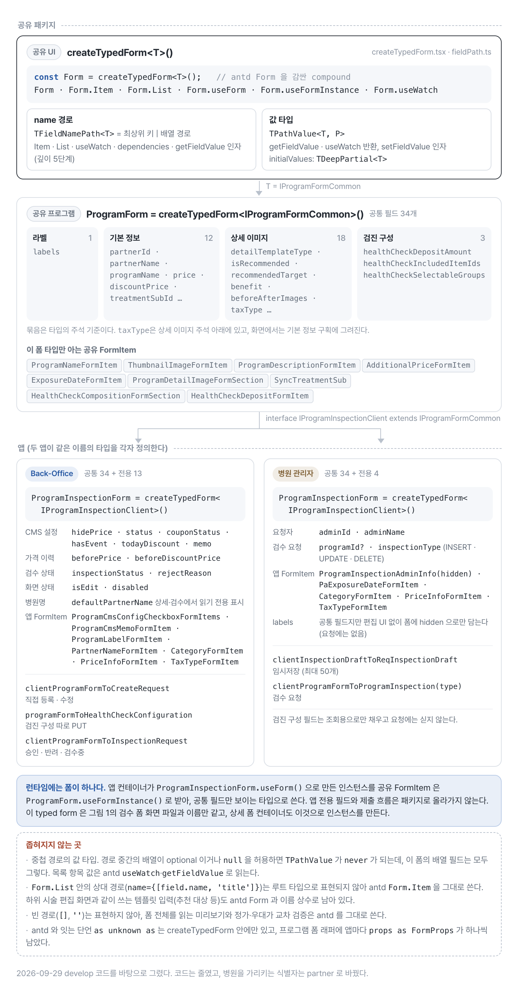

# 38개 필드로 구성된 프로그램 폼을 타입과 변환 계층으로 나눈 과정

병원 관리자의 프로그램 폼은 최상위 필드만 세도 38개다. Back-Office의 같은 폼은 47개이고, 그중 34개를 두 앱이 함께 쓴다(2026-09-29 develop 기준). 필드가 많아서만 어려운 것은 아니었다.

<figure class="figure-wide">
  
  <figcaption>프로그램 드로어의 구획과 각 입력이 담기는 폼 필드를 짝지었다. 회색은 두 앱이 공유하는 IProgramFormCommon이고, 파란색과 갈색은 각 앱 전용 필드다. 예약금·검진 구성과 노출예정일은 상세 폼과 검수 폼 중 한쪽에만 있다.</figcaption>
</figure>

드로어는 위에서부터 Back-Office만 쓰는 'CMS 설정' 구획, 기본 정보, 검진 프로그램일 때만 나오는 검진 구성, 상세 이미지 순서다. 상세 이미지 유형을 제공 템플릿으로 고르면 추천 대상부터 주의사항까지 일곱 섹션이 각각 노출 토글과 목록 한 쌍으로 펼쳐진다. 그중 다섯 섹션은 '제공 / 해당없음' 토글을 달고, 하위 시술을 바꾸면 시술에 저장된 값으로 채워진다(↻). 추가 혜택과 시술 전후 사진의 토글은 '직접입력 / 해당없음'이다. 같은 틀을 두 폼이 나눠 쓴다. 상세 폼은 Back-Office의 등록·상세·수정 화면과 병원 관리자의 상세(수정·삭제 요청) 화면에, 검수 폼은 두 앱의 검수 상세와 병원 관리자의 신규 등록 화면에 쓰인다.

이 폼을 다루기 어렵게 만든 조건은 네 가지였다.

- Ant Design(antd) Form의 `NamePath`와 일부 API가 느슨해 필드 오타가 런타임까지 남았다.
- Back-Office와 병원 관리자 두 앱이 공통 필드를 공유하면서 각자 전용 필드도 가졌다.
- API 응답은 중첩 객체지만 폼은 편집하기 쉬운 배열과 토글 값을 사용했다.
- 하위 시술을 바꾸면 그 시술에 저장된 추천 대상·시술 특장점·장비·과정·주의사항을 폼에 가져와야 했다.

처음에는 공통 FormItem을 늘려 해결했지만, 변환 코드와 그 안의 타입 단언이 API 흐름마다 복제됐고 필드 이름은 이름 상수로만 맞췄다. 그래서 바뀌는 이유가 서로 다른 네 부분으로 나눴다.

1. `createTypedForm`: 필드 경로와 값의 타입
2. 앱별 폼 모델: 공통 필드와 전용 필드
3. 변환 계층: API 모델과 폼 모델 사이의 변환
4. 동기화 컴포넌트: 하위 시술 변경에 따른 값 갱신

아래 코드는 2026-09-29 develop에서 옮기되 줄였고, 병원을 가리키는 식별자는 `partner`로 바꿔 적었다.

## Ant Design Form의 필드 경로를 타입으로 제한하기

antd Form은 자체적으로 제네릭을 지원하지만 중첩된 `NamePath`와 `setFieldValue`를 여러 컴포넌트에서 사용하면 타입이 쉽게 느슨해졌다. 그래서 단언을 호출부마다 반복하지 않고 작은 어댑터 안에 모았다.

```ts
type TFieldLeaf = string | number | boolean | bigint | symbol | null | undefined | Date | File;

type TPrev = [never, 0, 1, 2, 3, 4, 5];

// T 안에서 유효한 배열 경로를 모두 만든다(재귀 깊이 5단계 제한)
type TArrayPaths<T, Depth extends number = 5> = [Depth] extends [never]
  ? never
  : T extends TFieldLeaf
    ? []
    : T extends readonly (infer E)[]
      ? [] | [number, ...TArrayPaths<E, TPrev[Depth]>]
      : {
          [K in Extract<keyof T, string>]-?: [] | [K, ...TArrayPaths<T[K], TPrev[Depth]>];
        }[Extract<keyof T, string>];

export type TFieldNamePath<T> = Extract<keyof T, string> | Exclude<TArrayPaths<T>, []>;

// 경로 P가 가리키는 값의 타입
export type TPathValue<T, P> = P extends keyof T
  ? T[P]
  : P extends readonly [infer K, ...infer Rest]
    ? K extends keyof T
      ? Rest extends []
        ? T[K]
        : TPathValue<T[K], Rest>
      : never
    : never;
```

`createTypedForm<T>()`은 antd Form을 감싼 compound 컴포넌트를 돌려준다. `Form` 자신에 `Item`, `List`, `useForm`, `useFormInstance`, `useWatch`가 붙은 모양이다. 필드 경로를 받는 자리, 곧 `Item`·`List`·`useWatch`의 `name`(`Item`은 `dependencies`까지)과 폼 인스턴스의 `getFieldValue`·`setFieldValue`·`getFieldError`는 `TFieldNamePath<T>`로 좁혀진다. `getFieldValue`·`useWatch`가 돌려주는 값과 `setFieldValue`가 받는 값은 `TPathValue<T, P>`로 좁혀지고, `Form` 자신은 `initialValues`를 `TDeepPartial<T>`로, `onFinish`의 값을 `T`로 받는다. 런타임에는 antd 원본을 그대로 부르고, 바꾸는 것은 타입뿐이다.

```tsx
export interface ITypedFormInstance<T>
  extends Omit<
    FormInstance<T>,
    'getFieldValue' | 'getFieldsValue' | 'getFieldError' | 'setFieldValue' | 'setFieldsValue'
  > {
  getFieldValue: <P extends TFieldNamePath<T>>(name: P) => TPathValue<T, P>;
  getFieldsValue: () => T;
  getFieldError: (name: TFieldNamePath<T>) => string[];
  setFieldValue: <P extends TFieldNamePath<T>>(name: P, value: TPathValue<T, P> | undefined) => void;
  setFieldsValue: (values: TDeepPartial<T>) => void;
}

export function createTypedForm<T extends object>(): TTypedForm<T> {
  function useForm(): [ITypedFormInstance<T>] {
    // antd 타입과 잇는 `as unknown as` 단언은 이 파일 안에만 둔다
    return Form.useForm<T>() as unknown as [ITypedFormInstance<T>];
  }

  function useWatch<P extends TFieldNamePath<T>>(name: P, form: ITypedFormInstance<T>) {
    return Form.useWatch(name as never, form as unknown as FormInstance<T>) as TPathValue<T, P> | undefined;
  }

  function Item(props: ITypedFormItemProps<T>) {
    return createElement(Form.Item, props as unknown as FormItemProps);
  }

  // Form 자신(TypedFormComponent)과 List, useFormInstance도 같은 방식으로 감싼다
  return Object.assign(TypedFormComponent, { Item, List, useForm, useFormInstance, useWatch }) as unknown as TTypedForm<T>;
}
```

사용하는 쪽에서는 폼 타입 하나로 `createTypedForm`을 호출해 폼을 만든다. 이하 이렇게 만든 폼을 typed form이라고 부른다.

```tsx
export const ProgramForm = createTypedForm<IProgramFormCommon>();

<ProgramForm.Item name="programName" />;
// OK

<ProgramForm.Item name={['recommendedTarget', 0, 'title']} />;
// OK — 중첩 배열 경로도 이름은 검사된다

<ProgramForm.Item name="progamName" />;
// 컴파일 오류 — 오타를 사용하는 지점에서 바로 잡는다

const form = ProgramForm.useFormInstance();
form.getFieldValue('treatmentSubId');
// number — 반환값도 경로 기준으로 좁혀진다(아직 비어 있을 때의 undefined는 타입에 없다)
```

어댑터 내부에는 antd의 넓은 타입과 잇기 위한 단언(`as unknown as`)이 남는다. 그 비용을 어댑터에 모아 두고, 실제 FormItem과 헬퍼에서는 잘못된 필드 경로와 최상위 값의 타입을 바로 확인한다. 좁혀지지 않는 곳도 남았다.

- 중첩 경로의 값 타입은 좁혀지지 않는다. `TPathValue`는 경로 중간의 배열이 optional이거나 `null`을 허용하면 `never`가 되는데, 이 폼의 배열 필드는 모두 그렇다. 그래서 목록 항목의 값은 antd `useWatch`와 `getFieldValue`로 읽는다.
- `Form.List` 안의 상대 경로(`name={[field.name, 'title']}`)는 루트 타입으로 표현되지 않아 antd `Form.Item`을 그대로 쓴다. 하위 시술 편집 화면과 같이 쓰는 템플릿 입력(추천 대상 등)도 antd Form과 이름 상수로 남아 있다.
- 빈 경로(`[]`, `''`)도 표현하지 않아서, 폼 전체를 읽는 미리보기와 정가·우대가 교차 검증은 antd를 그대로 쓴다.
- 프로그램 폼을 그리는 래퍼는 antd 기반 폼 컴포넌트를 써서, 앱마다 `props as FormProps` 단언이 하나씩 있다.

## 공통 필드와 앱 전용 필드 나누기

두 앱이 같은 폼 컴포넌트를 사용해도 제출 방식까지 같지는 않았다.

<figure class="figure-wide">
  
  <figcaption>공유 패키지는 공통 필드 34개만 알고, 앱 전용 필드와 제출 흐름은 각 앱의 typed form과 컨테이너에 남는다.</figcaption>
</figure>

그림은 세 층이다. 공유 UI의 `createTypedForm`, 공유 프로그램 패키지의 `ProgramForm`, 그리고 두 앱이 같은 이름으로 각자 정의한 `IProgramInspectionClient`와 `ProgramInspectionForm`이다. 그림 1의 검수 폼 화면(`ProgramInspectionForm.tsx`)과 이름이 같지만, 여기서 `ProgramInspectionForm`은 상세 폼과 검수 폼의 컨테이너가 모두 인스턴스를 만드는 typed form이다. 병원 관리자 코드는 둘을 함께 쓰는 컨테이너에서 typed form을 `ProgramInspectionTypedForm`이라는 별칭으로 가져온다. 타입은 층마다 다르지만 런타임의 폼 인스턴스는 하나다. 앱 컨테이너가 `ProgramInspectionForm.useForm()`으로 만든 인스턴스를 공유 FormItem은 `ProgramForm.useFormInstance()`로 받아, 공통 필드만 보이는 타입으로 쓴다.

```ts
// 공유 패키지: 두 앱이 같이 쓰는 34개
export interface IProgramFormCommon {
  labels?: { id: number; text: string; type?: TProgramLabelType }[];
  // 기본 정보 12개
  partnerId: number;
  programName: string;
  treatmentSubId: number;
  // ...
  // 상세 이미지 18개
  detailTemplateType: PROGRAM_DETAIL_TEMPLATE_TYPE; // SAFEDOC_TEMPLATE | CUSTOM_IMAGE | CHECKUP_TEMPLATE | NONE
  isRecommended: SAFEDOC_PROVIDED_TYPE;
  recommendedTarget: TBaseTreatmentTemplateItemType; // { image?, title, content? }[] | null | undefined
  // ...
  // 검진 구성 3개 (검진 프로그램에서만 채운다)
  healthCheckDepositAmount?: number | null;
  // ...
}

export const ProgramForm = createTypedForm<IProgramFormCommon>();
```

```ts
// Back-Office 앱: 공통 34개 + 전용 13개
export interface IProgramInspectionClient extends IProgramFormCommon {
  inspectionStatus?: PROGRAM_INSPECTION_STATUS | null;
  rejectReason?: string;
  memo?: string;
  hidePrice?: boolean | null;
  // ...
}

// 병원 관리자 앱: 공통 34개 + 전용 4개
export interface IProgramInspectionClient extends IProgramFormCommon {
  adminId: number;
  adminName: string;
  programId?: number;
  inspectionType: PROGRAM_INSPECTION_TYPE; // INSERT | UPDATE | DELETE
}

export const ProgramInspectionForm = createTypedForm<IProgramInspectionClient>();
```

공유 패키지의 FormItem은 `IProgramFormCommon`만 알고, 각 앱의 컨테이너는 전용 필드를 더한 타입과 제출 동작을 가진다. 공통 UI를 공유한다는 이유로 Back-Office 전용 검수 상태나 병원 관리자 전용 검수 요청 종류까지 패키지에 올리지는 않았다. 반대로 공통 타입에 있어도 화면은 한쪽에만 있는 필드가 있다. `labels`는 공통 필드지만 편집 UI는 Back-Office에만 있다. 병원 관리자는 조회한 라벨을 hidden 필드로 폼에 담아 미리보기에만 쓰고, 요청에는 보내지 않는다.

## 서버 모델과 폼 모델 사이에 변환 계층 두기

API와 폼이 원하는 모양은 달랐다.

```text
API response
  -> programDetailToClientProgramForm   (응답 → 폼 값)
  -> 폼 값
  -> clientProgramFormToCreateRequest   (폼 값 → 요청 본문)
  -> API request
```

예를 들어 서버 이미지 객체는 antd `UploadFile[]`로 바뀌고, 상세 템플릿은 `orderNo`로 정렬된 편집 배열이 된다. 위 두 함수는 Back-Office 상세·수정 화면에서 짝으로 쓰이고, 등록도 같은 요청 함수를 쓴다.

<figure class="figure-wide">
  
  <figcaption>두 앱의 변환 파일은 API 흐름마다 하나이고, 대부분 응답을 폼 값으로, 폼 값을 요청 본문으로 바꾸는 두 방향을 함께 둔다. 응답 방향의 이미지 변환과 토글 판정은 공유 헬퍼에, orderNo 정렬은 앱 헬퍼에 있고, 폼 전용 필드는 요청 함수가 보낼 필드만 이름으로 골라 담는 방식으로 뺀다.</figcaption>
</figure>

변환 파일은 API 흐름마다 하나다. Back-Office는 등록·수정, 검수, 검진 구성을, 병원 관리자는 상세 조회, 검수 요청, 임시저장을 각각 파일 하나로 맡는다. 검진 구성은 프로그램과 다른 API라 변환 파일도 따로 두었고, 병원 관리자는 검진 구성을 조회용으로만 채우고 요청에는 싣지 않는다.

응답 방향에서 템플릿 여덟 섹션을 폼으로 옮기는 규칙은 두 앱의 변환 파일 어디서나 같다. 그래서 이미지 변환과 토글 판정은 공유 헬퍼로, `orderNo` 정렬은 앱마다 헬퍼로 뺐다(정렬 코드는 두 앱이 같고, 받는 템플릿 응답 타입만 앱마다 따로 정의돼 있다). 템플릿이 폼에서는 일곱 섹션인데 응답에서는 여덟인 것은 서버가 시술 전후 사진을 `BEFORE_IMAGES`·`AFTER_IMAGES` 두 목록으로 보내서다.

```ts
// 공유 헬퍼: 토글과 이미지
export const toVisibilityType = <T>(value: T | null | undefined): SAFEDOC_PROVIDED_TYPE =>
  isNil(value) ? SAFEDOC_PROVIDED_TYPE.None : SAFEDOC_PROVIDED_TYPE.SafedocProvided;

export function convertCommonAssetToUploadFile<T extends TImageFileInfo>(asset: T): UploadFile & { response: T } {
  return {
    uid: String(asset.id),
    name: asset.originalFileName || asset.fileName,
    status: 'done',
    url: asset.src,
    response: asset, // 제출할 때 여기서 id를 다시 꺼낸다
  };
}

// 앱 헬퍼: 섹션 하나를 orderNo 순서의 편집 배열로 (타입 인자는 생략했다)
const toClientForm = (templates: TProgramTemplate) => (type, initialValue) => {
  const items = templates[type];
  if (isEmpty(items)) return initialValue; // 섹션 초기값의 빈 줄

  return sortBy(items, 'orderNo').map((item) => ({
    title: item.title,
    content: item.content || '',
    image: item.imageFileInfo ? [convertCommonAssetToUploadFile(item.imageFileInfo)] : undefined,
  }));
};

export function resTemplateToClientTemplate(templates: TProgramTemplate) {
  const toClient = toClientForm(templates);

  return {
    isRecommended: toVisibilityType(templates.RECOMMENDED_TARGET),
    recommendedTarget: toClient('RECOMMENDED_TARGET', INITIAL_RECOMMENDED_TARGET),
    // 나머지 섹션도 같은 모양이다
  };
}
```

토글 판정은 `null`·`undefined`만 '없음'으로 보고, 빈 배열로 내려온 섹션은 켠다(추가 혜택과 시술 전후 사진은 '직접입력', 나머지는 '제공'). 항목은 섹션 초기값의 빈 줄로 채워진다(시술 특장점 3줄, 시술 과정 2줄, 나머지 1줄). 빈 배열을 '없음'으로 볼지는 요청마다 달라서, 토글 함수가 아니라 요청 변환이 정한다. 병원 관리자의 임시저장은 제목이 빈 줄을 거른 뒤 남는 것이 없어도 빈 배열을 보내고, 다시 불러오면 토글이 켜진 채 초기값의 빈 줄로 돌아온다. 검수·등록 요청은 토글이 꺼져 있거나 거른 뒤 남는 것이 없으면 섹션째 보내지 않는다.

제출 방향은 보낼 필드만 골라 담고, API가 요구하는 순서와 모양을 다시 만든다. 요청 방향에서 두 앱 헬퍼가 함께 가진 것은 순번을 붙이는 `titleFormToServerMap`과 공통 값을 고르는 `getBaseProgramInspectionItem`뿐이다. 섹션마다 토글을 확인하고 빈 줄을 거르는 `getDetailImageInspection`은 Back-Office만 헬퍼에 두었고, 병원 관리자는 검수 요청·임시저장 파일에 같은 이름으로 한 벌씩 두었다.

```ts
export const titleFormToServerMap =
  (type: TProgramDetailTemplatesItemType) =>
  ({ title }: { title: string }, orderNo: number) => ({ type, orderNo, title });

// 추천 대상: 꺼져 있거나 제목을 거른 뒤 비면 섹션을 보내지 않는다
const filteredRecommendedTarget = filter(client.recommendedTarget, ({ title }) => !isEmpty(title));
const recommendedTarget =
  client.isRecommended === SAFEDOC_PROVIDED_TYPE.None || isEmpty(filteredRecommendedTarget)
    ? undefined
    : filteredRecommendedTarget.map(titleFormToServerMap('RECOMMENDED_TARGET'));

// 이미지는 UploadFile.response에 실어 둔 에셋에서 id를 다시 꺼낸다
const thumbnailCommonImageId = client.thumbnailImage?.[0]?.response?.id ?? null;
```

제목 기반 섹션은 빈 줄을 거른 뒤 순서대로 `orderNo`를 다시 매기고, 이미지가 있는 섹션(특장점·장비·전후 사진)은 제목이 비어도 거르지 않는다. 전후 사진은 폼에서 한 줄(`{ title, before, after }`)이던 것을 같은 `orderNo`의 `BEFORE_IMAGES`·`AFTER_IMAGES` 두 목록으로 다시 나눈다. 요청 함수는 폼 값을 펼쳐 넘기지 않고 보낼 필드를 이름으로 골라 담는다. 그래서 토글과 변경 전 가격처럼 폼에만 있는 값과 따로 저장하는 검진 구성은 프로그램 요청에 섞이지 않고, 폼 전용 필드를 새로 더해도 마찬가지다.

변환 함수는 순수 함수라 방향마다 단위 테스트로 규칙을 고정했다. 처음 만든 변환 함수에는 테스트가 없었고, 두 앱의 변환 테스트는 2026년 7월에 붙였다. 9월에 더한 검진 구성 변환은 처음부터 테스트와 함께 넣었다. 검수 요청은 빈 섹션을 빼고 임시저장은 빈 배열로 보내는 차이도 각 파일의 테스트가 고정한다.

```ts
// 병원 관리자 검수 요청
it('걸러낸 뒤 남는 항목이 없으면 해당 섹션을 undefined 로 보내야 한다', () => {
  const result = clientProgramFormToProgramInspection(PROGRAM_INSPECTION_TYPE.Insert)(
    createClient({ recommendedTarget: [{ title: '', content: '' }] /* 나머지 섹션도 비운다 */ }),
  );

  expect(result.templates?.RECOMMENDED_TARGET).toBeUndefined();
});

// 병원 관리자 임시저장
it('걸러낸 뒤 남는 항목이 없어도 undefined 가 아니라 빈 배열을 보내야 한다', () => {
  const result = clientInspectionDraftToReqInspectionDraft(
    createClient({ recommendedTarget: [{ title: '', content: '' }] }),
  );

  expect(result.program.templates?.RECOMMENDED_TARGET).toEqual([]);
});
```

## 비동기 초기값은 폼을 마운트하기 전에 준비하기

antd Form의 `initialValues`는 마운트한 뒤 props가 바뀌어도 자동으로 다시 적용되지 않는다. 따라서 상세 조회가 끝나기 전에 빈 폼부터 만들지 않았다. Back-Office 상세 드로어는 프로그램 상세를 받고, 검진 프로그램이면 검진 구성까지 받은 뒤에야 초기값을 만든다. 그 전에는 폼 대신 로딩을 그린다. 구성 없이 먼저 초기화하면 늦게 온 구성이 폼에 실리지 않기 때문이다.

```tsx
const { data } = useQuery(programDetailOptions(partnerId, programId));
const savedProgramForm = useMemo(() => data && programDetailToClientProgramForm(data.data), [data]);
const { data: configuration, isLoading: isConfigurationLoading } = useQuery(
  healthCheckConfigurationOptions(isHealthCheckProgram(savedProgramForm?.departmentId) ? programId : undefined),
);

// 검진 구성까지 온 뒤에 초기값을 만든다
const initialValues = useMemo(
  () =>
    savedProgramForm && !isConfigurationLoading
      ? { ...PROGRAM_DETAIL_INITIAL_VALUES, ...savedProgramForm, ...healthCheckConfigurationToProgramForm(configuration) }
      : undefined,
  [savedProgramForm, isConfigurationLoading, configuration],
);

// 드로어를 열 때마다(다른 프로그램으로 바뀔 때마다) 한 번, 폼이 붙은 뒤 서버 값으로 되돌린다
useEffect(() => {
  if (!open) {
    resetProgramIdRef.current = undefined;
    return;
  }
  if (!initialValues || resetProgramIdRef.current === programId) return;

  form.resetFields();
  resetProgramIdRef.current = programId;
}, [form, open, programId, initialValues]);

return <DetailDrawer open={open} loading={!initialValues}>{/* 폼 */}</DetailDrawer>;
```

`resetFields`를 따로 부르는 이유는 폼 값이 컴포넌트가 아니라 `useForm()` 인스턴스에 남기 때문이다. 드로어는 `open` 값으로만 열리고 닫힐 뿐 컨테이너가 언마운트되지 않아서, 다시 열면 이전 편집이 `initialValues`를 이긴다. 그래서 열 때마다 한 번 서버 값으로 되돌린다. 열려 있는 동안 다시 조회된 값으로는 되돌리지 않는다. 프로그램은 저장됐는데 검진 구성 저장이 실패해 드로어가 열린 채 남으면, 재시도는 사용자가 고친 값을 보내야 하기 때문이다. `initialValues`와 `resetFields`로 들어간 시술 필드는 touched가 켜지지 않고, 사용자가 캐스케이더로 고른 값만 touched가 켜진다. 다음 절의 동기화는 이 차이로 저장된 값과 사용자 변경을 가른다.

## 하위 시술 변경에 따른 작업을 한곳에 모으기

하위 시술을 사용자가 바꾸면 시술에 저장된 템플릿을 프로그램 폼으로 가져온다. 초기 상세 조회로 ID가 채워졌을 때는 템플릿을 다시 적용하지 않고, 사용자가 시술을 직접 바꾼 경우에만 적용하도록 `isFieldsTouched`로 `treatmentId`와 `treatmentSubId`를 확인했다.

<figure class="figure-wide">
  
  <figcaption>SyncTreatmentSub는 두 경우 모두 하위 시술 상세를 조회하지만, 시술 필드가 touched일 때만 템플릿 필드 다섯 개를 교체한다.</figcaption>
</figure>

상세를 처음 열 때는 앞 절처럼 `initialValues`와 `resetFields`로 값이 들어가 두 필드가 touched가 아니다. 조회는 하지만 적용 조건을 통과하지 못해, 저장된 템플릿이 그대로 남는다. 사용자가 캐스케이더에서 진료과, 시술, 하위 시술을 고르면 `setFieldsValue`로 값을 넣어 touched가 켜지고, 새 ID로 조회한 응답이 다섯 필드를 교체한다. `setFields`로 값을 넣으면 touched가 켜지지 않아 자동 채움이 멈추므로, 값은 `setFieldsValue`로 넣는다.

```tsx
export function SyncTreatmentSub() {
  const form = ProgramForm.useFormInstance();
  const treatmentId = ProgramForm.useWatch(['treatmentId'], form) || form.getFieldValue(['treatmentId']);
  const treatmentSubId = ProgramForm.useWatch(['treatmentSubId'], form) || form.getFieldValue(['treatmentSubId']);

  // 두 ID가 모두 있어야 조회한다(없으면 queryFn이 skipToken)
  const { data } = useQuery(treatmentSubDetailQueryOptions({ treatmentId, treatmentSubId }));

  const isTouchedTreatmentId = form.isFieldsTouched(['treatmentId']);
  const isTouchedTreatmentSubId = form.isFieldsTouched(['treatmentSubId']);

  useEffect(() => {
    if (data && (isTouchedTreatmentId || isTouchedTreatmentSubId)) {
      const { recommendedTargets, procedureHighlights /* ... */ } = data.data;

      // 시술 상세는 추천 대상을 string[]로 내려준다. 폼은 { title }[]다.
      form.setFieldValue(
        'recommendedTarget',
        isEmpty(recommendedTargets) ? INITIAL_RECOMMENDED_TARGET : recommendedTargets?.map((title) => ({ title })),
      );
      form.setFieldValue(
        'procedureHighlights',
        isEmpty(procedureHighlights)
          ? INITIAL_PROCEDURE_HIGHLIGHTS
          : procedureHighlights?.map(({ image, title }) => ({
              title,
              image: image && [convertCommonAssetToUploadFile(image)],
            })),
      );
      // 시술 장비·시술 과정·주의사항도 같은 모양이다
    }
  }, [data, form, isTouchedTreatmentId, isTouchedTreatmentSubId]);

  return null;
}
```

이 구현에는 한계가 있다. touched는 폼을 다시 초기화하기 전까지 `true`로 남는다. 카테고리를 바꾼 뒤 상세 이미지 유형을 다른 것으로 바꿨다가 되돌리면 `SyncTreatmentSub`가 다시 마운트되고, 캐시된 응답으로 사용자가 고친 템플릿 값을 한 번 더 덮는다. 테스트로 재현해 확인했다. 다시 구현한다면 조회 결과를 지켜보는 effect 대신 캐스케이더의 `onChange`에서 템플릿 적용 함수를 호출하겠다. 사용자가 하위 시술을 바꾼 시점에만 값을 갱신하는 편이 동작을 이해하기 쉽다.

이렇게 나눈 뒤로 필드 경로 오타와 최상위 필드의 잘못된 값은 `createTypedForm` 사용처에서 바로 확인할 수 있었고, API 모양이 바뀌면 변환 함수부터 살펴보게 됐다. 두 앱은 FormItem을 공유하지만 검수와 제출 흐름까지 억지로 맞추지는 않았다.

비용도 남았다. 재귀 경로 타입은 계산량 때문에 깊이를 5단계로 제한했고, API와 폼이 함께 바뀌면 양방향 변환 함수도 모두 수정해야 한다. 요청 방향의 템플릿 변환은 Back-Office 헬퍼, 병원 관리자 검수 요청, 임시저장 세 곳에 거의 같은 코드로 복제돼 있어서, 빈 섹션을 다루는 차이처럼 일부러 다르게 둔 부분이 코드 한 줄에 숨어 있다. 응답을 폼으로 바꿨다가 다시 요청으로 되돌리는 왕복 테스트도 아직 없다. 복잡도를 없앴다기보다 타입, 변환, 동기화 중 어디에서 각각의 복잡도를 다룰지 정한 작업이었다.
