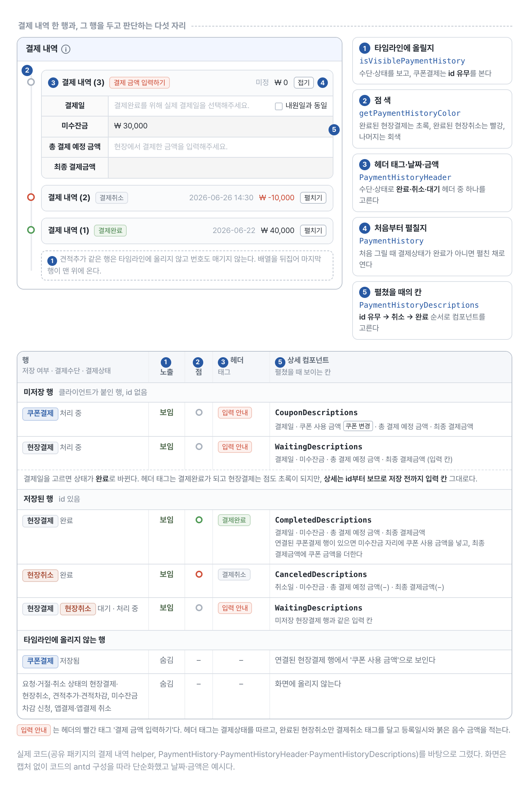
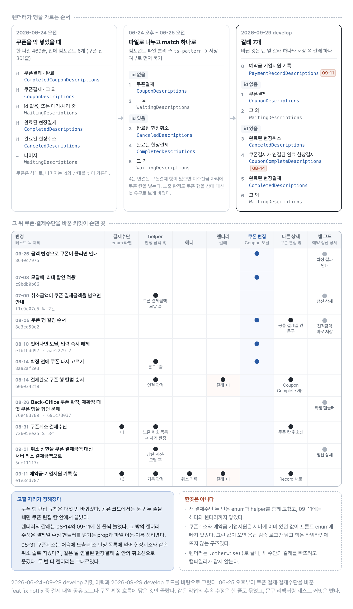

# 결제 내역에 쿠폰 결제를 추가하며 분기를 한곳으로 모은 과정

시술 결제 내역은 결제수단 하나만 보고 화면을 결정할 수 없었다. 다음 값이 함께 작용했다.

- 결제수단: 현장 결제, 취소, 쿠폰
- 결제상태: 처리 중, 대기, 완료
- 서버 저장 여부
- 쿠폰 선택 여부와 할인 금액

이 서비스는 결제 취소도 별도 거래 건으로 기록한다. 취소가 일어나면 기존 결제를 수정하는 대신 `method: 'CANCEL'`인 결제 내역이 새로 추가된다.

처음에는 쿠폰 타입과 렌더러 하나만 추가하면 될 거라 생각했다. 실제로는 결제 예정 금액이 바뀌면 선택한 쿠폰을 취소해야 했고, 저장 전후의 표시도 달랐다. 현장 결제 금액과 쿠폰 사용액을 함께 보여줘야 하는 경우도 있었다.

discriminated union으로 모든 상태를 모델링하려 했지만 서버 DTO는 enum과 optional field를 가진 단일 구조였고 알 수 없는 값의 fallback도 필요했다. 서버 계약을 다른 모양인 것처럼 단언하는 대신, 흩어진 판단을 몇 군데로 모으는 쪽으로 방향을 바꿨다.

글의 코드는 쿠폰을 처음 넣은 2026년 6월 24~25일의 모양을 줄인 것이다. 결제수단과 상태는 셋씩만 남겼고, 사용자 정의 이름은 공개용 가명이다. 당시 DTO에는 결제수단 8종과 상태 6종이 있었고, 2026년 9월 29일 develop에서는 결제수단이 15종이다. 그림은 9월 29일 develop 코드를 실제 이름으로 그렸다.

## 서버 DTO와 폼 모델을 구분하기

서버 응답은 다음처럼 하나의 DTO로 내려왔다.

```ts
interface PaymentHistoryResponse {
  id?: number | null;
  method: 'NORMAL' | 'CANCEL' | 'COUPON';
  status: 'PROCESSING' | 'WAITING' | 'COMPLETED';
  paymentAmount: number;
  paymentDate?: string | null;
  memberCouponId?: number | null;
  couponName?: string | null;
}
```

API가 이 구조를 보장하므로 client에서 다른 union인 것처럼 단언하지 않았다. 대신 편집 중에만 필요한 계산 값을 별도 client model에 추가했다.

```ts
interface PaymentHistoryFormValue extends PaymentHistoryResponse {
  couponDiscountAmount?: number | null;
}
```

`couponDiscountAmount`는 최종 결제 금액을 미리 보여주기 위한 값이고 서버에는 없다. 폼 모델은 서버 DTO에 이 필드 하나를 더한 타입이다. 확정 요청은 미저장 쿠폰 행에서 필요한 필드만 이름으로 골라 만들기 때문에 할인 금액과 쿠폰명은 요청에 실리지 않는다.

```ts
const couponPayment = payments.find(
  ({ id, method }) => method === 'COUPON' && id == null,
);
if (!couponPayment) return;

confirmReservation({
  reservationId,
  paymentAmount: couponPayment.paymentAmount,
  paymentDate: couponPayment.paymentDate,
  memberCouponId: couponPayment.memberCouponId,
  // 견적 금액·내원일·메모는 폼의 다른 칸에서 채운다.
});
```

폼 모델을 요청 DTO로 바꾸는 변환 함수는 따로 두지 않았다. 폼 전용 값은 optional 필드 하나이고, 그 값을 요청에서 빼는 일은 요청을 만드는 쪽이 필드를 골라 담으며 맡는다.

<figure class="figure-wide">
  
  <figcaption>폼의 결제 내역 배열에는 서버가 저장한 행과 화면이 붙인 대기·쿠폰 행이 함께 들어온다. 서버에 없는 값은 쿠폰 할인 금액 하나이고, 확정 요청은 미저장 쿠폰 행에서 필요한 필드만 골라 만든다.</figcaption>
</figure>

저장된 쿠폰결제 행은 따로 줄을 갖지 않는다. 같은 거래를 가리키는 현장결제 행 안에서 쿠폰 사용 금액으로 읽힌다.

## 화면 상태를 표로 정리하기

컴포넌트 안에 조건문을 늘리기 전에 화면에서 구분해야 할 상태를 표로 정리했다.

| 저장 여부 | 결제수단 | 상태 | 화면 |
| --- | --- | --- | --- |
| 미저장 | 쿠폰 | 처리 중 | 쿠폰 선택과 예상 결제 금액 |
| 미저장 | 그 외 | 처리 중 | 일반 결제 입력 |
| 저장 | 현장 결제 | 완료 | 완료 정보와 연결된 쿠폰 |
| 저장 | 취소 | 완료 | 취소 정보 |
| 저장 | 그 외 | 대기/처리 중 | 일반 대기 정보 |

노출 여부와 색상은 쿠폰 전부터 helper 함수로 나와 있었다. 색상 함수는 2026년 3월에 만들었고, 노출 조건 함수는 4월에 두 앱의 결제 내역 UI를 공통 패키지로 옮기며 만들었다. 쿠폰 조건은 그 함수에 더했고, 상세 컴포넌트 선택은 이 표의 순서대로 다시 짰다.

<figure class="figure-wide">
  
  <figcaption>한 결제 내역 행을 두고 노출·점 색·헤더·펼침·상세 칸을 다섯 곳에서 따로 판단한다. 표는 행의 저장 여부·결제수단·상태에 따라 각 자리가 내는 결과다.</figcaption>
</figure>

상세 칸은 id부터 보므로 결제일을 골라 상태가 완료로 바뀌어도 저장 전까지는 입력 칸이 그대로 남는다. 헤더와 점 색은 상태를 바로 따르기 때문에, 같은 행이 잠시 '결제완료' 태그와 입력 칸을 함께 보여준다.

## 노출 조건을 도메인 함수로 모으기

```ts
const VISIBLE_STATUSES = ['COMPLETED', 'PROCESSING', 'WAITING'] as const;
// as const만 쓰면 includes의 인자가 'NORMAL' | 'CANCEL'로 좁혀져
// payment.method를 받지 못하므로, 원소 타입을 method 전체 union으로 선언한다.
const VISIBLE_METHODS: readonly PaymentHistoryResponse['method'][] = [
  'NORMAL',
  'CANCEL',
];

function isVisiblePayment(payment: PaymentHistoryResponse | undefined) {
  if (!payment) return false;

  const isVisibleSavedPayment =
    VISIBLE_STATUSES.includes(payment.status) &&
    VISIBLE_METHODS.includes(payment.method);

  const isEditingCoupon =
    payment.method === 'COUPON' && payment.id == null;

  return isVisibleSavedPayment || isEditingCoupon;
}
```

저장된 쿠폰 행은 완료된 현장 결제에 연결해 보여주므로 별도의 타임라인 항목에서는 제외한다. 이 조건은 4월에 JSX filter callback에서 함수 하나로 옮겨 두었으므로, 쿠폰 조건도 그 함수 안에 더했다.

## 렌더러 선택을 한곳에 모으기

```tsx
import { P, match } from 'ts-pattern';

const isCanceledPayment = (payment: PaymentHistoryResponse) =>
  payment.method === 'CANCEL';

const isCompletedNormalPayment = (payment: PaymentHistoryResponse) =>
  payment.method === 'NORMAL' && payment.status === 'COMPLETED';

function PaymentHistoryDescriptions({ payment, index }: Props) {
  return match(payment)
    .with(
      { id: P.nullish, method: 'COUPON' },
      () => <CouponDescriptions index={index} />,
    )
    .with(
      { id: P.nullish },
      () => <WaitingDescriptions payment={payment} />,
    )
    .when(isCanceledPayment, () => (
      <CanceledDescriptions payment={payment} />
    ))
    .when(isCompletedNormalPayment, () => (
      <CompletedDescriptions payment={payment} />
    ))
    .otherwise(() => <WaitingDescriptions payment={payment} />);
}
```

`ts-pattern`이 모든 누락을 막아주는 것은 아니다. 입력 타입이 완전한 판별 유니언이 아니고 마지막에 `.otherwise()`도 있으므로, 새 결제수단에 필요한 UI를 빠뜨려도 컴파일러가 전부 잡지는 못한다. 대신 쿠폰은 상태로, 나머지는 id와 상태를 섞어 가르던 if 문을 저장 여부로 먼저 묶은 match 하나로 바꿔, 어떤 행이 어느 컴포넌트로 가는지 한곳에서 읽을 수 있게 됐다.

모든 경우를 컴파일 단계에서 검사하려면 API 응답을 파싱해 클라이언트 도메인의 유니언으로 바꾸고 `.exhaustive()`를 사용해야 한다. 이번에는 서버 계약과 기존 화면의 영향 범위를 고려해 거기까지 확장하지 않았다.

## 쿠폰에만 필요한 동작은 별도 컴포넌트에 둔다

```tsx
function CouponDescriptions({ index }: { index: number }) {
  const { message } = App.useApp();
  const form = paymentForm.useFormInstance();
  const paymentAmount = paymentForm.useWatch(['payments', index, 'paymentAmount'], form);
  const memberCouponId = paymentForm.useWatch(['payments', index, 'memberCouponId'], form);
  const couponDiscountAmount =
    paymentForm.useWatch(['payments', index, 'couponDiscountAmount'], form) ?? 0;

  const finalAmount = (paymentAmount ?? 0) - couponDiscountAmount;

  // 금액은 Form.Item이 폼에 쓰고, 여기서는 적용된 쿠폰만 푼다.
  const handlePaymentAmountChange = () => {
    if (memberCouponId == null) return;

    form.setFields([
      { name: ['payments', index, 'memberCouponId'], value: null },
      { name: ['payments', index, 'couponName'], value: null },
      { name: ['payments', index, 'couponDiscountAmount'], value: 0 },
    ]);
    message.info('현장 결제금액이 변경되어 적용된 쿠폰이 초기화되었습니다.');
  };

  return (
    <>
      <CouponSelector index={index} />
      <Form.Item name={[index, 'paymentAmount']} noStyle>
        <InputNumber onChange={handlePaymentAmountChange} />
      </Form.Item>
      <FinalAmount value={finalAmount} />
    </>
  );
}
```

`paymentForm`은 antd `Form`을 결제 내역 폼의 필드 타입으로 감싼 래퍼(가명)다. `useWatch`와 `setFields`는 antd Form API를 그대로 쓴다. 편집 중인 값은 폼이 소유하므로 `CouponDescriptions`는 과거의 `payment` 스냅샷 대신 현재 폼 경로를 가리키는 `index`를 받는다.

일반 결제 컴포넌트는 쿠폰 초기화나 할인 계산을 모른다. 반대로 타임라인과 헤더는 쿠폰 선택 모달의 세부 동작을 모른다.

<figure class="figure-wide">
  
  <figcaption>확정 전 쿠폰 행에서 총 결제 예정 금액을 바꾸면 쿠폰이 즉시 풀리고, 입력칸을 벗어날 때와 결제 내역 확정을 누를 때 선택 모달이 다시 뜬다. 확정 뒤 저장된 행은 CouponCompleteDescriptions가 결제 전과 같은 칼럼 순서로 그린다.</figcaption>
</figure>

글의 `handlePaymentAmountChange`는 6월 25일 모양이다. 안내 문구의 '현장 결제금액'은 7월 1일에 '총 결제 예정 금액'으로 바뀌었다. 토스트만으로는 쿠폰이 풀린 채 확정되는 경로가 남아, 8월에 입력칸을 벗어날 때와 제출 직전에 모달을 다시 띄우는 단계를 더했다. 세 단계 모두 `CouponDescriptions` 안에 있다.

## 바꾸고 나서 남은 것

쿠폰을 처음 넣은 6월 24일 오전에는 기존 렌더러 파일에 if를 더했다. 같은 날 오후부터 결제 내역별 설명 컴포넌트를 파일로 나누고, 렌더러 선택을 match 하나로 정리했다.

쿠폰을 추가하면서 이미 함수로 모여 있던 노출 조건에 쿠폰 조건을 더했고, 렌더링 분기는 저장 여부로 먼저 묶은 match 하나로 정리했다. 선택·초기화·금액 계산은 쿠폰 컴포넌트가 맡고, 편집 중에만 필요한 할인 금액은 확정 요청에 싣지 않는다.

새 결제수단이 생기면 기존 렌더러도 수정해야 하므로 OCP를 달성했다고 표현하지는 않는다. 대신 수정할 위치가 예측 가능해졌다.

<figure class="figure-wide">
  
  <figcaption>렌더러의 갈래는 쿠폰을 처음 넣은 날 여섯 개의 if에서 저장 여부로 먼저 묶은 match로 바뀌었고, 이후 두 번 한 줄씩 늘었다. 아래 표는 그 뒤 쿠폰·결제수단 변경이 어느 코드에 닿았는지 커밋별로 보인다.</figcaption>
</figure>

글의 렌더러 코드는 6월 25일 모양이고, 지금은 기록 행과 쿠폰이 연결된 완료 행 갈래가 더해져 일곱 갈래다. 쿠폰 편집 규칙 변경은 쿠폰 편집 칸 안에서 끝났지만, 새 결제수단은 enum·helper·헤더·렌더러까지 함께 고쳐야 했다. 다음 작업은 `결제수단 × 상태 × 저장 여부` 조합을 테이블 기반 테스트로 고정하는 것이다.
