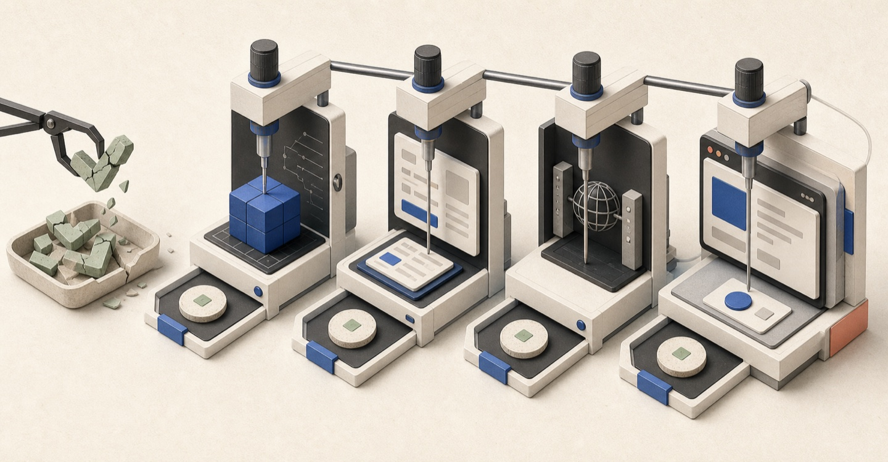

# 테스트를 전부 지운 뒤 다시 만든 기준

<figure class="figure-wide">
  
  <figcaption>테스트 개수가 아니라 각 성공 결과가 무엇을 보장하는지 다시 정의했어요</figcaption>
</figure>

<div class="note note-summary">
  <strong>이 글에서 다루는 것</strong>
  <p>제품을 검증하지 못하던 테스트를 2026년 4월에 모두 지우고, 7월에 다시 들이면서 단위·통합·live 계약·E2E의 책임을 나눈 기준을 다뤄요. 거짓 성공을 만든 Harness와 Mock을 어떻게 발견했고 무엇으로 바꿨는지가 중심이에요. 관리자 서비스 모노레포, 복지몰, 글로벌 서비스 사례가 섞여 있어 나올 때마다 어느 쪽인지 밝혀요.</p>
</div>

2026년 4월, 관리자 서비스 모노레포와 복지몰 두 저장소에서 Vitest 테스트 파일 23개(관리자 서비스 15개, 복지몰 8개)를 모두 지웠어요. 테스트가 싫어서는 아니었어요. 사라진 화면을 계속 가리키는 테스트, 실제 API와 다른 Mock, `1 + 1`이 `2`인지만 보는 예제가 섞여 있어서 테스트가 통과해도 무엇을 믿어야 할지 알 수 없었거든요.

석 달 뒤인 7월 20일에는 반대로 테스트를 다시 들였어요. 관리자 서비스 모노레포에서는 8월 7일까지 19일 동안 테스트 파일이 102개가 됐고(develop 기준, 그중 43개는 같은 저장소에 있는 글로벌 서비스 CMS), 이후 기능 개발과 회귀 대응을 하며 계속 늘렸어요. 2026년 8월 27일 develop 마지막 머지 기준 테스트 파일 수는 이랬어요.

- 관리자 서비스 모노레포: 일반 단위·통합 테스트 181개, dev API 서버에 붙는 `live` 테스트 23개(글로벌 CMS 8개 포함), Playwright E2E 7개
- 복지몰: Vitest 단위·컴포넌트 테스트 70개, Playwright E2E 9개

파일 수만 보면 처음의 선택과 모순돼 보여요. 달라진 건 테스트에 대한 태도가 아니라 "테스트 성공이 무엇을 보장하는가"를 구분하는 기준이었어요. 다시 들인 테스트에서도 거짓 성공은 나왔거든요. 원인과 바꾼 것, 확인한 결과를 먼저 적으면 이래요.

- **원인**: 요청 본문을 보지 않고 무엇이든 200으로 받아 주는 Mock, 제품의 제출 로직을 복제한 Harness, 책임이 옮겨 가도 제자리에 남은 테스트였어요.
- **바꾼 것**: 백엔드 DTO의 제약을 Mock에 옮기고, 등록되지 않은 요청은 에러로 끝나게 했어요. Harness 대신 실제 등록 Drawer를 렌더하고, 책임을 옮기면 테스트도 함께 옮기고, 새 테스트는 제품 코드를 일부러 틀리게 바꿔 실패하는지 확인했어요.
- **확인한 결과**: 7월 21일 제출 로직을 복제한 Harness 4개를 걷어냈어요. 7월 29일에는 Mock에서 통과하던 등록이 dev API 서버에서 거절된 원인(보내지 않던 필수 코드 값, 이름이 다른 enum)을 고쳤고, 그 코드 값을 빼면 통합 테스트가 실패하는 것도 확인했어요. 8월 19일에는 항상 통과하던 빈 단언을 찾아 책임이 옮겨 간 자리에서 되살렸고, 8월 28일에는 없는 문구가 사라지길 기다려서 늘 곧바로 통과하던 E2E 대기를 고쳤어요.

앞의 파일 수는 그 시점의 개수이지 CI가 매번 보장하는 범위는 아니에요. 당시 두 저장소의 PR 게이트는 lint와 타입 검사뿐이었어요. 관리자 서비스는 9월 1일 PR 게이트에 Vitest를 붙였어요. 게이트에 테스트가 없어서 깨진 테스트 6건이 develop에 쌓여도 드러나지 않았거든요. 그런데 CI 러너가 dev 환경과 한 인스턴스를 함께 써서, 전 패키지 MSW 테스트가 dev 환경까지 멈추게 했어요. 그래서 9월 16일 MSW 통합 테스트는 CI에서 빼고 push 직전 변경분 게이트에서만 돌게 했어요. 지금(2026년 9월 28일 develop 기준) 관리자 서비스 CI는 lint·타입 검사·Knip, MSW를 쓰지 않는 단위 테스트, dev API 서버 live 테스트(실패해도 PR은 막지 않아요)를 돌리고, 복지몰 CI는 lint·타입 검사·Knip까지예요. E2E는 두 저장소 모두 CI에서 돌지 않아요. 테스트의 개수, 실행 환경, 자동화 범위를 같은 성과처럼 묶지 않으려고 해요.

## 테스트를 소스 옆에 뒀어요

지운 테스트는 별도 디렉터리에 모여 있었어요.

```text
src/
  __test__/
    __mocks__/
    app/
    common/
```

도메인 코드를 옮겨도 테스트는 따라오지 않았어요. 오래된 화면의 테스트는 남고 새 화면에는 테스트가 없었죠. 그래서 다시 도입할 때는 대상 파일 옆에 두는 걸 기본 규칙으로 정했어요.

```text
program-form.tsx
program-form.test.tsx
```

파일을 옮기거나 지우면 테스트도 같은 diff에서 눈에 띄어요. 그래도 위치 규칙 하나로 충분하지는 않았어요. 8월 14일 글로벌 CMS 목록 화면의 탭·신규 등록·Drawer 책임을 목록 View에서 `page.tsx`로 올렸는데, 테스트는 여전히 목록 View만 단독으로 렌더하고 있었어요. 그릴 DOM이 없으니 테스트 8건이 깨진 채 남았고, "id가 없으면 Drawer가 닫혀 있다"는 단언은 Drawer가 아예 그려지지 않아 항상 통과하고 있었어요. 8월 19일에 옮겨간 계약을 `page.tsx` 옆 테스트로 되살리고, "책임을 옮기면 테스트도 옮긴 자리로 함께 옮긴다"를 관리자 서비스 `AGENTS.md`의 작업 원칙에 적었어요.

## 테스트 계층마다 확인할 범위를 나눴어요

테스트 종류가 많을수록 안전해진다고 생각하기 쉬워요. 하지만 같은 동작을 여러 계층에서 반복하면 실행 비용만 커지고, 각 계층의 한계를 모르면 성공 결과를 과신하게 돼요.

검증 책임은 이렇게 나눠요.

- 단위 테스트는 순수 함수, Zod 스키마, 상태 전이와 경곗값을 확인해요.
- 컴포넌트·통합 테스트는 실제 UI와 Query, 폼, MSW 계약이 연결되는지 확인해요.
- `*.live.test.ts(x)`는 Mock과 dev API 서버의 계약이 어긋났는지 확인하는 마지막 수단이에요.
- Playwright E2E는 직접 URL 진입, 새로고침, 뒤로 가기, 쿠키와 서버 게이트처럼 브라우저에서만 드러나는 흐름을 맡아요.

서버 컴포넌트나 Provider가 많이 필요한 화면을 억지로 jsdom에 올리지는 않아요. 컴포넌트 안의 계산을 순수 함수로 분리해 단위 테스트하거나, 실제 브라우저가 필요한 문제라면 E2E로 옮겼어요.

## 첫 통합 테스트는 제품 코드를 검증하지 않았어요

7월 20일, 글로벌 CMS의 첫 통합 테스트에서는 폼 필드만 렌더하고 제출 처리는 Harness가 대신 실행했어요. 아래 코드는 공개용으로 줄였고 이름도 바꿨어요.

```tsx
function CreateHarness({ onCreated }: { onCreated: (id: number) => void }) {
  // 등록 Drawer가 하는 변환·요청을 테스트가 다시 쓰고 있었다
  const handleFinish = async (values: PartnerFormValues) => {
    const { id } = await createPartner(toRequest(values));
    onCreated(id);
  };

  return <PartnerFormFields initialValues={initialValues} onFinish={handleFinish} />;
}
```

보기엔 편했지만 테스트가 프로덕션의 제출 로직을 복제하고 있었어요. 실제 등록 Drawer의 제출 처리가 깨져도 Harness만 맞으면 테스트가 통과했죠. 만든 다음 날 이런 Harness 네 개를 모두 지우고, 실제 등록 Drawer를 렌더해 프로덕션 경로를 타도록 바꿨어요.

테스트 코드의 중복보다 더 위험한 건 테스트가 제품의 결정을 대신하는 경우였어요. Provider나 라우터처럼 화면을 준비하는 코드는 공통화할 수 있지만, 무엇을 언제 서버로 보낼지는 제품 코드만 갖게 했어요.

## 무엇이든 받아 주는 Mock을 서버 계약으로 착각했어요

글로벌 서비스는 백엔드 API가 준비되기 전부터 MSW로 개발했어요. 문제는 handler가 요청 본문을 검사하지 않고 무엇이든 200으로 받아 줬다는 거예요. 7월 28~29일 글로벌 CMS를 dev API 서버에 붙여 보니 통합 테스트를 모두 통과한 등록 요청이 여러 도메인에서 거절됐어요. 파트너 등록은 입력 UI가 없던 순서 값이 빠졌고, 7일을 모두 요구하는 운영시간 규칙에 걸렸어요. 프로그램 등록에서는 서버가 필수로 받는 코드 값을 프론트엔드가 서버가 만들어 주는 값으로 보고 아예 보내지 않았고, 가격 정책 enum은 값 이름부터 서버와 달랐어요. Mock 시드도 서버의 초기 데이터와 따로 자라고 있었어요. 글로벌 서비스 사용자 화면(CMS와 다른 저장소)의 '전체' 카테고리 탭은 Mock 시드에만 있던 행이라 dev API 서버에서는 사라졌는데, E2E는 그 탭이 서버에서 온다는 틀린 전제로 통과하고 있었어요.

그래서 백엔드 DTO와 validation에서 확인한 제약만 Mock에 옮겨, 서버가 거절하는 요청은 Mock도 400으로 거절하게 했어요. 아래 코드는 공개용으로 줄였고 `partnerId`는 가명이에요.

```ts
// 서버 DTO가 거절하는 조건만 옮긴다
function programViolations(body: ProgramSaveRequest): Violation[] {
  const violations: Violation[] = [];
  const required = (field: keyof ProgramSaveRequest, isValid: boolean) => {
    if (!isValid) violations.push({ field, code: 'VALIDATION.REQUIRED' });
  };

  required('partnerId', Boolean(body.partnerId));
  required('programCode', Boolean(body.programCode?.trim()));

  if (body.listPrice < body.salePrice) {
    violations.push({ field: 'validPrice', code: 'VALIDATION.INVALID' });
  }

  return violations;
}

http.post('/programs', async ({ request }) => {
  const body = (await request.json()) as ProgramSaveRequest;
  const violations = programViolations(body);

  if (violations.length > 0) {
    return errorJson(400, 'COMMON.VALIDATION_FAILED', violations);
  }

  return ok({ id: programStore.create(body) });
});
```

등록되지 않은 요청은 `onUnhandledRequest: 'error'`로 실패하게 했어요. 화면을 열었을 때 자식 컴포넌트가 새 API를 호출해도 handler가 없으면 그 요청이 에러로 끝나 바로 드러나요. Mock을 편의용 가짜 백엔드가 아니라, 프론트엔드가 지금 이해한 서버 계약을 적어 두는 계층으로 쓴 거예요.

고친 뒤에는 요청에서 그 코드 값을 빼 보고 기존 통합 테스트가 실패하는 걸 확인했어요. dev API 서버에 붙는 live 테스트도 도메인마다 값을 모두 채운 입력과 최소 입력을 함께 돌려 통과시켰고요. 8월 4일에는 글로벌 CMS Mock 시드의 진료 분야·카테고리·언어·지역 코드를 서버 초기 데이터에 맞췄어요. 진료 분야 코드는 서버와 겹치는 값이 하나도 없었어요.

그래도 Mock이 계약의 정본은 아니에요. dev API 서버에서 새로운 제약을 발견하면 폼 검증과 Mock handler, 통합 테스트에 다시 반영해 다음 작업부터 로컬에서 먼저 실패하게 했어요.

## dev API 서버를 우선하고 Mock은 만들기 어려운 상태에 썼어요

기능을 dev API 서버에서 확인할 수 있다면 그 환경을 먼저 써요. API 계약과 데이터가 실제로 연결된 상태를 볼 수 있으니까요. Mock은 로그인 단계, 특정 오류 응답, 빈 목록처럼 dev API 서버에서 안전하고 반복적으로 만들기 어려운 조건을 고정할 때 썼어요.

복지몰의 회원가입 E2E도 모든 요청을 Mock으로 바꾸지 않았어요. 사용자 상태와 인증 흐름처럼 테스트가 직접 제어해야 하는 요청만 MSW가 처리하고, 나머지 요청은 dev API 서버로 보냈어요.

관리자 서비스 모노레포에서는 dev API 서버 검증이 필요한 테스트를 일반 Vitest 실행과 분리해 `*.live.test.ts(x)`와 별도 설정으로 돌려요. 일반 테스트처럼 MSW가 켜진 채로 live 테스트가 돌면 서버를 검증했다고 착각할 수 있거든요. dev API 서버는 계정과 데이터를 여럿이 함께 쓰니 파일을 직렬로 실행하고, 다른 사람의 데이터를 임의로 바꾸는 흐름은 자동화하지 않았어요.

live 테스트에서 계약 차이를 발견했다고 live 테스트만 늘리지도 않아요. 확인한 제약은 다시 로컬 Mock과 기존 테스트로 되돌려요. live 테스트는 계약 차이를 발견하는 보조 장치이지, 가장 많은 시나리오를 돌리는 계층이 아니에요.

예외도 있어요. 글로벌 CMS는 9월에 dev API 테스트 러너를 걷어내면서, 돌릴 수단이 없어진 live 테스트 파일도 같이 지웠어요. 남겨 두면 그 계약이 여전히 확인되고 있다고 착각하게 되니까요. 지금은 서버 규칙을 옮긴 Mock으로만 확인해요.

## 새 테스트가 실제로 실패하는지 확인했어요

테스트를 다시 도입한 초기에는 새로 보호한 경로의 제품 코드를 일부러 틀리게 바꿔 봤어요. 결제 금액 계산이라면 이런 식이에요.

```ts
// 정상
const finalAmount = paymentAmount - couponDiscount;

// 테스트 확인을 위해 잠시 변경
const finalAmount = paymentAmount + couponDiscount;
```

새 테스트가 실패하는 걸 확인한 뒤 제품 코드를 되돌렸어요. 앞의 Mock 사례에서 코드 값 전송을 빼 본 것도 같은 확인이에요. 자동 mutation testing을 구축한 건 아니고, 모든 테스트에 적용했다고 말할 수도 없어요. 다만 새 패턴을 만들 때는 "테스트를 추가했다"와 "그 테스트가 회귀를 잡는 걸 확인했다"를 구분했고, 이 확인은 관리자 서비스 `AGENTS.md`에 뮤테이션 체크라는 원칙으로 남겼어요.

단언 한 줄이 아무것도 확인하지 않는 경우도 있었어요. 내부 CMS의 광고 배너 등록 E2E는 '업로드 중...' 문구가 사라지길 기다리고 있었는데, 저장소 어디에도 없는 문구라 Playwright가 곧바로 통과시켰어요. 이미지 값이 폼에 실리기 전에 다음 단계로 넘어갈 수 있었던 거예요. 8월 28일 코드 리뷰에서 드러났고, 실제 업로드 진행 항목이 사라지는 걸 기다리도록 고쳤어요.

리팩터링에서는 순서도 중요했어요. 먼저 현재 동작을 테스트로 고정하고 구조를 바꿨어요. 구현을 바꾼 뒤 테스트를 쓰면 새 동작을 그대로 정답으로 만들 수 있거든요.

## E2E는 브라우저에서만 보이는 경계에 뒀어요

복지몰의 회원가입 퍼널은 URL 직접 진입, 새로고침, 뒤로 가기와 인증 상태가 함께 움직였어요. 함수 테스트만으로는 이 조합을 확인하기 어려웠죠. 순서대로 가입하는 흐름뿐 아니라 중간 URL로 바로 들어가거나, 로그아웃한 뒤 다시 들어오거나, 팝업이 차단된 조건을 Playwright로 확인했어요.

URL만 맞다고 성공으로 보지도 않았어요. 로그아웃한 뒤 주소는 로그인 화면으로 바뀌었는데 화면에는 에러 페이지가 떠 있을 수 있거든요.

```ts
await page.getByRole('button', { name: '로그아웃' }).click();

await expect(page).toHaveURL(/\/sign(\?|$)/);
await expect(page.getByRole('button', { name: '카카오로 계속하기' })).toBeVisible();
```

리다이렉트 목적지와 실제 화면을 함께 확인해야 가드나 화면이 깨졌을 때 테스트가 실패해요. E2E의 가치는 브라우저를 띄웠다는 데 있지 않고, 사용자가 실제로 보게 되는 결과를 단언하는 데 있었어요.

한 앱에서 끝나지 않는 흐름은 두 앱을 잇는 E2E로 봤어요. 파트너용 관리자의 프로그램 등록·검수 요청과 내부 CMS의 검수 화면은 처음 만들 때 테스트가 없었고, 테스트 체계를 들인 뒤인 9월 1일에 등록부터 검수중 전환·반려·승인까지 이어지는 E2E를 추가했어요. 두 앱을 함께 띄우고 dev API 서버를 그대로 호출해요. 과정은 [AI 작업 흐름을 다룬 글](https://jingeon27.tistory.com/34)에 적었어요.

실행 환경도 하나로 고정하지 않았어요. 복지몰 E2E는 기본적으로 Next 개발 서버를 띄워요. 8월 10일 프로덕션 빌드로 돌리는 경로도 열었는데, 온디맨드 컴파일이 없어 훨씬 빠르지만 쿠키를 읽는 정적 생성 라우트가 동시 요청에서 500으로 떨어지는 문제가 남아 기본으로 두지 못했어요. 내부 CMS 목록의 Router Cache 회귀처럼 개발 서버와 jsdom에서 재현되지 않는 문제는 로컬 프로덕션 빌드로 따로 확인했어요([27번 글](https://jingeon27.tistory.com/27)).

## 테스트에서는 핵심 행동이 보이도록 반복을 남겼어요

제품 코드에서는 공통화를 자주 검토하지만 테스트에서는 시나리오를 한눈에 읽는 쪽을 우선해요. 복지몰 검색 화면 E2E의 한 장면이에요(실제 테스트에는 이벤트 전송 확인이 더 붙어 있고, 헬퍼 이름은 공개용으로 바꿨어요).

```ts
await gotoSearchPage(page);

await page.getByRole('button', { name: '특가전', exact: true }).click();

await expect(page).toHaveURL(/hasEvent=true/);
```

필터를 누르고 URL을 확인하는 동작이 다른 테스트에도 반복되지만, 핵심 행동을 `expectFilterScenario()` 같은 범용 헬퍼 안에 숨기지 않았어요. 화면 진입이나 로그인처럼 이 테스트의 관심사가 아닌 준비만 감췄어요. 테스트 이름과 본문에서 입력, 행동과 기대 결과를 바로 읽을 수 있어야 AI가 보고한 "성공"의 의미도 빠르게 확인할 수 있었거든요.

테스트 도입 초기에는 AI가 작성한 테스트 코드도 모두 읽었어요. 제품 코드를 복제한 Harness, 항상 통과하는 단언, 서버와 다른 Mock이 섞이면 테스트 성공이 오히려 잘못된 확신을 만드니까요. 작성 방식과 계층이 자리 잡은 뒤에는 테스트에 사용자 조건·행동·기대 결과가 드러나는지, 요구사항에서 빠진 조건은 없는지, 실행한 테스트와 실패 원인을 중심으로 검토 범위를 바꿨어요.

## 병렬 작업에서는 전체 검증을 매번 돌리지 않았어요

여러 worktree에서 전체 lint, 타입 검사와 테스트를 동시에 돌리면 CPU 경합이 크게 생겼어요. 관리자 서비스 모노레포에서는 한 번의 전체 lint가 여러 패키지를 함께 검사하고, linked worktree마다 Turbo와 TypeScript 캐시가 다시 만들어지거든요. 실제로 여러 검증이 겹치면서 프로세스가 강제 종료돼 통과인지 실패인지조차 판정할 수 없는 상황이 있었어요.

그래서 각 작업의 worktree를 유지한 채, 요구사항과 plan을 확인한 뒤 테스트 작성 → 구현 → 에이전트 코드리뷰 → 변경분 테스트·lint·타입 검사 → 제 코드리뷰 → 로컬에서 제품 확인 → 전체 CI → QA 더블 체크 요청 순서로 진행해요. 어느 단계에서든 문제가 나오면 원인에 맞는 앞 단계로 돌아가요. 전체 lint·타입 검사·Knip은 push 뒤 CI가 다시 돌리고, CI가 실패한 작업은 완료로 처리하지 않아요.

로컬 검증도 도구마다 범위가 달라요. ESLint는 변경 파일만, 테스트는 변경 파일에 딸린 것만 보고, Knip은 두 저장소 모두 전체 참조 그래프를 봐요. 타입 검사는 복지몰에서는 앱 전체를, 관리자 서비스에서는 변경 파일이 속한 패키지를 보고, 공용 패키지의 API를 바꿨으면 그 패키지를 쓰는 앱도 함께 검사해요. 타입 검사를 "변경 파일만 본다"고 표현하면 의존 관계를 놓치게 돼요.

검증 범위를 줄인 이유는 AI 코드를 믿어서가 아니라 같은 검사를 여러 세션이 중복 실행하지 않기 위해서였어요. 이 실행 전략과 테스트가 보장하는 범위는 별개 문제로 다뤘어요.

## 지금 테스트가 통과한다는 말의 범위

<div class="note note-decision">
  <strong>다음 변경에서도 읽을 수 있는 계약</strong>
  <p>Vitest와 브라우저 E2E 모두 조건·행동·기대 결과가 본문에 드러나게 써요. 준비 코드는 공유하되 핵심 행동과 단언은 본문에 남겨요. 9월부터는 두 저장소 모두 새 테스트의 파일 이름도 나눠서, 동작 명세는 `*.spec`, 버그 재현은 `*.test`로 둬요. 다음 작업자가 테스트를 열었을 때 무엇을 바꾸면 안 되는지, 실패하면 제품과 Mock 중 어느 계약을 확인해야 하는지 알 수 있게 하려는 기준이에요.</p>
</div>

- 단위 테스트 통과는 변환, 상태 전이와 도메인 경곗값이 유지됐다는 뜻이에요.
- MSW 통합 테스트 통과는 실제 컴포넌트가 프론트엔드가 지금 이해한 계약과 연결됐다는 뜻이에요.
- live 테스트 통과는 자동으로 만들고 정리할 수 있는 범위에서 dev API 서버와 계약이 맞았다는 뜻이에요.
- E2E 통과는 선택한 브라우저 흐름에서 사용자에게 보이는 결과가 유지됐다는 뜻이에요.

이 네 가지가 있다고 제품 전체가 검증되는 건 아니에요. 사용자 데이터가 필요한 흐름, 브라우저에서 직접 확인해야 하는 UI, 운영에서만 생기는 조건은 여전히 남아요. 테스트가 없는 범위는 없는 그대로 말하고 직접 확인해요.

AI에게 작업을 맡길 때도 같은 기준을 써요. 성공 조건이 코드로 적힌 구간은 병렬로 맡길 수 있지만, 그 조건이 서버의 실제 계약인지 테스트가 복제한 가짜 계약인지는 따로 확인해야 해요.

처음 테스트를 지운 이유도, 다시 만든 이유도 같았어요. 성공하는 테스트를 늘리는 것보다, 그 성공이 무엇을 보장하고 무엇은 보장하지 않는지 설명할 수 있어야 했어요.

<div class="note note-limit">
  <strong>아직 확인하지 못한 것</strong>
  <p>테스트 파일 수는 품질 개선율이나 장애 감소율이 아니에요. 수동 뮤테이션 확인은 일부 변경에만 했고, 전체 테스트의 결함 탐지율은 재지 않았어요. 글로벌 CMS는 9월부터 Mock으로만 확인해서, 서버 계약이 바뀌면 사람이 Mock을 고치기 전까지 그 차이를 잡지 못해요. 관리자 서비스의 MSW 통합 테스트는 9월 16일부터 CI가 아니라 push 전 변경분 게이트에서만 돌고, 복지몰 테스트와 두 저장소의 E2E는 CI에서 돌지 않아요. 브라우저 자동화는 자체 검증의 일부이고, Stage 배포 뒤 QA는 사람이 화면을 확인하는 과정으로 남아 있어요. 이 구조가 동료의 유지보수 시간을 얼마나 줄였는지도 측정하지 못했어요.</p>
</div>

## 참고

- [MSW — `server.listen()`의 `onUnhandledRequest`](https://mswjs.io/docs/api/setup-server/listen)
- [Playwright — Page assertions (`toHaveURL`)](https://playwright.dev/docs/api/class-pageassertions)
- 관련 글: [Next.js에 맡기던 동작을 클라이언트로 옮기며 치른 비용](https://jingeon27.tistory.com/27)
- 관련 글: [AI 작업의 판단과 검증을 나눈 과정](https://jingeon27.tistory.com/34)
- 관련 글: [타입 단언을 걷어내다 다시 세운 실패 정책](https://jingeon27.tistory.com/35)
