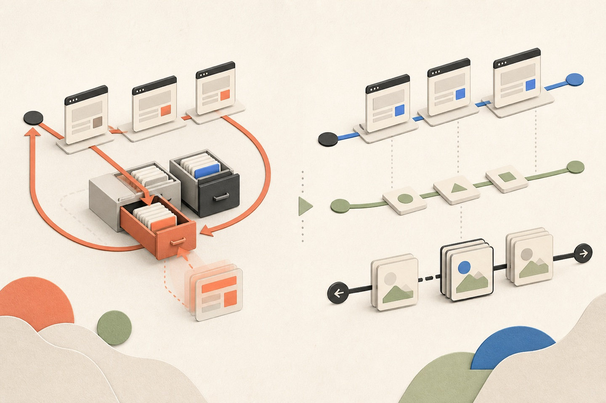

# Nextjs를 사용하면서 겪었던 이슈들

<figure class="figure-wide">
  
  <figcaption>프로덕션 전용 캐시 회귀를 계기로 URL 상태의 소유권을 다시 나눴습니다</figcaption>
</figure>

<div class="note note-summary">
  <strong>이 글에서 다루는 것</strong>
  <p>개발 서버에서는 보이지 않던 Router Cache 회귀를 프로덕션 빌드에서 재현하고, 서버가 읽지 않는 조회 조건을 Query와 History API가 소유하도록 내비게이션을 다시 설계한 과정을 다룹니다.</p>
</div>

Nextjs를 사용하며, 관련된 문제를 세 번 만났습니다. 라우터 캐시, 프록시, 서버 액션에서 각각 문제가 생겼는데요. 원인은 달랐지만 대응 과정에서 서버나 프레임워크에 맡기던 일부 동작을 클라이언트로 옮겼습니다.

각 수정은 당장 필요한 문제를 해결했지만, 비용은 나중에 다른 화면에서 드러났습니다.

## 조회 조건을 바꿔도 주소가 바뀌지 않았다

stage 환경에서 관리자 목록 화면 검색이 안 된되는 이슈가 있었습니다. 실제로 조건을 고르고 검색을 눌러도 목록이 그대로였습니다. 조건 없이 들어와서 검색하면 멀쩡했고, 조회 조건이 이미 주소에 붙어 있는 상태로 들어왔을 때만 그랬습니다. 새로고침했거나 공유받은 링크로 들어온 경우입니다.

`router.replace`를 부르는데 주소창이 안 바뀌었습니다.

원인은 라우터 캐시였습니다. 이 화면들은 서버 렌더에서 `searchParams`를 읽지 않습니다. 목록은 전부 클라이언트가 조회하는데요. 그런데 캐시를 쓸 때 키로 삼는 값이 요청 URL의 검색 문자열이 아니라 서버가 실제 렌더에 사용한 검색 문자열이었습니다. `searchParams`를 안 읽는 라우트에서는 이 값이 항상 빈 문자열입니다. 그래서 `/a?foo=bar`로 들어온 요청이 파라미터 없는 `/a`가 찾아가는 슬롯에 캐시를 남겼습니다. 이 엔트리에는 요청 URL이 그대로 저장돼 있어서, 나중에 `router.replace('/a')`가 이 슬롯을 맞히면 옛 검색 문자열이 주소창과 `useSearchParams()`에 되살아납니다.

같은 증상이 업스트림에도 [#92187](https://github.com/vercel/next.js/issues/92187), [#91658](https://github.com/vercel/next.js/issues/91658)로 올라와 있습니다. 위 설명은 수정 PR인 [#94144](https://github.com/vercel/next.js/pull/94144)에 적힌 내용입니다.

목록에서 행을 눌러 상세를 열 때는 직전에 있던 파라미터 없는 주소가 캐시에 있어서 정상으로 보였습니다. 상세 주소로 바로 들어오면 캐시에 남아 있는 게 행 링크들이 미리 프리페치해 둔 `?id=…` 주소뿐이라, 파라미터를 지워도 원래 주소로 돌아갔습니다. 상세 Drawer가 안 닫히던 것도 원인이 같았습니다.

확인하는 방법을 찾는 데 시간이 걸렸습니다. 테스트부터 짰는데 전부 통과했습니다. 테스트 코드를 읽어봐도 이상한 데가 없었고요. jsdom 위에서 도는 테스트도, 개발 서버도 이 문제를 보지 못합니다. 라우터 캐시가 프로덕션 빌드에서만 이렇게 동작하기 때문입니다.

그래서 확인을 `pnpm build && pnpm start`로 바꿨습니다. 프로덕션 빌드를 띄워놓고 보니 관리자 목록 7개 중 6개가 검색을 눌러도 주소가 전혀 바뀌지 않았습니다. 올라온 이슈에도 빌드 산출물에서만 재현된다고 적혀 있습니다.

고친 방법은 네이티브 history를 쓰는 것이었습니다.

```ts
/**
 * 쿼리 파라미터만 바뀐 주소로 바꾼다.
 *
 * `router.replace` 를 쓰면 안 된다. 이 화면들은 서버 렌더에서 searchParams 를 읽지 않아
 * 라우터 캐시가 검색 문자열과 무관하게 재사용되고, 그 과정에서 캐시에 담긴 주소가 그대로 커밋된다.
 */
export function replaceUrl(url: string) {
  window.history.replaceState(null, '', url);
}

/** 뒤로가기로 되돌아갈 조건 변경(검색 등)은 엔트리를 남긴다. */
export function pushUrl(url: string) {
  window.history.pushState(null, '', url);
}
```

네이티브 history는 Next 라우터에 연결돼 있어서 `usePathname`과 `useSearchParams`가 바로 갱신됩니다. 이 화면들은 어차피 서버에 다시 물어볼 게 없으니 이쪽이 맞았습니다.

### 이 해법은 앞선 리팩터링 위에서만 성립합니다

원래 이 화면들은 서버가 `ensureQueryData`로 조회한 결과를 props로 내려 그리는 구조였습니다. 그 구조에서는 주소만 바꾸는 해법이 애초에 성립하지 않습니다. 쿼리를 읽어 다시 조회하는 주체가 서버뿐이라, 목록을 새로 받으려면 서버 내비게이션을 시작하는 것 말고는 방법이 없습니다. `replaceState`를 불러도 주소만 바뀌고 목록은 그대로입니다.

그 전에 서버가 `prefetchQuery` + `HydrationBoundary`로 초기 캐시만 채우고, 클라이언트 View가 같은 query option을 `useQuery`로 구독하도록 바꿔둔 상태였습니다. 데이터 소유권이 클라이언트로 넘어가 있으니 **주소가 바뀌면 클라이언트가 스스로 다시 조회합니다.** 그래서 "서버에 다시 묻지 않고 주소만 바꾼다"는 선택지가 열렸습니다.

순서를 바꿔 말하면, 이 리팩터링을 먼저 하지 않았다면 라우터를 쓸 수밖에 없었고 버그도 계속 안고 갔을 겁니다.

### 그리고 이건 우회가 아닙니다

버전이 올라가 라우터 캐시 버그가 고쳐지면 `router.replace`는 "동작은 합니다". 그래도 돌아갈 이유가 없습니다.

같은 경로에서 쿼리만 바꾸는데 라우터 내비게이션을 태우면, 캐시가 맞지 않는 순간 **서버가 RSC 페이로드를 다시 만들고 클라이언트는 그에 딸린 JS 청크를 다시 받습니다.** 화면에서 실제로 바뀌는 건 목록 한 덩어리인데 사용자는 네트워크와 파싱 비용을, 서버는 렌더 비용을 다시 치릅니다. 검색·필터·탭처럼 연달아 누르는 자리에서는 이 왕복이 그대로 반복됩니다.

History API는 그 왕복을 만들지 않습니다. 주소만 바꾸고, 주소를 구독하는 쿼리가 필요한 데이터만 새로 받습니다. **같은 경로 + 서버가 읽지 않는 쿼리라면 버전과 무관하게 이쪽이 맞습니다.**

## 정작 고쳐진 버전으로는 올릴 수 없었다

이 버그는 16.3.0에서 이미 수정됐습니다. 릴리즈 노트 Core Changes에 `Bugfix: Incorrect search params stored in cache: #94144`로 올라와 있고, 캐시를 쓸 때 요청 URL의 검색 문자열을 키로 쓰도록 바꾼 게 수정 내용입니다.

그래서 버전을 올리려고 했는데 다른 게 걸렸습니다.

16.3.0부터 Turbopack이 client reference manifest의 `moduleLoading.crossOrigin`을 `null`이 아니라 문자열 `"none"`으로 직렬화합니다. 옵션 타입이 열거형으로 바뀌면서 기본값 `None`이 그대로 문자열이 돼서 나갔습니다.

```text
16.2.12  "moduleLoading":{"prefix":"","crossOrigin":null}
16.3.0   "moduleLoading":{"prefix":"","crossOrigin":"none"}
```

React Flight는 이 값이 `use-credentials`가 아닌 문자열이면 전부 `""`(anonymous)로 바꿉니다. 그래서 설정 파일에 `crossOrigin`을 적은 적이 없어도 SSR에서 preinit되는 클라이언트 컴포넌트 청크의 `<script>`에 `crossorigin=""`이 붙고, 브라우저는 그 청크를 CORS 모드로 받아옵니다.

- 이슈: [#96831](https://github.com/vercel/next.js/issues/96831)
- 수정: [#97164](https://github.com/vercel/next.js/pull/97164)

수정은 `null`로 되돌리는 게 아니라 `CrossOrigin::None`일 때 필드를 아예 직렬화하지 않는 방식입니다. 8월 12일에 canary에 머지돼서 `v16.3.1-canary.14`에 들어갔는데요. 안정 릴리즈에는 아직 없습니다. `v16.3.1` 태그의 매니페스트 소스를 열어보면 생략 옵션이 안 붙어 있습니다. 16.3.0부터 16.3.1까지는 같은 증상을 그대로 안고 있는 셈입니다.

구분해야 할 게 하나 있습니다. 업스트림 이슈가 다루는 상황은 cross-origin `assetPrefix`로 CDN을 쓰는 경우입니다. 저희는 `assetPrefix`를 쓰지 않습니다. cross-origin을 만든 건 프록시였습니다.

특정 prefix로 들어온 요청을 다른 도메인이 받게 프록시를 설정해 뒀는데, matcher가 `_next` 하위 번들 요청까지 잡고 있었습니다. 그래서 그 도메인에서 불러온 JS 번들이 원본 도메인으로 리다이렉트됐고, 여기에 `crossorigin=""`이 겹치면서 CORS로 막혔습니다. 번들이 리다이렉트되는 것 자체는 버전과 상관없이 로컬에서도 프로덕션에서도 일어나던 일입니다. 16.3이 그걸 드러냈을 뿐입니다.

근본 대응은 프록시 matcher에서 `_next` 같은 정적 경로를 빼는 것이었습니다. 도메인을 강제해야 하는 건 페이지 라우트뿐입니다. matcher를 고친 뒤로는 재현되지 않습니다. cross-origin 리다이렉트가 없어지니 이슈의 조건 자체가 성립하지 않기 때문입니다.

그런데도 당분간은 16.2.x에 있기로 했습니다. 같은 조건은 다른 앱의 다른 설정에서도 만들어질 수 있고, 업스트림 수정이 안정 릴리즈에 담기기 전까지는 `crossorigin=""`이 아예 안 붙는 버전에 있는 편이 비용이 적다고 봤습니다.

여기서 버전 업그레이드와 URL 설계를 분리해서 보게 됐습니다. 버전은 올릴 때가 되면 올리면 되고, URL 설계 쪽은 버전이 올라가도 답이 바뀌지 않습니다. 앞 절에 적은 대로 같은 경로의 쿼리 변경은 계속 History API로 둡니다. **되돌릴 항목이 아니라 유지할 결정입니다.**

라우터가 조회 조건 변경을 알아야 하는 기능이 생기면 그때 다시 봅니다. 그건 버전 문제가 아니라 요구사항 문제입니다.

## 탭을 오래 열어둔 사용자가 서버 액션에서 막혔다

병원 관리자 앱의 공지 배너는 쿠키로 노출 여부를 정합니다. 물려받은 구현에서 이 쿠키가 httpOnly·secure였고, 그래서 읽고 쓰는 걸 서버 액션이 하고 있었습니다.

탭을 띄워둔 채로 배포가 지나가면 그 탭에서 서버 액션 호출이 404가 났습니다. 서버 액션 ID는 빌드 산출물에 묶여 있어서 새로 배포하면 대체로 ID도 새로 생깁니다. 문서에는 소스가 그대로여도 최대 14일 주기로 회전한다고 돼 있습니다. 오래된 탭이 들고 있는 ID는 새 빌드에 없습니다. 사용자 입장에서는 아무것도 안 했는데 어느 순간부터 배너가 안 닫히는 상황이었습니다.

Next에 대응이 없는 건 아닙니다. `deploymentId`를 설정해두면 클라이언트와 서버의 배포 ID가 어긋날 때 하드 내비게이션으로 전환돼서 오래된 탭이 새 빌드로 올라옵니다. 문서는 여기에 롤링 배포와 "이 오류를 하드 실패가 아니라 재시도 경로로 노출하라"를 같이 권합니다. 다만 어느 쪽도 오래된 ID를 살려주지는 않습니다. 저희가 고민한 건 쿠키를 읽고 쓰는 경로를 어디에 둘 것이냐였습니다.

하나는 Route Handler로 옮기는 것입니다. `/api/...` 경로는 빌드 ID에 묶이지 않으니 배포가 지나가도 404가 나지 않고, httpOnly도 그대로 유지할 수 있습니다.

다른 하나는 클라이언트가 직접 읽고 쓰는 것입니다. 쿠키에서 httpOnly를 벗깁니다.

두 번째를 택했는데, 이유는 공지 쿠키가 아니라 토큰 쪽에 있었습니다. 요청 인터셉터가 모든 요청에서 accessToken을 읽어야 하는데 그때마다 서버를 왕복하고 싶지 않았습니다. 그래서 accessToken과 공지 토큰을 같이 클라이언트로 내렸습니다.

공지 쿠키만 떼어놓고 보면 이 이유가 성립하지 않습니다. 배너를 열지 말지는 요청마다 읽는 값이 아니니까요. Route Handler로 옮겼으면 httpOnly를 유지한 채로 404만 없앨 수 있었습니다. 두 쿠키를 같은 방식으로 다루려다 안 해도 될 노출을 같이 만들었습니다. 부채로 적어둡니다.

서버 액션을 걷어낸 이유가 하나 더 있습니다. 서버 액션 안에서 쿠키를 바꾸면 Next가 현재 페이지와 레이아웃을 서버에서 다시 렌더해서, 그 RSC 페이로드를 액션 반환값과 같은 응답에 실어 보냅니다. 브라우저가 통째로 새로고침되는 건 아니고 UI가 언마운트되지도 않습니다. 클라이언트 상태는 그대로 남습니다. 그래도 배너 한 번 닫는 데 서버 렌더가 한 번 더 붙습니다. 이 비용을 측정하지는 않아서 부하가 컸다고 쓰지는 않겠습니다. 없어도 되는 왕복이라고 봤을 뿐입니다.

토큰 쪽도 같이 정리했습니다.

- 서버 액션으로 읽어서 클라이언트가 `Authorization` 헤더에 싣던 흐름을 걷어내고, 재발급은 Route Handler가 맡는 BFF 방식으로 바꿨습니다.
- refreshToken은 httpOnly로 남깁니다. 브라우저가 재발급 요청에 알아서 실어 보내고, 라우트 핸들러가 그걸 읽습니다.
- accessToken이 없으면 로그아웃시키던 동작을, refreshToken으로 재발급을 한 번 시도하도록 바꿨습니다. 이전 세션이 남긴 httpOnly accessToken은 클라이언트가 읽을 수 없어서, 그대로 두면 배포 직후에 멀쩡한 세션이 전부 끊깁니다.

마지막 항목에는 반대 방향의 함정이 있습니다. 브라우저는 쿠키를 이름·도메인·경로로 구분합니다. 이름이 같아도 속성이 다르면 옛 쿠키와 새 쿠키를 둘 다 들고 있고 요청에도 둘 다 실어 보냅니다. 클라이언트에서 쿠키를 쓸 때 경로를 지정하지 않으면 현재 문서 경로가 기본값이라, 서버가 쓰던 경로와 다른 쿠키가 생기기 쉽습니다. 그러면 클라이언트에는 새 값만 보이는데 서버는 옛 값을 집을 수 있습니다. 이건 "accessToken 없음"이 아니라 "오래된 accessToken 있음"이라서 위의 폴백에 걸리지 않습니다. 클라이언트에서 쓸 때 도메인과 경로를 서버가 쓰던 것과 똑같이 맞추거나, 이름을 새로 파고 옛 쿠키를 명시적으로 만료시켜야 합니다.

이 폴백은 마이그레이션용입니다. 이전 세션의 httpOnly 쿠키가 다 없어지면 되돌립니다. 되돌릴 시점을 적어두지 않으면 "accessToken 없음"이 정상 경로로 굳어버리고, 세션이 끝났는지를 refreshToken 만료만으로 판단하게 됩니다.

### 클라이언트로 내리면서 늘어난 위험

accessToken을 JS가 읽을 수 있게 한 이상, 반출 조건은 "XSS가 나면"보다 넓습니다. 페이지에서 도는 스크립트는 다 읽을 수 있습니다. 서드파티 태그, 콘텐츠 스크립트를 가진 브라우저 확장, 번들에 딸려 들어온 의존성까지 전부 해당합니다. 취약점이 하나도 없어도 클라이언트 관측 도구가 쿠키나 요청 헤더를 자동으로 수집하면 토큰이 제3자 서버로 나갑니다.

서버 쪽 토큰 만료 주기를 줄이긴 했는데, 이건 차단이 아니라 노출되는 시간을 줄이는 완화입니다. 그마저도 기대만큼 듣지 않습니다. 재발급 경로를 페이지에서 부를 수 있는 이상 공격자도 같은 경로로 갱신하면 되기 때문입니다. 실제 노출 창은 accessToken 수명이 아니라 refreshToken 수명에 가깝습니다.

"refreshToken은 httpOnly니까 안전하다"도 절반만 맞습니다. httpOnly는 토큰 값을 훔쳐서 다른 데서 쓰는 걸 막지, 페이지 안에서 쓰이는 것까지 막지는 못합니다. 브라우저가 쿠키를 알아서 실어 보내니까 페이지에서 도는 코드는 재발급 경로를 호출하기만 하면 됩니다.

지금 실제로 줄인 건 서버 쪽 만료뿐입니다. 재발급 경로에 제약을 거는 일은 아직 하지 않았습니다. 서버 액션을 걷어내서 배포와 무관하게 도는 경로를 얻었고, 대신 이 목록이 생겼습니다.

## 주소를 기준으로 삼자 폼이 따라오지 않았다

조회 조건을 주소에서 관리하기로 했다면 폼도 주소를 따라가야 합니다. 처음에는 진입 시점의 주소로 폼을 한 번만 채웠습니다.

```tsx
// 진입 시점의 주소가 폼의 초기값이다. 이후 주소 변경은 폼을 건드리지 않는다.
const [initialValues] = useState(() => ({ ...defaultValues, ...currentParams }));
```

목록은 주소를 매 렌더 읽는데 폼은 읽지 않습니다. 그래서 뒤로가기를 누르면 목록만 이전 조건으로 돌아가고 검색바에는 방금 입력한 값이 남아 있습니다. 화면에 보이는 조건과 목록이 어긋나는 거죠.

주소가 바뀌면 폼도 되돌리도록 고쳤습니다. rc-field-form은 `initialValues`가 바뀌어도 이미 저장된 폼 값을 갱신하지 않으므로 직접 초기화해야 합니다.

```tsx
const paramsKey = JSON.stringify(currentParams);
const initialValues = useMemo(() => ({ ...defaultValues, ...currentParams }), [paramsKey]);

useEffect(() => {
  form.resetFields();
}, [form, initialValues]);
```

아직 남은 문제가 있습니다. 폼을 되돌리는 기준이 주소 파라미터 전체라는 점인데요. 조회 조건 스키마에는 페이지 번호와 상세 Drawer의 ID처럼 폼이 소유하지 않는 키도 들어 있습니다.

그래서 검색어를 입력해놓고 제출하기 전에 행을 눌러 Drawer를 열었다 닫으면, 주소의 id가 붙었다 빠지면서 입력하던 값이 사라집니다. 페이지를 넘겨도 마찬가지고요. 테스트로 재현했습니다.

```text
Expected: 검색어B   Received: 검색어A
```

고칠 방향은 트리거를 폼이 소유한 키로 좁히는 것입니다. 초기화 쪽에서 이미 폼 키와 주소 전용 키를 구분하고 있으니 그 구분을 한 군데로 모으면 됩니다. 아직 고치지는 않았습니다.

## 프레임워크가 상태를 대신 남겨줘서 폼이 비워지지 않았다

사용자 웹에서는 반대 방향의 문제가 나왔습니다. 사이트맵 생성 비용 때문에 Cache Components를 켰는데 라우트 상태 보존이 딸려왔습니다.

Next는 이동할 때 이전 페이지를 언마운트하지 않고 React의 `<Activity>`로 감춥니다. DOM이 `display: none` 상태로 문서에 남아 있어서 React 상태도 DOM 상태도 그대로 보존됩니다. [문서](https://nextjs.org/docs/app/guides/preserving-ui-state)에 따르면 최근 라우트 3개까지 들고 있다가 그 뒤로는 오래된 것부터 버립니다.

예약 신청과 상담 신청 폼이 제출하고 뒤로가기를 하면 입력값을 그대로 들고 있었습니다.

폼마다 고치는 대신 공용 폼 훅 한 군데서 처리했습니다. 이 앱의 폼은 전부 이 훅을 지나거든요.

```ts
export function useSchemaForm({ schema, ...props }) {
  const form = useForm({ ...props, resolver: zodResolver(schema) });
  const { reset } = form;

  // Cache Components 는 떠난 라우트를 언마운트하지 않고 <Activity> 로 숨겨 입력값을 그대로 보존한다.
  // 폼은 들어올 때마다 새로 시작해야 하므로 화면이 숨겨질 때 초기값으로 되돌린다.
  useIsomorphicLayoutEffect(() => reset, [reset]);

  return form;
}
```

짧은 코드지만 정한 게 몇 가지 있습니다.

cleanup 함수로 `reset`을 그대로 넘겼습니다. Activity가 컴포넌트를 감출 때 React가 언마운트와 똑같이 cleanup을 실행하니까, 숨겨지는 시점이 곧 되돌릴 시점입니다.

layout effect로 붙인 건 타이밍 때문입니다. 다시 보이는 시점에 되돌리면 이전 입력이 한 프레임 보였다가 사라집니다. 서버에서도 도는 코드라 `useLayoutEffect` 대신 isomorphic 버전을 썼습니다.

되돌아갈 곳은 빈 폼이 아니라 마운트 시점의 `defaultValues`입니다. 들어올 때 자동으로 정해지는 값이 있어서인데요. 예약 신청 화면은 진입하면 혜택이 가장 큰 쿠폰을 미리 골라두는데, 초기화가 빈 폼으로 떨어지면 이 값까지 지워집니다. 그래서 초기값을 서버 데이터에서 받는 폼은 데이터가 확정된 다음에 마운트해야 합니다. 조회가 끝나기 전에는 화면을 그리지 않습니다.

테스트로 고정해둔 건 이렇습니다.

- 입력한 값을 그대로 들고 있는다.
- 리렌더만으로는 입력이 지워지지 않는다.
- 화면이 정리되면 초기값으로 되돌아간다.
- 되돌아간 값은 빈 폼이 아니라 초기값이다.

`bfcacheId`라는 API도 있습니다. 키로 주면 되는 줄 알았는데 [문서](https://nextjs.org/docs/app/api-reference/functions/use-router#bfcacheid)를 보니 아니었습니다.

> `bfcacheId`는 push나 replace로 세그먼트가 새로 만들어질 때 바뀌고, 뒤로가기·앞으로가기와 `router.refresh()`, 검색 파라미터나 해시만 바뀌는 이동에서는 유지된다.

폼 페이지는 제출할 때 push로 떠나는 거지 새로 만들어지는 게 아닙니다. 뒤로가기로 돌아오면 같은 세그먼트가 복원되니까 `bfcacheId`도 그대로고 키도 바뀌지 않습니다. 제출하고 뒤로가기하는 이 시나리오에는 듣지 않는 거죠. 완료 화면에서 폼으로 push해서 다시 들어가는 흐름이라면 세그먼트가 새로 만들어져 키가 바뀌지만, 문서는 그 경우에도 새로 짜는 코드라면 명시적으로 리셋하거나 데이터에서 뽑은 key를 쓰라고 하고 `bfcacheId`는 마지막 수단으로 둡니다.

## 우회를 걷어낼 조건

언제 걷어낼지 적어두지 않으면 우회가 그대로 굳습니다.

- 매니페스트 수정이 담긴 안정 릴리즈가 나오면 버전을 올린다.
- 이전 세션의 httpOnly accessToken이 다 없어지면 재발급 폴백을 되돌린다.
- 폼을 되돌리는 트리거를 폼이 소유한 키로 좁힌다.
- 공지 쿠키는 Route Handler로 옮겨 httpOnly를 되찾는다.

History API는 이 목록에 없습니다. 라우터 캐시 버그 때문에 시작했지만, 같은 경로에서 서버가 읽지 않는 쿼리를 바꾸는 데 서버 왕복을 붙이지 않는다는 건 버그와 무관하게 맞는 선택이었습니다. **버그가 계기였을 뿐 이유는 아니었던 셈입니다.**

CORS도 폼 초기화도 결정 하나가 잘못돼서가 아니라 각각 맞는 결정 둘이 만나는 자리에서 어긋났습니다. 이 작업으로 프레임워크 의존이 없어진 건 아닙니다. 대신 어디까지가 프레임워크 몫이고 어디부터가 내 몫인지는 전보다 분명해졌습니다.
