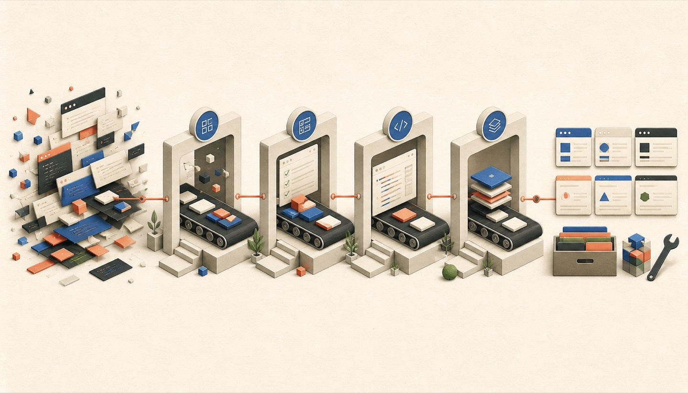

# Compound Engineering으로 코드 검토 위치를 바꿔 온 과정

<figure class="figure-wide">
  
  <figcaption>한 번의 작업에서 얻은 판단을 다음 작업의 시작점으로 만드는 과정</figcaption>
</figure>

<div class="note note-summary">
  <strong>이 글에서 다루는 것</strong>
  <p>AI가 작성한 모든 코드를 읽던 단계에서 시작해, 반복되는 판단을 Skill·테스트·lint에 축적하고 계획과 최종 diff를 중심으로 검토 위치를 바꾼 과정을 다룹니다.</p>
</div>

제 AI 개발 워크플로는 한 번에 설계한 자동화가 아니었습니다. 한 작업에서 발견한 실패와 반복되는 판단을 skill·테스트·lint에 남기고, 다음 작업은 그 기준 위에서 시작하도록 점진적으로 보강해 왔는데요. 지금 말하는 [Compound Engineering](https://every.to/guides/compound-engineering), 즉 한 번의 작업이 다음 작업을 더 쉽게 만드는 방식에 가깝습니다.

지금은 여러 AI 세션에 작업을 나누고, 구현 전에 plan을 검토한 뒤 코드 작성과 테스트·리뷰·push를 이어서 맡기고 있습니다. Stage 배포 전에는 그동안 합쳐진 diff 전체를 다시 읽으며 리팩터링하는데요. 하지만 처음부터 이렇게 일한 것은 아니었습니다.

초기에는 지금과 같은 테스트 체계도 없었고 AI가 작성한 코드를 거의 모두 읽었습니다. 프로젝트의 폼과 Query, FSD 경계, UI 구성 방식이 프롬프트 한 번으로 재현될 만큼 정리돼 있지 않았고, 당시 모델도 긴 작업에서 제 스타일을 안정적으로 유지하지 못했는데요. 코드 생성은 빨랐지만 제가 다시 고치는 시간이 길었습니다.

리뷰에서 반복된 판단을 그 작업의 수정으로만 끝내지는 않았습니다. 폼을 어디에 두는지, Query option과 캐시 무효화를 어떻게 연결하는지, 어떤 UI를 공용 컴포넌트로 올리는지 같은 기준을 먼저 skill에 보강했습니다. 이후 테스트를 다시 도입했고, lint로 판정할 수 있는 기준은 실행 규칙으로 옮겼는데요. 다음 작업에서는 같은 설명과 같은 리뷰를 반복하지 않기 위해서였습니다.

별도의 방법론을 한 번에 도입한 것이 아니라, 다음 순환을 반복하면서 현재 흐름에 도달했습니다.

```text
작업 실행
  → 코드와 결과 검토
  → 반복될 판단을 skill·테스트·lint에 반영
  → 다음 작업은 보강된 기준에서 시작
```

모델 성능도 함께 좋아졌습니다. 축적된 skill과 기존 코드의 패턴을 읽은 모델이 제 코드 스타일과 판단 기준에 가까운 결과를 내기 시작했는데요. 처음에는 모든 코드를 검토했지만, 패턴이 안정된 부분부터 직접 검토하는 범위를 줄였습니다. 현재 plan 중심의 검토가 가능한 이유는 모델을 무조건 신뢰해서가 아니라, 모델의 향상과 저장소에 축적한 기준이 함께 작동하기 때문입니다.

현재 흐름은 다음과 같습니다.

```text
사람이 Jira 티켓·Figma·선행 조건 확인
  → 불명확한 요구사항과 UX 방향 협의
  → 에이전트가 관련 코드와 기존 패턴 탐색
  → 구현 plan과 추가 판단이 필요한 지점 제안
  → 사람이 plan 검토·승인
  → 격리된 worktree에서 테스트와 구현
  → Playwright MCP로 실제 화면 진입·스크린샷 비교
  → AI 코드 리뷰
  → Critical 자동 수정
  → 변경 파일 lint·typecheck·관련 테스트
  → push·PR 반영·develop 병합
  → Stage 배포 전 누적 diff 전체 검토·리팩터링
  → 배포 후 발견한 반복 패턴을 skill·lint·공통 구현에 반영
```

## 티켓을 에이전트에게 바로 넘기지 않았습니다

작업은 여전히 제가 Jira 티켓을 읽는 것부터 시작합니다. Figma가 있으면 화면과 컴포넌트 상태까지 먼저 확인하는데요. 요구사항이 명확하지 않으면 구현을 시작하기 전에 기획·디자인·백엔드 담당자와 기준을 맞췄습니다.

- API나 데이터 준비처럼 먼저 끝나야 할 작업이 있는가
- Figma와 티켓의 동작 설명이 서로 일치하는가
- 현재 화면보다 사용자 행동을 더 단순하게 만들 방법이 있는가
- 모바일·오류·빈 상태처럼 시안에 빠진 조건은 무엇인가
- 일정 안에서 반드시 지켜야 할 범위와 조정 가능한 범위는 어디인가

더 나은 UX가 보이면 코드에서 조용히 바꾸지 않고 구현 전에 제안했습니다. 제품 요구사항과 화면 방향을 정리한 뒤에야 에이전트가 코드베이스를 조사하게 했는데요. 에이전트는 이미 합의한 요구사항을 기준으로 영향 범위와 구현 순서를 만들고, 코드 관점에서 추가로 판단이 필요한 지점을 찾아냅니다.

## 코드 리뷰를 자동화하기 전에 계획을 구조화했습니다

Jira 티켓을 작업 계획으로 바꾸는 skill에는 다음 네 가지를 남기게 했습니다.

```markdown
## 작업 plan

### 티켓 요약
- 무엇을 바꾸려는 작업인가

### 영향 범위
- 관련 도메인과 FSD 레이어
- 변경 가능성이 있는 파일과 역할

### 작업 순서
1. 기존 동작과 가장 가까운 구현 확인
2. 타입·API·상태 경계 수정
3. 성공 조건과 회귀 테스트 작성
4. UI 구현과 검증

### 검토 필요
- 기존 패턴으로 처리할 수 없는 기술적 선택
- 캐시·상태 소유권처럼 구현에 따라 동작이 달라지는 부분
- 결제·인증·개인정보처럼 검증 수준을 높여야 하는 변경
```

에이전트는 plan을 보여 준 뒤 멈춥니다. 사람의 판단이 필요한 지점도 제가 하나씩 미리 지시하는 것이 아니라, 티켓과 기존 코드를 조사한 에이전트가 plan 안에 표시하는데요. 저는 사전에 합의한 제품 요구사항이 구현 계획에 제대로 반영됐는지와 표시된 결정 지점을 확인합니다.

이 단계에서는 코드가 아직 없기 때문에 방향을 바꾸는 비용이 작습니다. 반대로 구현이 끝난 뒤 잘못된 전제를 발견하면 코드와 테스트를 함께 버려야 합니다.

제가 주로 보는 것도 파일 이름의 정확성보다 plan의 전제입니다.

- 합의한 요구사항을 실제 사용자 행동으로 제대로 번역했는가
- 기존 데이터의 소유권과 아키텍처 경계를 잘못 이해하지 않았는가
- 성공 조건이 정상 경로만 확인하고 있지는 않은가
- 실패했을 때 피해가 큰 지점과 쉽게 되돌릴 수 있는 변경을 구분했는가

사람의 역할을 없앤 것이 아니라, 사람이 가장 적은 비용으로 방향을 바꿀 수 있는 시점으로 옮긴 셈입니다.

## Figma 구현은 실제 화면의 일치율을 종료 조건으로 삼았습니다

Figma 관련 판단은 먼저 `design-system` skill에 쌓았습니다. 실제 문서에는 다음과 같은 기준이 들어 있습니다.

- 새 마크업을 만들기 전에 `@core`, 공용 UI와 기존 아이콘을 먼저 찾습니다.
- Figma의 px·hex 값을 그대로 넣지 않고 프로젝트의 색상·간격·z-index 토큰으로 옮깁니다.
- 폰트 토큰에 포함된 line-height를 두고 Figma의 행간을 임의 값으로 다시 강제하지 않습니다.
- 시안의 문구가 예시인지 실제 카피 변경인지 확인하고, 기존의 동적 문구 로직을 임의로 지우지 않습니다.
- 아이콘은 내부 Vector 하나가 아니라 전체 래퍼를 가져오고 `currentColor`와 원래 viewBox를 유지합니다.

반면 Playwright MCP를 이용한 스크린샷 비교는 이 문서에 적힌 규칙이 아니라 제가 별도로 운용하는 실행 루프인데요. Figma 화면을 구현하는 작업은 코드가 완성됐다는 이유로 끝내지 않았습니다. 에이전트가 실제 개발 화면에 들어가 대상 상태를 만들고 스크린샷을 찍은 뒤, 그 결과를 Figma와 비교해 레이아웃, 간격, 타이포그래피, 색상, 아이콘, 반응형 배치와 상호작용 상태를 수정했습니다.

```text
Figma와 구현 대상 상태 확인
  → 실제 개발 화면 진입
  → 스크린샷 캡처
  → 차이 목록 작성
  → 코드 수정
  → 같은 viewport와 상태에서 다시 캡처
```

이 반복의 종료 조건은 일치율 100%입니다. 여기서 100%는 자동 이미지 도구가 계산한 픽셀 유사도 수치가 아닌데요. 비교 대상으로 정한 viewport와 상태에서 Figma와 다른 항목이 체크리스트에 남아 있지 않다는 뜻입니다. 데스크톱 한 장만 맞추는 것이 아니라 작업 범위에 포함된 모바일 화면과 열림·선택·오류 같은 상태도 각각 확인합니다.

초기에는 이 비교 결과도 제가 직접 보면서 누락된 상태와 과한 수정 범위를 잡았습니다. 반복하면서 디자인 토큰, 공용 UI 사용법과 자주 틀리는 항목을 skill에 옮겼는데요. 이후에는 에이전트가 스크린샷 비교와 수정 루프를 스스로 반복할 수 있게 했습니다.

## worktree는 병렬 실행보다 컨텍스트 격리를 위해 썼습니다

여러 세션을 띄우면 가장 먼저 생기는 문제는 속도가 아니라 작업 디렉터리 충돌인데요. 한 세션이 브랜치를 바꾸거나 의존성을 수정하면 다른 세션은 자신이 보던 코드와 다른 상태에서 검증을 시작합니다.

각 작업은 별도의 Git worktree에서 실행하게 했습니다. 에이전트는 브랜치를 만들고, 로컬 환경 파일을 복사하고, 의존성을 설치한 뒤 그 경로 안에서만 편집·테스트·커밋합니다.

```text
main working tree
├── worktree/task-a
├── worktree/task-b
└── worktree/task-c
```

이 구조의 장점은 세션 수를 늘릴 수 있다는 것보다, 각 세션이 어떤 코드와 환경을 기준으로 판단했는지가 분리된다는 데 있었습니다. 코드 리뷰에도 worktree의 절대 경로를 전달해 다른 브랜치의 diff를 읽지 않게 했습니다.

## 변경 파일만 검증한 이유는 신뢰가 아니라 CPU였습니다

여러 worktree에서 세션을 동시에 돌리자 새로운 병목이 생겼습니다. 각 세션이 저장소 전체의 lint와 typecheck를 함께 실행하면 CPU 사용량이 치솟아 구현과 개발 서버까지 느려졌는데요. 그래서 각 작업에서는 변경한 파일의 lint와 typecheck만 실행하도록 범위를 줄였습니다.

이 선택은 에이전트가 만든 코드를 충분히 신뢰해서 검증을 생략한 것이 아니었습니다. 같은 시점에 여러 작업이 전체 저장소를 반복해서 검사하지 않도록 계산량을 제한한 것이었습니다. 당시에는 지금과 같은 테스트 체계를 도입하기 전이라 초기 검증은 변경 파일의 정적 검사와 직접 코드 검토가 중심이었습니다.

테스트를 도입한 뒤에는 변경과 관련된 테스트를 이 단계에 추가했습니다. 한 작업이 저장소 전체 테스트를 매번 점유하지 않도록 각 세션에서는 관련 테스트만 실행하고, 여러 작업이 합쳐진 결과는 Stage 배포 전 통합 diff 검토에서 다시 확인했습니다.

## 테스트는 에이전트의 성공 선언을 실행 가능한 조건으로 바꿨습니다

처음부터 테스트를 전제로 이 워크플로를 만든 것은 아니었습니다. AI 작업 방식과 skill을 먼저 운영했고, 테스트는 그다음에 도입했는데요. 코드와 정적 검사만으로는 에이전트가 말하는 `성공`의 범위를 명확하게 고정하기 어려웠기 때문입니다.

테스트를 도입한 뒤에는 plan이 승인되면 에이전트가 성공 조건과 회귀 위험을 테스트로 옮긴 뒤 구현하게 했습니다. 테스트는 입력, 사용자의 행동, 기대 결과가 한눈에 보이도록 선언적으로 작성했습니다.

```ts
it('쿠폰을 적용하면 결제 예정 금액이 할인 금액만큼 줄어야 한다', async () => {
  renderPaymentPage({ price: 100_000, couponDiscount: 20_000 });

  await user.click(screen.getByRole('button', { name: '쿠폰 적용' }));

  expect(screen.getByText('80,000원')).toBeVisible();
});
```

범용 헬퍼 안에 행동과 단언을 숨기기보다, 테스트 이름과 본문만 읽어도 무엇을 보장하는지 알 수 있게 했습니다. 에이전트가 `성공했다`고 보고했을 때 그 말이 어떤 조건의 성공인지 명령 결과에서 확인할 수 있어야 했기 때문입니다.

검증 환경은 실제 개발 서버를 우선합니다. 실제 API 계약과 데이터가 연결된 환경에서 확인할 수 있다면 그 결과를 먼저 보는데요. Mock은 로그인 상태나 오류 응답처럼 실제 서버에서 안전하고 반복적으로 만들기 어려운 조건을 재현할 때 사용합니다.

```text
실제 개발 서버에서 재현 가능
  → 실제 서버로 기능과 API 계약 확인

재현에 다른 사람의 데이터가 필요하거나 상태 통제가 어려움
  → Mock으로 조건을 고정해 회귀 검증
```

Mock에서 발견한 성공을 실제 계약의 성공으로 간주하지도 않습니다. Mock은 프론트엔드가 알고 있는 계약을 반복하는 도구일 뿐인데요. 실제 서버에서 새 제약을 발견하면 Zod 스키마와 Mock handler, 통합 테스트에 다시 반영해 다음 작업부터 로컬에서 먼저 실패하게 합니다.

## 처음에는 테스트 코드도 모두 읽었습니다

테스트 자동화를 도입한 초기에는 에이전트가 만든 테스트 코드와 실행 결과를 직접 확인했습니다. 제품 코드를 복제한 테스트, 항상 통과하는 단언, 실제 서버와 다른 Mock이 섞이면 테스트 성공이 오히려 잘못된 확신을 만들기 때문인데요.

대표적인 흐름에서는 제품 코드를 일부러 틀리게 바꿔 새 테스트가 실제로 실패하는지 확인하기도 했습니다. 모든 테스트에 자동 mutation testing을 적용한 것은 아니지만, 적어도 초기에 만든 패턴이 회귀를 잡는지는 직접 봤습니다.

이후 입력·행동·기대 결과를 드러내는 작성 방식과 테스트 계층이 안정되면서 검토 단위를 바꿨습니다. 지금은 매번 생성된 테스트의 모든 줄을 확인하기보다, plan의 성공 조건과 실행한 검증 명령, 실패한 경우의 원인을 봅니다. 테스트가 선언적으로 쓰여 있어야 이러한 신뢰 전환이 가능했습니다.

이것은 AI가 쓴 테스트를 무조건 믿는다는 뜻이 아닌데요. 이미 검증한 작성 규칙과 실행 환경 안에서 같은 형태의 작업이 반복될 때, 매번 같은 비용으로 다시 읽지 않는다는 뜻입니다.

## 리뷰어는 모두 찾고, 실행 단계에서 심각도를 판단했습니다

구현이 끝나면 별도의 코드 리뷰 에이전트가 기준 브랜치와의 diff를 읽습니다. 리뷰어에게 중요한 문제만 고르게 하지 않고, 발견한 내용을 Critical과 Warning으로 나눠 확신도와 함께 모두 보고하게 했는데요.

리뷰어가 처음부터 적게 보고하도록 만들면 진짜 결함도 함께 빠질 수 있습니다. 대신 다음 단계에서 심각도를 해석했습니다.

- Critical은 에이전트가 수정하고 관련 검증을 다시 실행합니다.
- Warning은 현재 요구사항과 실제 영향에 따라 반영 여부를 판단합니다.
- 반복되는 오탐은 해당 작업에서만 무시하지 않고 리뷰 규칙의 예외 조건으로 되돌립니다.

예를 들어 코드 형태가 비슷하다는 이유로 서로 다른 앱의 API 모듈을 공통화하라는 지적이 반복된 적이 있었습니다. 각 모듈은 엔드포인트와 응답 계약에 종속돼 있어 합치면 오히려 결합도가 높아졌는데요. 이런 권고는 매번 설명하는 대신 리뷰 규칙에 예외 조건으로 남겼습니다.

Critical 수정이 끝나면 변경한 파일의 lint와 typecheck, 관련 테스트를 실행합니다. 모두 통과하면 push하고 PR에 반영하는데요. 전체 저장소 검증을 생략할 만큼 코드가 안전하다고 본 것이 아니라, 병렬 세션의 CPU 경합을 피하면서 각 변경의 검증 책임을 분리한 것입니다.

## Stage 배포 전에는 누적 diff 전체를 다시 읽었습니다

plan을 앞에서 검토하고 테스트와 리뷰를 자동화했지만, 개별 작업의 diff를 전혀 보지 않게 된 것은 아닙니다. 여러 PR이 develop에 합쳐진 뒤 Stage에 배포하기 전에는 누적 diff 전체를 한 번에 읽었는데요. 각 작업만 볼 때는 자연스러웠던 코드도 함께 놓고 보면 중복된 추상화, 서로 다른 이름, 불필요하게 갈라진 패턴이 보였습니다.

이 단계에서는 기능을 다시 설계하기보다 프로젝트 전체의 일관성을 기준으로 리팩터링했습니다. plan에서는 요구사항과 구조적 결정을 일찍 확인하고, Stage 전에는 실제로 합쳐진 코드가 하나의 제품 코드처럼 읽히는지 확인하는 식으로 검토 목적을 나눴습니다.

배포가 끝난 뒤에도 아쉬운 코드 스타일이나 반복될 가능성이 있는 패턴을 발견하면 해당 파일만 고치고 끝내지 않았습니다. 기존 코드에도 같은 문제가 있는지 확인하고, 필요하면 skill과 ESLint 규칙, 공통 구현 패턴을 함께 바꿨는데요. 한 번의 리팩터링에서 얻은 기준을 다음 작업의 기본값으로 만드는 과정도 Compound Engineering의 일부였습니다.

## 실행은 자동화했지만 제품 판단은 남겨 뒀습니다

이 흐름에서 에이전트는 많은 결정을 내립니다. 관련 파일을 찾고, 영향 범위를 추정하고, 검토가 필요한 지점을 골라내고, 테스트와 구현 방법을 제안하는데요. 하지만 최종 목표와 제품의 성공 기준까지 에이전트가 정하는 것은 아닙니다.

다음과 같은 질문은 plan 단계에서 사람의 판단으로 남겼습니다.

- 사용자가 완료해야 할 행동이 무엇인가
- 서로 충돌하는 요구사항 중 무엇을 우선할 것인가
- 일정 안에서 어떤 품질 위험을 감수할 것인가
- 결제·인증·개인정보처럼 실패 비용이 큰 변경을 어느 수준까지 검증할 것인가

에이전트가 검토 지점을 제안한다고 해서 목록이 완전하다는 보장도 없습니다. 제가 모르는 문제는 에이전트 규칙에도 적혀 있지 않을 수 있는데요. 그래서 plan은 승인 게이트이지 정답지가 아닙니다.

## 이 흐름이 실패했던 지점

자동화 범위를 넓히면서 다음과 같은 실패도 겪었습니다.

### plan이 상세해도 전제가 틀릴 수 있었습니다

관련 파일과 작업 순서가 구체적이어도 제품 요구사항을 잘못 읽으면 계획 전체가 틀립니다. 문서의 길이는 신뢰 근거가 아니었는데요. 검토할 때는 단계 수보다 사용자 행동과 데이터 흐름의 전제를 먼저 봅니다.

### 테스트가 제품 코드를 다시 구현하기도 했습니다

테스트용 harness가 실제 제출 로직을 복제하면 제품 코드가 깨져도 테스트는 통과합니다. Provider처럼 준비에 필요한 부분은 도와도, 무엇을 언제 서버로 보낼지는 실제 제품 코드만 소유하게 했습니다.

### Mock이 실서버보다 관대하기도 했습니다

Mock handler가 요청 본문을 그대로 받아 주면 통합 테스트는 통과하지만 개발 서버는 400을 반환합니다. 실제 개발 서버를 우선하는 이유인데요. Mock은 실제 서버를 대체하는 진실의 원천이 아니라 만들기 어려운 상태를 재현하는 도구로 한정했습니다.

### 규칙 문서와 실제 자동화가 달라지기도 했습니다

워크플로를 계속 고치다 보면 설명 문서와 실제 실행 방식이 어긋날 수 있습니다. 예를 들어 Critical을 자동 수정하도록 운용하면서 이전의 확인 절차가 규칙 문서에 남아 있으면, 같은 명령도 세션마다 다르게 동작할 수 있는데요. 자동화는 명령을 연결하는 것만으로 끝나지 않고 정본 문서와 실제 동작을 함께 맞춰야 합니다.

## 모든 줄을 보는 시점과 목적을 바꿨습니다

초기에는 AI가 만든 코드를 작업마다 거의 전부 읽었습니다. 테스트를 도입한 초기에는 테스트 코드도 직접 확인했는데요. 지금은 plan에서 전제와 판단 지점을 더 꼼꼼히 보고, 구현 중에는 선언적인 테스트와 변경 범위 검증을 활용합니다. 그리고 Stage 배포 전에는 누적 diff 전체를 읽으며 통합된 구조를 다시 봅니다.

작업마다 모든 줄을 같은 강도로 따라가는 비용은 줄였지만 코드 검토 자체를 없애지는 않았습니다. 요구사항과 구조는 plan에서, 개별 동작은 실제 개발 서버와 테스트에서, 여러 작업이 합쳐진 일관성은 Stage 전 전체 diff에서 확인하도록 검토 위치를 나눴습니다.

이 워크플로의 목표는 사람을 빼는 것이 아닙니다. 에이전트는 구현과 반복 검증을 맡고, 저는 구현 전에는 제품 요구사항과 plan을, 배포 전에는 전체 diff와 프로젝트의 일관성을 확인하는데요. 배포 후 얻은 기준까지 다시 skill과 규칙에 남겼기 때문에 다음 작업은 이전보다 적은 설명으로도 같은 기준에서 시작할 수 있었습니다.
