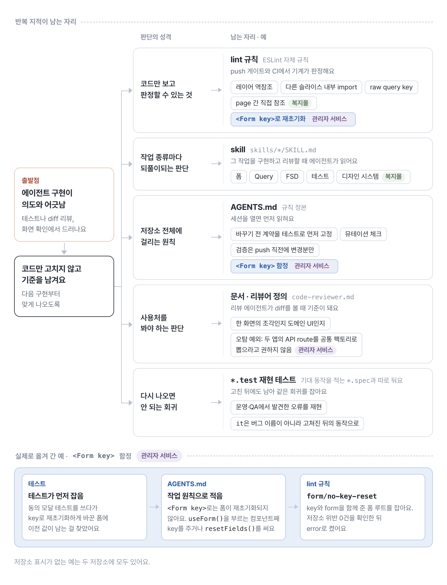
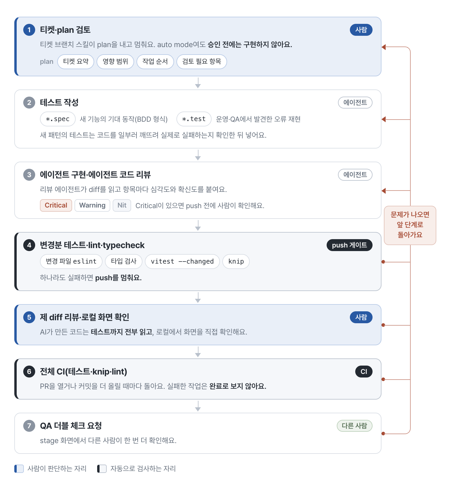
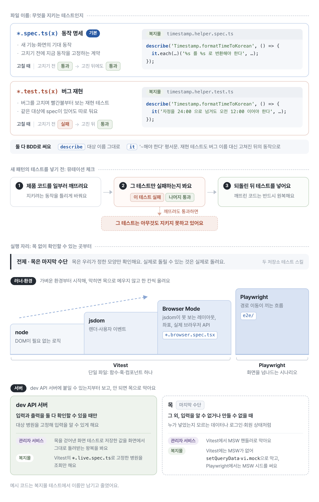
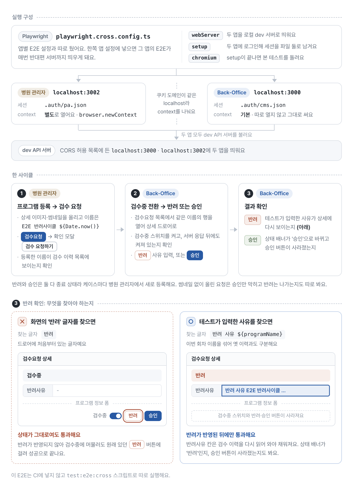
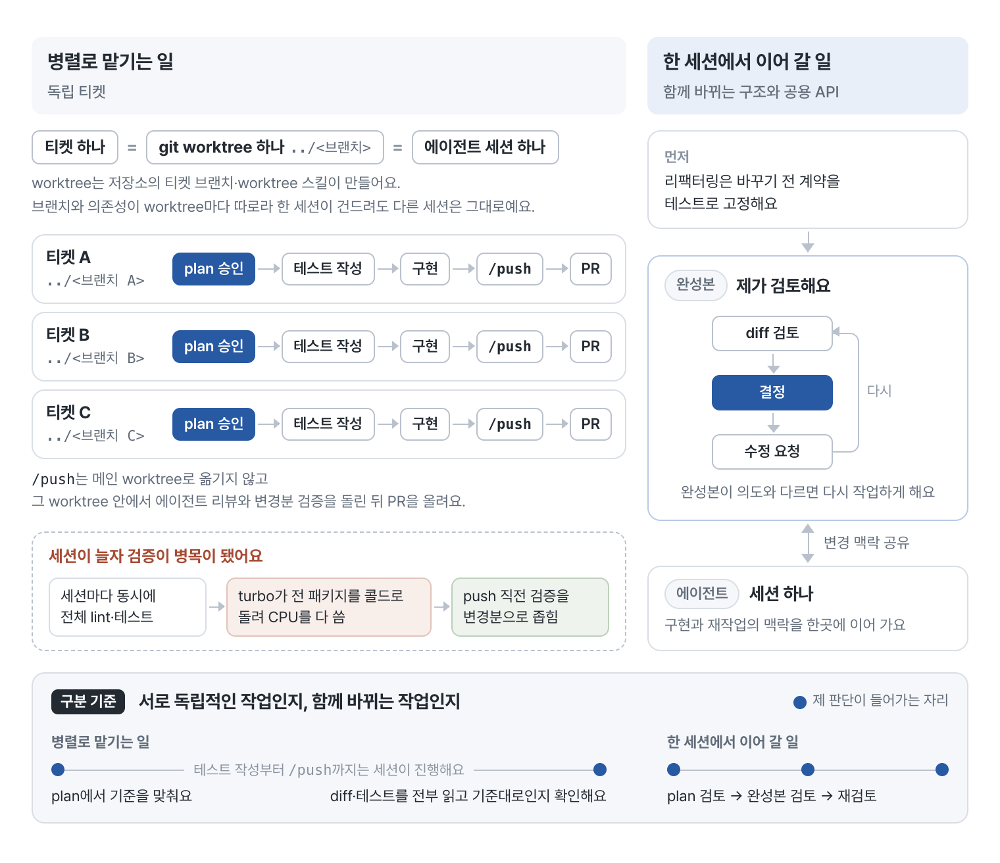
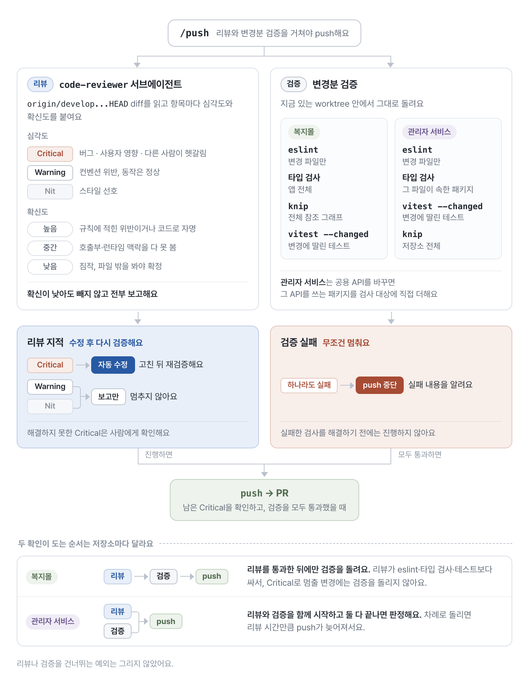

# AI에 구현을 맡기며 다듬은 개발 workflow

<figure class="figure-wide">
  
  <figcaption>한 번 고친 내용을 다음 작업의 기본값으로 남기는 과정</figcaption>
</figure>

<div class="note note-summary">
  <strong>이 글에서 다루는 것</strong>
  <p>AI가 만든 코드를 읽으면서 같은 지적을 반복하던 문제에서 출발해요. 반복되는 판단을 skills, lint rule, 테스트에 남기고, plan과 완성본을 검토하는 지금의 작업 흐름으로 다듬은 과정을 적었어요. 실제 화면 확인과 여러 PR을 합친 diff를 어디에서 보는지도 함께 설명해요.</p>
</div>

한번은 에이전트가 성공했다고 보고한 E2E를 열어 봤어요. 배너 등록 드로어에서 '업로드 중...' 문구가 사라지길 기다리는 줄이 있었는데, 그 문구는 저장소 코드 어디에도 없었어요. 어디서 나오는지 확인되지 않은 문구에 기대는 대기라 이 줄이 정말 업로드를 기다리는지 알 수 없었어요. 성공했다는 말을 그대로 믿었다면 그냥 지나갔을 일이에요.

처음에는 에이전트가 만든 코드를 처음부터 끝까지 읽고 고쳤어요. 폼을 어디에 두는지, Query Options를 어떻게 만드는지 같은 기준은 문서에 있었지만, 세부 판단은 코드와 제 머릿속에 흩어져 있었거든요. 같은 지적을 반복하면서 저장소에 그 기준을 더 남겨야겠다고 생각했어요. push 명령에 리뷰어를 붙이고, 티켓 브랜치 skill이 plan을 제시한 뒤 승인을 기다리도록 조금씩 작업 흐름을 바꿨어요.

저저번 스프린트에서는 코드를 읽지 않고 동작 검증 중심으로 진행해 봤어요. 그런데 핫픽스가 많이 발생했어요. 그 뒤로 기능과 리팩터링의 제품 코드와 테스트는 다시 모두 읽어요. 동작이 바뀌지 않는 기계적인 lint 수정이나 파일 이동까지 같은 방식으로 다시 읽는다는 뜻은 아니에요. 이때의 경험과 지금의 검토 기준은 [별도 회고](post-new-reading-ai-code.md)에 적었어요.

## 같은 지적을 두 번 하지 않게 만들었어요

초기에는 작업마다 주의사항을 프롬프트에 덧붙였어요. 내용이 길어지면서 폼, Query, FSD, 디자인 시스템처럼 작업 종류별 skill로 나눴어요(에러 처리는 관리자 서비스의 정책 문서로 뒀고, 디자인 시스템 skill은 복지몰에만 있어요). 에이전트 구현이 의도와 어긋나면 코드만 고치지 않고 그 기준을 skill이나 lint 규칙으로 남겨 다음 구현부터 맞게 나오게 해요. 지금 skill은 관리자 서비스에 33개, 복지몰에 36개가 있고, 규칙의 정본은 `AGENTS.md`예요.

[Compound Engineering](https://every.to/guides/compound-engineering) 방식을 참고하며 작업에서 얻은 판단을 다음 작업의 규칙으로 남겼어요. 처음부터 이 흐름을 한 번에 만든 것은 아니에요. 반복해서 고치는 부분을 스킬에 보강했고, 모델 성능도 좋아지면서 제 코드 스타일에 맞는 결과가 늘었어요.

## 코드만 보고 판단할 수 있는 기준은 lint로 옮겼어요

옮긴 건 레이어를 거꾸로 참조하는 import, 다른 슬라이스 내부로 들어가는 import, raw query key 같은 항목이에요. 다만 두 저장소의 진도가 달라요. 복지몰은 레이어, page 간 참조, raw query key 규칙이 error예요. Public API 규칙도 271건에서 44건, 17건, 0건까지 걷어낸 뒤 error로 잠갔고, 그 뒤로는 "lint 규칙은 warn으로 켜지 않는다"가 원칙이에요. warning만 있으면 eslint가 exit 0으로 끝나 아무것도 막지 못하거든요.

관리자 서비스는 기존 위반이 남은 규칙을 warning으로 켠 뒤 정리하는 과정을 거쳤어요. 두 저장소의 규칙과 심각도를 똑같이 맞추기보다는, 각 저장소에서 정리한 범위에 맞춰 적용했어요. 한때 예외로 뒀던 상담 채팅 코드도 다시 lint와 테스트 대상으로 돌려놓았어요.

테스트가 먼저 잡은 회귀가 규칙이 되기도 했어요. 관리자 서비스에서는 `<Form key>`로는 폼이 재초기화되지 않는다는 함정을 `AGENTS.md`에 원칙으로 적고 lint 규칙으로도 막았어요.

맥락이 필요한 것까지 lint에 넣지는 않았어요. 어떤 컴포넌트가 한 화면의 조각인지 도메인 UI인지는 사용처를 봐야 해서 문서와 리뷰에 남겼어요.

<figure class="figure-wide">
  
  <figcaption>같은 지적은 판단의 성격에 맞는 자리에 남겨 다음 구현부터 맞게 나오게 해요</figcaption>
</figure>

## 지금의 작업 흐름

지금은 다음 순서로 작업해요.

**티켓과 plan 검토 → 테스트 작성 → 에이전트 구현과 에이전트 코드 리뷰 → 변경분 테스트, lint, typecheck → 직접 diff 리뷰와 화면 동작 확인 → 전체 CI → QA 더블 체크 요청**

리뷰나 검증에서 문제가 나오면 plan이나 구현, 테스트를 고치는 단계로 돌아가요. 실무에서는 별도 QA 엔지니어가 없는 만큼 제가 먼저 확인하고, 관련 담당자에게도 더블 체크를 요청해요.

<figure class="figure-wide">
  
  <figcaption>plan 승인과 diff 리뷰, 화면 확인은 제가 판단하고, push 게이트와 CI는 자동으로 검사해요</figcaption>
</figure>

단계마다 무엇을 보는지 일하는 순서대로 적어 볼게요.

## 티켓부터 AI에 넘기지는 않아요

티켓을 받으면 내용을 읽고 코드 수준에서 해결할 수 있는 문제인지, 기존 구현보다 나은 방법이 있는지 먼저 생각해요. 티켓 이전의 요구사항 논의에 참여한 경우도 있지만, 모든 티켓의 스펙을 제가 정하거나 전부 확인한 것은 아니에요. plan을 검토하면서 모호한 요구사항이나 백엔드 작업이 필요한 부분을 발견하면 관련 담당자에게 확인해요.

복지몰은 디자이너의 시안을 바탕으로 작업하고, 그 외 제품은 주로 와이어프레임을 분석해 구현해요. 시안이 있는 작업에는 Figma MCP를 활용해요. 와이어프레임 기반 작업은 에이전트 구현과 테스트를 마친 뒤 자체 검증에서 UI를 검토하기도 해요. 글로벌 서비스의 파일 업로드 화면에서는 인증 코드 입력값을 어디까지 유지할지, 업로드 실패 시 무엇을 보여줄지를 와이어프레임 밖에서 정해야 했어요.

그다음 에이전트가 관련 코드와 기존 패턴을 조사해요. 저는 세션에서 작업을 세 종류로 나눠 지시했어요. 기존 패턴이 명확해 바로 PR까지 가는 작업, 구현 전에 요구사항 확인이 필요한 작업, 구현 뒤 사람이 화면이나 데이터를 봐야 하는 작업이에요. 바로 PR까지 가는 작업도 plan 승인은 거쳐요. 관리자 서비스에서 `/bugfix`로 맡긴 버그 수정은 plan 없이 원인 추적과 재현 테스트부터 PR까지 이어 가고, 리뷰에서 Critical이 나오거나 검증이 실패할 때만 멈춰요. 운영 로그로 들어온 스키마 불일치를 고치는 `/schema-fix`도 두 저장소 모두 plan 없이 develop 머지까지 가요.

## 코드를 보기 전에 plan부터 봐요

구현이 끝난 뒤 diff에서 방향이 틀린 것을 발견하면, 그 시점에는 작성한 코드를 버려야 해요. 그래서 티켓으로 브랜치를 만드는 스킬이 plan을 제시한 뒤 멈추게 했어요. auto mode여도 제 입력을 기다리고, 승인 전에는 구현하지 않아요.

스킬 템플릿에는 티켓 요약, 영향 범위, 작업 순서, 검토 필요 항목 넷만 적게 했어요. 저는 그중 티켓 요약에 드러난 전제와 검토 필요 항목을 봐요. 티켓을 어떤 동작으로 이해했는지가 틀리면 파일 목록이 정확해도 소용이 없거든요. 상태와 데이터를 누가 소유하는지, 무엇이 성공하면 끝낼지는 템플릿에 없어서 승인하면서 제가 되물어요. 빠진 상태나 잘못 이해한 API가 보이면 다시 조사하게 했고, 수정된 plan을 본 뒤 구현을 시작했어요. 이 단계에는 코드가 없어서 방향을 바꿔도 버리는 건 plan 문서뿐이에요.

## 테스트는 명세와 버그 재현으로 나눠 써요

테스트는 입력과 행동, 기대 결과가 본문에 보이도록 규칙을 정했어요. 새 기능의 기대 동작은 BDD 형식의 `*.spec`에 적어 컴포넌트별로 빠진 조건이 없는지 보고, 운영과 QA에서 발견한 오류는 `*.test`에 재현해요. 테스트 스킬도 이 둘을 구분해요. 리팩터링은 바꾸기 전 계약을 테스트로 먼저 고정하고, 제품 코드를 일부러 틀리게 바꿔 그 테스트만 실패하는지 보는 뮤테이션 체크를 한다는 원칙을 `AGENTS.md`에 적었어요. 관리자 서비스는 이 '테스트 먼저'를 버그 수정까지 넓혔어요. 새 패턴의 테스트도 코드를 일부러 깨뜨려 실제로 실패하는지 확인한 뒤 넣어요.

테스트 코드를 도입한 뒤에는 실제로 확인하려는 동작에 맞춰 실행 환경을 고쳐 왔어요. 함수와 스키마는 Vitest의 node 환경에서, 폼과 컴포넌트는 jsdom이나 Browser Mode에서 확인해요. 화면을 오가는 흐름은 Playwright로 보고요. 관리자 서비스의 새 테스트는 dev API 서버를 사용하는 것이 기본이고, 직접 만들기 어려운 실패 상태는 MSW로 재현해 `.mock` 파일로 구분해요. 복지몰도 실제 서버에서 일정하게 확인할 수 있는 조회와, 응답을 통제해야 하는 경우를 나눠요.

Mock을 쓰는 자리에서도 서버 제약은 지키게 했어요. 관리자 서비스는 통합 테스트의 Mock이 서버 제약을 그대로 검사해 거절하도록 만들었어요. 무엇이든 받아 주는 Mock이 400을 숨긴 일이 있었거든요. dev API 서버에서 다른 제약이 나오면 스키마와 Mock, 기존 테스트를 서버에 맞춰 고치고, Mock으로는 잡을 수 없는 계약은 그 서버에 붙는 테스트로 따로 고정했어요.

<figure class="figure-wide">
  
  <figcaption>이름으로 명세와 버그 재현을 나누고, 목 없이 확인할 수 있는 자리부터 골라요</figcaption>
</figure>

## 테스트가 성공했다는 말도 그대로 믿지 않아요

AI가 만든 테스트도 전부 읽어요. 글머리의 '업로드 중...' E2E는 이렇게 고쳤어요.

```ts
// before: 저장소에 없는 화면 문구가 사라지길 기다린다
await expect(drawer.getByText('업로드 중...')).toBeHidden();

// after: 진행 중인 업로드 항목이 0개인지 본다
await expect(drawer.locator('.ant-upload-list-item-uploading')).toHaveCount(0);
```

이 대기문만으로 업로드 성공을 판단할 수는 없어요. 업로드가 시작되지 않았거나 실패해도 진행 중인 항목은 0개일 수 있으니까요. 이 코드는 대기 대상을 화면 문구에서 진행 중인 업로드 항목으로 바꾼 예시이고, 완료 여부는 이번 실행에서 올린 파일과 저장 결과까지 확인해야 해요. 테스트를 읽을 때는 각 줄을 확인하면서 plan의 성공 조건을 실제로 검증하는지, 실행 결과가 그 조건과 맞는지도 봐요.

테스트 환경 자체가 제품과 다른 가정을 갖고 있던 경우도 있었어요. 앱의 QueryClient는 초기 데이터가 없는 조회 실패를 Error Boundary로 넘기는데, 테스트용 QueryClient는 그렇지 않았어요. 테스트도 같은 조건으로 오류를 넘기게 맞추고, 첫 조회 실패와 기존 데이터가 있는 상태의 재조회 실패를 나눠 검증했어요. 테스트가 성공하는지만 보면 이런 차이를 놓칠 수 있어요.

한 앱에서 끝나지 않는 기능은 두 앱을 횡단하는 E2E로 봤어요. 병원 관리자에서 프로그램을 등록해 검수 요청을 만들고 Back-Office에서 검수중으로 바꾼 뒤 반려하거나 승인하는 흐름이라 한쪽 앱의 렌더 테스트로는 덮이지 않았어요. 별도 Playwright 설정에서 두 앱의 dev 서버(3000, 3002)를 함께 띄우고 dev API 서버를 그대로 호출했고, 쿠키 도메인이 같은 localhost라 병원 관리자 세션은 별도 브라우저 context에 뒀어요. 반려 성공은 테스트에서 입력한 반려 사유가 상세에 다시 나타나는지로 확인했어요. 드로어에 반려 버튼이 있어서 '반려' 글자만 찾으면 상태가 안 바뀌어도 통과하거든요.

<figure class="figure-wide">
  
  <figcaption>반려는 테스트가 입력한 사유가 다시 보이는지로 확인해요</figcaption>
</figure>

## 독립적인 작업만 세션을 나눠요

독립적인 티켓은 Orca에서 worktree와 에이전트 세션을 나눠 진행해요. 공용 API와 여러 화면을 함께 바꾸는 리팩터링은 한 세션에서 맥락을 이어 가고요. 어느 쪽이든 구현은 에이전트에 맡겨요. 에이전트가 완성본을 주면 제가 코드와 테스트를 검토하고, 의도와 다르면 반려해 다시 작업하게 해요.

<figure class="figure-wide">
  
  <figcaption>작업 간 의존성으로 세션을 나누고, 완성본은 직접 읽고 검토해요</figcaption>
</figure>

## 여러 세션이 CPU를 같이 잡아먹기 시작했어요

Orca를 쓰기 전부터 서로 겹치지 않는 티켓은 별도 Git worktree에서 진행했어요. 한 세션이 브랜치나 의존성을 건드려도 다른 세션에 영향을 주지 않게 하려는 목적이었는데, 세션을 여러 개 돌리자 이번에는 검증이 병목이 됐어요.

각 세션이 전체 lint와 테스트를 동시에 돌리면 turbo가 전 패키지를 콜드로 실행해 CPU를 통째로 먹었어요. 여러 검사가 겹친 실행에서는 exit 143으로 종료되기도 했어요. 이 종료 코드만으로 CPU 경합이 직접 원인이라고 단정할 수는 없지만, 검사가 끝나지 않아 코드 문제인지 판단할 결과도 얻지 못했어요. 관리자 서비스의 처음 push 명령은 전 패키지 `pnpm run lint` 하나가 게이트였는데요. 그 뒤 push 직전 검증을 변경 파일의 eslint, 그 파일이 속한 패키지의 타입체크, `vitest --changed`로 좁히면서 관련 테스트도 같이 넣었어요.

로컬 검증은 변경 영향에 맞춰 push 직전에 실행한다는 원칙도 `AGENTS.md`에 적었어요. 캐시를 쓰려고 메인 worktree에 임시로 합치는 대신 각 작업의 worktree에서 그대로 검증해요.

여기서 변경분 검증이 모든 도구에 파일 목록만 넘긴다는 뜻은 아니에요. 복지몰은 ESLint를 변경 파일에, Vitest를 영향 범위에 적용하지만 타입 검사와 Knip은 전체 앱과 참조 그래프를 봐요. 관리자 서비스는 변경 파일이 속한 패키지의 타입 검사와 관련 테스트를 실행하고, 공용 API가 바뀌면 그 API를 쓰는 패키지를 직접 검사 대상에 더해요. Knip은 관리자 서비스에서도 저장소 전체를 한 그래프로 봐요.

전체 CI의 구성도 저장소마다 달라요. 관리자 서비스 CI에서는 lint와 단위 테스트를 실행하고, 복지몰에서는 lint, 타입 검사, Knip을 확인해요. dev API 서버에 붙는 테스트는 로컬과 push 전 검증에서, 브라우저 E2E는 별도 실행 경로에서 확인해요. 모든 검사를 CI 하나에서 돌리는 구성은 아니에요.

## 리뷰 지적과 검증 실패를 구분해서 처리했어요

push를 지시하면 별도 리뷰어가 `origin/develop...HEAD` diff를 읽고 항목마다 Critical, Warning, Nit과 확신도를 붙여 전부 보고해요. 두 저장소 모두 리뷰어가 eslint, 타입체크, 테스트보다 먼저 돌게 했어요. 리뷰가 더 싸서 Critical로 멈출 변경이면 비싼 검증을 아예 돌리지 않게 하려는 순서였어요. 복지몰은 이 순서를 그대로 두었고, 관리자 서비스는 리뷰와 검증을 동시에 띄우고 둘 다 끝난 뒤 push 여부를 정하도록 바꿨어요. 차례로 돌리면 리뷰 시간만큼 push가 늦어지거든요.

관리자 서비스에서는 한 화면 안의 마크업, 문구, 스타일만 바꾼 작업이라고 에이전트가 판단하면 리뷰어와 테스트를 빼고 eslint, 타입체크, Knip만 돌리고, 분기나 데이터 흐름을 건드렸다면 한 줄이어도 리뷰와 검증을 모두 돌려요.

Critical로 분류한 문제는 에이전트가 수정하고 다시 검증하도록 했어요. 수정할 수 없거나 판단이 필요한 Critical이 남으면 멈추고 제 확인을 받아요. Warning과 Nit은 보고하되 그 자체로 진행을 막지는 않아요. 리뷰 결과와 별개로 lint, 타입 검사, 테스트가 실패해도 다음 단계로 진행하지 않아요.

<figure class="figure-wide">
  
  <figcaption>Critical은 수정 후 다시 검증하고, 남은 문제와 검증 실패는 그대로 넘기지 않아요</figcaption>
</figure>

반복되는 오탐은 리뷰어 정의에 예외로 적었어요. 관리자 서비스에서는 Back-Office와 병원 관리자 두 앱의 `src/app/api` route가 구조는 비슷하고 엔드포인트와 서비스명만 달라서 공통 팩토리로 뽑으라는 지적이 반복됐는데요. 각 앱의 백엔드와 응답 타입에 묶여 있어 분리가 맞다고 보고, 공통 핸들러 팩토리로 추출하라고 권고하지 않는다는 문장을 남겼어요.

## diff를 읽고 실제 화면을 열어 봐요

구현이 끝나면 변경 내용과 실행한 검증을 보고받아요. 이 보고는 처음 확인한 요구사항과 대조해요. plan도 에이전트가 만든 결과물이라 plan대로 했다는 것만으로 완료 처리하지 않았어요.

plan에서는 영향 범위와 바꾸지 않을 동작, 예외 조건, 검토할 부분을 먼저 맞춰요. 구현 후 리뷰는 그때 정한 기준을 실제 diff가 지키는지 확인하는 단계예요. 에이전트의 지적도 코드 근거와 재현 조건을 확인한 뒤 반영해요. 도구의 리뷰를 동료와 설계에 합의한 경험으로 보지는 않아요.

Figma 작업은 에이전트가 `claude-in-chrome` MCP나 Chrome CDP 스크립트로 화면을 띄우고 스크린샷을 찍게 했어요. 간격, 글꼴, 색상, 아이콘, 반응형 배치, 열림과 오류 상태가 시안과 다르면 차이 목록을 만들고, 고친 뒤 같은 viewport와 상태에서 다시 찍었어요. 이미지 유사도 점수는 쓰지 않았고, 남은 차이 목록이 비면 끝냈어요. 기능도 화면을 띄워 동작을 확인하고 E2E로 봤어요.

## 마지막에는 합쳐진 코드를 읽어요

여러 PR을 모아 배포할 때는 합쳐진 diff 전체를 다시 봐요. 배포 PR을 따로 만드는 흐름에서는 이 검토를 거치고, PR 병합과 배포를 한 번에 맡기는 흐름에서는 별도 검토가 생략돼요. PR 하나만 볼 때는 자연스러웠던 코드도 함께 놓으면 중복된 추상화나 어긋난 이름, 갈라진 FSD 경계가 보여서 전체 규칙에 맞게 다시 리팩터링했어요.

배포 뒤에도 마음에 걸리는 패턴이 있으면 그 파일만 고치지 않고 프로젝트 전체에서 찾아 skill이나 lint, 공용 구현을 바꾸기도 했어요. 복지몰에서 `entities`를 없애고 page 간 직접 참조를 막는 규칙(정리 전 62건에서 0건)까지 넣은 작업도 여기서 시작됐는데요. 이 개편은 develop에 반영됐고, 과정은 [FSD 레이어를 다시 나눈 글](https://jingeon27.tistory.com/23)에 적었어요.

<div class="note note-decision">
  <strong>최종 결정</strong>
  <p>요구사항과 구조는 plan 단계에서 검토해요. 완성본이 나오면 코드와 테스트를 읽고 화면을 띄워 동작을 확인해요. 여러 작업의 일관성은 배포 전 합쳐진 diff에서 다시 봐요. 반복되는 판단은 skills에, 코드로 검사할 수 있는 기준은 lint rule에 남겼어요.</p>
</div>

## 참고

- [Compound Engineering](https://every.to/guides/compound-engineering): every.to 원문
- 관련 글: [테스트 코드를 도입하면서 세운 기준](https://jingeon27.tistory.com/25)
- 관련 글: [FSD 레이어를 저장소에 맞게 다시 나눈 과정](https://jingeon27.tistory.com/23)
