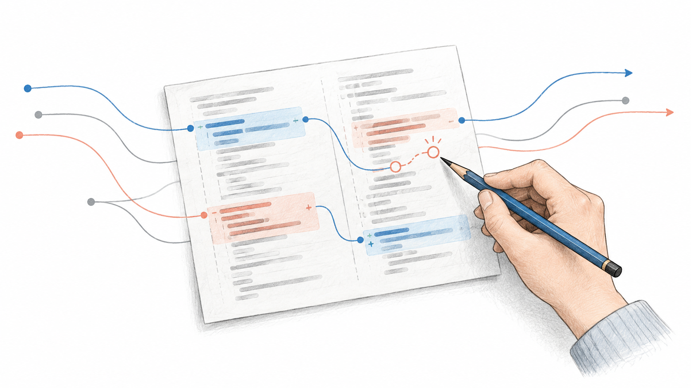

# AI가 코드를 짜도 저는 diff를 읽어요

<div class="note note-summary">
  <strong>이 글에서 다루는 것</strong>
  <p>저저번 스프린트에서 코드 확인을 생략했는데, 핫픽스가 많이 발생했어요. 그 뒤 다시 코드 확인을 검증 과정에 넣었어요. 기계적인 변경과 동작을 바꾸는 변경을 구분하는 기준, 작은 기능과 큰 기능을 검토하는 방식, 읽기 쉬운 구조를 유지하려는 이유를 적었어요.</p>
</div>

<figure class="figure-wide">
  
  <figcaption>코드를 만드는 동안에도, 그 코드가 무엇을 하고 있는지는 따라가려고 해요.</figcaption>
</figure>

“코드를 안 읽어요.”

요즘 이런 말을 종종 봤어요. 저도 궁금했어요. 에이전트가 구현하고, 테스트가 성공하고, 화면까지 확인했다면 굳이 코드도 읽어야 할까요? 동작만 검증하면 되는 것 아닐까요?

그래서 저저번 스프린트에서는 코드를 읽지 않고 동작 검증을 중심으로 진행해 봤어요. 그런데 핫픽스가 많이 발생했어요. 동작만 확인하면 충분하다고 생각했던 검증 방식을 돌아보게 됐고, 그 뒤로 기능 개발과 리팩터링에서는 diff를 다시 읽고 있어요.

그렇다고 에이전트가 코드를 못 짠다는 뜻은 아니에요. 지금도 작은 기능이나 리팩터링을 맡기면, 제가 코드를 고치지 않아도 만족스러운 퀄리티로 나오는 경우가 있어요. 다만 **코드를 고치지 않는 것과 코드를 읽지 않는 것은 다른 일이었어요.**

## 기계적인 변경까지 한 줄씩 다시 읽지는 않아요

지금도 모든 변경을 같은 방식으로 읽어야 한다고 생각하지는 않아요. 포맷이나 동작을 바꾸지 않는 lint 자동 수정, 정해 둔 구조에 따라 파일을 옮기고 import 경로만 맞추는 작업은 원래 코드를 처음부터 다시 읽을 필요가 적어요. 무엇을 바꾸는 작업인지 확인하고, 그 범위에 맞는 검증을 해요.

다만 'lint 적용'이나 '폴더 이동'이라는 작업 이름만으로 판단하지는 않아요. lint를 맞추면서 분기나 실행 순서까지 바꿨다면 동작 변경이에요. 파일을 옮기며 서버·클라이언트 경계나 모듈 초기화 방식이 달라졌다면 단순한 이동도 아니고요. 변경량이 많다는 것과 기계적인 변경이라는 것은 별개예요.

리팩터링과 기능 개발은 diff를 읽어요. 입력을 어디서 받고, 상태를 누가 소유하며, 어떤 조건에서 요청하는지 알아야 하니까요. 전체 저장소를 매번 다시 읽는다는 뜻은 아니에요. 평소에 파악한 맥락 위에서 변경된 부분을 보고, 기존 호출부나 관련 흐름까지 필요한 만큼 따라가요.

특히 리팩터링은 화면이 그대로 보여도 내부 계약이 달라질 수 있어요. 초기값을 넣는 시점, 뒤로 갔을 때 남는 상태, 실패한 요청을 처리하는 방식이 바뀌었는지는 정상 경로를 한 번 눌러 보는 것으로 다 확인하기 어려워요.

## 손댈 코드가 없는 결과도 나오기 시작했어요

처음부터 지금처럼 맡길 수 있었던 것은 아니에요. 약 반년 동안 [Compound Engineering](https://every.to/guides/compound-engineering) 방식을 참고하며, 결과가 제 의도와 어긋날 때마다 skill·`AGENTS.md`·lint를 보강했어요. 한 작업에서 고친 판단을 다음 작업의 기준으로 남기는 식이었어요.

폴더 위치나 import 방향처럼 코드만으로 판정할 수 있는 것은 lint에 넣었어요. 상태를 어디에 두고 어떤 추상화를 쓸지처럼 맥락이 필요한 기준은 skill과 `AGENTS.md`에 남겼어요. 기대 동작과 다시 발생하면 안 되는 오류는 테스트로 고정했고요.

지금 흐름은 이래요.

```text
티켓·plan 검토
→ 테스트 작성
→ 에이전트 구현·에이전트 코드 리뷰
→ 변경분 테스트·lint·typecheck
→ 제 diff 리뷰·dev 화면에서 동작 확인
→ 전체 CI(테스트·knip·lint)
→ QA 더블 체크 요청
```

앞의 네 단계만으로 제가 고칠 부분이 없는 결과가 나오기도 해요. 특히 변경 범위가 작고 저장소 안에 비슷한 패턴이 있으면 잘 끝내는 편이에요. 모델 성능이 좋아진 영향도 있고, 저장소에 제 기준을 계속 남긴 영향도 있다고 느껴요. 둘의 기여를 따로 측정한 것은 아니에요.

테스트도 읽어요. 새 기능의 기대 동작은 BDD 형식의 `*.spec`에 적고, 컴포넌트에 필요한 조건이 빠지지 않았는지 봐요. 운영이나 QA에서 발견한 버그는 `*.test`에 재현해요. 새 패턴의 테스트는 제품 코드를 일부러 깨뜨렸을 때 실제로 실패하는지도 확인하고 넣어요.

그렇게 기준을 쌓았는데도 엇나가는 부분은 남아요. 확률적 모델을 바탕으로 만드는 결과인 만큼, 기준을 적어 둔 것과 이번 코드가 그 기준을 지킨 것은 따로 확인해야 해요. 제가 원하는 구현에 가까워졌다는 것이 다음 결과까지 보장한다는 뜻은 아니었어요. 에이전트 리뷰도 한 번 더 확인하는 과정이지, 제가 코드와 요구사항을 대조할 필요가 없어졌다는 증명은 아니고요.

## 작은 변경과 큰 기능에서 고민이 달라요

작은 기능은 결과가 좋을수록 코드를 안 읽어도 될 것처럼 느껴져요. 그런데 이런 작업은 변경량도 작아서 읽는 데 시간이 많이 들지 않아요. 몇 파일을 확인하면서 요구사항과 맞는지, 기존 패턴을 벗어나지 않았는지 보는 비용이 크지 않아요.

오히려 읽는 시간이 부담스러운 건 큰 기능이에요. 화면과 상태, API, 기존 기능에 미치는 영향이 함께 늘어나니까요. 그런데 제가 맡긴 큰 기능이 한 번의 지시로 완전히 끝난 적은 없었어요. 에이전트가 자기 기준으로는 완성됐다고 제출해도, 제가 읽어 보면 다시 작업해야 하는 부분이 남아 있었어요.

구현 중간에 개입하는 방식은 아니에요. 에이전트가 완성본을 제출하면 diff와 테스트를 읽고, 요구사항이나 저장소의 기준에 맞지 않는 부분을 짚어 반려해요. 수정한 결과를 다시 제출받으면 또 확인하고요. 큰 기능은 이 과정이 반복돼요. 에이전트의 완료 보고와 제가 작업을 받아들이는 시점은 달라요.

복지몰의 Bottom Sheet를 compound 구조로 바꿀 때는 AI가 만든 코드와 기존 검토 과정을 믿고 작업을 마쳤어요. 하지만 헤더가 본문과 같은 스크롤 영역에 들어가 있어서, 본문을 스크롤하면 제목도 함께 올라갔어요. 이후 드래그 크래시를 해결하려고 라이브러리를 업그레이드하면서도 이 구조를 그대로 옮겼어요. diff를 읽고 시트 높이와 스냅 위치까지 확인했지만, 스크롤할 때 제목이 고정되는지는 놓쳤어요.

코드를 읽었는데도 화면의 잘못된 동작을 놓친 경험이었어요. 그 뒤로는 스크롤이나 드래그처럼 실제 화면에서 확인해야 하는 동작도 따로 챙기고, 같은 문제가 다시 생기면 알 수 있도록 브라우저 테스트를 남겨요. [자세한 수정 과정은 별도 글에 적었어요.](https://jingeon27.tistory.com/33)

## 화면에서 재현하기 전에 코드에서 보이는 것들

코드를 읽는 이유는 스타일을 맞추기 위해서만은 아니에요. 실행해 보다 잡는 것보다 코드를 읽고 먼저 의심하는 편이 빠른 문제도 있어요. 비동기 응답 순서가 그중 하나예요.

아래는 실제 운영 버그를 옮긴 것이 아니라, 순서 문제만 설명하기 위해 줄인 예제예요.

```tsx
useEffect(() => {
  searchPrograms(query).then(setPrograms);
}, [query]);
```

사용자가 검색어를 바꾸면 요청이 다시 나가요. 이전 검색의 응답보다 새 검색의 응답이 먼저 돌아올 수도 있어요. 그런데 응답이 오면 무조건 상태에 넣으니, 뒤늦게 돌아온 이전 결과가 최신 결과를 덮을 수 있어요.

```text
이전 검색 요청 → 새 검색 요청
새 검색 응답   → 새 결과 표시
이전 검색 응답 → 이전 결과로 덮어씀
```

정상 순서로 응답하는 조건만 보면 문제가 드러나지 않아요. 코드를 읽으면 '어느 요청의 응답을 반영할지 확인하는 부분이 없는데?'라는 질문을 먼저 할 수 있어요. 그다음 응답 순서를 뒤집는 테스트로 실제 문제인지 확인하면 돼요.

예를 들어 effect를 직접 쓰는 구조에서는 끝난 effect의 응답을 무시하도록 정할 수 있어요.

```tsx
useEffect(() => {
  let active = true;

  searchPrograms(query).then((programs) => {
    if (active) setPrograms(programs);
  });

  return () => {
    active = false;
  };
}, [query]);
```

이 코드는 요청을 취소하는 것이 아니라, 이전 effect의 응답이 상태를 바꾸지 못하게 하는 예제예요. 오류 처리나 로딩 상태는 별도로 정해야 해요. 서버 상태를 조회하는 실제 코드라면 조회 라이브러리와 query key에서 이 책임을 다루는지도 먼저 보겠어요. [React 공식 문서](https://react.dev/reference/react/useEffect#fetching-data-with-effects)도 응답 순서가 달라질 수 있는 상황과 cleanup을 이용한 처리를 설명해요.

에이전트가 이런 조건을 알아서 넣어 줄 때도 있어요. 반대로 API 동작을 잘못 가정하거나 필요한 조건을 빠뜨릴 때도 있어요. 'race condition도 찾아줘'라고 한 번 더 요청하는 것은 도움이 될 수 있지만, 그 답만으로 문제가 없다고 확정하지는 않아요.

코드를 읽고 의심하는 것 역시 확정은 아니에요. 재현이나 테스트로 확인해야 해요. 다만 처음부터 모든 타이밍을 실행해 보는 대신, 확인할 조건을 몇 줄의 코드에서 찾을 수 있다는 점이 값싼 검증이라고 생각해요.

## 읽는 시간을 구현 시간과 겹쳐 써요

코드를 읽는 시간이 늘어난 것은 맞아요. 특히 큰 기능은 그 시간이 부담스러워질 수 있어요. 하지만 에이전트가 구현이나 검증을 하는 동안 제가 할 수 있는 일이 생겼어요.

에이전트가 다른 작업을 구현하거나 반려한 부분을 수정하는 동안, 이미 제출받은 diff를 읽거나 다음 변경과 연결되는 기존 코드를 따라가요. 진행 중인 구현에 개입하는 것이 아니라, 제출된 결과를 검토하는 시간과 에이전트가 작업하는 시간을 겹쳐 쓰는 거예요. 업무 중에는 이렇게 코드의 맥락과 비즈니스 맥락을 파악하는 데 시간을 써요.

지금 제 작업에서는 코드 읽기 때문에 업무 전체가 멈춘다는 느낌은 크지 않아요. 구현하는 시간과 읽는 시간을 겹쳐 쓸 수 있기 때문이라고 생각해요. 다만 리뷰 시간을 따로 재거나 생산성을 전후 비교한 것은 아니에요. 작업이 더 커지거나 모르는 영역이 많아지면 이 방식에서도 제 검토가 병목이 될 수 있어요.

그래서 변경된 코드가 제 머릿속에 들어오는 속도도 중요해요. 구현은 빨리 끝났는데 무엇을 바꿨는지 설명할 수 없다면, 제 입장에서는 아직 끝난 작업이 아니에요.

## 읽기 쉬운 구조를 유지하려는 이유

저는 코드 위생에 집착하는 편이에요. 미사용 코드를 찾으려고 knip을 쓰고, 반복해서 확인하는 기준은 lint와 skill에 남겨요. 이름이나 폴더 위치가 계속 달라지면 같은 동작을 확인하는 데도 먼저 위치와 맥락부터 찾아야 하니까요.

응집도와 결합도를 생각하고, 서로 다른 맥락을 나누고, 한 함수 안의 추상화 수준을 맞추려는 이유도 여기에 있어요. 상태를 누가 바꾸는지 찾으려고 여러 파일을 오가거나, 서로 다른 수준의 일이 섞여 있으면 응답 순서처럼 작은 조건을 놓치기 쉬워요.

이름과 구조가 일관되면 에이전트가 따라갈 기준도 생기고 제가 읽을 때 찾을 것도 줄어요. 반대로 익숙한 패턴처럼 보이게 만드는 것만으로는 부족해요. 이름은 비슷한데 역할이 다르거나, 짧게 만들려고 중요한 분기를 숨겼다면 오히려 확인하기 어려워져요. 읽으면서 책임과 조건을 설명할 수 있는지를 기준으로 봐요.

제가 말하는 코드 위생은 결과물의 모양에만 신경 쓰는 일이 아니에요. 코드를 읽는 것도 검증 과정이기 때문에, 그 검증을 적은 비용으로 할 수 있게 유지하는 일이에요.

<div class="note note-decision">
  <strong>지금의 검토 기준</strong>
  <p>동작이 바뀌지 않는 기계적인 변경은 범위와 검증 결과를 중심으로 보고, 기능과 리팩터링은 변경된 제품 코드와 테스트를 읽어요. 큰 기능도 에이전트가 제출한 완성본을 검토하고, 부족하면 반려해 수정한 결과를 다시 확인해요. 코드 확인, 테스트 성공, 실제 화면 확인은 서로 다른 검증으로 남겨 둬요.</p>
</div>

처음에는 에이전트가 잘 짜면 읽을 필요도 없어질 것이라고 생각했어요. 지금은 좋은 구현이 나오면 제가 고치는 시간이 줄어든다고 생각해요. 읽을 필요까지 없어졌다고 느끼지는 않아요.

AI 덕분에 원하는 구조를 구현하는 속도는 빨라졌어요. 좋은 코드인지 판단하는 기준이 있다면 빠르게 만들면서도 그 기준을 유지하기 쉬워졌고요. 그래서 저는 구현을 맡기되, 검증할 때는 코드를 읽어요.

<div class="note note-limit">
  <strong>이 글의 범위</strong>
  <p>코드를 읽지 않았던 스프린트와 지금의 작업 방식에 대한 개인적인 회고예요. 크고 작은 기능의 성공률이나 리뷰 시간, 검증 비용을 수치로 비교하지 않았어요. 비동기 예제는 원리를 설명하기 위한 코드이지 서비스에 적용한 수정 사례는 아니에요. 코드 리뷰로 모든 오류를 막을 수 있다고 생각하지 않으며, 테스트·dev 화면·QA·운영 관측은 함께 필요해요.</p>
</div>

## 참고

- [Every: Compound Engineering](https://every.to/guides/compound-engineering)
- [React: effect에서 데이터를 조회할 때 응답 순서 다루기](https://react.dev/reference/react/useEffect#fetching-data-with-effects)
- 관련 글: [AI가 코드를 잘 짜기 시작했는데 제가 덜 바빠지지는 않았어요](https://jingeon27.tistory.com/31)
- 관련 글: [테스트를 전부 지운 뒤 다시 만든 기준](https://jingeon27.tistory.com/25)
- 관련 글: [Bottom Sheet 드래그 크래시를 고치며 놓친 것](https://jingeon27.tistory.com/33)
