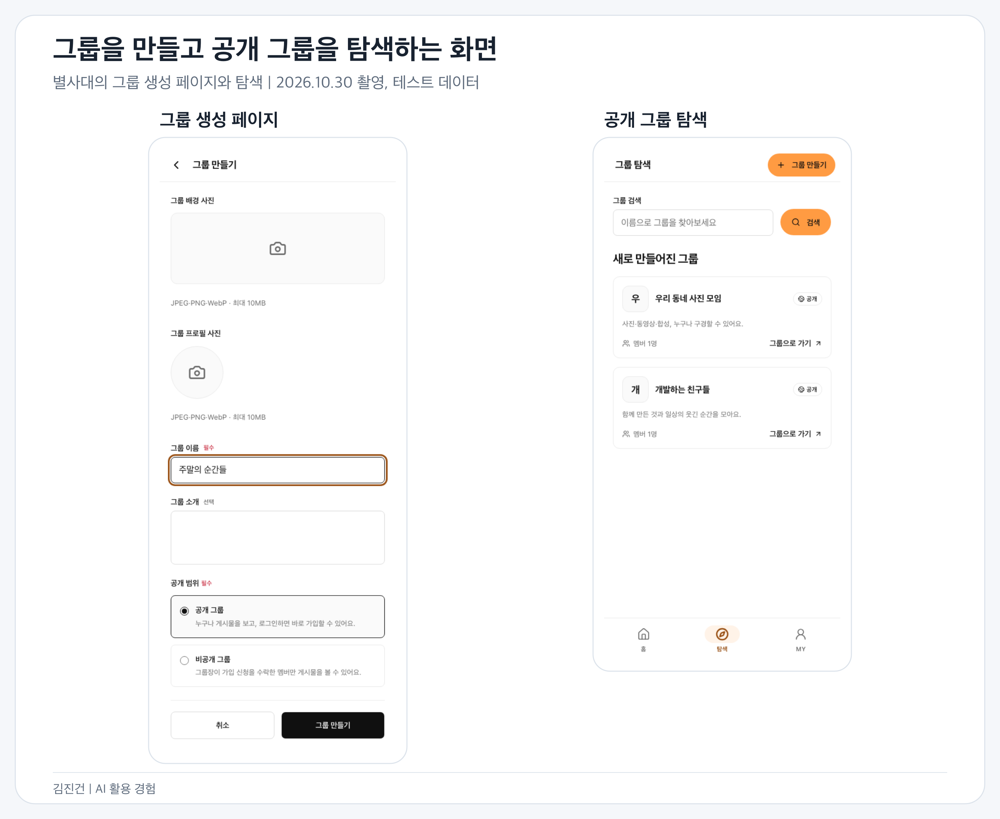
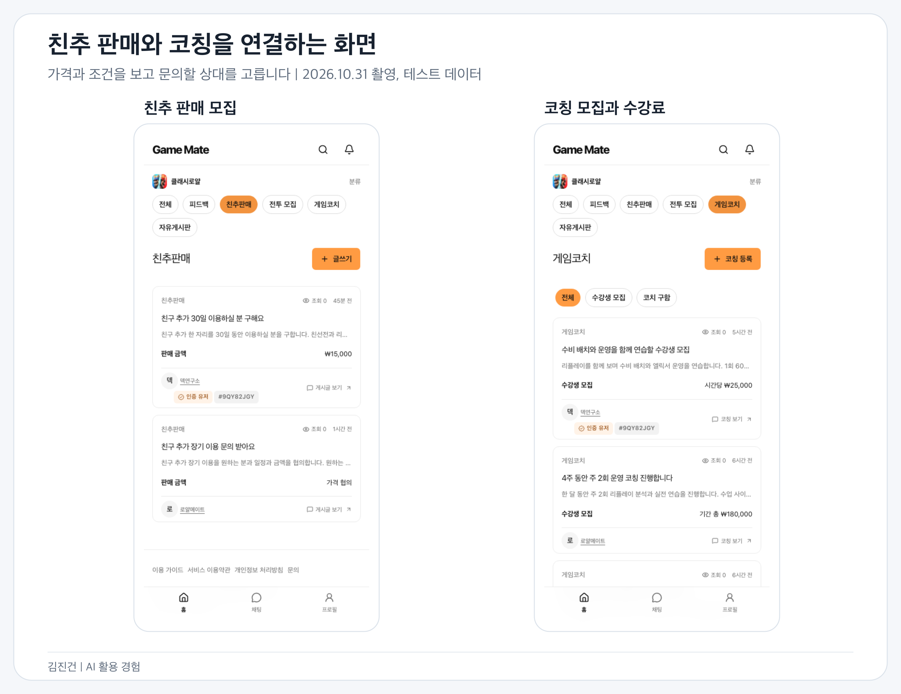

# 김진건 포트폴리오와 경력기술서

Frontend Engineer | jingeon27@gmail.com | [GitHub](https://github.com/jingeon27) | [기술 블로그](https://blog.bambyul.com/ko/blog)

산업기능요원 현역 복무 중 | 2025.08 편입 | 전직 희망

[공통 이력서](resumev7.md) | [AI 활용 경험 포트폴리오](resumes/doers/portfolio-doers-ai-experience.md)

채용 SaaS와 의료복지 서비스에서 사용자 웹과 관리자 서비스를 개발했습니다. 사용자가 입력하고 신청하는 과정과 운영팀이 이를 처리하는 과정을 함께 다룹니다. 직접 써 보며 찾은 불편은 담당자에게 공유하고, 요구사항에서 빠진 동작과 실패 후 재시도 조건을 확인해 구현합니다. 출시 후에는 오류의 원인과 영향받은 사용자를 추적해 고칩니다.

현재는 세이프닥의 전사 프론트엔드를 단독으로 맡고 있습니다. 개발과 QA를 수행하고 병원 관리자와 백오피스의 화면 디자인도 담당합니다. AI에 구현을 맡길 때는 요구사항과 검증 기준을 정하고, 완성된 코드와 테스트, 화면 동작을 검토합니다.

## 대표 경험

| 경험 | 판단의 출발점과 맡은 일, 확인한 결과 |
| --- | --- |
| [건강검진 서비스 내재화](#건강검진-서비스-내재화) | 기존 예약 구조로 다루기 어려운 검진을 세 제품에 연결. 프론트엔드 개발과 실패 경로 검증을 맡아 2026년 9월 30일 정식 오픈 |
| [데이터 조회와 Next.js 오류 대응](#데이터-조회와-nextjs-오류-대응) | 무효화해도 화면이 바뀌지 않는 원인을 캐시 구독 구조에서 찾아 전환. 개발 서버에서 보이지 않는 검색 오류도 production build와 업스트림 구현을 따라 수정 |
| [공통 폼과 관리자 업무](#공통-폼과-관리자-업무) | 필터의 예외 분기를 줄이려고 화면 조합과 데이터 계약을 분리. 27개 화면에 적용하고 중첩 폼 경로와 값도 타입 검사로 확인 |
| [Sentry 도입과 운영 오류 추적](#sentry-도입과-운영-오류-추적) | 수집 범위와 복구 경계를 설계하고 라이브러리 크래시를 추적. 해당 오류 그룹은 배포 후 18일간 추가 발생 0건 |
| [개발 환경과 기술 전환](#개발-환경과-기술-전환) | 개발 속도와 브라우저 호환성을 보고 도입 범위를 결정. 회귀가 있는 버전과 검사 시간이 늘어난 lint 도입은 보류 |
| [글로벌 사용자 서비스와 CMS](#글로벌-사용자-서비스와-cms) | PO의 프로토타입을 바탕으로 두 제품의 전체 화면과 빠진 상태를 구현. 기존 제품 운영과 병행해 3주 만에 PoC 배포 |

## 목차

- [경력과 담당 범위](#경력과-담당-범위)
- [세이프닥](#세이프닥)
  - [건강검진 서비스 내재화](#건강검진-서비스-내재화)
  - [모바일 리뷰와 WebView](#모바일-리뷰와-webview)
  - [데이터 조회와 Next.js 오류 대응](#데이터-조회와-nextjs-오류-대응)
  - [공통 폼과 관리자 업무](#공통-폼과-관리자-업무)
  - [Sentry 도입과 운영 오류 추적](#sentry-도입과-운영-오류-추적)
  - [사용자 행동 측정과 실험 참여](#사용자-행동-측정과-실험-참여)
  - [상담 채팅](#상담-채팅)
  - [테스트 도입과 AI 개발 workflow](#테스트-도입과-ai-개발-workflow)
  - [글로벌 사용자 서비스와 CMS](#글로벌-사용자-서비스와-cms)
  - [개발 환경과 기술 전환](#개발-환경과-기술-전환)
- [왓타임](#왓타임)
- [개인 프로젝트](#개인-프로젝트)
- [기술과 학력](#기술과-학력)

## 경력과 담당 범위

| 소속 | 기간 | 제품과 담당 범위 |
| --- | --- | --- |
| 세이프닥 | 2025.05 – 현재 | 복지몰, 병원 관리자, 백오피스의 프론트엔드. 2026년 7월부터 글로벌 사용자 서비스와 CMS 추가. 개발과 QA, 병원 관리자와 백오피스 화면 디자인 |
| 왓타임 | 2024.01 – 2024.11 | 채용 SaaS RoundHR의 채용 관리와 채용 담당자용 웹, 랜딩과 라운지, Electron 지원자 데이터 수집 앱의 프론트엔드 |

## 세이프닥

세이프닥은 제휴 병원의 비급여 프로그램을 예약하는 B2B2C 서비스입니다. 예약과 리뷰, 검색을 갖춘 [복지몰](https://safedoc.io/) MVP 출시 초기에 합류해 기능과 관리자 서비스를 확장했습니다. 복지몰의 가입 회원은 약 15만 명, 주간 활성 사용자는 약 1만 명입니다.

2026년 1월부터 사내 유일한 프론트엔드 개발자이며, 4월부터 전사 프론트엔드를 단독으로 담당합니다. 기획과 운영 담당자에게 빠진 동작과 예외를 확인하고, API 계약은 백엔드 개발자와 맞춥니다. 복지몰 화면은 기획과 디자인 담당자의 시안을 구현합니다.

### 건강검진 서비스 내재화

2026.09 – 현재 | 복지몰, 병원 관리자, 백오피스

**담당과 기여:** 세 제품의 프론트엔드 개발과 연동 검증을 맡았습니다. 제휴 병원의 요구사항을 개발팀장, 부팀장과 확인하고 백엔드 개발자와 API와 예외 처리를 맞췄습니다.

**문제 상황**

건강검진은 아임웹에서 정보를 보고 전화로 문의하던 흐름이었습니다. 검사 구성과 기업지원 코드, 예약금 처리 방식이 비급여 프로그램과 달라 기존 복지몰과 병원 관리자에서 관리하기 어려웠습니다.

**해결 방법**

프로그램을 구성하고 예약을 받은 뒤 취소와 환불을 처리하는 과정이 세 제품에 걸쳐 있어, 각 담당자가 처리할 흐름을 나눴습니다.

| 제품 | 구현한 흐름 |
| --- | --- |
| 백오피스 | 검사항목과 검진 프로그램 구성, 기업지원 서류 확인, 결제취소와 환불 승인 |
| 병원 관리자 | 검진 예약 관리와 예약금 결제취소 요청 접수 |
| 복지몰 | 검사 선택, 기업 검진 코드 입력, 예약금 결제 |

모바일 토스페이먼츠 결제창은 결과를 리다이렉트로 돌려줘, 결제창을 다녀오면 페이지가 새로 열리며 신청 입력이 사라졌습니다. 사용자가 같은 신청을 이어갈 수 있도록 입력을 어느 결제 시도까지 복원할지 정했습니다. 입력값을 `orderId`와 함께 sessionStorage에 저장하고, 같은 주문이며 현재 Zod 스키마를 통과한 값만 한 번 복원했습니다. 이전 결제 시도나 옛 폼 값이 현재 입력을 덮어쓰지 않도록 했습니다.

검사를 정해진 수만큼 고르면 다음 그룹을 자동으로 열자는 요청도 있었습니다. 기존 선택을 수정할 때도 화면이 넘어가는 문제를 짚고 담당자와 논의했습니다. 선택 수를 채운 그룹에서 아직 고르지 않은 chip만 비활성화해 초과 선택을 막았고, 빠져 있던 비활성 상태 디자인도 요청해 반영했습니다.

검사항목 일괄 저장에서는 일부 요청만 성공할 수 있었습니다. 이전 폼으로 재시도하면 이미 만든 항목을 또 전송하므로, 성공 여부와 관계없이 서버 목록을 다시 받아 발급된 ID를 폼에 반영했습니다. 검진 구성 수정이 거절될 때는 삭제된 검사항목까지 조회 응답에 들어오는 것을 찾아 백엔드에 전달하고 요청값을 실제 API 계약에 맞췄습니다.

**트레이드오프**

앱 전역에 Zustand persist를 두면 여러 화면에서 입력을 재사용하기 쉽지만, 이 값은 결제창을 다녀오는 한 번의 신청에 필요한 상태였습니다. `orderId`와 입력값을 sessionStorage에 묶어 저장해 복원 범위를 해당 탭의 결제 시도로 좁혔습니다. 다른 기기나 다음 방문까지 입력을 복원하는 범위로 확장하지 않았고, 같은 주문인지와 현재 스키마를 통과하는지는 별도로 검사합니다.

검사 선택도 다음 그룹으로 자동 이동하는 편의보다 기존 선택을 고칠 수 있는 흐름을 우선했습니다. 사용자가 다음 그룹을 직접 여는 동작은 남기고, 선택 수를 채운 그룹의 미선택 chip만 비활성화했습니다.

**결과 및 배운 점**

9월 9일 개발을 시작해 23일 운영에 배포했고, 30일 정식 오픈했습니다.

결제 실패 후 입력 복원과 승인 요청 실패 뒤 이동은 dev API 서버 E2E로 확인했습니다. 여러 제품이 연결되는 기능에서는 각 화면의 완료뿐 아니라 실패 후 어떤 값으로 다시 시도할 수 있는지도 검증 기준에 넣었습니다.

[건강검진 개발 과정](https://blog.bambyul.com/ko/blog/기존-프로그램-구조에-건강검진을-들이며-화면을-나눈-기준)

### 모바일 리뷰와 WebView

2025.06 – 2026.09 | 복지몰

**담당과 기여:** 모바일에서 불편을 직접 찾아 PO에게 공유했고, 기획과 디자인 담당자가 정한 개선안을 구현했습니다. 이후 Bottom Sheet 적용과 WebView 이동 처리도 맡았습니다.

**문제 상황**

모바일로 리뷰를 직접 써 보니 키패드가 시술 목록을 가렸고, 하나를 고를 때마다 목록이 닫혀 여러 개를 선택하기 번거로웠습니다. 고른 항목도 잘 보이지 않았습니다.

**해결 방법**

2025년 6월 세 문제를 Jira에 정리해 PO에게 공유했고, 기획과 디자인 담당자가 정한 복수 선택, 체크, chip UI를 구현해 7월 10일 배포했습니다.

8월 7일에는 디자인 시스템의 Bottom Sheet를 리뷰 화면에 적용했습니다. 시트 안에서는 임시로 선택하고 ‘확인’을 누를 때 리뷰 폼에 반영하도록 했습니다.

앱 안의 웹에서는 브라우저와 다른 이동 처리를 다뤘습니다. 열리지 않던 `tel:` 상담 버튼은 기존 네이티브 브릿지의 외부 링크 열기에 연결했습니다. 외부 예약 사이트 이동 기능에서는 뒤로 가기가 WebView 전체를 닫는 것을 배포 전에 발견했습니다. 외부 사이트는 브릿지로 열고 웹 내부 이동은 웹 라우터로 처리하도록 구분했습니다.

쿠폰함 주소가 잘못 안내돼 핫픽스 요청을 받았을 때는 앱과 인프라 중 어디에서 처리할지 먼저 확인했습니다. 앱 수정 대신 Load Balancer에서 올바른 주소로 리다이렉트하자고 제안해 합의했습니다.

**트레이드오프**

선택 즉시 폼에 반영하면 중간 상태는 줄지만, 시트 안에서 여러 항목을 고른 뒤 확정하는 흐름을 만들기 어렵습니다. 시트의 임시 선택과 폼의 확정값을 나눠 ‘확인’ 전에는 검토할 수 있게 했고, 그 대신 시트를 열고 닫을 때 두 상태를 맞추는 책임이 생겼습니다.

이동도 웹 라우터 하나로 처리하면 단순하지만 외부 예약 사이트와 앱 내부 화면은 뒤로 가기의 의미가 달랐습니다. 외부 이동은 기존 브릿지에 맡기고 내부 이동은 웹 라우터로 나눠, 앱과 웹 양쪽에서 이동 경로를 확인하는 비용을 감수했습니다.

**결과 및 배운 점**

복수 선택 UI는 7월 10일, 디자인 시스템 Bottom Sheet는 8월 7일 배포했습니다. 직접 발견한 불편을 PO에게 공유하고 제품 담당자의 개선안을 실제 동작으로 연결했습니다. WebView에서는 링크가 열리는지와 함께 앱 뒤로 가기가 어느 화면을 닫는지까지 확인했습니다.

### 데이터 조회와 Next.js 오류 대응

2025.05 – 현재 | 복지몰과 관리자 서비스

**담당과 기여:** 기존 데이터 전달 구조의 전환을 설계하고 화면별로 적용했습니다. 인증 이동과 검색 오류의 재현, 프레임워크 원인 추적과 수정도 맡았습니다.

**문제 상황**

입사 당시에는 서버 컴포넌트가 `ensureQuery`로 받은 결과를 render props로 화면에 넘겼습니다. 화면이 Query 캐시를 구독하지 않아 캐시를 무효화해도 내용이 바뀌지 않았습니다.

**해결 방법**

문제는 서버에서 가져온 데이터를 화면이 props로만 읽고 있다는 점이었습니다. `ensureQuery`를 다른 조회 함수로 바꾸는 것만으로는 캐시 무효화 뒤 화면을 갱신할 수 없어, 데이터를 읽는 경계를 바꿨습니다. 2025년 5월 예약 화면부터 prefetch와 hydration을 적용해 서버는 초기 HTML에 필요한 데이터를 준비하고 클라이언트는 같은 캐시를 구독하도록 옮겼습니다. 이후 조회와 갱신, 무효화도 이 캐시를 통해 처리합니다.

인증을 마친 사용자가 로그인이나 본인인증 화면에서 돌아갈 때 앱이 멈추는 오류는 조사 당시 53명에게 68건 발생했습니다. Next.js 소스를 따라가 서버 컴포넌트의 `redirect()`가 하드 내비게이션으로 처리되면서 AppRouter 렌더를 중단하고 훅 개수가 달라지는 경로를 확인했습니다. 진입 판정과 리다이렉트를 React 렌더 전에 실행되는 proxy로 옮겼습니다.

관리자 목록에서는 조회 조건이 주소에 붙은 채 들어오면 검색이 되지 않았습니다. 개발 서버에서는 나타나지 않아 build 후 start로 띄워 목록 7개 중 6개에서 재현했습니다. 업스트림 이슈와 수정 PR로 라우터 캐시 원인을 확인한 뒤, 서버가 읽지 않는 조회 조건은 History API로 처리하도록 바꿨습니다.

예약 화면의 가족과 날짜 값은 Query 캐시, Zustand, 로컬 상태에 흩어져 있었습니다. 가족을 추가하면 선택한 일시가 어긋나는 문제를 고치면서 서버 목록은 Query, 작성 중인 값은 React Hook Form, 제출 조건은 Zod가 맡도록 나눴습니다.

Cache Components를 켠 뒤 뒤로 가기로 돌아온 신청 폼에 이전 입력이 남는 문제도 있었습니다. `<Activity>`가 화면을 언마운트하지 않고 숨기기 때문이었습니다. 숨겨질 때 실행되는 layout effect cleanup에서 공용 폼 훅이 마운트 시점의 기본값으로 되돌리도록 했습니다.

검색 노출을 위한 작업에서는 병원과 시술 상세의 메타데이터와 JSON-LD에 위치와 인근 지하철역 정보를 넣었습니다. 스트리밍 메타데이터를 읽지 못하는 봇은 `htmlLimitedBots`로 처리했습니다. 동적 sitemap은 공개 조회에서 인증 쿠키를 읽는 경로를 분리한 뒤 `'use cache'`로 하루 단위 재검증을 하도록 만들었습니다.

**트레이드오프**

서버 조회 결과를 props로 넘기는 방식은 데이터 전달 경로가 단순하지만 화면이 Query 캐시의 변경을 구독하지 못했습니다. prefetch와 hydration으로 초기 HTML과 이후 캐시 갱신을 연결한 대신, 서버와 클라이언트가 같은 queryKey와 초기 데이터 계약을 사용하도록 맞춰야 했습니다.

클라이언트만 읽는 검색 조건은 History API로 바꿔 서버를 다시 오가지 않게 했습니다. 그 대신 URL 변경이 서버 조회를 다시 실행하는 효과는 없으므로, 적용 범위를 서버가 읽지 않는 조건으로 제한했습니다. 캐시 설정이 화면을 유지하는 방식도 바꿔 폼의 숨김과 복원을 별도로 확인했습니다.

**결과 및 배운 점**

관리자 검색 오류는 수정 뒤 2026년 9월 28일까지 같은 증상이 다시 보고되지 않았습니다.

예약 폼에서는 서버 목록, 작성 중인 값과 제출 검증의 책임을 나누면서 519줄이던 예약 대상 선택 컴포넌트가 55줄이 됐습니다.

개발 서버에서 재현되지 않던 검색 문제는 production build에서 확인했습니다. 프레임워크의 이동과 캐시 동작이 원인이 될 수 있어 재현 환경과 업스트림 구현을 함께 살폈습니다.

[Next.js 오류 대응](https://blog.bambyul.com/ko/blog/nextjs를-사용하면서-겪었던-이슈들) | [예약 폼의 상태 정리](https://blog.bambyul.com/ko/blog/예약-폼의-작성-상태를-zustand에서-react-hook-form으로-옮긴-과정) | [사이트맵의 API 경계](https://blog.bambyul.com/ko/blog/동적-사이트맵을-만들며-공개-api와-인증-api의-경계를-나눈-과정)

### 공통 폼과 관리자 업무

2025.06 – 현재 | 병원 관리자와 백오피스

**담당과 기여:** 공통 검색 필터와 타입이 적용된 Form 래퍼의 설계, 구현과 화면별 적용을 맡았습니다. 아래 프로그램 등록과 검수 화면은 처음 개발했고, 정산은 최초 구현을 인수해 개선했습니다.

**문제 상황**

관리 화면이 늘면서 공통 검색 필터에 화면별 예외가 쌓였습니다. URL 파라미터와 폼 필드, API 요청 타입도 따로 관리됐습니다.

Ant Design Form의 중첩 필드명과 값도 폼 타입으로 충분히 검사되지 않았습니다.

**해결 방법**

화면마다 달라지는 필터 배치와 반드시 같아야 하는 값의 계약을 나눴습니다. 각 화면은 필요한 필터를 JSX로 조합하고, `createSearchFilter(schema)`는 URL과 폼, API가 같은 Zod 스키마를 따르게 했습니다. 공통 렌더러에 예외를 계속 추가하는 부담을 줄이려고 화면별 JSX가 일부 반복되는 비용을 받아들였고 27개 화면에 적용했습니다.

재귀 조건부 타입과 `infer`로 유효한 경로와 값을 계산하는 `createTypedForm<T>`를 만들고 `name`, `getFieldValue`, `setFieldValue`, `useWatch`에 적용했습니다. 라이브러리 연결에 필요한 단언은 래퍼 안에 두고 공통 필드 31개와 앱별 확장의 필드명과 값을 타입 검사에서 확인합니다.

**트레이드오프**

범용 렌더러의 예외 분기를 늘리는 대신 화면의 JSX가 일부 반복되는 것을 감수했습니다. URL과 폼, API의 계약은 공통화하고 화면 배치는 각 화면이 정하도록 했습니다. Ant Design 연결에 필요한 타입 단언은 래퍼 안에 모았습니다.

**결과 및 배운 점**

검색 필터는 27개 화면에 적용했고 공통 필드 31개와 앱별 확장의 필드명, 값을 타입 검사에서 확인합니다. 화면마다 달라지는 구성과 반드시 같아야 하는 데이터 계약을 구분해 공통화 범위를 정했습니다.

#### 프로그램 등록과 검수

**담당과 기여:** 2025년 12월 말부터 병원 관리자의 프로그램 등록과 검수 요청, 백오피스의 검수와 반려, 승인 화면을 처음 개발했습니다. E2E는 테스트 도입 후 2026년 9월에 추가했고, 반려 오류 재현과 수정도 맡았습니다.

**문제 상황**

2026년 9월에는 반려 버튼을 눌러도 반응이 없다는 제보를 받았습니다. 내용을 확정하지 않는 반려에도 폼 전체 검증이 걸려, 오래된 프로그램이 새 할인율과 카테고리 규칙을 통과하지 못하면 요청도 안내도 없이 끝났습니다.

**해결 방법**

반려와 검수중 전환은 현재 값 그대로 보내고 승인에만 검증을 남겨 당일 고쳤습니다. 병원 관리자의 등록부터 백오피스 반려와 승인까지는 dev API 서버 E2E로 묶었습니다.

임시저장 API가 진료과를 저장하지 않는 문제는 저장된 시술이 속한 진료과를 찾아 복원하도록 처리했습니다. 테스트에서는 초안 시술을 두 번째 진료과 아래에 둬 첫 진료과를 무조건 고르는 구현이 통과하지 못하게 했습니다.

**트레이드오프**

내용을 확정하는 승인에는 전체 검증을 남기고 반려와 검수중 전환은 현재 값으로 처리했습니다. 모든 액션에 같은 검증을 걸면 단순하지만, 새 규칙을 통과하지 못하는 과거 데이터는 상태 변경조차 할 수 없어 액션별 조건을 나눴습니다.

**결과 및 배운 점**

반려 오류는 제보 당일 수정했고 병원 관리자의 등록부터 백오피스 반려와 승인까지 dev API 서버 E2E로 확인했습니다. 폼의 유효성과 업무 상태를 바꿀 수 있는 조건은 따로 판단해야 했습니다.

#### 임시 진료일과 예약 판정

**담당과 기여:** 관리자 입력과 API 배열의 변환, 복지몰의 예약 가능일 판정과 테스트를 맡았습니다. 저장과 복원은 병원 관리자에서 확인하고 백오피스는 읽기 전용으로 검증했습니다.

**문제 상황**

2026년 9월 임시 진료일 기능을 추가하며 서버가 임시 휴무와 임시 진료를 같은 배열에 담아 보내게 됐습니다. 기존 예약 판정은 배열 전체를 휴무로 읽는 구조여서 그대로 두면 새로 연 날짜도 막힐 수 있었습니다.

**해결 방법**

관리 화면에서는 휴무일과 진료일을 따로 입력하고 어댑터에서 서버의 배열로 합쳤습니다. 복지몰에서는 오늘 이전 → 임시 진료 → 요일 휴무 → 임시 휴무 순서로 판정했습니다. 구분값이 없는 옛 데이터는 휴무로 읽도록 유지했습니다. 공용 판정과 변환은 Vitest로, 병원 관리자의 저장과 복원은 dev API 서버 테스트로 확인했습니다. 백오피스는 전체를 덮어쓰는 API의 위험을 고려해 읽기 전용으로 검증했습니다.

**트레이드오프**

옛 데이터에 구분값을 필수로 요구하면 판정은 명확해지지만 기존 휴무 기록을 그대로 읽지 못합니다. 구분값이 없는 값은 휴무로 유지해 호환성을 택했습니다. 새 진료일은 명시적으로 구분돼야 열리도록 하고, 예외일이 요일 휴무보다 우선하는 순서와 변환 테스트를 함께 관리했습니다.

백오피스의 전체 덮어쓰기 API까지 저장 테스트를 하면 검증 범위는 넓어지지만 기존 데이터를 변경할 위험이 있었습니다. 백오피스는 읽기 전용 검증으로 제한하고 저장과 복원은 병원 관리자에서 확인했습니다. 따라서 백오피스 저장까지 같은 수준으로 검증했다고 묶지 않았습니다.

**결과 및 배운 점**

판정 우선순위와 서버 변환은 공용 함수로 만들고 Vitest와 dev API 서버 테스트로 확인했습니다. 같은 배열에 담긴 값도 업무 의미가 달라지면 화면 입력과 판정 순서에서 명시적으로 구분해야 했습니다.

#### 정산과 쿠폰, 운영팀 업무

**담당과 기여:** 정산은 기존 구현을 인수해 프론트엔드 리팩터링과 배포 전 운영 요구사항, 이후 오류 대응을 맡았습니다. 쿠폰과 기업/대학 관리, 포인트와 데이터 추출 등 운영팀 화면도 개발했습니다.

**문제 상황**

인수한 정산 화면에서 조회와 편집, 정산 처리를 나눌 필요가 있었습니다.

기업 제휴를 해지할 때 남은 쿠폰을 회수해야 하는데, 쿠폰 조회가 끝나기 전이나 이전 대상의 데이터가 남아 있을 때도 저장을 통과할 수 있었습니다.

**해결 방법**

정산 기능의 최초 구현을 인수한 뒤 프론트엔드를 리팩터링하고, 배포 전 운영 요구사항과 이후 오류를 반영했습니다. 큰 화면에서 조회와 표, 선택, 편집, 정산 처리를 나누고, ref로 열던 모달은 대상 데이터와 열림 상태를 props로 받도록 바꿨습니다.

복지몰의 쿠폰함과 쿠폰팩, 예약 화면의 쿠폰 적용을 개발했습니다. 병원 관리자의 결제내역에는 쿠폰 결제를 추가했습니다. 백오피스에는 기업과 대학의 영업관리, 담당자별 목록, 포인트 일괄 지급과 데이터 추출, 권한별 메뉴와 병원 알림 수신 설정을 반영했습니다.

해당 기업이나 대학의 조회 결과를 받은 뒤에만 판정하고, 그 전에는 안내와 함께 저장을 막았습니다.

**트레이드오프**

프로그램 가격이 바뀌었을 때 정산에도 이력이 필요한지 판단하려고, 실제 업무가 프로그램 가격과 견적 금액 중 무엇을 기준으로 삼는지 먼저 확인했습니다. 정산 기준은 견적 금액이어서 가격 이력 구조는 추가하지 않았습니다. 제휴 해지의 저장은 해당 대상의 쿠폰 조회가 끝날 때까지 막아 잘못된 정보로 저장하지 않도록 했습니다. 조회 중에는 운영자가 기다려야 하는 비용을 받아들였습니다.

**결과 및 배운 점**

정산 기능은 최초 구현을 인수한 뒤 리팩터링과 운영 요구사항, 오류 대응을 맡았습니다. 쿠폰과 운영팀 업무도 확장했습니다. 추가할 데이터 구조를 정하기 전에 실제 업무가 어떤 값을 기준으로 판단하는지 확인했습니다.

[프로그램 폼](https://blog.bambyul.com/ko/blog/두-관리자-앱의-프로그램-폼을-만드는-과정) | [공통 코드와 조합 기준](https://blog.bambyul.com/ko/blog/선언적으로-코드를-쓰는-기준) | [결제내역에 쿠폰 결제를 추가한 과정](https://blog.bambyul.com/ko/blog/결제-내역에-쿠폰-결제를-추가하며-분기를-한곳으로-모은-과정)

### Sentry 도입과 운영 오류 추적

2026.08 – 현재 | 복지몰과 관리자 서비스

**담당과 기여:** 복지몰의 Sentry 도입과 수집 정책, 크래시 원인 추적과 수정을 맡았습니다. 관리자 서비스에서는 오류 경계를 나누고 API와 Zod 실패를 CloudWatch로 트래킹하도록 정리했습니다.

**문제 상황**

간헐적인 오류의 원인과 영향받은 사용자를 파악할 수 있어야 했습니다. 관리자 서비스에서는 일부 조회 실패가 헤더와 정상 구획까지 지웠고, 회원 조회의 일시적인 실패도 로그아웃으로 처리됐습니다.

**해결 방법**

간헐적인 오류의 원인과 영향받은 사용자를 찾으려고 복지몰의 브라우저, 서버, Edge에 Sentry를 도입했습니다. 8월 19일 구현을 시작해 27일 운영에 배포했습니다. 화면을 표시할 수 없는 실패와 나머지 실패를 구분하고 요청 종류와 상태 코드에 따라 레벨을 나눴습니다. 인터셉터와 오류 경계에서 같은 오류가 중복 수집되지 않게 했습니다.

의료 서비스이므로 SDK 소스에서 event와 breadcrumb에 URL, 쿠키, 인증 헤더가 실리는 경로를 확인했습니다. 공통 함수에서 민감정보를 제거하고 사용자 식별은 회원 ID로만 했습니다. release와 브라우저 소스맵을 연결해 배포 버전별 오류 위치를 찾도록 했습니다.

Bottom Sheet 드래그 크래시는 라이브러리 내부의 null ref 접근까지 따라가 버전업으로 해결했습니다. 달라진 snap point는 공통 Root에서 변환해 호출부 API를 유지했습니다.

회원 조회가 어떤 이유로든 실패하면 로그아웃되던 동작도 나눴습니다. 401일 때만 로그아웃하고 타임아웃이나 서버 오류는 다시 시도할 수 있게 했습니다.

관리자 서비스에서는 일부 조회 실패가 앱 루트의 Error Boundary로 번져 헤더와 정상 구획까지 사라졌습니다. 독립적으로 복구할 수 있는 기능 단위로 경계를 나누고 백오피스 라우트 30개의 화면 구성을 맞췄습니다. 동의서 문서 조회가 실패해도 고객명과 동의 내역은 남는지 테스트했습니다. 관리자 서비스의 API 오류와 렌더링 오류, Zod 스키마 불일치는 CloudWatch에서 트래킹합니다.

**트레이드오프**

URL과 쿠키, 인증 헤더를 그대로 남기면 특정 요청을 추적하기는 쉽지만 민감정보도 수집될 수 있습니다. 해당 값을 제거하면서 원문만 보고 요청 상황을 복원할 수 있는 정보는 줄었고, release와 브라우저 소스맵, 스택 위치와 오류 종류를 중심으로 원인을 추적하도록 했습니다.

오류 경계를 루트에 모으면 처리는 단순하지만 작은 조회 실패도 전체 화면을 가립니다. 기능별로 나눠 정상 구획을 남기는 대신 각 구획에 실패 안내와 재시도 동작을 마련해야 했습니다. Bottom Sheet 버전업도 호출부 API를 유지하려고 달라진 snap point를 공통 Root에서 변환하는 코드를 남겼습니다.

**결과 및 배운 점**

Bottom Sheet 드래그 크래시는 운영 배포 전 누적 75건, 57명 이상에게 발생했고, 9월 10일 배포 뒤 28일까지 18일간 같은 오류 그룹의 추가 발생은 0건이었습니다.

회원 조회 실패에 따른 로그아웃 수정도 9월 23일 배포 뒤 28일까지 관련 CS 문의나 Sentry 이슈가 없었습니다.

오류 건수만 줄이는 것과 정상 화면을 보존하는 것은 별개의 과제였습니다. 수집 범위와 복구 경계를 함께 정하고, 개선 결과는 같은 오류 그룹과 확인 기간을 기준으로 추적했습니다.

[오류 수집과 개인정보 제거](https://blog.bambyul.com/ko/blog/sentry로-에러-수집부터-web-vitalsmcp릴리스까지-연결한-과정) | [Bottom Sheet 크래시 분석](https://blog.bambyul.com/ko/blog/sentry가-잡아-준-bottom-sheet-드래그-크래시-원인-경로가-사라진-버전으로-올리기까지) | [오류 경계 설계](https://blog.bambyul.com/ko/blog/오류는-남기고-화면은-덜-잃게-만든-에러-처리-개편)

### 사용자 행동 측정과 실험 참여

2025.07 – 현재 | 복지몰

**담당과 기여:** Amplitude A/B 테스트 환경과 이벤트 구현, 제품 실험의 화면 개발과 사용자 행동 측정을 맡았습니다. 가설과 결과 판단은 담당자의 역할과 구분하고, 제가 직접 확인한 설정과 이벤트를 근거로 개선했습니다.

**문제 상황**

검색과 프로그램 상세, 예약과 쿠폰에서 사용자가 어느 단계로 이동하고 어디서 나가는지 구분할 필요가 있었습니다. 담당자가 주도하는 제품 실험의 화면과 사용자 행동 측정을 맡았습니다.

**해결 방법**

Amplitude 기반 A/B 테스트 환경을 구축했습니다. 검색, 프로그램 상세, 예약, 쿠폰 이벤트 140개 이상을 새로 붙이거나 수정하고 담당자가 주도한 실험에는 화면 구현과 사용자 행동 측정으로 참여했습니다. 상세에서 예약이나 상담으로 이어지는지, 예약 중 날짜와 시간을 고르다 나가는지 구분하도록 했습니다.

전화상담 실험에서는 진입점과 클릭 위치를 구분하는 이벤트를 구현했습니다. 실험 종료 뒤 2026년 7월 27일 관련 코드를 정리하고 채팅상담으로 되돌렸습니다. 8월 4~11일 룰렛 이벤트는 진료과 선택부터 당첨, 쿠폰함과 예약, 공유까지 구현했습니다. 종료 후 페이지 방문 이벤트로 방문 사용자가 없다고 판단해 10월 7일 코드를 제거했습니다.

신규 가입의 UTM 누락에는 저장 코드를 추가했다가 측정 설정을 다시 확인했습니다. Amplitude에서 unexpected로 분류된 속성을 live로 바꾸는 방법을 PO에게 공유하고, 코드는 운영 배포 전에 되돌렸습니다.

**트레이드오프**

UTM을 클라이언트 코드로 따로 저장하면 값의 보관과 전달을 제어할 수 있지만, 언제 저장한 값을 사용하고 지울지도 계속 관리해야 합니다. 이번 문제는 Amplitude의 속성 설정으로 해결할 수 있는 범위여서 추가한 저장 코드를 배포 전에 되돌렸습니다. 코드 유지보수는 줄였지만 수집 결과가 SDK 코드뿐 아니라 Amplitude의 속성 상태에도 영향을 받으므로 설정을 함께 확인해야 했습니다.

이벤트를 많이 붙이는 것보다 예약과 상담의 다음 행동을 구분할 수 있게 구성했습니다. 이벤트 구현으로 확인한 흐름과 실험의 전후 비교를 나눠 해석하고, 전환율 변화의 원인을 제 구현만으로 단정하지 않았습니다.

**결과 및 배운 점**

로그인 전에 홈을 둘러보게 한 실험에서는 진입과 인증 처리를 개선했습니다. 랜딩 변경과 원복은 동료가 구현했습니다. 팀의 월간 전후 비교에서 24시간 내 가입 전환율은 26.3%→10.6%였고, 2025년 12월 31일 로그인 랜딩으로 돌아갔습니다. 이 비교는 무작위 A/B 결과나 제 구현의 인과적 효과로 해석하지 않았습니다.

140개 이상의 이벤트를 새로 붙이거나 고쳤습니다. 로그인 랜딩 실험의 전후 수치는 개선 성과로 쓰지 않고 원복한 결과와 함께 남겼습니다. 구현량을 늘리는 것보다 설정으로 풀 수 있는 문제인지 먼저 확인하는 판단도 필요했습니다.

### 상담 채팅

2026.06 – 현재 | 백오피스와 병원 관리자

**담당과 기여:** 기존 사용자 상담 채팅의 오류를 고치고 병원 상담 채팅을 새로 개발했습니다. 두 앱의 공통 대화 UI와 SSE 연결 구조, 초기 조회와 재연결 처리 및 회귀 테스트를 맡았습니다.

**문제 상황**

백오피스와 병원 관리자에서 대화 UI와 실시간 연결을 공유할 필요가 있었습니다. 초기 조회 전에 SSE를 연결하면 지난 이벤트를 다시 받았고, 한글 조합 중 Enter가 중복 전송되기도 했습니다.

**해결 방법**

관리자 서비스의 사용자 상담 채팅을 개선하고 10월에는 병원 상담 채팅을 새로 만들었습니다. 대화와 입력창, 실시간 연결을 공유 패키지로 옮기고 백오피스와 병원 관리자는 API 함수를 주입하도록 했습니다.

SSE는 React 외부 스토어와 `useSyncExternalStore`로 연결했습니다. 토큰 갱신과 `last-event-id` 재연결을 처리하고 메시지와 읽음은 Query 캐시에 반영했습니다. 초기 조회 전에 연결해 지난 이벤트를 다시 받던 문제는 첫 페이지의 마지막 순번부터 이어 받도록 고치고 회귀 테스트를 추가했습니다.

한글 조합 중 Enter 중복 전송은 `isComposing`과 전송 중 가드로 막았습니다. 읽음 처리는 500ms 단위로 묶어 보내고 중복 배정 요청의 409 응답도 화면에서 구분했습니다.

**트레이드오프**

두 앱에 대화 UI와 SSE 연결을 각각 두면 화면별 변경은 독립적이지만 같은 연결 오류를 양쪽에서 고쳐야 합니다. 대화와 연결을 공유 패키지로 모으고 제품별 API 함수를 주입해 중복 구현을 줄였습니다. 그 대신 공통 코드가 바뀌면 두 앱에 미치는 영향을 확인해야 하고, 제품별 차이는 주입하는 API 계약으로 유지해야 합니다.

읽음은 메시지마다 즉시 전송하는 대신 500ms 단위로 묶었습니다. 요청 횟수는 줄일 수 있지만 상대에게 읽음이 반영되는 시점은 즉시 전송보다 늦어질 수 있습니다.

**결과 및 배운 점**

사용자 상담 채팅을 개선하고 병원 상담 채팅을 구현했습니다. 초기 조회의 마지막 순번부터 이어 받는 동작은 회귀 테스트로 확인했습니다. 실시간 연결에서는 연결 성공뿐 아니라 어느 순번부터 복원할지도 데이터 조회와 함께 정해야 했습니다.

### 테스트 도입과 AI 개발 workflow

2026.04 – 현재 | 복지몰과 관리자 서비스

**담당과 기여:** AI 작업의 기준과 리뷰, 7월 이후 테스트 도입과 검증 기준, 자체 skills와 lint rule을 맡았습니다. 에이전트가 작성한 구현과 테스트를 검토하고, 최종 QA 더블 체크는 별도로 요청합니다.

**문제 상황**

에이전트 구현에서 파일 배치와 상태의 책임, 공통 코드 사용이 반복해서 어긋났습니다. 테스트용 QueryClient가 앱과 다른 화면을 검증하거나 diff를 읽고도 스크롤 회귀를 놓친 적이 있었습니다.

**해결 방법**

4월부터 코딩 에이전트로 구현하면서 파일 배치와 상태의 책임, 공통 코드 사용 기준을 다듬었습니다. 같은 요구사항도 구조가 모호하면 다른 구현이 나와 FSD 기준을 정리하고 반복되는 판단을 skills에 남겼습니다. import 방향과 공개 API, queryKey처럼 자동으로 검사할 수 있는 기준은 lint rule로 만들었습니다. 복지몰의 화면 간 직접 참조 62건과 슬라이스 내부 직접 import 경고 271건을 정리하고 lint error로 검사합니다.

티켓과 plan 검토 → 테스트 작성 → 에이전트 구현과 에이전트 코드 리뷰 → 변경분 테스트, lint, typecheck → 직접 diff 리뷰와 화면 동작 확인 → 전체 CI(테스트, knip, lint) → QA 더블 체크 요청

에이전트가 완성본을 제출하면 검토하고 부족한 부분은 수정을 요청해 다시 확인합니다. 현재 기능 개발과 리팩터링에서는 변경된 제품 코드와 테스트를 읽습니다. 7월부터 테스트를 도입해 기대 동작과 오류 재현도 함께 검토합니다.

새 기능은 BDD 형식의 `*.spec`에 컴포넌트별 기대 동작을 적습니다. 운영이나 QA에서 나온 오류는 `*.test`에 재현하고, 새 테스트 패턴은 제품 코드를 일부러 깨뜨려 실제로 실패하는지 확인합니다. 기대 payload는 제품의 변환 함수를 그대로 호출하지 않고 따로 적어 같은 실수가 테스트에도 복제되지 않게 합니다.

테스트용 QueryClient가 앱과 다르게 오류를 처리해 실제로는 오류 경계에 가려질 화면을 검증한 적이 있습니다. 설정을 맞추고 데이터가 없는 첫 조회 실패와 기존 데이터의 재조회 실패를 나눠 확인했습니다. 공통 Bottom Sheet에서는 헤더까지 스크롤되는 것을 diff에서 놓쳐, 본문만 스크롤되게 고치고 브라우저 레이아웃 회귀 테스트를 추가했습니다.

API 연동은 dev API 서버를 우선하고 만들기 어려운 조건에만 MSW를 씁니다. 성공만 반환하는 목이 서버 계약 위반을 가리지 않도록 실제 인증으로 연결하는 계약 테스트도 뒀습니다. 자체 lint rule은 RuleTester와 fixture, mock으로 검사하고 미사용 코드는 Knip으로 찾습니다. 병렬 worktree의 전체 검사가 겹치는 부담은 변경분과 영향 범위를 먼저 검사하고 타입 검사는 앱과 패키지 단위로 실행하는 방식으로 조정했습니다.

**트레이드오프**

테스트와 리뷰를 추가하면 검증 비용도 늘어납니다. 병렬 worktree마다 전체 검사를 반복하는 대신 변경분과 영향 범위를 먼저 검사하고, 타입 검사는 앱과 패키지 단위로 실행했습니다. 실제 API 테스트는 계약을 확인할 수 있지만 서버 환경과 데이터의 영향을 받으므로 MSW와 용도를 나눴습니다.

**결과 및 배운 점**

화면 간 직접 참조 62건과 슬라이스 내부 직접 import 경고 271건을 정리하고 lint error로 검사합니다. QueryClient 설정과 Bottom Sheet 동작도 수정해 회귀 테스트로 남겼습니다. 테스트가 통과하는지와 실제 앱의 같은 조건을 확인하는지는 구분해 검토합니다.

[테스트 도입 기준](https://blog.bambyul.com/ko/blog/테스트-코드를-도입하면서-세운-기준) | [AI 개발 workflow](https://blog.bambyul.com/ko/blog/ai가-코드를-잘-짜기-시작했는데-제가-덜-바빠지지는-않았어요) | [AI 활용 상세 포트폴리오](resumes/doers/portfolio-doers-ai-experience.md)

### 글로벌 사용자 서비스와 CMS

2026.07 – 09 | 글로벌 사용자 서비스와 CMS

**담당과 기여:** PO가 전달한 프로토타입의 전체 화면을 두 제품에 구현하고, 빠진 상태와 인터랙션, 프론트엔드 구조와 업로드 흐름 검증을 맡았습니다. 제품의 최초 요구사항과 프로토타입은 PO가 정했습니다.

**문제 상황**

PO가 전달한 프로토타입을 기존 제품 운영과 병행해 사용자 서비스와 CMS로 옮겨야 했습니다. 2,021줄 단일 파일의 코드를 나누고 와이어프레임에 없는 상세 상태와 인터랙션도 채워야 했습니다.

**해결 방법**

Next.js 16과 strict TypeScript로 옮기고 shadcn/ui와 Base UI를 적용했습니다. 영어, 한국어, 아랍어와 RTL을 지원합니다.

와이어프레임에서 빠진 인증 전후 입력 유지와 실패 안내, 완료 후 이동을 채웠습니다. CMS에서 링크를 발급하고 사용자 서비스에서 파일을 올린 뒤 CMS에서 내려받는 흐름은 하나의 E2E로 확인했습니다.

최대 2GB 파일 여러 개의 전송 상태는 React 밖 스토어에 두고 `useSyncExternalStore`로 구독했습니다. 동시에 보내는 크기의 합도 2GB로 제한해 큰 파일 하나도 전송을 시작할 수 있게 했습니다. FIFO여서 작은 파일이 큰 파일 뒤에서 기다리는 비용은 감수했습니다.

**트레이드오프**

동시에 전송하는 파일 크기의 합을 2GB로 제한하고 FIFO로 처리했습니다. 큰 파일도 시작할 수 있지만 작은 파일이 큰 파일 뒤에서 기다리는 비용은 감수했습니다. PoC에서는 기능 흐름을 검증했으며 사업 성과를 측정한 것은 아닙니다.

**결과 및 배운 점**

기존 제품을 운영하면서 두 서비스를 3주 만에 PoC로 배포했습니다.

클라이언트에 목 백엔드 코드가 포함되는 의존을 끊어 앱 번들을 2,564KB에서 1,880KB로 줄였습니다. 200건을 한 번에 받던 조회는 20건 단위 무한 스크롤과 행 가상화로 바꿨습니다.

로컬에서 빌드한 백엔드를 연결해 CMS의 링크 발급부터 사용자 업로드, CMS 다운로드까지 하나의 E2E로 확인했습니다. 프로토타입의 화면을 옮길 때도 인증 전후 입력과 실패 후 이동을 채워야 실제 흐름을 검증할 수 있었습니다.

[프로토타입을 서비스로 옮긴 과정](https://blog.bambyul.com/ko/blog/프로토타입을-실사용-서비스로-옮기며-작업-규칙을-먼저-만든-이유)

### 개발 환경과 기술 전환

2025.10 – 현재 | 복지몰과 관리자 서비스

**담당과 기여:** 전환 목적과 호환성을 확인하고 버전업, 회귀 대응과 도입 보류를 판단했습니다. 브라우저 지원 측정과 fallback 확인, 별도의 타입 검사 시간 비교를 맡았습니다.

**문제 상황**

로컬 개발과 타입 검사의 대기 시간을 줄이고 싶었습니다. 새 기술을 적용할 때는 기존 사용자의 브라우저 호환성과 라우팅, 캐시 동작도 함께 확인해야 했습니다.

**해결 방법**

Next.js 14→16, React 18→19 전환은 Turbopack과 Next.js 16의 로컬 개발 속도 개선을 보고 결정했습니다. 비동기 API와 캐시 변경에 맞춰 코드를 고치고 직접 진입, 뒤로가기, 새로고침을 확인했습니다. 업스트림 수정이 담긴 16.3에서는 Turbopack 청크의 `crossorigin` 회귀가 프록시 설정과 겹쳤습니다. 필요한 수정이 포함돼 있어도 새 회귀의 영향을 함께 보고, 프록시 matcher를 고친 뒤 관리자 서비스는 안정 릴리스가 나올 때까지 16.2에 두었습니다.

Tailwind CSS v4로 넘어가기 전에는 2026년 8월 27일~10월 1일 사용자 브라우저가 `color-mix()`와 `@property`를 지원하는지 Amplitude로 확인했습니다. 하루 평균 약 1,000명 중 `color-mix()` 미지원은 하루 1명꼴인 평균 0.94명이었고 `@property` 미지원은 없었습니다. 철회도 검토했지만 v4.1의 색상 fallback을 확인하고 전환했습니다.

Sentry의 pageload 워터폴에서는 메인 배너 링크가 화면에 들어오기만 해도 여러 경로를 prefetch하는 것을 찾아 껐습니다. 이후 Partial Prefetching을 적용해 라우트당 App Shell을 받도록 바꾸고 임시로 넣었던 `prefetch={false}`도 걷어냈습니다.

**트레이드오프**

타입 정보를 쓰는 lint는 변경 파일 기준 검사 시간이 3.3배 늘어 도입을 보류했습니다. Next.js 16.3의 청크 회귀에는 프록시 matcher를 수정하고 관리자 서비스는 안정 릴리스가 나올 때까지 16.2에 뒀습니다. 새 버전의 이점과 전환 비용을 따로 판단했습니다.

**결과 및 배운 점**

별도로 TypeScript 7 네이티브 체커를 함께 돌려 복지몰 타입 검사 시간을 12.5초에서 1.9초로 줄였습니다.

TypeScript 네이티브 체커의 12.5초→1.9초는 타입 검사 결과이며 Next.js 전환의 측정 성과로 합치지 않았습니다. 브라우저 지원 범위와 fallback을 확인하고, 느려진 검사나 회귀가 있는 전환은 보류할 수 있어야 했습니다.

## 왓타임

2024.01 – 2024.11 | Frontend Engineer

왓타임은 일정 조율 서비스 ‘되는시간’을 운영하며 채용 SaaS RoundHR을 개발하는 회사입니다. RoundHR은 2023년 후반부터 개발됐고, 제가 합류한 2024년에는 시장성을 확인하며 기능을 늘리던 단계였습니다. 프론트엔드와 백엔드 개발자, 디자이너와 pnpm, Turborepo 모노레포에서 협업했습니다.

### 채용 관리와 채용 담당자용 웹

**담당과 기여:** 채용 관리와 채용 담당자용 웹의 기능 개발, 면접 템플릿의 단계별 입력과 복원, 랜딩/라운지 콘텐츠 연동을 맡았습니다. 프론트엔드와 백엔드 개발자, 디자이너와 협업했습니다.

**문제 상황**

RoundHR이 시장성을 확인하며 기능을 늘리던 시기에 채용 설정과 평가, 온보딩 화면을 개발했습니다. 면접 템플릿은 여러 종류의 입력을 단계별로 검증하고 작성 중 나갔다 돌아와도 복원할 수 있어야 했습니다.

**해결 방법**

채용 페이지와 지원서 설정, 메일과 면접 알림 템플릿, 채용 단계 자동화, 평가 템플릿과 척도를 개발했습니다. 채용 담당자용 웹에는 서류와 면접 평가, 온보딩 체크리스트와 화면 안내를 더했습니다. 랜딩과 라운지의 가이드, 모바일 화면, Notion과 Strapi 콘텐츠 연동도 맡았습니다.

면접 템플릿 입력은 시간 유형, 장소, 참여자 확인, 메일 본문의 네 단계로 나눴습니다. 제품용 `useFunnel`로 단계를 넘길 때마다 검증하고 작성 중에 나간 내용은 sessionStorage에서 복원했습니다.

**트레이드오프**

면접 템플릿을 한 화면에서 마지막에 검증하면 단계 이동과 중간 상태는 단순해집니다. 네 단계로 나눠 각 단계에서 입력을 확인하게 한 대신, 이전 단계로 돌아갈 때 값이 유지되는지와 작성 중 나갔다 돌아오는 복원 조건을 함께 관리해야 했습니다. sessionStorage는 같은 탭의 작성 복원에 사용했고 서버에 저장되는 초안 기능으로 다루지는 않았습니다.

**결과 및 배운 점**

채용 관리와 채용 담당자용 웹, 랜딩과 라운지의 기능을 개발했습니다. 긴 입력 흐름에서는 마지막 제출 검증뿐 아니라 중간 이탈과 복원도 화면의 동작에 포함해야 했습니다.

### 앱 간 조회와 드래그 공통화

**담당과 기여:** Query key와 조회 함수를 공용 패키지로 모으고 공통 드래그 컴포넌트를 제품 화면에 적용했습니다. mutation 뒤 갱신할 목록과 상세를 함께 정리했습니다.

**문제 상황**

여러 앱에 TanStack Query key와 조회 함수가 나뉘어 있었고, 공고 순서와 중첩 필터, 설정 테이블에서 드래그 동작을 함께 사용했습니다.

**해결 방법**

앱마다 있던 TanStack Query key와 조회 함수를 query-key-factory 기반 공용 패키지로 모았습니다. mutation 후 어떤 목록과 상세를 갱신할지 함께 정리했습니다. dnd-kit 공통 컴포넌트는 채용 공고 순서와 후보자 필터 중첩 트리, 설정 테이블에 적용했습니다.

**트레이드오프**

앱마다 조회 함수와 드래그 동작을 두면 앱별 요구사항에 바로 맞추기 쉽지만 같은 동작의 수정이 여러 곳으로 퍼집니다. 공용 패키지로 모아 재사용하는 대신, 공통 변경이 다른 앱의 목록 갱신과 드래그 동작에도 영향을 주는지 확인해야 했습니다. 공용화 이후에도 mutation별로 갱신할 목록과 상세를 명시해 데이터가 바뀌는 범위를 맞췄습니다.

**결과 및 배운 점**

Query key와 조회 함수를 공용화하고 공통 드래그 컴포넌트를 세 종류의 화면에 적용했습니다. 공통화할 때는 같은 모양보다 함께 유지해야 하는 동작과 데이터 계약을 기준으로 범위를 정했습니다.

### Electron 지원자 데이터 수집 앱

**담당과 기여:** 공통 수집 단계와 사이트별 adapter의 초기 구조 설계, 잡플래닛과 게임잡 연동을 맡았습니다.

**문제 상황**

외부 채용 사이트마다 로그인부터 업로드까지의 수집 흐름을 나누고, 지원자 한 명의 오류가 전체 수집을 멈추지 않도록 해야 했습니다.

**해결 방법**

외부 채용 사이트의 로그인 → 수집 → 중복 확인 → 업로드를 공통 단계와 사이트별 adapter로 나누는 초기 구조를 설계했습니다. 잡플래닛과 게임잡을 연동하고 지원자 한 명의 오류가 전체 수집을 멈추지 않도록 했습니다.

**트레이드오프**

책임을 나누는 초기 구조 위에 NestJS도 도입하려 했지만, Electron main 프로세스에 무겁다는 CTO 피드백을 받아 닷새 만에 제거했습니다. 필요한 것은 수집 단계와 사이트별 구현의 경계였으므로 모듈 경계와 생성자 주입은 참고하고 객체는 factory에서 조립했습니다. 프레임워크 도입이 반려된 뒤에도 초기 구조의 목적은 유지했습니다.

**결과 및 배운 점**

공통 단계와 사이트별 adapter로 나누는 초기 구조를 설계하고 잡플래닛과 게임잡을 연동했습니다. 책임 분리와 객체 조립 방식은 프레임워크를 도입하지 않고도 참고할 수 있었습니다.

[Electron 초기 구조와 선택을 바꾼 이유](https://blog.bambyul.com/ko/blog/nestjs의-책임-분리를-참고해-electron-수집-앱을-나눈-기준) | [Query key 공통화](https://blog.bambyul.com/ko/blog/tanstack-query-v4의-query-key를-query-key-factory로-정리한-이유)

## 개인 프로젝트

2026.10 – 현재 | 별사대와 Game Mate

두 제품을 Yarn workspace 모노레포에서 개발하며 요구사항 정의부터 화면 설계, API와 DB, 테스트 기준과 배포 구성까지 맡습니다. 구현과 테스트 작성은 코딩 에이전트에 맡기고 만들 기능과 기술 선택, 완성된 결과의 검토는 제가 합니다. 두 서비스와 개인 블로그를 2주 동안 만들었고 이후 보완하고 있습니다. 블로그는 공개했으며 두 서비스는 공개 전입니다.

작업 목표와 plan 검토 → 테스트 작성 → 에이전트 구현과 에이전트 코드 리뷰 → 변경분 테스트, lint, typecheck → 직접 diff 리뷰와 화면 동작 확인 → 전체 CI

### 사진 커뮤니티 별사대

**담당과 기여:** 대회에서 상시 그룹으로 바꾸는 제품 방향, 화면과 API/DB 계약, GraphQL과 Apollo의 검증 기준을 정했습니다. 구현과 테스트 작성은 에이전트가 맡고 저는 코드와 화면, 검증 결과를 검토합니다.

**문제 상황**

친구끼리 사진을 올리고 투표하는 대회로 시작했습니다. 직접 써 보며 대회가 없을 때도 사진을 모을 공간이 필요하다고 판단했습니다.

**해결 방법**

상시 그룹으로 바꾸고 홈에는 가입한 그룹의 새 게시물을 모았습니다. 공개 그룹 탐색을 추가하고 기존 사진과 대회, 이전 링크는 보존했습니다.

NestJS의 schema-first GraphQL과 Apollo Client를 사용합니다. 타입 생성만으로 실제 조회 문서와 화면 캐시까지 맞는다고 볼 수 없어 검증을 나눴습니다. GraphQL Code Generator로 문서 타입을 생성하고 모든 연산과 fragment를 서버 스키마와 대조합니다. 객체 ID 기반 정규화 캐시와 `useFragment`, 페이지네이션과 좋아요의 낙관적 갱신은 실제 Apollo 캐시에 값을 쓰고 읽어 확인합니다. RSC의 `PreloadQuery` 결과를 브라우저로 넘기고 개인화 조회와 공개 SEO 조회는 분리했습니다.

**트레이드오프**

기간제 대회는 참가와 투표, 종료 시점이 분명하지만 대회가 없을 때 사진을 올릴 흐름이 비어 있었습니다. 상시 그룹으로 바꿔 대회 주기와 관계없이 공유할 수 있게 한 대신, 공개와 비공개, 가입 승인과 탐색을 계속 관리해야 하는 제품으로 범위가 넓어졌습니다. 기존 대회와 사진, 이전 링크도 보존해 새 구조와 과거 데이터의 연결을 함께 유지했습니다.

Apollo의 정규화 캐시는 같은 게시물의 변경을 여러 화면에 반영할 수 있지만 엔티티 ID와 목록별 병합 정책을 관리해야 합니다. 그룹과 카테고리, 정렬 조건이 다른 목록을 섞지 않는지 실제 캐시 테스트로 확인합니다.

**결과 및 배운 점**

검증하려는 가설은 대회가 없어도 친구들과 사진을 모으는지, 초대와 반응이 재방문으로 이어지는지입니다. 가입 → 첫 게시물 → 좋아요 → 재방문 흐름을 확인할 준비를 했으며 실사용 성과는 아직 측정하지 않았습니다.

제품 방향을 바꾼 판단과 그 방향이 사용자에게 유효한지는 별도입니다. 구현한 흐름과 앞으로 확인할 가설을 나눠 기록했습니다.

### 친추 판매와 코칭을 연결하는 Game Mate

**담당과 기여:** 모집과 문의 중심의 제품 범위, UI와 API/DB 계약, 저장과 캐시 갱신의 실패 정책, 파일 확정 조건을 정했습니다. 에이전트의 구현과 테스트를 검토하며 API부터 브라우저 흐름까지 연결합니다.

**문제 상황**

친추 판매와 게임 코칭을 원하는 사람이 모집 조건과 가격을 확인하고 상대에게 문의할 수 있는 흐름을 만들려고 시작했습니다.

**해결 방법**

친추 판매와 게임 코칭을 원하는 사람이 모집 글에서 가격과 조건을 확인하고 1:1 채팅으로 문의하도록 만들었습니다. 코치와 수강생 모두 모집하고 수강료 단위를 시간당, 월 단위, 목표 달성까지로 나눴습니다. 결제와 정산은 구현하지 않았습니다.

*두 서비스의 이미지는 2026년 10월 30일 최신 작업 코드에서 촬영한 실제 UI입니다. 그룹과 게시물, 가격과 계정은 테스트 데이터입니다. [촬영 원본과 소스 상태](resumes/doers/assets/ai-experience/captures/manifest.json)에 기준을 기록했습니다.*

Game Mate는 REST와 TanStack Query를 사용합니다. 공개 글에 Next.js 캐시를 적용하면서 저장과 캐시 만료 중 어디까지 성공해야 사용자에게 저장 성공으로 응답할지 정했습니다. 글은 저장됐는데 만료 호출만 실패한 상황을 저장 실패로 알리면 사용자가 같은 글을 다시 쓸 수 있습니다. 변경 내용과 만료 태그를 같은 DB 트랜잭션에 저장하고, 커밋 뒤 만료 호출이 실패해도 저장 성공으로 응답하도록 했습니다. 남은 태그만 재시도하며 늦게 끝난 호출이 새 대기 기록을 지우지 않도록 revision을 확인합니다. 롤백과 재시작, 경합은 통합 테스트에 넣었습니다.

파일은 브라우저에서 S3로 직접 올리도록 했습니다. Game Mate는 HEAD와 앞 4KB 검사 후 ETag가 같을 때만 최종 객체로 복사하고, 별사대는 원본을 보관하며 HEAD로 크기와 형식만 확인합니다. 두 API의 데이터는 Prisma와 PostgreSQL로 관리합니다. API 통합 테스트는 Supertest 요청 뒤 격리 PostgreSQL의 저장 결과를 확인하고 S3 객체도 실행별로 나눕니다.

**트레이드오프**

모집 글과 1:1 문의에 범위를 집중해 가격과 조건을 확인하고 대화를 시작하는 흐름부터 만들었습니다. 결제와 정산까지 넣으면 거래 완료를 서비스 안에서 다룰 수 있지만 주문과 취소, 환불의 계약도 함께 관리해야 합니다. 이번 범위에서는 이를 포함하지 않아 실제 거래 완료를 서비스 데이터만으로 확인할 수 없습니다.

글 저장은 성공으로 반환하고 캐시 만료만 재시도해 중복 작성을 유발하지 않도록 했습니다. 그 대신 저장 직후 모든 공개 캐시가 이미 최신이라고 보장할 수는 없고, 대기 기록과 revision, 재시작과 경합을 관리하는 복잡성을 감수했습니다. 파일 검사도 Game Mate의 내용 검사와 조건부 복사를 별사대의 HEAD 검사와 구분해 정책을 관리합니다.

**결과 및 배운 점**

모집과 채팅 흐름, 저장과 캐시 갱신의 실패 처리, S3 업로드를 구현하고 경합과 저장 결과를 테스트했습니다. 실제 매칭과 거래 성과는 아직 검증하지 않았습니다. 화면의 성공과 저장, 캐시 갱신의 성공을 분리해 실패 동작을 정했습니다.

### 모니터링과 초기 배포 구성

**담당과 기여:** 두 서비스의 이벤트 수신 검증 기준과 결과 확인, 초기 비용과 복구 책임을 고려한 배포 구성을 맡았습니다. 에이전트가 작성한 배포 스크립트와 설정을 검토했으며 실제 EC2 구성 적용과 DB 백업 복구는 아직 검증하지 않았습니다.

**문제 상황**

모니터링 설정을 넣은 뒤 실제 수신 여부를 확인하고, 초기 비용을 줄일 수 있는 배포 구성을 준비해야 했습니다.

**해결 방법**

Sentry와 Amplitude에 확인용 이벤트를 보낸 뒤 MCP로 다시 조회했습니다. 개발 모드의 중복 페이지뷰와 URL에 남는 검색어를 찾아 고쳤습니다. Web Vitals도 브라우저 전송 테스트와 실제 Sentry 수신 확인을 나눠 검증했습니다.

두 서비스와 PostgreSQL을 EC2 한 대에서 실행하도록 구성했습니다. 초기 비용은 줄지만 한 대가 멈추면 두 서비스와 DB가 함께 중단돼 백업과 복구를 직접 관리해야 합니다. DB 데이터는 별도 EBS에 두고 일일 스냅샷과 배포 전 S3 덤프를 준비했습니다. 검증한 이미지는 digest로 고정하고 readiness 실패 시 이전 이미지로 되돌리도록 구성했습니다. Terraform은 mock provider로 테스트하며 실제 AWS 적용과 운영 부하, 백업 복구는 별도로 검증해야 합니다.

**트레이드오프**

두 서비스와 DB를 한 EC2에 두면 함께 중단될 수 있고 백업과 복구를 직접 관리해야 합니다. Terraform mock provider 테스트와 확인용 이벤트 수신은 실제 AWS 적용이나 운영 부하, 사용자 성능 개선을 보장하지 않습니다.

**결과 및 배운 점**

MCP 재조회로 중복 페이지뷰와 URL의 검색어를 찾아 고쳤습니다. 이미지 고정과 readiness 실패 시 롤백, EBS와 S3 백업 구성을 준비했습니다. 설정과 전송 성공만으로 확인을 끝내지 않고 수신 결과와 복구 범위를 나눠 검증해야 했습니다.

[공개 소스 코드](https://github.com/jingeon27/side-project) | [제품 판단과 구현 상세](resumes/doers/portfolio-doers-ai-experience.md) | [실제 화면 원본](resumes/doers/assets/ai-experience/README.md)

## 기술과 학력

- Frontend: JavaScript, TypeScript, React, Next.js, Electron
- State & Form: TanStack Query, Zustand, React Hook Form, Zod
- UI: Radix UI, shadcn/ui, Base UI, Ant Design, Tailwind CSS, overlay-kit
- Testing: Vitest, React Testing Library, MSW, Playwright, Supertest
- Monitoring & Logging: Sentry, AWS CloudWatch
- Analytics: Amplitude
- API & Data(개인 프로젝트): NestJS, GraphQL, Apollo Client, GraphQL Code Generator, Prisma, PostgreSQL
- Infrastructure(개인 프로젝트): Docker, AWS EC2, EBS, S3, Terraform
- Tooling: pnpm, Yarn workspace, Turborepo, Turbopack, ESLint, Knip, GitHub Actions
- AI: Claude Code, Codex

대덕소프트웨어마이스터고등학교 소프트웨어개발과 | 2021.03 – 2024.01
