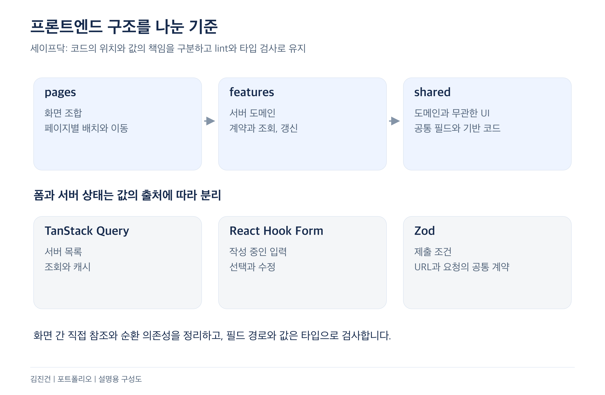
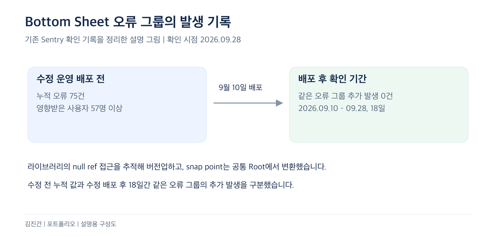
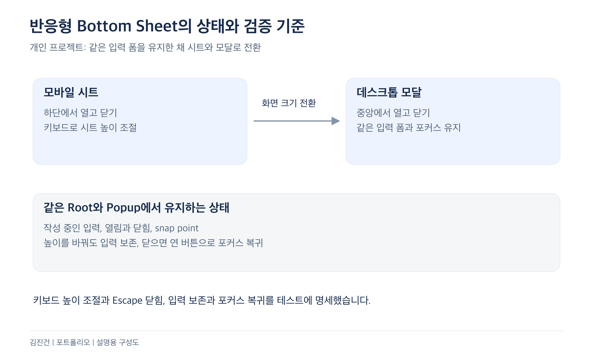

# 김진건 포트폴리오 | 당근 산업기능요원 캠페인

Frontend Engineer | jingeon27@gmail.com | GitHub: jingeon27

산업기능요원 현역 복무 중 | 2025.08 편입 | 전직 희망

사용자가 입력하고 예약하는 흐름과 병원, 운영팀의 업무를 함께 개발했습니다. 이 문서에서는 정식 출시, 웹 플랫폼과 아키텍처, 운영 오류 대응, 개인 프로젝트의 인터랙션과 GraphQL 판단을 보여 주는 다섯 사례를 설명합니다. 직접 맡은 범위와 선택의 이유, 받아들인 비용과 검증 결과를 함께 적었습니다.

## 대표 사례

- 프로그램 개발에서 건강검진 내재화까지
- SSR과 프론트엔드 아키텍처 개선
- Sentry 도입과 운영 오류 추적
- 반응형 공통 UI와 인터랙션 검증
- 사진 커뮤니티 피식

## 경력과 기여 범위

| 구분 | 기간 | 담당 범위 |
| --- | --- | --- |
| 세이프닥 | 2025.05 – 현재 | 전사 프론트엔드 개발과 QA. 병원 관리자와 백오피스는 기능 요구사항을 바탕으로 화면 구성과 상세 동작 설계. API 계약은 백엔드와 조율 |
| 왓타임 | 2024.01 – 2024.11 | 채용 SaaS RoundHR의 웹 기능과 Electron 수집 앱. 개발자, 디자이너와 협업 |
| 개인 프로젝트 | 2026.10 – 현재 | 요구사항과 제품 범위, UI와 API/DB, 실패 정책과 테스트 기준, 배포 구성 설계. 구현과 테스트 작성은 에이전트에 맡기고 결과 검토 |

## 프로그램 개발에서 건강검진 내재화까지

2025.05 – 현재 | 복지몰, 병원 관리자, 백오피스 | 건강검진 개발 2026.09 시작

**담당과 기여:** 프로그램 상세 확장의 스타일과 OG 메타, 퍼널 이벤트를 맡고 병원 등록과 운영팀 검수 화면을 처음 개발했습니다. 이후 건강검진에서는 3개 제품의 프론트엔드와 연동 검증을 전담했습니다. 제휴 병원의 요구사항을 개발팀장, 부팀장과 확인하고 백엔드 개발자와 API와 예외 처리를 맞췄습니다.

**문제 상황**

입사 당시 복지몰은 비급여 프로그램 상세가 없어 사용자가 병원 상세에서 바로 예약했습니다. 팀이 프로그램 상세와 쿠폰팩을 추가하면서 사용자가 프로그램 정보를 살펴보는 흐름을 확장했습니다. 병원이 프로그램을 등록하고 운영팀이 검수하는 관리 흐름도 개발했습니다.

건강검진은 아임웹에서 정보를 보고 전화로 문의하던 별도 흐름이었습니다. 검사 구성과 기업지원 코드, 예약금 처리 방식이 비급여 프로그램과 달라 기존 복지몰과 병원 관리자에서 관리하기 어려웠습니다. 제휴 병원의 요청으로 건강검진을 세 제품 안에서 처리하는 작업이 이어졌습니다.

**해결 방법**

프로그램 상세에서는 동료가 주 화면을 구현하고 저는 스타일과 OG 메타, 리뷰 조회와 공유 등의 퍼널 이벤트를 맡았습니다. 병원 관리자의 프로그램 템플릿 등록과 검수 요청, 백오피스의 검수와 반려, 승인 화면은 처음 개발했습니다. 등록부터 검수중, 반려와 승인까지 잇는 dev API 서버 E2E는 테스트 도입 뒤인 2026년 9월에 추가했습니다.

*2026년 9월 28일 스테이지에서 테스트 데이터로 촬영한 실제 화면입니다. 병원 등록과 운영팀 검수 흐름 중 본인이 처음 개발한 등록 화면입니다.*

건강검진에서는 검사 구성부터 예약, 취소와 환불까지 세 제품의 흐름을 연결했습니다. 기존 비급여 프로그램에 없던 검사 선택과 기업지원 코드, 예약금 처리를 추가하고 각 담당자가 처리할 흐름을 나눴습니다.

| 제품 | 구현한 흐름 |
| --- | --- |
| 백오피스 | 검사항목과 검진 프로그램 구성, 기업지원 서류 확인, 결제취소와 환불 승인 |
| 병원 관리자 | 검진 예약 관리와 예약금 결제취소 요청 접수 |
| 복지몰 | 검사 선택, 기업 검진 코드 입력, 예약금 결제 |

*2026년 9월 28일 스테이지에서 테스트 데이터로 촬영한 구현 화면입니다. 필수 검사와 선택 그룹을 구성하는 본인 담당 화면이며 정식 오픈은 9월 30일입니다.*

모바일 토스페이먼츠 결제창은 결과를 리다이렉트로 돌려줘, 결제창을 다녀오면 페이지가 새로 열리며 신청 입력이 사라졌습니다. 사용자가 같은 신청을 이어갈 수 있도록 입력을 어느 결제 시도까지 복원할지 정했습니다. 입력값을 `orderId`와 함께 sessionStorage에 저장하고, 같은 주문이며 현재 Zod 스키마를 통과한 값만 한 번 복원했습니다. 이전 결제 시도나 옛 폼 값이 현재 입력을 덮어쓰지 않도록 했습니다.

검사를 정해진 수만큼 고르면 다음 그룹을 자동으로 열자는 요청도 있었습니다. 기존 선택을 수정할 때도 화면이 넘어가는 문제를 짚고 담당자와 논의했습니다. 선택 수를 채운 그룹에서 아직 고르지 않은 chip만 비활성화해 초과 선택을 막았고, 빠져 있던 비활성 상태 디자인도 요청해 반영했습니다.

검사항목 일괄 저장에서는 일부 요청만 성공할 수 있었습니다. 이전 폼으로 재시도하면 이미 만든 항목을 또 전송하므로, 성공 여부와 관계없이 서버 목록을 다시 받아 발급된 ID를 폼에 반영했습니다. 검진 구성 수정이 거절될 때는 삭제된 검사항목까지 조회 응답에 들어오는 것을 찾아 백엔드에 전달하고 요청값을 실제 API 계약에 맞췄습니다.

**트레이드오프**

앱 전역에 Zustand persist를 두면 여러 화면에서 입력을 재사용하기 쉽지만, 이 값은 결제창을 다녀오는 한 번의 신청에 필요한 상태였습니다. `orderId`와 입력값을 sessionStorage에 묶어 저장해 복원 범위를 해당 탭의 결제 시도로 좁혔습니다. 다른 기기나 다음 방문까지 입력을 복원하는 범위로 확장하지 않았고, 같은 주문인지와 현재 스키마를 통과하는지는 별도로 검사합니다.

검사 선택도 다음 그룹으로 자동 이동하는 편의보다 기존 선택을 고칠 수 있는 흐름을 우선했습니다. 사용자가 다음 그룹을 직접 여는 동작은 남기고, 선택 수를 채운 그룹의 미선택 chip만 비활성화했습니다.

**결과 및 배운 점**

프로그램 상세 확장과 병원 등록, 운영팀 검수 흐름 개발에 이어 건강검진의 프로그램 구성과 예약, 취소와 환불까지 담당했습니다. **건강검진 3개 제품의 프론트엔드와 연동 검증을 전담해 3주 만에 정식 오픈**했습니다(2026년 9월 9일 개발 시작 → 23일 운영 배포 → 30일 오픈).

결제 실패 후 입력 복원과 승인 요청 실패 뒤 이동은 dev API 서버 E2E로 확인했습니다. 여러 제품이 연결되는 기능에서는 각 화면의 완료뿐 아니라 실패 후 어떤 값으로 다시 시도할 수 있는지도 검증 기준에 넣었습니다.

## SSR과 프론트엔드 아키텍처 개선

2025.05 – 현재 | 세이프닥 복지몰과 관리자 서비스

**담당과 기여:** 서버와 클라이언트의 조회 경계 전환, 상태와 폼의 책임 분리, FSD와 도메인 의존성, 공통 계약의 설계와 화면별 적용을 맡았습니다.

**문제 상황**

서버에서 조회한 값을 render props로만 읽는 화면은 Query 캐시를 무효화해도 바뀌지 않았습니다. 예약의 서버 목록과 작성 중인 값도 Query, Zustand, 로컬 상태에 흩어져 가족을 추가하면 선택한 일시가 어긋났습니다. 코드 위치와 공통화 기준이 모호해 화면 간 직접 참조와 도메인 순환 의존성도 남아 있었습니다.

**해결 방법**

2025년 5월 예약 화면부터 prefetch와 hydration으로 전환했습니다. 서버는 초기 HTML에 필요한 데이터를 준비하고 클라이언트는 같은 캐시를 구독하도록 했습니다. 서버 목록은 Query, 작성 중인 입력은 React Hook Form, 제출 조건은 Zod가 맡도록 나눴습니다.

서버 도메인은 features, 화면 조합은 pages, 도메인과 무관한 공통 UI는 shared로 정했습니다. 프로그램과 시술 도메인의 순환 의존성을 끊고 화면 간 직접 참조를 lint error로 검사했습니다. 검색 필터는 화면별 조합을 허용하면서 URL과 폼, API 요청이 같은 Zod 스키마를 따르게 했습니다. Ant Design Form은 재귀 조건부 타입으로 중첩 필드 경로와 값을 검사하는 래퍼를 만들었습니다.

*본인이 적용한 코드의 의존 방향과 값의 책임을 설명하는 구성도입니다.*

인증 이동 오류는 Next.js 소스까지 추적해 `redirect()`가 AppRouter 렌더를 중단하며 훅 개수가 달라지는 경로를 확인하고 진입 판정을 proxy로 옮겼습니다. 관리자 검색 오류는 build 후 start로 목록 7개 중 6개에서 재현하고, 서버가 읽지 않는 조회 조건에 History API를 적용했습니다.

**트레이드오프**

서버와 클라이언트가 같은 queryKey와 초기 데이터 계약을 사용하도록 맞춰야 했습니다. 화면 배치를 범용 렌더러에 모두 넣는 대신 JSX 중복을 일부 감수하고 반드시 같아야 하는 데이터 계약만 공통화했습니다. 공통 계약과 lint rule이 바뀌면 사용하는 화면과 규칙 자체의 테스트도 확인합니다.

**결과 및 배운 점**

검색 필터는 27개 화면에 적용했고 공통 필드 31개와 앱별 확장의 경로와 값을 타입 검사에서 확인합니다. 화면 간 직접 참조 62건을 정리하고 예약 대상 선택 컴포넌트를 519줄에서 55줄로 줄였습니다. 프레임워크의 캐시와 화면 유지 방식까지 확인한 뒤 상태의 책임과 전환 범위를 정했습니다.

## Sentry 도입과 운영 오류 추적

2026.08 – 현재 | 복지몰과 관리자 서비스

**담당과 기여:** 복지몰의 Sentry 도입과 수집 정책, 크래시 원인 추적과 수정을 맡았습니다. 관리자 서비스에서는 오류 경계를 나누고 API와 Zod 실패를 CloudWatch로 트래킹하도록 정리했습니다.

**문제 상황**

간헐적인 오류의 원인과 영향받은 사용자를 파악할 수 있어야 했습니다. 관리자 서비스에서는 일부 조회 실패가 헤더와 정상 구획까지 지웠고, 회원 조회의 일시적인 실패도 로그아웃으로 처리됐습니다.

**해결 방법**

간헐적인 오류의 원인과 영향받은 사용자를 찾으려고 복지몰의 브라우저, 서버, Edge에 Sentry를 도입했습니다. 8월 19일 구현을 시작해 27일 운영에 배포했습니다. 화면을 표시할 수 없는 실패와 나머지 실패를 구분하고 요청 종류와 상태 코드에 따라 레벨을 나눴습니다. 인터셉터와 오류 경계에서 같은 오류가 중복 수집되지 않게 했습니다.

의료 서비스이므로 SDK 소스에서 event와 breadcrumb에 URL, 쿠키, 인증 헤더가 실리는 경로를 확인했습니다. 공통 함수에서 민감정보를 제거하고 사용자 식별은 회원 ID로만 했습니다. release와 브라우저 소스맵을 연결해 배포 버전별 오류 위치를 찾도록 했습니다.

Bottom Sheet 드래그 크래시는 라이브러리 내부의 null ref 접근까지 따라가 버전업으로 해결했습니다. 달라진 snap point는 공통 Root에서 변환해 호출부 API를 유지했습니다.

회원 조회가 어떤 이유로든 실패하면 로그아웃되던 동작도 나눴습니다. 401일 때만 로그아웃하고 타임아웃이나 서버 오류는 다시 시도할 수 있게 했습니다.

관리자 서비스에서는 일부 조회 실패가 앱 루트의 Error Boundary로 번져 헤더와 정상 구획까지 사라졌습니다. 독립적으로 복구할 수 있는 기능 단위로 경계를 나누고 백오피스 라우트 30개의 화면 구성을 맞췄습니다. 동의서 문서 조회가 실패해도 고객명과 동의 내역은 남는지 테스트했습니다. 관리자 서비스의 API 오류와 렌더링 오류, Zod 스키마 불일치는 CloudWatch에서 트래킹합니다.

*2026년 9월 28일 확인한 Sentry 기록을 정리한 설명 그림입니다. 수정 전 누적 값과 배포 후 18일의 추가 발생을 구분합니다.*

**트레이드오프**

URL과 쿠키, 인증 헤더를 그대로 남기면 특정 요청을 추적하기는 쉽지만 민감정보도 수집될 수 있습니다. 해당 값을 제거하면서 원문만 보고 요청 상황을 복원할 수 있는 정보는 줄었고, release와 브라우저 소스맵, 스택 위치와 오류 종류를 중심으로 원인을 추적하도록 했습니다.

오류 경계를 루트에 모으면 처리는 단순하지만 작은 조회 실패도 전체 화면을 가립니다. 기능별로 나눠 정상 구획을 남기는 대신 각 구획에 실패 안내와 재시도 동작을 마련해야 했습니다. Bottom Sheet 버전업도 호출부 API를 유지하려고 달라진 snap point를 공통 Root에서 변환하는 코드를 남겼습니다.

**결과 및 배운 점**

Bottom Sheet 드래그 크래시는 운영 배포 전 누적 75건, 57명 이상에게 발생했고, 9월 10일 배포 뒤 28일까지 18일간 같은 오류 그룹의 추가 발생은 0건이었습니다.

회원 조회 실패에 따른 로그아웃 수정도 9월 23일 배포 뒤 28일까지 관련 CS 문의나 Sentry 이슈가 없었습니다.

오류 건수만 줄이는 것과 정상 화면을 보존하는 것은 별개의 과제였습니다. 수집 범위와 복구 경계를 함께 정하고, 개선 결과는 같은 오류 그룹과 확인 기간을 기준으로 추적했습니다.

## 반응형 공통 UI와 인터랙션 검증

2026.10 – 현재 | 개인 프로젝트 공통 디자인 시스템

**담당과 기여:** 입력과 포커스 유지, 화면 크기 전환과 키보드 동작의 기준을 정했습니다. 구현과 테스트 작성은 에이전트에 맡기고 제출된 코드와 화면, 검증 결과를 검토합니다.

**문제 상황**

모바일의 시트와 데스크톱의 모달을 별도 컴포넌트로 바꾸면 작성 중인 입력과 포커스가 함께 바뀔 수 있습니다. UI를 공통화하면서도 제품별 데이터 조회와 완료 후 이동은 앱에서 다뤄야 했습니다.

**해결 방법**

같은 Root와 Popup 안에서 CSS 미디어쿼리로 시트와 모달을 전환하고 입력 폼의 인스턴스를 유지하도록 했습니다. 열고 닫을 때의 이동과 투명도, 크기 전환을 구현했습니다. 입력창과 Dialog 등 공통 UI는 공용 패키지로 모으고 데이터 조회와 완료 후 이동은 각 앱에 남겼습니다.

*공통 UI의 상태 경계와 테스트에 명세한 동작을 설명하는 구성도입니다. 실제 UI 캡처와 구분합니다.*

**트레이드오프**

공통 UI를 바꾸면 두 제품을 함께 확인해야 합니다. 제품별 차이를 모두 공용 컴포넌트에 넣지 않고 데이터 조회와 후속 이동은 앱이 맡도록 했습니다. 반응형 동작도 같은 입력 폼을 유지하는 대신 CSS와 snap point, 키보드와 포커스 조건을 함께 관리합니다.

**결과 및 배운 점**

키보드로 시트 높이를 바꿔도 입력이 유지되고 Escape로 닫으면 연 버튼으로 포커스가 돌아오는 조건을 테스트에 담았습니다. Storybook과 접근성 검사, 색 대비 테스트도 검토합니다. UI가 보이는 모양과 함께 입력 상태와 키보드 이동을 완료 기준으로 다룹니다.

## 사진 커뮤니티 피식

2026.10 – 현재 | 개인 프로젝트

*2026년 10월 31일 side-project origin/develop의 0deb9209 소스에서 촬영한 실제 UI입니다. 그룹과 게시물, 계정은 테스트 데이터입니다.*

**담당과 기여:** 대회에서 상시 그룹으로 바꾸는 제품 방향, 화면과 API/DB 계약, GraphQL과 Apollo의 검증 기준을 정했습니다. 구현과 테스트 작성은 에이전트가 맡고 저는 코드와 화면, 검증 결과를 검토합니다.

**문제 상황**

친구끼리 사진을 올리고 투표하는 대회로 시작했습니다. 직접 써 보며 대회가 없을 때도 사진을 모을 공간이 필요하다고 판단했습니다.

**해결 방법**

상시 그룹으로 바꾸고 홈에는 가입한 그룹의 새 게시물을 모았습니다. 공개 그룹 탐색을 추가하고 기존 사진과 대회, 이전 링크는 보존했습니다.

NestJS의 schema-first GraphQL과 Apollo Client를 사용합니다. 타입 생성만으로 실제 조회 문서와 화면 캐시까지 맞는다고 볼 수 없어 검증을 나눴습니다. GraphQL Code Generator로 문서 타입을 생성하고 모든 연산과 fragment를 서버 스키마와 대조합니다. 객체 ID 기반 정규화 캐시와 `useFragment`, 페이지네이션과 좋아요의 낙관적 갱신은 실제 Apollo 캐시에 값을 쓰고 읽어 확인합니다. RSC의 `PreloadQuery` 결과를 브라우저로 넘기고 개인화 조회와 공개 SEO 조회는 분리했습니다.

**트레이드오프**

기간제 대회는 참가와 투표, 종료 시점이 분명하지만 대회가 없을 때 사진을 올릴 흐름이 비어 있었습니다. 상시 그룹으로 바꿔 대회 주기와 관계없이 공유할 수 있게 한 대신, 공개와 비공개, 가입 승인과 탐색을 계속 관리해야 하는 제품으로 범위가 넓어졌습니다. 기존 대회와 사진, 이전 링크도 보존해 새 구조와 과거 데이터의 연결을 함께 유지했습니다.

Apollo의 정규화 캐시는 같은 게시물의 변경을 여러 화면에 반영할 수 있지만 엔티티 ID와 목록별 병합 정책을 관리해야 합니다. 그룹과 카테고리, 정렬 조건이 다른 목록을 섞지 않는지 실제 캐시 테스트로 확인합니다.

**결과 및 배운 점**

검증하려는 가설은 대회가 없어도 친구들과 사진을 모으는지, 초대와 반응이 재방문으로 이어지는지입니다. 가입 → 첫 게시물 → 좋아요 → 재방문 흐름을 확인할 준비를 했으며 실사용 성과는 아직 측정하지 않았습니다.

제품 방향을 바꾼 판단과 그 방향이 사용자에게 유효한지는 별도입니다. 구현한 흐름과 앞으로 확인할 가설을 나눠 기록했습니다.

## 제품 실험과 협업 요약

세이프닥에서는 Amplitude 기반 A/B 테스트 환경을 구축하고 PO, 마케터, 개발팀장과 트래킹할 데이터를 협의했습니다. 검색과 시술 상세, 예약과 쿠폰 이벤트 140개 이상을 새로 붙이거나 고쳤습니다.

| 작업 | 담당 범위 |
| --- | --- |
| 로그인 전 탐색 실험 | 진입과 인증 처리. 랜딩 변경과 원복은 동료가 구현 |
| 시술 상세와 전화상담 실험 | 스타일과 OG 메타, 퍼널 및 클릭 위치 이벤트. 전화상담 종료 뒤 채팅상담으로 복원 |
| 쿠폰 룰렛 캠페인 | 진료과 선택부터 당첨과 쿠폰함, 예약 이동, 공유의 UI와 이벤트. 종료 후 방문 이벤트를 확인해 랜딩 코드 정리 |

신규 가입 UTM 누락은 Amplitude 속성을 unexpected에서 live로 바꾸면 해결할 수 있음을 확인해 PO에게 공유했습니다. 추가한 저장 코드는 운영 배포 전에 되돌렸습니다. 측정 방식과 설정을 확인해 불필요한 코드 변경을 줄인 사례입니다.
