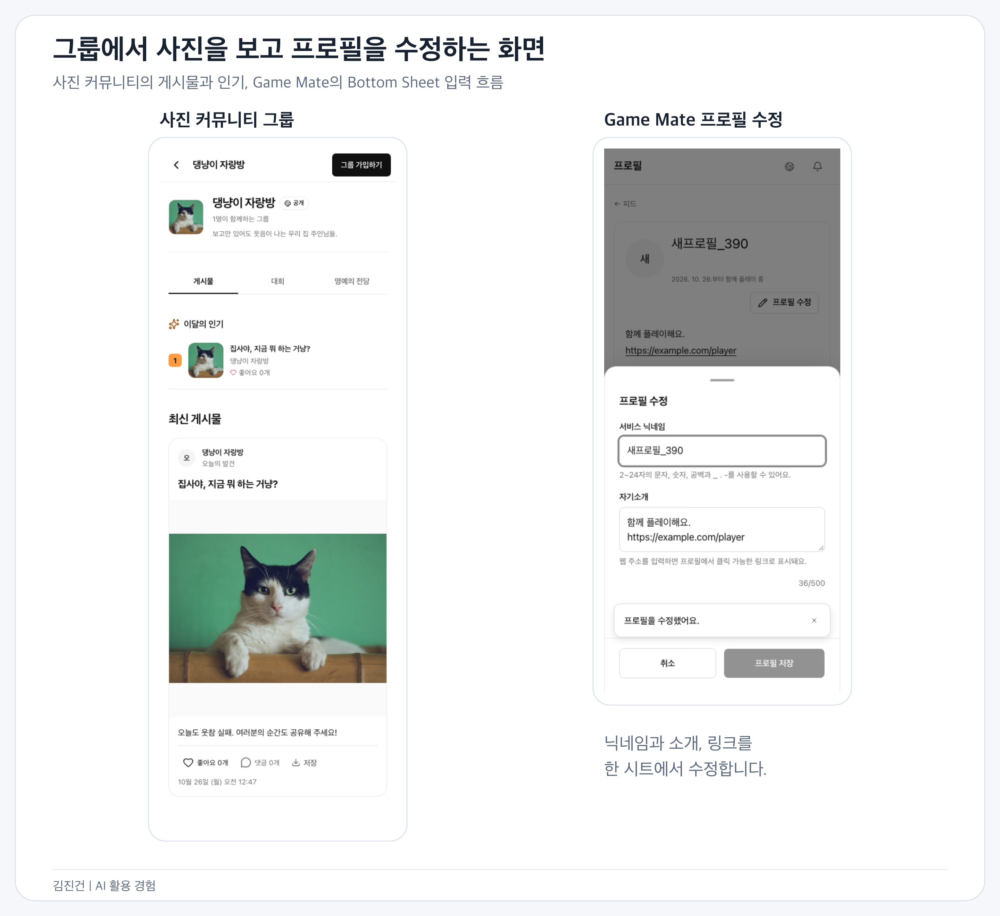
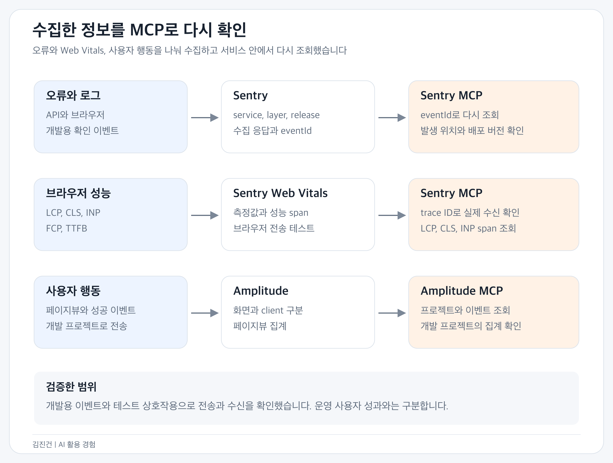

# 김진건의 사이드프로젝트와 AI 활용 경험

jingeon27@gmail.com | [GitHub](https://github.com/jingeon27) | [이력서](resume-doers-ai-product-engineer.md)

## 직접 만들고 있는 제품

2026년 10월부터 친구들과 사진을 모으는 그룹 커뮤니티 별사대와 글로벌 게임 커뮤니티 Game Mate를 만들고 있습니다. 제품 방향과 디자인, 기술 선택은 제가 맡고 구현과 테스트 작성은 코딩 에이전트에 맡깁니다. 웹뿐 아니라 API와 DB, 배포 구성까지 다루고 있습니다.

사진 서비스에서는 대회가 끝나도 사진과 관계가 남도록 제품 방향을 바꿨습니다. Game Mate에서는 글과 댓글, 채팅으로 게임에 관한 피드백과 코칭을 주고받도록 만들었습니다. 두 서비스는 Yarn workspace 모노레포에서 관리합니다.

두 서비스 모두 초기 사용자 검증을 준비하고 있습니다.

[전체 저장소](https://github.com/jingeon27/side-project)

*검증용 데이터로 확인한 Game Mate 피드와 회원가입, 사진 커뮤니티의 그룹 탐색 화면입니다.*

## 에이전트에게 맡기는 일과 제가 확인하는 것

2026년 4월부터 실무에서 코딩 에이전트로 개발하며 skills와 lint rule을 보강해 왔습니다. 개인 프로젝트에도 이 방식을 가져오되, 저장소의 구조와 기술에 맞게 고쳤습니다.

작업 목표와 plan 검토 → 테스트 작성 → 에이전트 구현과 에이전트 코드 리뷰 → 변경분 테스트, lint, typecheck → 직접 diff 리뷰와 화면 동작 확인 → 전체 CI

완성본을 받으면 요구사항과 테스트 명세부터 대조합니다. 컴포넌트마다 필요한 동작이 `*.spec`에 빠짐없이 들어갔는지, 제품 코드의 상태 관리와 컨벤션이 맞는지 읽습니다. 화면을 직접 써 보고 부족한 부분을 짚어 수정을 요청합니다. 에이전트 리뷰의 critical 항목은 자동으로 고치게 하되 수정 결과는 다시 확인합니다. 어느 단계에서든 문제가 나오면 앞 단계로 돌아갑니다.

익숙하지 않은 기술은 에이전트에게 장단점과 대안을 묻습니다. 설명이 이해되지 않으면 동작 원리부터 다시 질문하고 코드와 문서를 함께 봅니다. 캐시를 언제 갱신할지, 파일을 어느 서버가 받을지, 배포 비용과 관리 범위를 어디까지 감당할지처럼 선택이 필요한 부분을 확인하며 결정했습니다.

## 사진 대회에서 상시 커뮤니티로

처음에는 친구끼리 사진을 올리고 투표하는 대회로 시작했습니다. 화면을 써 보니 대회가 열릴 때만 들어오는 서비스보다는 평소에도 사진을 모을 수 있는 편이 좋겠다고 생각했습니다. 그룹을 계속 유지하고 사진, 동영상, 합성 이미지를 언제든 올릴 수 있게 바꿨습니다.

홈에서는 가입한 그룹들의 새 게시물을 바로 볼 수 있게 했습니다. 그룹 목록은 MY로 옮기고, 초대 링크가 없어도 공개 그룹을 찾아볼 수 있는 탐색 화면을 추가했습니다. 공개 그룹의 게시물은 로그인 없이 볼 수 있지만 비공개 그룹은 가입 승인을 받아야 볼 수 있습니다.

새 게시물에는 대회 마감일이나 한 사람당 한 장 같은 제한을 두지 않았습니다. 기존 대회와 사진 데이터, 이전 링크는 보존하면서 상시 게시물을 더했습니다. 대회 기능도 그룹 안에서 선택해 참여할 수 있도록 남겼습니다.

*대회가 끝나도 그룹과 게시물은 남고, 새 대회는 그룹 안에서 열 수 있게 바꿨습니다.*

글로벌 게임 커뮤니티에서는 프로필에서 처리할 수 있는 설정 메뉴를 합쳤습니다. 코칭은 코치와 수강생 모두 모집 글을 쓸 수 있게 했습니다. 수강료 표기는 시간당, 월 단위, 목표 달성까지로 나눴지만 결제와 정산은 아직 만들지 않았습니다. 문의와 인증 요청도 별도 티켓 시스템을 추가하지 않고 기존 관리자 1:1 채팅으로 받도록 했습니다.

[사진 서비스 제품 방향](https://github.com/jingeon27/side-project/blob/82199271/projects/photo-contest/docs/product-plan.md) | [글로벌 게임 커뮤니티 제품 범위](https://github.com/jingeon27/side-project/blob/82199271/projects/game-feedback/docs/product.md)

## 화면을 보고 수정한 부분

인스타그램처럼 정돈된 느낌을 요청했더니 스토리 기능도 없는 프로필에 스토리 테두리가 붙었습니다. 순위가 사진을 가리는 화면도 있었습니다. 참고한 서비스의 장식까지 가져올 필요는 없어 테두리는 빼고, 순위는 사진 밖으로 옮겨 달라고 했습니다.

| 처음 받은 화면 | 수정한 내용 |
| --- | --- |
| 사진을 보려면 내용 보기 버튼을 눌러야 함 | 제목과 본문을 피드에 바로 표시 |
| 등록 버튼 아래에 선택 파일이 따로 표시됨 | 파일 선택 영역을 미리보기로 교체 |
| 수정, 숨기기, 삭제 버튼이 각각 노출됨 | 메뉴로 모으고 권한에 따라 표시 |
| 모바일 채팅에 Shift+Enter 안내가 있고 헤더가 큼 | 불필요한 안내를 빼고 대화 영역과 입력 높이 조정 |
| 실제 동작과 무관한 LIVE, ACTIVE 표시 | 표시 제거 |

모바일에서는 로그인과 약관, 닉네임 입력을 작은 창에 몰아넣지 않고 별도 페이지로 바꿨습니다. 댓글은 처음에는 화면의 75%로 열리고 헤더를 끌어 확장할 수 있게 했습니다. 데스크톱에서는 사진과 대화를 나란히 배치하도록 수정했습니다.

최근에는 가입 화면에서 게임 프로필을 선택적으로 연결하게 하고, 짧은 화면에서도 입력 본문만 스크롤되도록 바꿨습니다. 가입 완료 버튼은 하단에 남겨 입력을 마친 뒤 다시 찾아 내려가지 않게 했습니다.

프로필은 펼침 메뉴에서 고치는 방식 대신 '프로필 수정' 버튼으로 Bottom Sheet를 열도록 요청했습니다. 닉네임과 자기소개를 수정하고, 소개에 넣은 웹 주소는 프로필에서 누를 수 있게 했습니다. 이 작업에 맞춰 DB의 자기소개 필드와 API 계약, 생성 SDK도 함께 변경했습니다. 게임 프로필에는 제공되는 시즌 순위와 외부 상세 링크도 추가했습니다.

*사진 서비스의 그룹 화면과 Game Mate의 프로필 수정 화면입니다. 데이터는 화면 검증용입니다.*

두 서비스에서 버튼과 입력창의 모양이 달라지지 않도록 shadcn/ui와 Base UI 기반 공통 디자인 시스템을 만들었습니다. 색과 글자 스타일, 버튼, 입력창, Dialog는 공용 패키지에 뒀습니다. 피드와 레이아웃, 라우팅과 데이터 조회는 각 앱에 남겼습니다. 함께 쓰는 UI를 고칠 때는 두 앱에서 모두 확인합니다.

[공통 디자인 시스템](https://github.com/jingeon27/side-project/tree/82199271/packages/design-system) | [사진 서비스 화면 구성](https://github.com/jingeon27/side-project/blob/82199271/projects/photo-contest/apps/web/AGENTS.md)

## 서비스 구조와 상태 관리

사진 서비스는 schema-first GraphQL과 Apollo Client, 게임 서비스는 REST와 TanStack Query를 사용합니다. 두 서비스의 API와 캐시는 각각 유지하고 UI와 lint 설정을 공용 패키지로 옮겼습니다.

*각 서비스의 웹과 API, 모바일은 projects 아래에 두고, 디자인 시스템과 lint는 루트 packages에서 공유합니다.*

게임 서비스의 첫 구현은 App 한곳에 여러 기능이 몰려 있어 화면과 도메인별로 나누도록 요청했습니다. 작성과 수정을 한 폼의 mode로 처리하던 코드도 바꿨습니다. 입력 필드는 함께 쓰되, 작성 후 페이지 이동과 수정 후 창 닫기는 각 화면에서 처리합니다. 관리자 API도 사용자 API와 같은 테이블을 쓰지만 권한과 처리 절차가 달라 controller와 service를 따로 뒀습니다.

서버 데이터는 Query나 Apollo 캐시에 두고, 폼 입력과 검증에는 RHF와 Zod를 씁니다. 오버레이를 열고 닫는 상태는 overlay-kit으로 관리합니다. WebView 연결처럼 React 밖에서도 유지해야 하는 자원은 class로 관리하고 `useSyncExternalStore`로 구독합니다. 요청마다 훅을 추가하던 코드는 query options와 mutation options를 필요한 곳에서 조합하도록 정리했습니다.

REST는 서버 스키마에서 OpenAPI 문서와 Orval SDK를 생성합니다. Zod 응답 검증에 실패했을 때 기본값을 넣는 처리는 화면 표시용 필드에만 허용했습니다. ID, 권한, 세션처럼 잘못 읽으면 안 되는 값은 검증에 실패하면 요청도 실패로 처리합니다.

[게임 서비스 아키텍처](https://github.com/jingeon27/side-project/blob/82199271/projects/game-feedback/docs/architecture.md) | [생성과 수정 흐름 분리](https://github.com/jingeon27/side-project/tree/82199271/projects/game-feedback/apps/web/src/widgets/post-composer)

## 공개 캐시 갱신과 재시도

Next.js 캐시를 적용할 수 있을지 에이전트에게 물어보고 갱신 방법을 비교했습니다. 일정 시간마다 만료하는 방식이 단순하지만, 사용자가 방금 수정한 글은 바로 바뀌기를 원했습니다. Game Mate에서는 NestJS에서 수정이 끝나면 Next.js Route Handler를 호출해 해당 태그의 캐시를 만료하도록 했습니다.

공개 게시글은 쿠키 없이 조회해 캐시하고, 사용자별 상태는 별도로 조회합니다. 수정 후에는 브라우저의 Query 캐시와 Next 서버 캐시를 각각 갱신합니다.

*DB에 변경 내용과 만료할 캐시 태그를 함께 저장합니다. 콜백이 실패하면 DB에 남은 기록으로 재시도합니다.*

게시글은 저장됐는데 캐시 만료 콜백이 실패했다고 저장 실패를 반환하면 사용자가 다시 작성할 수 있습니다. 이 경우에는 저장 성공을 반환하고 캐시 만료만 재시도합니다. 콜백을 기다리는 동안 같은 태그에 새 수정이 생길 수도 있습니다. 이전 콜백이 뒤늦게 끝나 새 기록까지 지우지 않도록 revision이 일치할 때만 대기 기록을 삭제합니다.

시간 기반 캐시보다 구현이 복잡해지고 재시도 대기열도 관리해야 합니다. 수정 직후 갱신하면서도 콜백 실패를 복구하려고 선택한 방식입니다. 트랜잭션 롤백, 콜백 실패 후 재시작, 이전 콜백이 늦게 끝나는 경우를 테스트에 넣었습니다.

사진 서비스는 공개 SEO 데이터에만 fetch 캐시를 적용하고, 개인화된 Apollo 요청은 no-store로 유지했습니다. 공개 여부와 대회 일정은 별도로 확인하며 mutation 뒤 공개 태그를 만료합니다.

[캐시 무효화 구현](https://github.com/jingeon27/side-project/blob/82199271/projects/game-feedback/apps/api/src/cache-invalidation/cache-invalidation.service.ts) | [실패와 경합 테스트](https://github.com/jingeon27/side-project/blob/82199271/projects/game-feedback/apps/api/src/cache-invalidation/cache-invalidation.integration.spec.ts)

## 파일을 API 서버가 받지 않도록 변경

파일 전체를 API 서버가 받으면 업로드가 겹칠수록 메모리와 전송 부담이 커집니다. 처음에는 서버 작업을 동시에 3개만 처리하고 12개까지 기다리게 했습니다. 이후 프로필 사진을 포함한 Game Mate의 업로드를 모두 브라우저에서 S3로 직접 보내도록 통일했습니다. 파일을 받는 작업 자체를 API 서버에서 줄이는 쪽으로 바꾼 것입니다.

*Game Mate는 업로드 후 파일 앞부분도 검사합니다. 사진 서비스는 HEAD로 크기와 형식만 확인합니다.*

게임 서비스의 업로드는 서명 발급 → 브라우저의 S3 전송 → 완료 확인 순서입니다. 서버가 허용하는 크기와 형식을 POST 정책에 넣습니다. 업로드가 끝나면 HEAD와 파일 앞 4KB를 검사하고, ETag가 일치할 때만 최종 객체로 복사합니다. 전체 파일을 서버 메모리에 올리지 않으면서 검사 후 파일이 바뀌는 경우도 막도록 했습니다.

사진 서비스의 게시물, 대회 사진, 그룹 대표 사진도 직접 업로드합니다. 원본을 보관하기로 해 서버 변환을 없앴고 완료 시 HEAD로 크기와 형식만 확인합니다. Game Mate와 달리 파일 내용까지 검사하거나 별도 객체로 복사하지는 않습니다. 서명 정책이 만료되기 전에는 같은 키의 파일이 다시 올라올 수도 있습니다.

S3 버킷 경로와 CORS, IAM 역할을 연결할 위치는 에이전트에게 질문하며 설정했습니다. 반복 테스트는 로컬 S3 대체 환경에서 돌리고, Game Mate는 실제 AWS S3에서도 게시물, 프로필, 채팅 파일의 업로드와 조회를 확인했습니다. HTTP와 API로 서명 발급, 직접 업로드, 완료 처리, 원본 일치와 Range 조회를 검사했습니다.

[게임 서비스 파일 확정](https://github.com/jingeon27/side-project/blob/82199271/projects/game-feedback/apps/api/src/media-storage/media-storage.service.ts) | [S3 직접 업로드 통일](https://github.com/jingeon27/side-project/commit/2ca0034f) | [사진 서비스 업로드](https://github.com/jingeon27/side-project/blob/82199271/projects/photo-contest/apps/api/src/media-upload/media-upload.service.ts) | [실제 S3 검증 기록](https://github.com/jingeon27/side-project/blob/b758d2e8/projects/game-feedback/docs/implementation.md)

## 앱별 테스트와 공통 lint

테스트는 각 앱에서 관리하고 루트에서는 실행만 위임하도록 했습니다. unit과 integration 테스트는 구현 파일 옆에 둡니다. 새 동작은 `*.spec`, 발견한 오류의 재현은 `*.test`로 구분했습니다.

*UI와 API, 브라우저 흐름을 나눠 확인합니다. 권한과 동시성 테스트는 실제 PostgreSQL을 사용합니다.*

- Vitest로 함수와 UI를 테스트하고, Supertest와 격리된 PostgreSQL로 API 응답과 DB에 저장된 값을 확인합니다.
- Playwright로 웹과 WebView 호스트를 연결해 글 작성, 댓글, 채팅과 화면 이동을 확인합니다. OS 기능과 외부 인증은 fixture로 대체하고 앱과 웹 사이의 메시지와 이동 흐름을 테스트합니다.
- 권한과 동시성은 함수 호출 횟수보다 DB 결과를 확인합니다. 대회당 한 표, 동시 가입과 양도, 캐시 콜백 경합 같은 조건을 통합 테스트로 남겼습니다.
- 테스트 스키마와 포트, 빌드 경로를 분리해 작업 중인 서버와 다른 테스트를 건드리지 않게 했습니다.

실무에서 쓰던 lint rule은 이 저장소에 맞게 고쳤습니다. TypeScript로 규칙과 preset을 만들고, 컴포넌트의 직접 fetch, 중복된 오버레이 상태, FSD 의존 방향과 공개 API를 검사합니다. 각 규칙은 RuleTester와 fixture로 테스트합니다. DOM 접근성 규칙은 Next.js와 Vite 앱에만 적용하고 Expo는 제외했습니다.

자동으로 검사할 수 있는 것은 lint rule로 옮겼습니다. 작성과 수정 흐름을 어디서 나눌지처럼 코드마다 판단해야 하는 내용은 skills에 적고 리뷰할 때 확인합니다.

[테스트 기준](https://github.com/jingeon27/side-project/blob/82199271/projects/photo-contest/.agents/skills/testing/SKILL.md) | [공용 ESLint 설정](https://github.com/jingeon27/side-project/blob/b758d2e8/packages/config/eslint/README.md) | [lint 적용 범위 변경](https://github.com/jingeon27/side-project/commit/899349f7)

## 사용자 행동 측정과 모니터링

Sentry로 API와 Next.js 서버, 브라우저에서 발생한 오류를 수집합니다. 서비스와 실행 위치, 배포 버전을 함께 남겨 어느 코드에서 생긴 문제인지 구분합니다. Amplitude로는 페이지 방문과 가입, 글쓰기, 채팅 같은 사용자 행동을 수집하고, 요청이 성공한 뒤 이벤트를 보내도록 했습니다.

두 도구를 MCP로 연결해 에이전트가 수집된 정보를 코드와 함께 조회할 수 있게 했습니다. 개발용 확인 이벤트를 실제 수집 서버로 보낸 뒤 Sentry에서는 eventId로 오류와 실행 위치를 다시 찾고, Amplitude에서는 개발 프로젝트에 페이지뷰가 집계됐는지 확인했습니다.

*수집 응답이 성공한 것과 서비스 안에서 이벤트를 다시 조회한 것을 각각 확인했습니다.*

이 과정에서 사진 서비스의 페이지뷰가 개발 모드에서 중복 집계되는 문제와, 자동 URL 수집에 검색어가 붙는 문제도 확인해 수정했습니다. 수집 설정을 넣는 것으로 끝내지 않고 실제 SDK가 보낸 데이터까지 확인하도록 검증을 보완했습니다.

두 웹에 Web Vitals 측정도 추가했습니다. Sentry BrowserTracing으로 LCP, CLS, INP와 FCP, TTFB를 수집하고, 오류 전송과 별도로 성능 span의 속성을 정리합니다. 화면별로 비교할 수 있도록 경로의 ID와 검색어는 제거하고 측정값은 남깁니다.

격리된 빌드에서 Chromium의 상호작용으로 다섯 지표가 전송되는지 테스트합니다. 검증용 상호작용을 실제 Sentry로 보내고, LCP, CLS, INP span은 MCP에서 trace ID로 다시 조회했습니다.

[Game Mate 수집과 MCP 검증](https://github.com/jingeon27/side-project/blob/82199271/projects/game-feedback/docs/observability.md) | [사진 서비스 수집 검증](https://github.com/jingeon27/side-project/blob/82199271/projects/photo-contest/docs/observability.md) | [Web Vitals 전송 테스트](https://github.com/jingeon27/side-project/blob/82199271/projects/game-feedback/apps/web/e2e/sentry-web-vitals.spec.ts)

## 인프라 선택과 Terraform

배포를 준비하며 에이전트에게 비용을 줄일 방법과 CD 설정 순서를 물었습니다. Lightsail과 EC2를 비교했고, 처음에는 두 서비스를 EC2 한 대에 올리고 DB는 RDS에 두는 구성을 잡았습니다. 이후 초기 비용을 더 줄이려고 PostgreSQL도 같은 EC2의 컨테이너로 옮기고, 파일은 서비스별 S3에 두도록 변경했습니다.

한 대가 멈추면 두 서비스와 DB가 함께 중단되고, DB 백업과 복구도 직접 관리해야 합니다. 이 비용을 감수하는 대신 DB 데이터는 별도 EBS 볼륨에 저장하고, 일일 스냅샷과 배포 전 S3 덤프를 준비했습니다. 덤프 업로드가 실패하면 migration도 진행하지 않게 했습니다.

*DB는 같은 EC2에서 실행하되 데이터 볼륨을 분리했습니다. 파일과 DB 덤프는 S3에 보관하도록 구성했습니다.*

외부 요청은 Caddy로 받고 서비스별 네트워크와 DB, 계정을 나눴습니다. 실행 중 사용하는 DB 계정과 migration 계정도 구분했습니다. VPC와 서브넷, 보안 그룹, EC2와 고정 IP, EBS와 스냅샷 정책, S3와 IAM은 Terraform으로 구성했습니다. 비밀번호와 액세스 키는 Terraform에서 생성하지 않고 별도로 주입합니다.

CI에서 검증한 이미지를 digest로 고정해 배포하고, readiness 확인에 실패하면 이전 이미지로 되돌리도록 했습니다. 같은 호스트에서 배포가 겹치지 않게 잠금도 뒀습니다. 이미지 롤백으로 DB까지 되돌릴 수는 없어 migration과 백업은 따로 확인해야 합니다.

Terraform 설정은 mock provider 테스트로 확인합니다. 배포 구성은 API와 웹 컨테이너, Caddy, PostgreSQL을 함께 띄워 재배포와 재시작, 롤백을 확인하는 smoke 테스트도 뒀습니다. 실제 AWS 리소스 적용과 운영 부하 검증은 별도입니다.

[공통 배포 구성](https://github.com/jingeon27/side-project/blob/b758d2e8/deploy/shared-instance/README.md) | [Terraform](https://github.com/jingeon27/side-project/tree/b758d2e8/deploy/shared-instance/terraform) | [Terraform 설정 테스트](https://github.com/jingeon27/side-project/blob/b758d2e8/deploy/shared-instance/terraform/tests/plan.tftest.hcl)

## 실무의 AI 개발 workflow

세이프닥에서는 기능 개발과 운영 오류 대응에 같은 검토 방식을 적용하고 마지막에 QA 더블 체크를 요청합니다. 개인 프로젝트에는 별도 QA 요청 단계가 없습니다.

티켓과 plan 검토 → 테스트 작성 → 에이전트 구현과 에이전트 코드 리뷰 → 변경분 테스트, lint, typecheck → 직접 diff 리뷰와 화면 동작 확인 → 전체 CI(테스트, knip, lint) → QA 더블 체크 요청

공통 Bottom Sheet를 바꿀 때는 코드를 읽고도 본문과 헤더가 함께 스크롤되는 문제를 놓쳤습니다. 이후 본문만 스크롤되도록 고치고 화면 확인과 레이아웃 회귀 테스트를 보완했습니다. 실제로 놓친 동작을 다음 검토와 테스트에 반영하며 기준을 다듬고 있습니다.

구현을 에이전트에 맡긴 만큼 코드를 읽고 제품을 써 보는 데 시간을 쓰고 있습니다. 수정할 부분을 짚어 다시 맡기고, 같은 문제가 나오면 skills와 lint rule을 고칩니다.

[AI 개발 workflow](https://jingeon27.tistory.com/31) | [테스트 도입](https://jingeon27.tistory.com/25) | [Sentry 도입](https://jingeon27.tistory.com/30)
