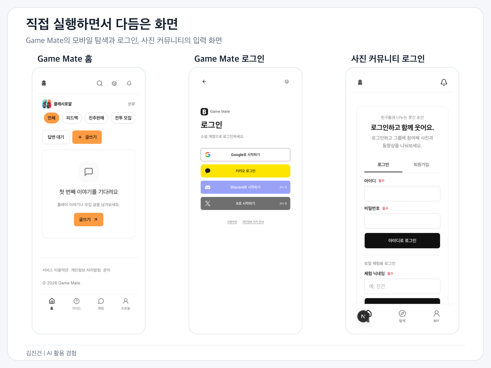
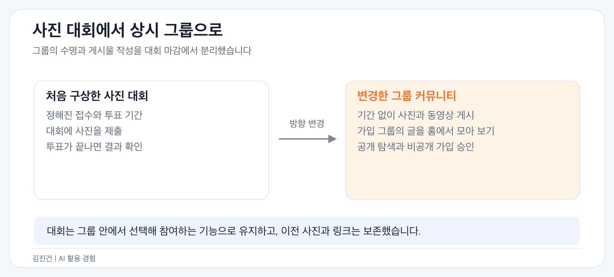
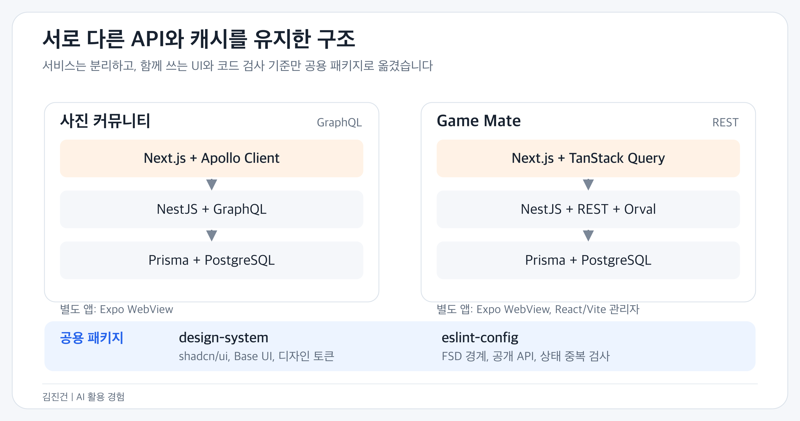
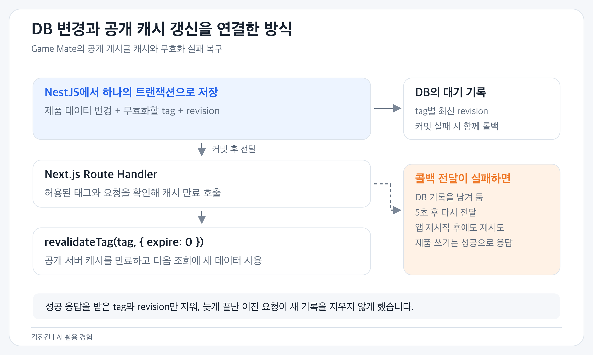
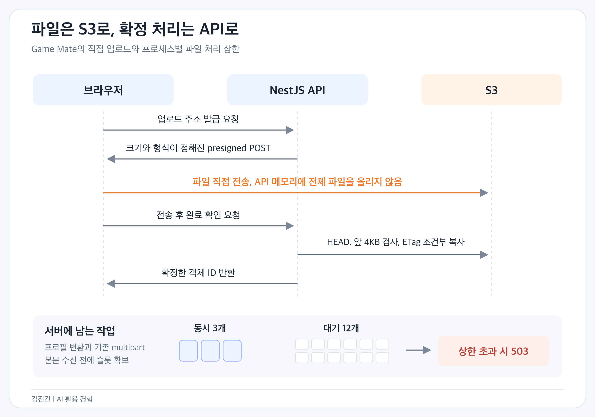
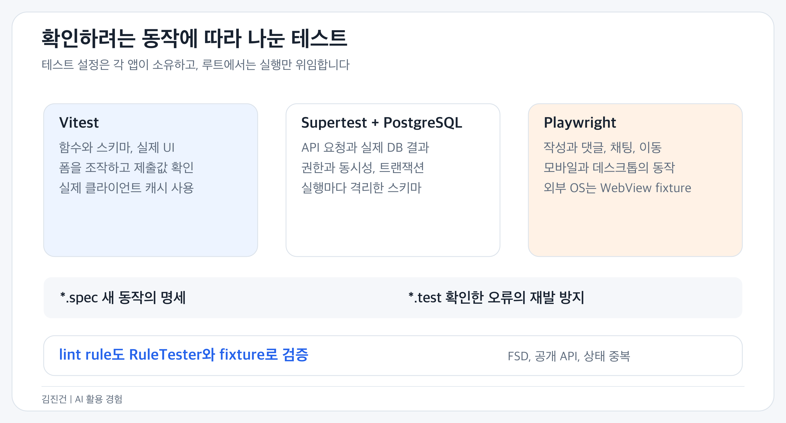
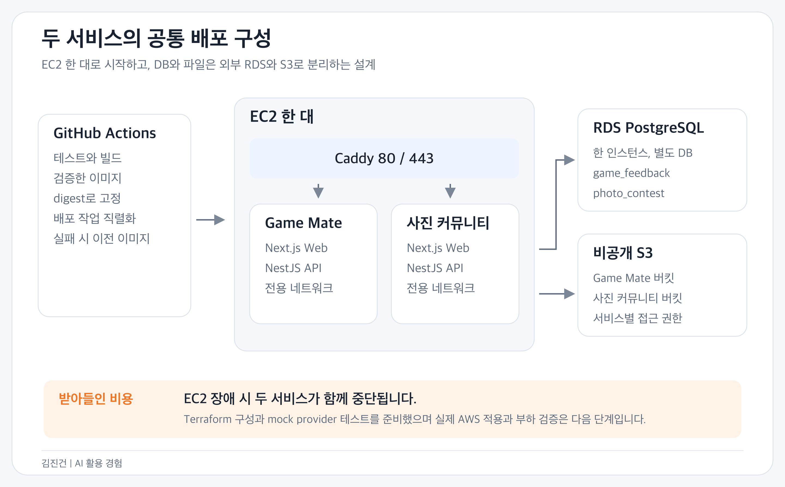

# 김진건의 AI 활용 경험

jingeon27@gmail.com | [GitHub](https://github.com/jingeon27) | [이력서](resume-doers-ai-product-engineer.md)

## 무엇을 직접 판단했는가

2026년 4월부터 실무에서 코딩 에이전트로 개발하고 있습니다. 구현과 테스트 작성은 AI에게 맡기고, 저는 요구사항과 설계, 검토 기준을 정합니다. 에이전트 리뷰의 critical 항목은 자동 수정하게 하고, 완성본을 받은 뒤 코드를 읽고 화면을 사용해 보며 부족한 결과는 반려합니다. 반복되는 수정은 skills와 lint rule에 남겼습니다.

10월에는 이 방식을 개인 프로젝트로 넓혔습니다. 친구들과 사진을 모으는 서비스와 게임 커뮤니티를 만들며 웹, API, DB, 배포 구성을 함께 다뤘습니다. 기술을 선택할 때는 에이전트에게 각 대안의 장단점을 물었습니다. 이해되지 않는 동작도 다시 질문하며 이해를 넓혔고, 제품에 필요한 이점과 제가 감당할 수 있는 비용, 복잡도를 비교해 선택했습니다. 기능과 디자인도 실행 결과를 보면서 바꿨습니다.

아래는 그 과정에서 제가 요청하고 판단한 내용, 에이전트와 함께 만든 결과입니다. 두 서비스는 초기 사용자 검증을 준비하고 있습니다.

[전체 저장소](https://github.com/jingeon27/side-project)

*개발 중 저장한 실제 모바일 화면입니다. Game Mate 홈은 게시물이 없는 초기 상태이며, 로그인 화면의 준비 중 표시도 당시 구현 상태 그대로입니다.*

## 사진 대회에서 상시 커뮤니티로

처음에는 친구끼리 사진을 올리고 투표하는 대회였습니다. 구현된 화면을 보며 제품을 행사 기간에만 쓰는 구조로 둘 필요는 없다고 생각했습니다. 그룹은 계속 유지하고 사진, 동영상, 합성을 언제든 올릴 수 있게 바꿨습니다.

홈에 그룹 목록을 먼저 보여 주는 대신 가입한 모든 그룹의 게시물을 최신순으로 보여 달라고 요청했습니다. 가입한 그룹은 MY로 옮기고, 초대 링크 없이도 찾아볼 수 있는 공개 탐색을 더했습니다. 공개 그룹은 로그인 없이 감상하고, 비공개 그룹은 가입을 승인받은 뒤 내용을 보도록 나눴습니다.

대회는 그룹의 필수 조건에서 선택 기능으로 바꿨습니다. 상시 게시물과 대회 참여를 구분하고, 그룹 안에서 대회를 열어 투표와 지난 결과를 볼 수 있게 했습니다. 기존 대회와 사진은 보존하도록 이관했습니다.

*그룹과 게시물의 수명을 대회 마감에서 분리했습니다.*

게임 커뮤니티에서도 기능을 넣고 빼는 판단을 했습니다. 프로필로 합칠 수 있는 별도 설정 메뉴는 덜어냈고, 코칭은 코치와 수강생 양쪽이 모집할 수 있게 했습니다. 수강료는 시간당, 월 단위, 목표 달성까지로 구분하되 결제와 정산까지 한꺼번에 만들지는 않았습니다. 문의와 인증 요청은 별도 티켓 시스템 대신 기존 관리자 1:1 채팅으로 연결했습니다.

[사진 서비스 제품 방향](https://github.com/jingeon27/side-project/blob/6d858497/projects/photo-contest/docs/product-plan.md) | [게임 커뮤니티 제품 범위](https://github.com/jingeon27/side-project/blob/6d858497/projects/game-feedback/docs/product.md)

## 디자인에서 받아들이지 않은 것

참고할 서비스는 전달했지만 결과물을 그대로 사용하지는 않았습니다. 인스타그램처럼 정돈된 느낌을 요청했더니 스토리 기능도 없는 프로필에 테두리가 붙었습니다. 사진 위에 순위가 겹쳐 콘텐츠를 가리기도 했습니다. 둘 다 빼고 순위는 사진 밖에 두도록 요청했습니다.

| 처음 받은 화면 | 수정한 기준과 결과 |
| --- | --- |
| 사진을 보려면 내용 보기 버튼을 눌러야 함 | 제목과 본문을 피드에 바로 보여 주도록 변경 |
| 등록 버튼 아래에 선택 파일이 따로 표시됨 | 파일 선택 영역 자체를 미리보기로 교체 |
| 수정, 숨기기, 삭제가 각각 노출됨 | 게시물 작업을 메뉴로 모으고 권한에 따라 표시 |
| 모바일 채팅에 Shift+Enter 안내가 있고 헤더가 큼 | 기기에 맞지 않는 안내를 제거하고 대화 영역과 입력 높이 조정 |
| 근거 없는 LIVE, ACTIVE 표시와 장식 | 실제 데이터로 설명할 수 없는 표시는 제거 |

모바일에서는 로그인과 약관, 닉네임 입력을 작은 창에 몰아넣지 않고 별도 페이지로 바꿨습니다. 댓글은 처음에는 화면의 75%로 열리고 헤더를 끌어 확장할 수 있게 했습니다. 데스크톱에서는 사진과 대화를 나란히 배치하도록 수정했습니다.

두 서비스가 같은 느낌을 유지하도록 shadcn/ui와 Base UI 기반 공통 디자인 시스템을 만들게 했습니다. 색과 글자, 버튼, 입력, Dialog는 패키지에 두고, 서비스별 피드와 레이아웃은 각 앱에 남겼습니다.

[공통 디자인 시스템](https://github.com/jingeon27/side-project/tree/6d858497/packages/design-system) | [사진 서비스 화면 구성](https://github.com/jingeon27/side-project/blob/6d858497/projects/photo-contest/apps/web/AGENTS.md)

## 서비스 구조와 상태 관리

사진 서비스는 schema-first GraphQL과 Apollo Client, 게임 서비스는 REST와 TanStack Query를 사용합니다. 서로 다른 API 계약과 캐시를 억지로 통일하지 않고, 실제로 공유하는 UI와 lint 설정을 공용 패키지로 옮겼습니다.

*각 서비스의 웹과 API, 모바일은 projects 아래에 두고, 디자인 시스템과 lint는 루트 packages에서 공유합니다.*

게임 서비스의 첫 구현은 App에 여러 책임이 몰려 있었습니다. 화면과 도메인을 분리하도록 요청하고, 작성과 수정을 한 폼의 mode로 처리하던 구조도 바꿨습니다. 입력 필드만 공유하고 생성 후 이동과 수정 후 닫기는 각 화면이 맡습니다. 관리자 API는 같은 테이블을 사용하더라도 사용자 API와 권한과 업무 흐름이 달라 controller와 service를 나눴습니다.

서버 데이터는 Query나 Apollo 캐시, 입력은 RHF와 Zod, 오버레이 수명은 overlay-kit이 소유하게 했습니다. WebView 연결처럼 React 밖 자원은 class로 수명을 관리하고 `useSyncExternalStore`로 구독합니다. 단순히 요청을 감싼 훅을 늘리는 대신 query options와 mutation options를 호출부에서 조합하도록 정리했습니다.

REST는 서버 계약에서 OpenAPI와 Orval SDK를 생성합니다. 응답 Zod 검증의 fallback은 화면 표시 필드에만 허용하고 ID, 권한, 세션 같은 필수 계약이 틀리면 실패하도록 했습니다.

[게임 서비스 아키텍처](https://github.com/jingeon27/side-project/blob/6d858497/projects/game-feedback/docs/architecture.md) | [생성과 수정 흐름 분리](https://github.com/jingeon27/side-project/tree/6d858497/projects/game-feedback/apps/web/src/widgets/post-composer)

## 캐시를 언제 공유하고 언제 비울 것인가

Next.js 캐시가 현재 구조에도 유효한지 AI에게 확인하고 두 서비스에 적용하도록 요청했습니다. 게임 서비스에서는 시간만 지나면 갱신되는 방식보다, NestJS에서 내용이 바뀌었을 때 Next.js Route Handler로 태그를 만료하는 방식을 요청했습니다.

공개 게시글은 쿠키 없이 조회한 데이터를 공유하고, 사용자별 상태는 그 캐시에 섞지 않습니다. 브라우저의 Query 캐시와 Next 서버 캐시는 따로 갱신해야 하므로 다음 흐름으로 연결했습니다.

*데이터 변경과 무효화 대상을 함께 남겨, 콜백 실패를 다시 처리할 수 있게 했습니다.*

DB 쓰기가 성공한 뒤 콜백이 실패했다고 사용자에게 저장 실패를 반환하면 중복 작성으로 이어질 수 있습니다. 그래서 쓰기는 성공으로 처리하고 캐시 만료를 재시도합니다. 이때 콜백이 끝나기 전에 같은 태그에 새 쓰기가 생길 수 있어, 이전 콜백이 새 기록까지 지우지 않도록 revision을 비교합니다.

대신 구현과 운영에서 살펴야 할 대기열이 하나 늘어납니다. 시간 기반 캐시보다 복잡해진 비용을 감수하고 수정 직후의 일관성과 실패 복구를 함께 다뤘습니다. 테스트에는 트랜잭션 롤백, 콜백 실패와 재시작, 이전 콜백의 지연 완료를 넣었습니다.

사진 서비스는 공개 SEO 데이터에만 fetch 캐시를 적용하고, 개인화된 Apollo 요청은 no-store로 유지했습니다. 공개 여부와 대회 일정은 별도로 확인하며 mutation 뒤 공개 태그를 만료합니다.

[캐시 무효화 구현](https://github.com/jingeon27/side-project/blob/6d858497/projects/game-feedback/apps/api/src/cache-invalidation/cache-invalidation.service.ts) | [실패와 경합 테스트](https://github.com/jingeon27/side-project/blob/6d858497/projects/game-feedback/apps/api/src/cache-invalidation/cache-invalidation.integration.spec.ts)

## 업로드의 메모리와 동시성

파일을 API로 전부 보내면 여러 요청이 겹칠 때 파일 크기만큼 서버 메모리와 전송 비용이 늘어납니다. 게시물에 이어 채팅 첨부도 S3 직접 업로드로 바꾸도록 요청했습니다. 사진 서비스도 게시물, 대회 사진, 그룹 대표 사진을 같은 방향으로 옮겼습니다.

*Game Mate의 업로드 흐름입니다. 사진 서비스의 완료 검사는 아래에 적은 것처럼 HEAD 확인만 사용합니다.*

게임 서비스에서는 발급 → 브라우저의 S3 전송 → 완료 확인으로 나눴습니다. 서버가 정한 크기와 형식을 POST 정책에 넣고, 완료 시 HEAD와 앞 4KB로 확인한 뒤 같은 ETag 조건으로 최종 객체에 복사합니다. 전체 파일을 서버 메모리에 올리지 않고, 확인한 뒤 바뀐 파일을 그대로 확정하지 않게 했습니다.

서버에서 여전히 처리하는 프로필 변환과 기존 multipart 경로에는 프로세스당 동시 3개, 대기 12개 제한을 뒀습니다. 대기열까지 찼으면 본문을 읽기 전에 503을 반환합니다. 직접 업로드로 서버를 가볍게 하되, 남아 있는 서버 작업도 무제한으로 받지 않는 방식입니다.

사진 서비스는 원본 보존을 택해 서버 변환을 없앴습니다. 완료 시에는 HEAD로 크기와 형식만 확인합니다. 게임 서비스의 내용 검사와는 다른 정책이며, 서명 정책이 만료되기 전 같은 키의 파일이 다시 올라올 수 있는 제약도 남습니다. 원본을 그대로 보관하는 대신 서버에서 파일 내용은 검사하지 않는 선택입니다.

S3 버킷 경로와 CORS, 역할을 어디에 연결할지 AI에게 질문하며 외부 설정도 확인했습니다. 로컬 S3 대역 테스트와 실제 AWS 권한 설정은 구분했습니다.

[게임 서비스 파일 확정](https://github.com/jingeon27/side-project/blob/6d858497/projects/game-feedback/apps/api/src/media-storage/media-storage.service.ts) | [동시 처리 제한](https://github.com/jingeon27/side-project/blob/6d858497/projects/game-feedback/apps/api/src/media-storage/media-work.ts) | [사진 서비스 업로드](https://github.com/jingeon27/side-project/blob/6d858497/projects/photo-contest/apps/api/src/media-upload/media-upload.service.ts)

## 테스트와 lint를 앱의 책임으로

사진 서비스부터 모노레포 전체에 테스트를 몰아두지 말고 각 앱이 소유하도록 요청했습니다. 이후 unit과 integration은 구현 파일 옆으로 옮기고, 새 동작은 `*.spec`, 확인된 오류는 `*.test`로 구분했습니다.

*테스트 도구마다 확인할 범위를 나누고, 권한과 동시성은 실제 DB 결과로 검증했습니다.*

- Vitest는 순수 규칙과 UI를, Supertest와 격리 PostgreSQL은 API 요청과 실제 DB 결과를 확인합니다.
- Playwright는 웹과 WebView 호스트를 연결해 작성과 댓글, 채팅, 이동을 확인합니다. 외부 OS 기능과 OAuth는 fixture로 대체하고, 실제 기기의 인증과 스토어 출시는 별도로 확인할 대상으로 뒀습니다.
- 권한과 동시성은 함수 호출 횟수보다 DB 결과를 확인합니다. 대회당 한 표, 동시 가입과 양도, 캐시 콜백 경합 같은 조건을 통합 테스트로 남겼습니다.
- 테스트 스키마와 포트, 빌드 경로를 분리해 작업 중인 서버와 다른 테스트를 건드리지 않게 했습니다.

lint는 기존 업무에서 정리한 기준을 이 저장소에 맞춰 적용했습니다. TypeScript로 규칙과 preset을 만들고, 컴포넌트의 직접 fetch, 오버레이 상태 복제, FSD 의존 방향과 공개 API를 검사합니다. 규칙 옆에는 RuleTester와 fixture를 둡니다. DOM 접근성 규칙은 Next.js와 Vite에만 적용하고 Expo는 제외했습니다.

문서만으로는 같은 실수가 반복될 수 있어 검사 가능한 기준을 코드로 옮겼습니다. 반대로 생성과 수정의 책임을 어디서 나눌지처럼 맥락이 필요한 판단은 skills와 직접 리뷰에 남깁니다.

[테스트 기준](https://github.com/jingeon27/side-project/blob/6d858497/projects/photo-contest/.agents/skills/testing/SKILL.md) | [공용 ESLint 패키지](https://github.com/jingeon27/side-project/blob/6d858497/packages/eslint-config/README.md) | [lint 적용 범위 변경](https://github.com/jingeon27/side-project/commit/899349f7)

## 인프라 선택과 Terraform

배포를 준비하면서 AI에게 최소 비용으로 운영할 방법, CD 설정, 자동으로 준비할 수 있는 일과 제가 콘솔에서 해야 할 일을 물었습니다. Lightsail도 검토했지만 이후 두 서비스를 EC2 한 대에 묶고 DB와 파일은 외부 RDS와 S3로 분리하는 구성을 정했습니다.

초기에는 관리할 서버 수를 줄이고 싶었습니다. 대신 EC2 한 대가 멈추면 두 서비스가 함께 중단된다는 비용을 받아들였습니다. 두 API의 프로토콜은 유지하고 Caddy만 외부에 열며, 서비스마다 컨테이너 네트워크와 DB, 계정, 버킷을 구분했습니다.

*Terraform으로 준비한 배포 구성입니다. 두 서비스의 서버는 함께 두되 DB와 원본 파일은 외부에 보관합니다.*

Terraform에는 VPC와 서브넷, 보안 그룹, EC2와 고정 IP, RDS, S3, IAM, 선택적 DNS를 담았습니다. DB 비밀번호 값과 S3 액세스 키는 state에 직접 넣지 않고, Secrets Manager 조회와 별도 발급 절차로 다룹니다. 기본값과 잘못된 설정은 mock provider 테스트로 검사합니다.

배포 구성은 검증한 이미지를 digest로 고정해 전달하고 readiness가 실패하면 이전 이미지로 복구하도록 했습니다. 공용 호스트의 배포는 잠금으로 직렬화합니다. 앱 이미지 롤백이 DB를 되돌리는 것은 아니어서 migration과 백업 확인은 별도로 둡니다.

Terraform은 구성과 mock provider 테스트를 준비했고, 실제 AWS 계정의 적용과 운영 부하 검증은 다음 단계로 뒀습니다.

[공통 배포 구성](https://github.com/jingeon27/side-project/blob/6d858497/deploy/shared-instance/README.md) | [Terraform](https://github.com/jingeon27/side-project/tree/6d858497/deploy/shared-instance/terraform) | [Terraform 설정 테스트](https://github.com/jingeon27/side-project/blob/6d858497/deploy/shared-instance/terraform/tests/plan.tftest.hcl)

## 실무에서 이어 온 검토 방식

세이프닥에서는 아래 흐름으로 검증하고 마지막에 QA 더블 체크를 요청합니다. 개인 프로젝트는 별도 QA 요청 없이 코드와 테스트를 읽고 화면을 직접 확인합니다.

티켓과 plan 검토 → 테스트 작성 → 에이전트 구현과 에이전트 코드 리뷰 → 변경분 테스트, lint, typecheck → 직접 diff 리뷰와 화면 동작 확인 → 전체 CI(테스트, knip, lint) → QA 더블 체크 요청

세이프닥에서는 이 과정으로 건강검진의 세 제품 프론트엔드와 글로벌 사용자 서비스, CMS를 개발했습니다. 복지몰에 Sentry를 도입하고 라이브러리 내부 오류를 추적해 고친 경험도 있습니다. Bottom Sheet에서는 코드를 읽고도 헤더까지 스크롤되는 문제를 놓쳐, 화면 확인과 레이아웃 회귀 테스트를 보완했습니다.

AI 덕분에 제가 다룰 수 있는 구현 범위가 넓어졌습니다. 그만큼 결과물을 보고 무엇을 고칠지, 어느 구조를 유지할지 판단하는 데 시간을 쓰고 있습니다.

[AI 개발 workflow](https://jingeon27.tistory.com/31) | [건강검진 개발](https://jingeon27.tistory.com/34) | [테스트 도입](https://jingeon27.tistory.com/25) | [Sentry 도입](https://jingeon27.tistory.com/30)
