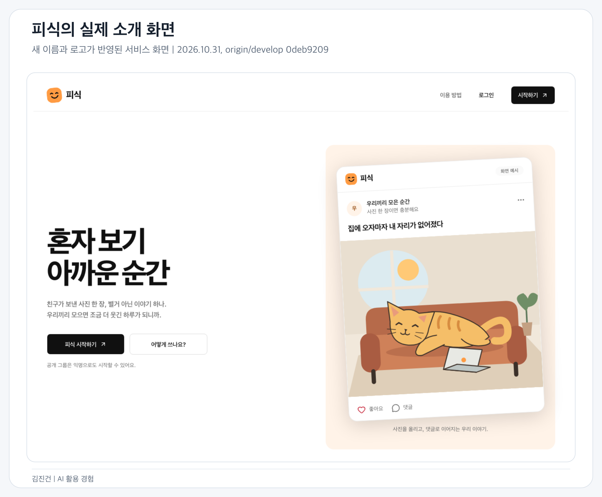
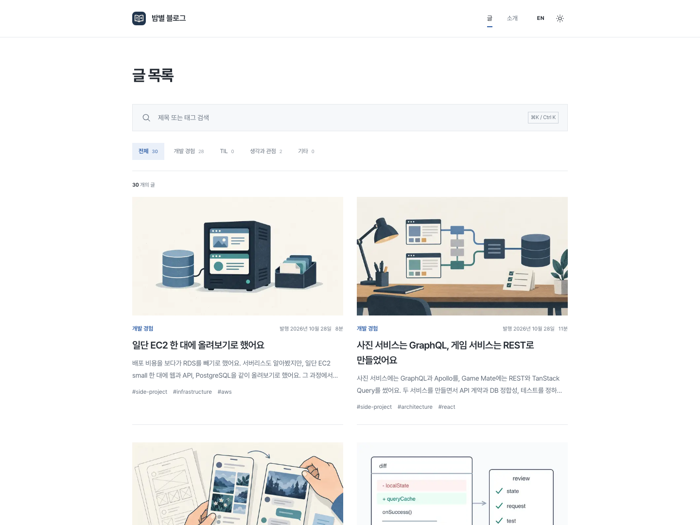
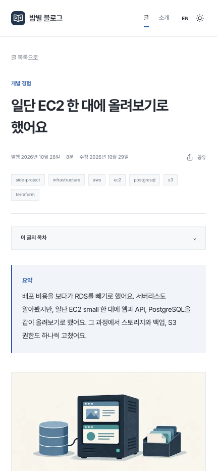
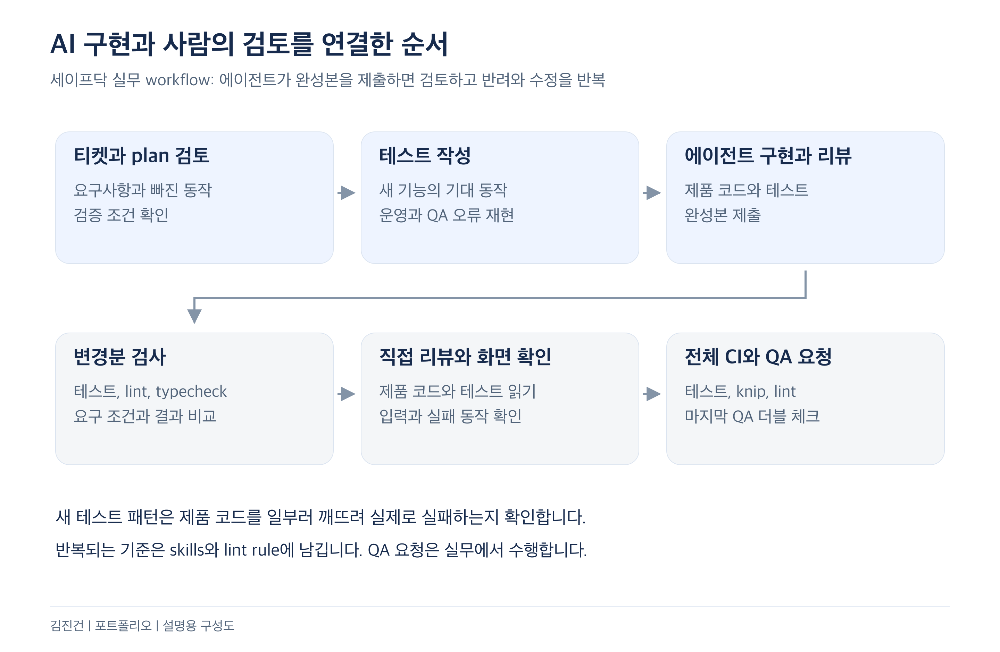
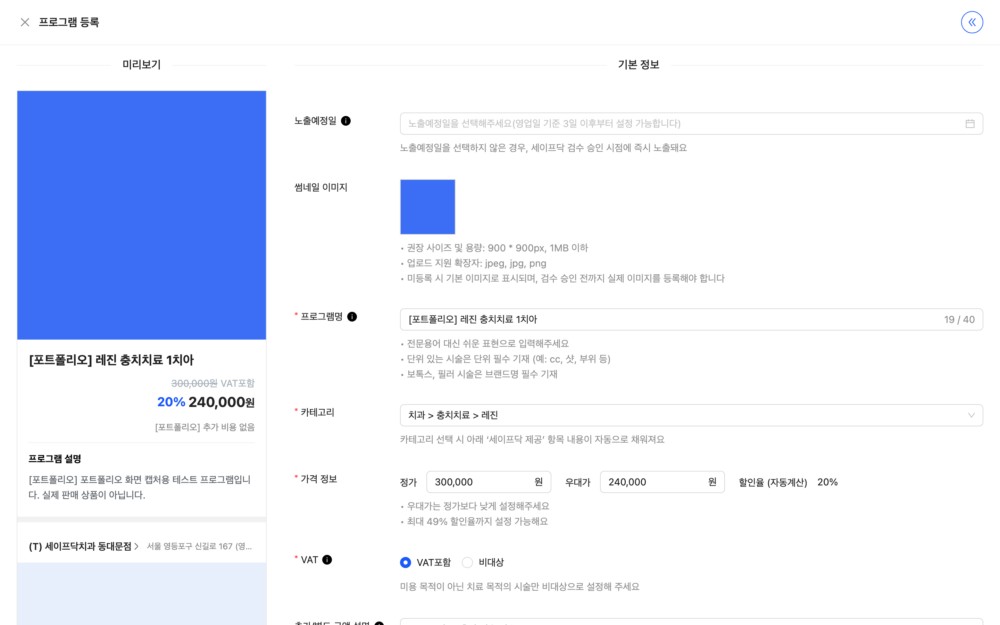
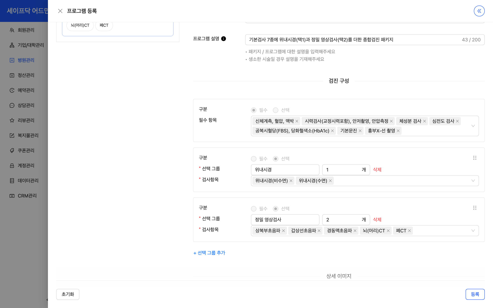

# 김진건 포트폴리오 | 두어스

AI Product Engineer 지원 | jingeon27@gmail.com | GitHub: jingeon27

산업기능요원 현역 복무 중 | 2025.08 편입 | 전직 희망

AI를 활용해 두 서비스와 블로그를 2주 동안 만들었고 이후 보완하고 있습니다. 제품 범위와 아키텍처, 필요한 동작과 배포 방향을 정합니다. 세부 구현과 테스트 작성 및 실행은 에이전트에 맡기고, 실제 화면과 코드의 전반적인 구조, 검증 보고를 보며 피드백합니다. 다섯 사례에서 제품의 범위와 기술 선택, 검증 기준을 정한 과정과 실무의 정식 출시 경험을 보여 줍니다. 피식과 Game Mate, 개인 기술 블로그를 모두 포함했습니다.

## 대표 사례

- 친추 판매와 코칭을 연결하는 Game Mate
- 사진 커뮤니티 피식
- 개인 기술 블로그
- AI 구현을 검토하고 검증 기준을 고친 과정
- 프로그램 개발에서 건강검진 내재화까지

## 경력과 기여 범위

| 구분 | 기간 | 담당 범위 |
| --- | --- | --- |
| 세이프닥 | 2025.05 – 현재 | 전사 프론트엔드 개발과 QA. 병원 관리자와 백오피스는 기능 요구사항을 바탕으로 화면 구성과 상세 동작 설계. API 계약은 백엔드와 조율 |
| 왓타임 | 2024.01 – 2024.11 | 채용 SaaS RoundHR의 웹 기능과 Electron 수집 앱. 개발자, 디자이너와 협업 |
| 개인 프로젝트 | 2026.10 – 현재 | 요구사항과 제품 범위, UI와 API/DB, 실패 정책과 테스트 기준, 배포 구성 설계. 구현과 테스트 작성은 에이전트에 맡기고 결과 검토 |

## 친추 판매와 코칭을 연결하는 Game Mate

2026.10 – 현재 | 개인 프로젝트

한국어, 영어, 일본어를 지원하는 글로벌 서비스입니다. 브라우저의 언어 설정과 저장한 사용자 선택을 적용합니다.

**담당과 기여:** 친추 판매와 코칭의 제품 범위, API와 DB, 캐시와 파일 확정의 구조, 가입과 문의의 완료 조건을 정했습니다. 세부 구현과 테스트 작성 및 실행은 에이전트가 맡았습니다. 저는 화면을 직접 써 보고 코드의 전반적인 구조와 검증 보고를 보며 수정을 요청했습니다.

GitHub: [프로젝트 코드와 실행 안내](https://github.com/jingeon27/side-project/tree/9576836125cfd91e977b417b50dd9b049e649cff/projects/game-feedback) | [제품의 출발점과 화면 변경 기록](https://github.com/jingeon27/side-project/blob/9576836125cfd91e977b417b50dd9b049e649cff/projects/blog/apps/web/content/posts/side-project-design/ko.mdx#L69)

**문제 상황**

직접 보던 클래시로얄 커뮤니티에서는 해외 사용자의 친추 판매와 코칭 모집이 트위터에, 국내 모집이 카카오톡과 디시인사이드, 네이버 카페에 흩어져 있었습니다. 해외 랭커와 친구를 맺기 어려웠고 게임을 가르쳐 줄 사람을 찾는 글도 보면서, 모집을 한곳에서 찾고 조건을 확인한 뒤 대화하는 서비스를 만들고자 했습니다.

초기 사용자에게 다가갈 수 있는 커뮤니티가 있는 클래시로얄부터 시작했습니다. 브롤스타즈와 롤 확장은 남겨 두고 첫 게임의 친추 판매와 코칭, 피드백과 대화 흐름을 먼저 만들기로 했습니다.

**해결 방법**

친추 판매와 게임 코칭을 원하는 사람이 모집 글에서 가격과 조건을 확인하고 1:1 채팅으로 문의하도록 만들었습니다. 코치와 수강생 모두 모집하고 수강료 단위를 시간당, 기간 단위, 목표 달성까지로 나눴습니다. 결제와 정산은 구현하지 않았습니다.

목록 카드와 상세에 가격과 모집 역할을 함께 보여 주고 문의로 연결했습니다. 친추 판매 금액과 코칭의 시간당, 기간 단위, 목표 달성 조건은 별도 입력으로 받아 비교할 조건을 드러냈습니다. 글쓰기에서 분류를 바꿔도 제목과 본문, 선택한 게임은 유지하고 분류별 금액 입력만 바뀌게 했습니다.

*개인 서비스 화면은 2026년 10월 31일 side-project origin/develop의 0deb9209 소스에서 촬영한 실제 UI입니다. 그룹과 게시물, 가격과 계정은 테스트 데이터입니다.*

Game Mate는 REST와 TanStack Query를 사용합니다. 공개 글에 Next.js 캐시를 적용하면서 저장과 캐시 만료 중 어디까지 성공해야 사용자에게 저장 성공으로 응답할지 정했습니다. 글은 저장됐는데 만료 호출만 실패한 상황을 저장 실패로 알리면 사용자가 같은 글을 다시 쓸 수 있습니다. 변경 내용과 만료 태그를 같은 DB 트랜잭션에 저장하고, 커밋 뒤 만료 호출이 실패해도 저장 성공으로 응답하도록 했습니다. 남은 태그만 재시도하며 늦게 끝난 호출이 새 대기 기록을 지우지 않도록 revision을 확인합니다. 롤백과 재시작, 경합은 통합 테스트에 넣었습니다.

*개인 프로젝트 Game Mate의 저장과 캐시 복구 흐름을 설명하는 구성도입니다.*

API가 발급한 presigned POST로 브라우저에서 S3에 직접 업로드해 API가 파일 전체를 중계하지 않도록 했습니다. HEAD와 앞 4KB 검사 후 검사한 ETag가 같을 때만 최종 객체로 복사합니다. 데이터는 Prisma와 PostgreSQL로 관리하며 API 통합 테스트는 Supertest 요청 뒤 격리 PostgreSQL의 저장 결과를 확인합니다.

*Game Mate의 크기와 내용 일부 검사, ETag 조건부 복사를 설명합니다. 피식의 HEAD 확인 정책과는 구분합니다.*

초기 비용을 줄이려고 두 서비스와 PostgreSQL을 같은 EC2에 두고 DB 데이터는 별도 EBS, 백업은 S3에 두는 구성을 선택했습니다. 한 대의 장애가 두 서비스와 DB에 영향을 주는 비용을 받아들였습니다. 백업 업로드 실패 시 migration 중단, readiness 실패 시 이전 이미지 복귀를 구성했으며 검증 근거는 Terraform mock provider 테스트와 배포 스크립트의 실패 조건 검사입니다.

가격을 비워 둔 코칭은 0원 대신 ‘수강료 협의’로 표시했습니다. ‘월 단위’는 ‘기간 단위’로 바꿔 기간을 정한 코칭과 목표를 달성할 때까지 받는 코칭을 구분하게 했습니다. 게임 프로필 연결은 가입 시 선택 사항으로 두고 입력이 길어도 본문만 스크롤되며 완료 버튼은 아래에 남도록 했습니다. 프로필 수정은 펼침 메뉴에서 Bottom Sheet를 거쳐 전용 페이지로 옮겨 여러 항목을 한 번에 저장하도록 했습니다.

채팅에서는 서버에 저장됐지만 응답을 받지 못한 메시지를 다시 보내도 중복되지 않도록 요청했습니다. 같은 대화의 같은 요청 식별자와 내용은 기존 메시지를 반환하고, 다른 내용이나 다른 대화에 재사용하면 거절하도록 했습니다. 읽음 표시는 실제 확인한 메시지까지만 반영하도록 했습니다.

**트레이드오프**

모집 글과 1:1 문의에 범위를 집중해 가격과 조건을 확인하고 대화를 시작하는 흐름부터 만들었습니다. 결제와 정산까지 넣으면 거래 완료를 서비스 안에서 다룰 수 있지만 주문과 취소, 환불의 계약도 함께 관리해야 합니다. 이번 범위에서는 이를 포함하지 않아 실제 거래 완료를 서비스 데이터만으로 확인할 수 없습니다.

글 저장은 성공으로 반환하고 캐시 만료만 재시도해 중복 작성을 유발하지 않도록 했습니다. 그 대신 저장 직후 모든 공개 캐시가 이미 최신이라고 보장할 수는 없고, 대기 기록과 revision, 재시작과 경합을 관리하는 복잡성을 감수했습니다.

**결과 및 배운 점**

모집과 채팅 흐름, 저장과 캐시 갱신의 실패 처리, S3 업로드를 구현하고 경합과 저장 결과를 테스트했습니다. 실제 매칭과 거래 성과는 아직 검증하지 않았습니다. 화면의 성공과 저장, 캐시 갱신의 성공을 분리해 실패 동작을 정했습니다.

구현과 검증: [채팅 재전송 통합 테스트](https://github.com/jingeon27/side-project/blob/9576836125cfd91e977b417b50dd9b049e649cff/projects/game-feedback/apps/api/src/chat/chat.controller.integration.test.ts#L206) | [캐시 전달 실패와 재시작 검사](https://github.com/jingeon27/side-project/blob/9576836125cfd91e977b417b50dd9b049e649cff/projects/game-feedback/apps/api/src/cache-invalidation/cache-invalidation.integration.spec.ts#L235) | [presigned POST 파일 확정](https://github.com/jingeon27/side-project/blob/9576836125cfd91e977b417b50dd9b049e649cff/projects/game-feedback/apps/api/src/media-storage/media-storage.service.ts#L53)

## 사진 커뮤니티 피식

2026.10 – 현재 | 개인 프로젝트

**담당과 기여:** 제품 범위와 아키텍처, 홈과 탐색의 동작, 권한과 실패 조건을 정했습니다. 세부 구현과 테스트 작성 및 실행은 에이전트가 맡고, 저는 실행한 화면을 직접 써 보고 코드의 전반적인 구조와 검증 보고를 보며 수정 방향을 피드백했습니다.

GitHub: [프로젝트 코드와 실행 안내](https://github.com/jingeon27/side-project/tree/9576836125cfd91e977b417b50dd9b049e649cff/projects/photo-contest) | [제품의 출발점과 화면 변경 기록](https://github.com/jingeon27/side-project/blob/9576836125cfd91e977b417b50dd9b049e649cff/projects/blog/apps/web/content/posts/side-project-design/ko.mdx#L13)

**문제 상황**

한 방송인의 ‘영도 대회’를 보며 친한 사람끼리 재밌는 사진을 공유하고 투표할 수 있는 서비스를 떠올렸습니다. 그룹에 친구를 초대하고 사진을 올린 뒤 투표하는 기능부터 에이전트에 요청했습니다.

첫 화면을 직접 써 보니 홈에는 사진보다 그룹 목록이 먼저 보였고 긴 안내가 사진을 가렸습니다. 제가 원한 흐름은 들어오자마자 가입한 그룹의 새 사진을 보고 반응하는 것이었습니다. 대회가 끝나면 더 올릴 수 있는 흐름도 없어, 기간과 1인 1장 제한 없이 사진과 동영상, 합성 이미지를 계속 쌓는 상시 그룹으로 범위를 바꿨습니다.

**해결 방법**

사진을 올리고 감상하는 흐름에 맞춰 홈, 탐색, MY의 역할을 나눴습니다. 에이전트가 만든 화면도 이 기준으로 검토하고 수정을 요청했습니다.

| UI와 UX 결정 | 판단한 이유와 반영한 동작 |
| --- | --- |
| 홈에 가입한 그룹의 새 게시물을 모아 표시 | 들어오면 새 사진부터 볼 수 있도록 최신순 피드를 중심에 두고 그룹 관리와 프로필은 MY에서 처리 |
| 공개 그룹 탐색과 비공개 그룹 승인 구분 | 초대 링크 없이도 새로운 그룹을 찾고 내용을 살펴보게 하되 비공개 그룹의 사진과 댓글은 승인된 멤버에게만 노출 |
| 사진을 가리는 순위 표시와 스토리 테두리 제거 | 사진 감상을 방해하는 요소를 줄이고 실제로 제공하지 않는 기능을 장식이 암시하지 않게 수정 |
| 게시물 작업은 메뉴로, 프로필 수정은 별도 버튼으로 제공 | 감상하는 화면과 수정하는 동작을 구분하고 필요한 때 편집을 열도록 구성 |
| 익명 시작과 회원가입 뒤 기록 승계 | 먼저 공개 그룹을 이용해 보고 회원가입한 뒤에도 쓰던 프로필과 활동을 유지 |

익명으로 먼저 둘러보고 활동한 뒤 회원가입해도 같은 프로필과 그룹 가입, 작성한 글을 이어가게 했습니다. 공개 그룹에 가입한 직후 글쓰기 버튼이 나타나지 않아 재진입해야 했던 동작도 직접 확인하고 수정을 요청했습니다. 가입 상태가 바뀌면 화면의 작성 권한도 함께 갱신하도록 했습니다.

사진 선택을 취소하면 기존 선택을 유지하고, 업로드만 실패했을 때는 작성 중인 글을 남겨 그 단계부터 다시 시도하도록 요청했습니다.

기존 대회와 사진, 이전 링크는 보존했습니다.

사진 하나가 홈과 그룹 피드, 인기 목록에 함께 나타나 같은 엔티티를 여러 화면에서 읽고 바꾸는 방식을 다뤄 보려고 GraphQL과 Apollo Client를 골랐습니다. 서버는 NestJS의 schema-first 스키마를 사용합니다. 타입 생성만으로 실제 조회 문서와 화면 캐시까지 맞는다고 볼 수 없어 검증을 나눴습니다. GraphQL Code Generator로 문서 타입을 생성하고 모든 연산과 fragment를 서버 스키마와 대조합니다. 객체 ID 기반 정규화 캐시와 `useFragment`, 페이지네이션과 좋아요의 낙관적 갱신은 실제 Apollo 캐시에 값을 쓰고 읽어 확인합니다. RSC의 `PreloadQuery` 결과를 브라우저로 넘기고 개인화 조회와 공개 SEO 조회는 분리했습니다.

**트레이드오프**

상시 그룹은 마감일 없이 게시물을 쌓을 수 있지만 공개 범위와 가입 승인, 탐색과 관리 기능을 계속 유지해야 합니다. 대회는 그룹 안의 선택 기능으로 남겨 기존 사진과 링크, 새 게시물 구조의 연결도 함께 관리했습니다.

익명 이용은 가입 전에 시작하기 쉽지만 회원가입 전 로그아웃하면 쓰던 프로필에 다시 접근할 수 없습니다. 게시물이 모두 삭제된다는 오해를 주지 않도록 접근을 잃는다는 점과 회원가입으로 기록을 이어갈 방법을 안내했습니다.

Apollo의 정규화 캐시는 같은 게시물의 변경을 여러 화면에 반영할 수 있지만 엔티티 ID와 목록별 병합 정책을 관리해야 합니다. 그룹과 카테고리, 정렬 조건이 다른 목록을 섞지 않는지 실제 캐시 테스트로 확인합니다.

**결과 및 배운 점**

상시 게시물과 홈 피드, 공개 그룹 탐색을 구현하고 기존 대회와 사진, 이전 링크를 보존했습니다. 사진을 보고 반응하는 흐름을 기준으로 화면의 정보와 동작을 골랐습니다.

확인할 가설은 친구들과 웃긴 순간을 계속 모으려는 수요가 있는지, 초대와 반응이 재방문으로 이어지는지입니다. 가입 → 첫 게시물 → 좋아요 → 재방문 흐름의 측정을 준비했으며 실사용 성과는 아직 확인하지 않았습니다.

구현과 검증: [익명 활동의 회원가입 승계](https://github.com/jingeon27/side-project/blob/9576836125cfd91e977b417b50dd9b049e649cff/projects/photo-contest/apps/api/src/auth/anonymous/anonymous-auth.service.integration.spec.ts#L75) | [목록별 Apollo 캐시 검사](https://github.com/jingeon27/side-project/blob/9576836125cfd91e977b417b50dd9b049e649cff/projects/photo-contest/apps/web/src/features/post/model/post.cache.spec.ts#L41)

## 개인 기술 블로그

2026.10 – 현재 | 공개 서비스

**담당과 기여:** 읽기와 검색, 언어 전환의 요구사항, 콘텐츠 구조와 이관, 발행 기준을 정했습니다. 세부 구현과 테스트 작성 및 실행은 에이전트가 맡고, 저는 글과 실제 화면, 코드의 전반적인 구조와 검증 보고를 보며 수정을 요청했습니다.

GitHub: [프로젝트 코드와 실행 안내](https://github.com/jingeon27/side-project/tree/9576836125cfd91e977b417b50dd9b049e649cff/projects/blog) | [제품의 출발점과 화면 변경 기록](https://github.com/jingeon27/side-project/blob/9576836125cfd91e977b417b50dd9b049e649cff/projects/blog/apps/web/content/posts/side-project-design/ko.mdx#L152)

**문제 상황**

블로그 원고는 별도 저장소에서 관리하고 Tistory로 옮겨 발행했습니다. 글을 고친 뒤 다시 옮기는 과정이 번거로웠고 직접 만드는 비용도 낮아져, 익숙한 편집기에서 원고와 변경 이력을 관리하며 개인 도메인으로 발행하기로 했습니다.

기존 공개 글을 옮길 때는 코드와 이미지, 이전 주소를 보존해야 했습니다. 독자가 주제와 태그로 글을 찾고 긴 글의 필요한 부분으로 이동하는 흐름을 정했고, 블로그에서는 글을 쓰고 읽는 일에 집중하도록 범위를 잡았습니다.

**해결 방법**

글 목록은 제목과 태그를 한 입력창에서 검색하고 카테고리로 좁히도록 했습니다. 목록에서 주제를 판단할 수 있도록 썸네일과 제목, 설명, 읽는 시간을 함께 표시하고 데스크톱은 2열, 모바일은 1열로 배치했습니다. 검색은 Cmd/Ctrl+K와 방향키, Enter, Escape로 조작하며 한글 조합 중 Enter는 선택으로 처리하지 않도록 했습니다.

*2026년 11월 1일 공개 배포 화면을 로그인 정보가 없는 브라우저에서 촬영했습니다. 실제 발행한 글의 목록입니다.*

긴 글에서는 H2와 H3로 목차를 만들고 본문과 같은 앵커를 사용합니다. 모바일은 목차를 접어 두었다가 필요한 때 펼치게 했습니다. 글의 한국어와 영어는 같은 콘텐츠 ID로 연결하고, 언어를 바꿔도 같은 글과 선택한 테마를 유지하도록 했습니다.

*같은 날 공개 글 상세를 430×932 화면에서 촬영했습니다. 제목과 발행 정보, 접이식 목차를 보여 줍니다.*

처음 결과물에는 요청하지 않은 이력서도 들어 있어 제거하고 소개에는 연락처만 남기도록 했습니다. 번역이 없는 글에 영문 주소만 만들지 않게 했고, 다크 모드에서 언어를 바꿀 때 생긴 테마 경고는 주소로 직접 진입할 때와 사이트 안에서 이동할 때를 비교해 수정을 요청했습니다.

콘텐츠는 Git 기반 MDX로 관리하고 별도 CMS 서버와 DB를 두지 않았습니다. 제목과 고정 slug를 분리해 제목 수정으로 주소가 바뀌지 않게 했습니다. 글을 옮기거나 주소를 바꿀 때는 301 대상이 실제 글로 이어지는지 검사하며, 코드 블록과 이미지의 체크섬도 확인합니다.

**트레이드오프**

MDX와 정적 검색 인덱스를 사용해 콘텐츠를 코드와 함께 검토할 수 있는 대신, 글을 수정하려면 커밋과 빌드, 배포를 거쳐야 합니다. 한국어와 영어 본문은 각각 관리하므로 내용과 번역 연결을 함께 확인해야 하고, 기존 주소를 유지하려면 리다이렉트 목록과 대상 검사를 계속 관리해야 합니다.

**결과 및 배운 점**

개인 도메인에 배포해 공개했습니다. 초기 이관한 공개 글 27편은 코드 블록 180개와 원본 이미지 32장의 체크섬을 검사했고, 새 도메인의 기존 숫자 경로 27개도 301로 연결했습니다. 제목과 본문을 고치는 일과 독자가 기존 주소로 다시 찾아오는 일을 함께 발행 기준에 넣었습니다.

구현과 검증: [번역과 이전 주소 계약 검사](https://github.com/jingeon27/side-project/blob/9576836125cfd91e977b417b50dd9b049e649cff/projects/blog/apps/web/scripts/content.test.ts#L40) | [검색 키보드 동작 검사](https://github.com/jingeon27/side-project/blob/9576836125cfd91e977b417b50dd9b049e649cff/projects/blog/apps/web/src/features/article-search/ui/article-search.spec.tsx)

## AI 구현을 검토하고 검증 기준을 고친 과정

2026.04 – 현재 | 세이프닥 실무

**담당과 기여:** 요구사항과 검증 범위, 에이전트 완성본의 코드와 테스트 검토, 반려와 재검토, skills와 lint rule 보완을 맡습니다. 테스트는 2026년 7월부터 도입했습니다.

**문제 상황**

에이전트가 작성한 테스트가 통과해도 앱과 다른 조건을 검증하거나 화면 회귀를 놓칠 수 있었습니다. 테스트용 QueryClient는 실제 앱과 다르게 오류를 처리했고, diff를 읽고도 Bottom Sheet 헤더까지 스크롤되는 회귀를 놓친 적이 있었습니다.

**해결 방법**

티켓과 plan 검토 → 테스트 작성 → 에이전트 구현과 에이전트 코드 리뷰 → 변경분 테스트, lint, typecheck → 직접 diff 리뷰와 화면 동작 확인 → 전체 CI(테스트, knip, lint) → QA 더블 체크 요청

*실무에서 수행하는 순서입니다. 개인 프로젝트에는 QA 더블 체크 요청 단계를 두지 않습니다.*

QueryClient 설정을 앱과 맞추고 첫 조회 실패와 기존 데이터의 재조회 실패를 나눴습니다. 헤더 스크롤은 본문만 스크롤되게 고치고 브라우저 레이아웃 회귀 테스트로 남겼습니다. 기대 payload는 제품의 변환 함수를 그대로 호출하지 않고 따로 적어 같은 실수가 테스트에도 복제되지 않게 했습니다.

새 기능은 BDD 형식의 `*.spec`, 운영과 QA 오류는 `*.test`로 다룹니다. 새 테스트 패턴은 제품 코드를 일부러 깨뜨려 실제 실패하는지 확인합니다. 반복되는 판단은 skills에, 정적으로 검사할 수 있는 import 방향과 공개 API, queryKey는 lint rule에 남기며 규칙 자체도 RuleTester와 fixture로 검증합니다.

**트레이드오프**

검토와 테스트는 비용이 들어 변경분과 영향 범위를 먼저 검사하고 타입 검사는 앱과 패키지 단위로 실행합니다. 실제 API 연동은 계약을 확인할 수 있지만 서버 환경과 데이터의 영향을 받으므로 dev API 서버와 MSW의 용도를 나눴습니다.

**결과 및 배운 점**

잘못된 테스트 전제와 놓친 스크롤을 수정하고 회귀 조건으로 남겼습니다. 코드와 테스트의 통과 여부, 화면에서 실제로 같은 조건을 확인했는지를 나눠 검토합니다. 에이전트의 완성본을 반려하고 검증 기준을 다음 구현에 남기는 방식으로 작업합니다.

## 프로그램 개발에서 건강검진 내재화까지

2025.05 – 현재 | 복지몰, 병원 관리자, 백오피스 | 건강검진 개발 2026.09 시작

**담당과 기여:** 프로그램 상세 확장의 스타일과 OG 메타, 퍼널 이벤트를 맡고 병원 등록과 운영팀 검수 화면을 처음 개발했습니다. 이후 건강검진에서는 3개 제품의 프론트엔드와 연동 검증을 전담했습니다. 제휴 병원의 요구사항을 개발팀장, 부팀장과 확인하고 백엔드 개발자와 API와 예외 처리를 맞췄습니다.

**문제 상황**

입사 당시 복지몰은 비급여 프로그램 상세가 없어 사용자가 병원 상세에서 바로 예약했습니다. 팀이 프로그램 상세와 쿠폰팩을 추가하면서 사용자가 프로그램 정보를 살펴보는 흐름을 확장했습니다. 병원이 프로그램을 등록하고 운영팀이 검수하는 관리 흐름도 개발했습니다.

건강검진은 아임웹에서 정보를 보고 전화로 문의하던 별도 흐름이었습니다. 검사 구성과 기업지원 코드, 예약금 처리 방식이 비급여 프로그램과 달라 기존 복지몰과 병원 관리자에서 관리하기 어려웠습니다. 제휴 병원의 요청으로 건강검진을 세 제품 안에서 처리하는 작업이 이어졌습니다.

**해결 방법**

프로그램 상세에서는 동료가 주 화면을 구현하고 저는 스타일과 OG 메타, 리뷰 조회와 공유 등의 퍼널 이벤트를 맡았습니다. 병원 관리자의 프로그램 템플릿 등록과 검수 요청, 백오피스의 검수와 반려, 승인 화면은 처음 개발했습니다. 등록부터 검수중, 반려와 승인까지 잇는 dev API 서버 E2E는 테스트 도입 뒤인 2026년 9월에 추가했습니다.

*2026년 9월 28일 스테이지에서 테스트 데이터로 촬영한 실제 화면입니다. 병원 등록과 운영팀 검수 흐름 중 본인이 처음 개발한 등록 화면입니다.*

건강검진에서는 검사 구성부터 예약, 취소와 환불까지 세 제품의 흐름을 연결했습니다. 기존 비급여 프로그램에 없던 검사 선택과 기업지원 코드, 예약금 처리를 추가하고 각 담당자가 처리할 흐름을 나눴습니다.

| 제품 | 구현한 흐름 |
| --- | --- |
| 백오피스 | 검사항목과 검진 프로그램 구성, 기업지원 서류 확인, 결제취소와 환불 승인 |
| 병원 관리자 | 검진 예약 관리와 예약금 결제취소 요청 접수 |
| 복지몰 | 검사 선택, 기업 검진 코드 입력, 예약금 결제 |

*2026년 9월 28일 스테이지에서 테스트 데이터로 촬영한 구현 화면입니다. 필수 검사와 선택 그룹을 구성하는 본인 담당 화면이며 정식 오픈은 9월 30일입니다.*

모바일 토스페이먼츠 결제창은 결과를 리다이렉트로 돌려줘, 결제창을 다녀오면 페이지가 새로 열리며 신청 입력이 사라졌습니다. 사용자가 같은 신청을 이어갈 수 있도록 입력을 어느 결제 시도까지 복원할지 정했습니다. 입력값을 `orderId`와 함께 sessionStorage에 저장하고, 같은 주문이며 현재 Zod 스키마를 통과한 값만 한 번 복원했습니다. 이전 결제 시도나 옛 폼 값이 현재 입력을 덮어쓰지 않도록 했습니다.

검사를 정해진 수만큼 고르면 다음 그룹을 자동으로 열자는 요청도 있었습니다. 기존 선택을 수정할 때도 화면이 넘어가는 문제를 짚고 담당자와 논의했습니다. 선택 수를 채운 그룹에서 아직 고르지 않은 chip만 비활성화해 초과 선택을 막았고, 빠져 있던 비활성 상태 디자인도 요청해 반영했습니다.

검사항목 일괄 저장에서는 일부 요청만 성공할 수 있었습니다. 이전 폼으로 재시도하면 이미 만든 항목을 또 전송하므로, 성공 여부와 관계없이 서버 목록을 다시 받아 발급된 ID를 폼에 반영했습니다. 검진 구성 수정이 거절될 때는 삭제된 검사항목까지 조회 응답에 들어오는 것을 찾아 백엔드에 전달하고 요청값을 실제 API 계약에 맞췄습니다.

**트레이드오프**

앱 전역에 Zustand persist를 두면 여러 화면에서 입력을 재사용하기 쉽지만, 이 값은 결제창을 다녀오는 한 번의 신청에 필요한 상태였습니다. `orderId`와 입력값을 sessionStorage에 묶어 저장해 복원 범위를 해당 탭의 결제 시도로 좁혔습니다. 다른 기기나 다음 방문까지 입력을 복원하는 범위로 확장하지 않았고, 같은 주문인지와 현재 스키마를 통과하는지는 별도로 검사합니다.

검사 선택도 다음 그룹으로 자동 이동하는 편의보다 기존 선택을 고칠 수 있는 흐름을 우선했습니다. 사용자가 다음 그룹을 직접 여는 동작은 남기고, 선택 수를 채운 그룹의 미선택 chip만 비활성화했습니다.

**결과 및 배운 점**

프로그램 상세 확장과 병원 등록, 운영팀 검수 흐름 개발에 이어 건강검진의 프로그램 구성과 예약, 취소와 환불까지 담당했습니다. **건강검진 3개 제품의 프론트엔드와 연동 검증을 전담해 3주 만에 정식 오픈**했습니다(2026년 9월 9일 개발 시작 → 23일 운영 배포 → 30일 오픈).

결제 실패 후 입력 복원과 승인 요청 실패 뒤 이동은 dev API 서버 E2E로 확인했습니다. 여러 제품이 연결되는 기능에서는 각 화면의 완료뿐 아니라 실패 후 어떤 값으로 다시 시도할 수 있는지도 검증 기준에 넣었습니다.

## 함께 맡은 실무 범위

| 경험 | 담당과 결과 |
| --- | --- |
| 글로벌 사용자 서비스와 CMS | PO의 프로토타입을 바탕으로 두 제품의 전체 화면과 프론트엔드 구조를 맡아 기존 제품 운영과 병행하며 3주 만에 PoC 배포. 로컬에서 빌드한 백엔드로 CMS 링크 발급 → 사용자 업로드 → CMS 다운로드를 E2E로 확인 |
| 전반적인 아키텍처 개선 | FSD와 도메인 의존성, 서버와 입력 상태의 책임을 정리. 공통 필터 27개 화면 적용, 공통 필드 31개와 확장의 타입 계약 검사 |
| 운영 오류 대응 | 별도의 복지몰 운영 작업에서 Sentry 도입과 라이브러리 크래시 수정. 배포 전 누적 75건, 57명 이상에게 발생한 오류 그룹은 9월 10일 배포 뒤 28일까지 18일간 추가 발생 0건 |
